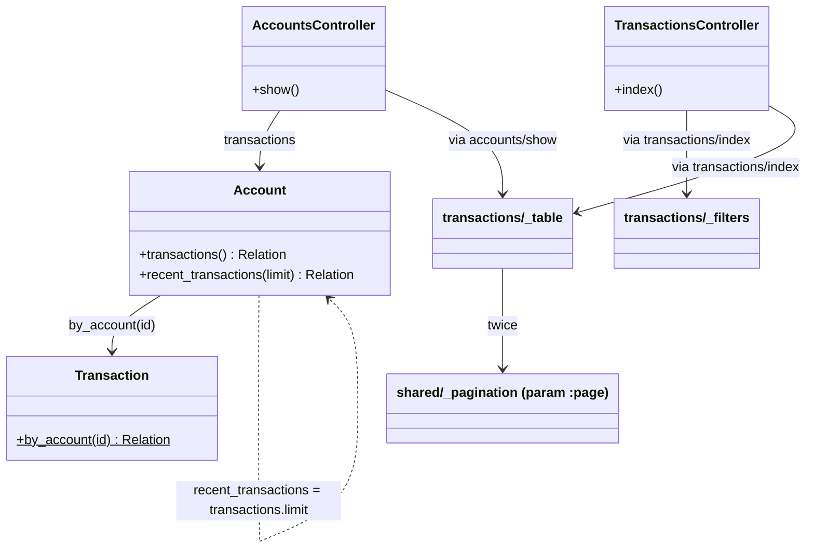
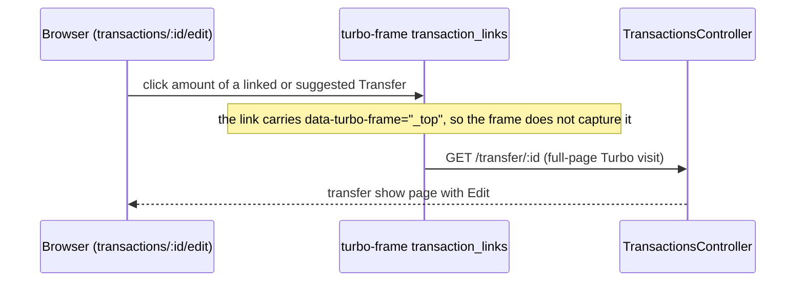

# Plan: Account page uses the shared transactions table

From `intent.md` (2026-10-25, amended the same day to add the transaction link tables). Status: accepted.

## Design

### Domain terms

- **Transaction**, **Account**, **TransactionSplit**: existing domain terms, as `AGENTS.md` defines them. `GLOSSARY.md` holds only household-finance terms; none conflicts with this change, and no avoided word appears in the intent.
- **Transactions table**: the partial `transactions/_table.html.erb`. It renders one page of transactions: pagination, one row per transaction with split sub-rows for its explicit splits, pagination. After this change it renders nothing else.
- **Filters form**: the partial `transactions/_filters.html.erb`. It submits a GET to `/transactions`, so it belongs to the transactions list page only.
- **Account transactions** (`Account#transactions`, new): every transaction where the account is debitor or creditor, newest booked date first, then highest id. Not a glossary term; a method name.
- **Transaction link tables**: the three tables on a transaction's edit page that list `Transfer`s for a `TransactionLink` — the balance table (`transaction_links/_balance_table`), the suggestions (`transaction_links/_suggestions`) and the search results (`transaction_links/_search_results`). All three render inside a Turbo frame: `transaction_links`, and for the search results the nested `transaction_links_search`.

### Diagrams

Before:

```mermaid
classDiagram
  class AccountsController { +show() }
  class TransactionsController { +index() }
  class Account { +recent_transactions(limit) Relation }
  class RecentTransactions["shared/_recent_transactions"]
  class TransactionsTable["transactions/_table"]
  class FiltersForm["transactions/_filters"]
  class Pagination["shared/_pagination (param :page)"]
  AccountsController --> Account : recent_transactions(limit: nil), params[:transactions_page]
  AccountsController --> RecentTransactions : via accounts/show
  RecentTransactions --> Pagination
  TransactionsController --> TransactionsTable : via transactions/index
  TransactionsTable --> FiltersForm
  TransactionsTable --> Pagination
```

After:



```mermaid
sequenceDiagram
  participant B as Browser
  participant C as AccountsController
  participant A as Account
  participant V as accounts/show
  participant T as transactions/_table
  B ->> C : GET /accounts/:id?page=N
  C ->> A : transactions
  A -->> C : relation (by_account, booked_at desc, id desc, preloaded)
  C ->> C : set_page_and_extract_portion_from(relation, per_page: [20])
  C ->> V : render (@page, @transactions)
  V ->> T : render transactions:, page:
  T -->> B : table; pagination links write ?page=N+1
```

Transaction link tables, after (before: the amount cell holds only text):



ER diagram: not affected, the schema does not change. State diagram: not affected, no state changes.

### Signatures

`Account` — a bank account that answers which transactions involve it.

```ruby
# Every transaction where this account is debitor or creditor, newest booked first
#
#: () -> ActiveRecord::Relation
def transactions
  Transaction
    .by_account(id)
    .includes(:creditor, :debitor, :category)
    .order(id: :desc)
end

# The latest transactions of this account
#
#: (?limit: Integer?) -> ActiveRecord::Relation
def recent_transactions(limit: 10)
  transactions.limit(limit)
end
```

`Transaction` has `default_scope { order(booked_at: :desc) }`, so `.order(id: :desc)` appends the tie-break: the order is `booked_at desc, id desc`, the same order `recent_transactions` has today. `recent_transactions` keeps its signature, order, preloads and limit, and builds on `transactions`, so "involves this account" has one definition (`Transaction.by_account`). The account edit page and the category pages keep calling it unchanged.

`AccountsController` — serves account resources.

```ruby
# Displays a single account with one page of its transactions
#
#: () -> void
def show
  @transactions = set_page_and_extract_portion_from @account.transactions, per_page: [ 20 ]
end
```

This is the idiom `TransactionsController#index` uses. It sets `@page` and reads `params[:page]`. `@transactions_page` and the `transactions_page` param go away.

Templates (no Ruby signature):

- `transactions/_table.html.erb`: locals stay `(transactions:, page:, show_uncategorized_amount: false)`. The line `<%= render "transactions/filters" %>` goes.
- `transactions/index.html.erb`: renders `transactions/filters` inside `<article class="transactions">`, directly before `transactions/table`. The HTML of `/transactions` stays identical.
- `accounts/show.html.erb`: the last `<article>` becomes an `<h2>` with `t("transactions.recent.heading")` followed by `render "transactions/table", transactions: @transactions, page: @page`.
- `transaction_links/_balance_table.html.erb`: the first row's amount cell becomes `link_to cents_to_currency(transaction.amount, unit: "€"), polymorphic_path(transaction), data: { turbo_frame: "_top" }`; in each linked-transfer row it becomes `link_to cents_to_currency(-transfer.amount, unit: "€"), polymorphic_path(transfer), data: { turbo_frame: "_top" }`. The footer (the balance, not a transaction) stays text.
- `transaction_links/_suggestions.html.erb` and `transaction_links/_search_results.html.erb`: the amount cell becomes `link_to cents_to_currency(transfer.amount, unit: "€"), polymorphic_path(transfer), data: { turbo_frame: "_top" }`. Locals stay the same.

Not checked: the project has no Steep or rbs_rails; the inline `#:` comments document the types only.

### Complexity

Account show request, page of N ≤ 20 rows, S explicit splits on that page:

- Fixed, for the transactions part: one COUNT and one SELECT for the page, three preloads (creditor, debitor, category). The rest of the page (account find, account numbers, owner, aliases, payment provider) keeps its current queries.
- Per row, the cost `/transactions` has today: `consolidatable?` 1–3 queries (`Splittable#uncategorized_amount`), the view's `split?` 1 query. Per split row T (rows that are split): 1 query to load its explicit splits. Per split S: 1 query for `split.category`.
- New against the reduced table today: N (`split?`) + T + S queries, on top of the existing `consolidatable?` cost. Bounded by `per_page: [20]`, and independent of how many transactions the account has in total.
- `transaction_splits` is not preloaded: `Splittable` calls `where` and `sum` on the association, so a preload saves nothing. Fixing that is out of scope and would also touch `/transactions`.
- `/transactions`: query count unchanged.
- Transaction link tables: no new queries. `polymorphic_path(transfer)` reads only the `type` and `id` already loaded.

### Invariants

- `Account#transactions` returns only transactions where the account is debitor or creditor. Enforced by `Transaction.by_account(id)`.
- `Account#transactions` orders by `booked_at desc`, then `id desc`, so offset pages are deterministic. Enforced by `Transaction`'s default scope plus the method's `order(id: :desc)`.
- `Account#transactions` preloads creditor, debitor and category. Enforced by the method.
- The account page's pagination links write the param the controller reads (`page`). Enforced by `shared/_pagination`'s default and `set_page_and_extract_portion_from`'s default.
- The transactions table never renders the filters form; only `transactions/index.html.erb` does. Enforced by the templates.
- The account edit page and the category pages keep the reduced table, with the same rows and order. Enforced by `shared/_recent_transactions` staying untouched and `Account#recent_transactions` keeping its result; its existing tests prove it.
- An amount link in a transaction link table opens a full page, never a frame swap. Enforced by `data: { turbo_frame: "_top" }` on each link; without it Turbo would load the transfer page into the `transaction_links` frame and show "Content missing".
- Every listed transaction's amount links to `polymorphic_path` of that transaction, the same helper the transactions table uses. Enforced by the four templates.

### Alternatives

1. **Minimal reuse (rejected).** Keep `@account.recent_transactions(limit: nil)`; only switch `params[:transactions_page]` to `params[:page]` and swap the partial. Smallest diff, no model change. Rejected: `limit: nil` meaning "no limit" is connascence of meaning, "recent" with a default of 10 does not name a full paginated list, and the controller keeps a pagination idiom of its own.
2. **Model-owned query, filters lifted to the index page (chosen).** As above. A new `Account#transactions` reuses `Transaction.by_account`, and `recent_transactions` builds on it, so "involves this account" has one definition; the controller uses the same pagination idiom as the list; the table partial gets one responsibility.
3. **Filter flag on the table partial (rejected).** Keep filters in `_table` behind a `show_filters:` local, default true. Rejected: a flag that leaks page concerns into the partial; every caller must know about it, and the index output is already identical with option 2.

For the transaction link tables:

1. **`data-turbo-frame="_top"` on each amount link (chosen).** Explicit at the link, the idiom `searches/_result_*.html.erb` already uses for links inside a frame.
2. **`target="_top"` on the `transaction_links` frame (rejected).** It also changes the frame's own form submissions, and the nested `transaction_links_search` frame would need it too. It moves a link's behaviour away from the link.
3. **A shared amount-link partial for all four tables (rejected).** Four call sites with two different amount signs (the balance table shows `-transfer.amount`) and two frame contexts; a partial with flags for both is more surface than one `link_to` per table.

## Design decisions

- Order on the account page stays booked date descending, then id descending. The list sorts by booked date first too, through `Transaction`'s default scope; its own tie-break is `interest_at desc`, the account page's is `id desc`. Rows with the same booked date can therefore differ in order between the two pages. Intent leaves order open, so this is no conflict with `## Decisions`.
- `Account#recent_transactions` is rewritten as `transactions.limit(limit)`. Its result does not change, so the account edit and category pages stay as they are.
- Pagination param becomes `page`. This also fixes a latent bug: the account page's links wrote `?page=N` while the controller read `transactions_page`, so "next" never moved. An old bookmarked `?transactions_page=N` URL falls back to page 1.
- The amount links through `polymorphic_path`, as on the list, so a Debit links to `/debit/:id`. That route goes to `TransactionsController#show`, where Edit is available. This matches intent's decision "amount links to the transaction, Edit lives on its show page".
- The heading `transactions.recent.heading` stays on the account page, rendered by `accounts/show.html.erb`; no locale changes.
- Filters stay off the account page, as intent decided.
- Transaction link tables link the amount of each listed `Transfer` (linked, suggested, found) through `polymorphic_path`, so `/transfer/:id`, as the transactions table does. This follows intent's decision "the amount is the show link everywhere; no extra Show button".
- The balance table's first row is the transaction being edited. It is a listed transaction, so its amount links to its show page too, as intent's in-scope line "link each listed transaction's amount to that transaction" and the decision "the amount is the show link everywhere" say. The footer is the balance, not a transaction, and stays text.
- Clicking an amount on the edit page leaves the edit form without saving. That is a normal link from a form page; no confirm guard, since intent asks for none.

## Integration points

- `geared_pagination`'s `set_page_and_extract_portion_from` (controller concern already used by `TransactionsController`, `ProductsController`, `ReceiptsController`).
- Routes `resources :credit|:debit|:transfer, controller: "transactions"` for the amount links.
- Turbo frames `transaction_links` (in `transactions/edit.html.erb`, replaced by `transaction_links/create|destroy.turbo_stream.erb`) and `transaction_links_search` (filled by `transaction_links/index.html.erb`). The turbo stream responses render the same partials, so they gain the links without a change of their own.
- No external systems, no MCP change, no JSON change (`accounts/show.json.jbuilder` renders only the account).

## Files that change

- `app/models/account.rb` — add `Account#transactions`; `recent_transactions` builds on it.
- `app/controllers/accounts_controller.rb` — `show` paginates `@account.transactions` with `set_page_and_extract_portion_from`.
- `app/views/accounts/show.html.erb` — replace the `shared/recent_transactions` render with the heading and the `transactions/table` render.
- `app/views/transactions/_table.html.erb` — remove the filters render.
- `app/views/transactions/index.html.erb` — render the filters before the table.
- `test/models/account_test.rb` — unit tests for `Account#transactions`.
- `test/integration/account_merges_test.rb` — the test "a transaction from any of the three numbers shows under the merged account" asserted `transaction_path`; it asserts `polymorphic_path` now (found during implementation).
- `test/integration/accounts_show_test.rb` — new acceptance tests; update two tests whose assertions encode the old reduced table (see Order of work, step 6).
- `app/views/transaction_links/_balance_table.html.erb` — link the source transaction's amount and each linked transfer's amount to that transaction, breaking out of the frame.
- `app/views/transaction_links/_suggestions.html.erb` — link each suggested transfer's amount to that transfer, breaking out of the frame.
- `app/views/transaction_links/_search_results.html.erb` — link each found transfer's amount to that transfer, breaking out of the frame.
- `test/integration/transaction_links_test.rb` — acceptance tests for the balance table and suggestions links.
- `test/controllers/transaction_links_controller_test.rb` — acceptance test for the search results link, in its `Index` class.

Out of scope, unchanged: `shared/_recent_transactions.html.erb`, the result of `Account#recent_transactions`, `accounts/edit.html.erb`, the category pages, `TransactionsController`, `TransactionLinksController`, `Splittable`, `Linkable`, `transactions/_filters.html.erb`, the dashboard balance table, the transaction splits table, the turbo stream templates.

## Order of work

1. Write the acceptance test "show lists the interest date column" in `test/integration/accounts_show_test.rb`, run it, watch it fail (no interest date header on the account page).
2. Write the remaining acceptance tests from `## Proof` in the same file: split sub-rows, amount link, pagination via the next link, empty account, no filters form, query count. Run them; the split, interest-date and pagination tests fail.
3. Write the unit tests for `Account#transactions` in `test/models/account_test.rb`; run, watch them fail (no method).
4. Add `Account#transactions` and rewrite `recent_transactions` as `transactions.limit(limit)`. The new unit tests and the existing `recent_transactions` tests go green.
5. Move `render "transactions/filters"` from `transactions/_table.html.erb` into `transactions/index.html.erb`, before the table render. Run `test/integration/transactions_index_test.rb`; it stays green.
6. Change `AccountsController#show` and `accounts/show.html.erb` as in `### Signatures`. Update the two existing tests in `accounts_show_test.rb` that encode the old table:
   - "show links a recent transaction to its show page": assert `polymorphic_path(transactions(:debit_grocery))` instead of `transaction_path(...)`; keep the "no edit link" assertion.
   - "show paginates recent transactions to the next page": request page 2 by following the `a[rel='next']` href instead of passing `transactions_page: 2`; assert with `polymorphic_path(oldest)`. `oldest` already has the oldest booked date of the created rows.
7. Run `test/integration/accounts_show_test.rb`.
8. Write the four link-table acceptance tests from `## Proof` (balance table source row, balance table linked transfer and suggestions in `test/integration/transaction_links_test.rb`, search results in the `Index` class of `test/controllers/transaction_links_controller_test.rb`). Run them; watch them fail (no link in the amount cell).
9. Change the amount cells of `_balance_table`, `_suggestions` and `_search_results` as in `### Signatures`. Run both test files; all green.
10. Run `bin/rails test`, then `bin/rails test:system` (the responsive tables test visits the account page).
11. Run `bundle exec rubocop`, `npx @herb-tools/linter app/views/`, `bundle exec brakeman --no-pager -q`, `bundle exec bundler-audit check`.
12. In a running worktree app: load `/accounts/<checking id>` and check the interest date column, split sub-rows, a working "next" link and no filters form. Then open the edit page of a debit with a linked transfer, click the linked transfer's amount, and check that the browser lands on the full transfer show page (not "Content missing" inside the frame). Do the same for a search result after a search. Record the evidence.

## Risks

- The account page gains N + T + S queries from the split sub-rows (see Complexity); bounded by 20 rows. The same cost exists on `/transactions`.
- Rewriting `recent_transactions` could change the account edit and category pages. Guarded by its existing tests (debitor, creditor, limit, default limit, order, preloads).
- `/transactions` could lose its filters if the render is not moved; guarded by the existing test "filter form is present on the index page".
- The responsive tables system test visits the account page; the wider table could scroll sideways on a phone. The `data-stack="wide"` table already passes this test on `/transactions`.
- Bookmarked `?transactions_page=N` URLs fall back to page 1. Acceptable: the param never worked from the page's own links.
- An amount link in a transaction link table without `data-turbo-frame="_top"` would load the transfer page into the frame and show "Content missing". Guarded by the acceptance tests, which assert the attribute, and by the manual check in step 12.
- A user who clicks an amount on the edit page loses unsaved edits in the form above. Accepted as normal link behaviour.
- Rejected: changing the behaviour of `Account#recent_transactions` (would change the account edit and category pages, out of scope); its implementation delegates to `transactions.limit(limit)` and its result stays the same. Also rejected: a `show_filters:` flag; `target="_top"` on the frame (see Alternatives).

## Proof

- An account page lists the account's transactions with the same columns as the transactions list, including interest date → `test/integration/accounts_show_test.rb` `show lists the interest date column` (asserts every `th` of the list, including `transactions.table.interest_date`, and the `time` of `transactions(:debit_grocery).interest_at`)
- A split transaction on an account page shows its split sub-rows with amount, category and note → `test/integration/accounts_show_test.rb` `show renders split sub-rows with amount category and note` (`tr.split-row` for `debit_grocery`'s two fixture splits: 3000/supermarket/"Supermarket items", 1000/bakery/"Bakery items")
- Clicking a transaction's amount on an account page opens that transaction, where Edit is available → `test/integration/accounts_show_test.rb` `show links the amount to the transaction which offers edit` (follows the amount link's href, asserts success and a link to `edit_transaction_path`)
- An account with more than 20 transactions shows pagination on its page, and page 2 shows the next transactions → `test/integration/accounts_show_test.rb` `show paginates recent transactions to the next page` (updated: follows `a[rel='next']`)
- An account with no transactions shows an empty table without an error → `test/integration/accounts_show_test.rb` `show renders an empty table for an account without transactions` (`accounts(:jumbo)`, status 200, `table.transactions tbody tr` count 0)
- On the transactions list, clicking an amount opens that transaction → `test/integration/transactions_index_test.rb` existing `index links each transaction to the page for its kind` and `index has a title bar with + Nieuw and rows that open the transaction through the amount` (both stay unchanged and green)
- In the balance table of a transaction, clicking an amount opens the linked transaction → `test/integration/transaction_links_test.rb` `edit page links a linked transfer's amount to that transfer` (`get edit_transaction_url(debit_grocery)`; asserts `turbo-frame#transaction_links table a[href='#{transfer_path(transfer_for_grocery)}'][data-turbo-frame='_top']`; follows the href and asserts success)
- In the balance table, the source transaction's amount opens that transaction → `test/integration/transaction_links_test.rb` `edit page links the source transaction's amount in the balance table` (asserts `turbo-frame#transaction_links table a[href='#{debit_path(debit_grocery)}'][data-turbo-frame='_top']`)
- In the link suggestions of a transaction, clicking an amount opens the suggested transaction → `test/integration/transaction_links_test.rb` `edit page links a suggested transfer's amount to that transfer` (destroys `debit_grocery`'s links first, so `transfer_for_grocery` becomes a suggestion: same amount, one hour apart; asserts the same `a[href][data-turbo-frame='_top']` inside `details` and follows it)
- In the search results of a transaction, clicking an amount opens the found transaction → `test/controllers/transaction_links_controller_test.rb` `Index` `links each found transfer's amount to that transfer` (`params: { query: "savings" }`; asserts `tbody a[href='#{transfer_path(transfer_savings)}'][data-turbo-frame='_top']`)
- The transaction list keeps working unchanged (constraint) → `test/integration/transactions_index_test.rb` existing tests, including `filter form is present on the index page`
- Query count: the account page's query count does not depend on the account's total number of transactions → `test/integration/accounts_show_test.rb` `show runs the same number of queries for 21 and 41 transactions` (counts `sql.active_record` notifications for `get account_path` at both sizes, same row shape, asserts equal)
- Invariant: the transactions table never renders the filters form, enforced by `transactions/_table.html.erb` → `test/integration/accounts_show_test.rb` `show renders no filters form` (`form[action='#{transactions_path}'][method='get']` count 0)
- Invariant: pagination links write the param the controller reads, enforced by `shared/_pagination` and `set_page_and_extract_portion_from` defaults → `test/integration/accounts_show_test.rb` `show paginates recent transactions to the next page`
- Invariant: `Account#transactions` holds only the account's transactions, enforced by `Transaction.by_account` → `test/models/account_test.rb` `transactions excludes another account's transaction`
- Invariant: `Account#transactions` orders by booked date then id, enforced by the default scope and `Account#transactions` → `test/models/account_test.rb` `transactions orders by booked date then id descending`
- Invariant: `Account#transactions` preloads creditor, debitor and category, enforced by `Account#transactions` → `test/models/account_test.rb` `transactions preloads associations used by the table`
- Invariant: the account edit and category pages keep the same rows and order, enforced by `Account#recent_transactions` → `test/models/account_test.rb` existing `recent_transactions` tests
- Invariant: an amount link in a transaction link table opens a full page, enforced by `data: { turbo_frame: "_top" }` on each link → the four link-table tests above (each asserts the attribute)

Per changed file, the unit tests expected:

- `app/models/account.rb`: `transactions returns transactions where account is debitor`, `transactions returns transactions where account is creditor`, `transactions excludes another account's transaction`, `transactions orders by booked date then id descending`, `transactions preloads associations used by the table`, `transactions has no limit` (more than 10 rows). The existing `recent_transactions` tests stay unchanged and green.
- `app/controllers/accounts_controller.rb`, `app/views/accounts/show.html.erb`, `app/views/transactions/_table.html.erb`, `app/views/transactions/index.html.erb`, `app/views/transaction_links/_balance_table.html.erb`, `app/views/transaction_links/_suggestions.html.erb`, `app/views/transaction_links/_search_results.html.erb`: covered by the integration tests above; no unit tests (no new public Ruby interface).

Test setup: link tables use `transactions(:debit_grocery)`, `transactions(:transfer_for_grocery)`, `transactions(:transfer_savings)` and `transaction_links(:grocery_to_transfer)`. Account page: existing fixtures — `accounts(:checking)` (debitor of `debit_grocery`, creditor of `credit_salary`), `accounts(:jumbo)` (no transactions), `transaction_splits(:split_grocery_supermarket|:split_grocery_bakery)` on `debit_grocery`. Pagination and query-count tests create transactions with `Transaction.create!` between `checking` and `albert_heijn`, category `supermarket`, as the existing pagination test does.

---
Domain skills applied: software-design, rails-architecture, rails-ui, rails-testing, glossary, diagrams.

## Critique

### Round 1 (codex exec -p terra)

- Interest-date ordering is not implemented, because `Transaction` has a `booked_at desc` default scope that the planned order only appends to; the plan also misstated the list's order → fixed (verified the default scope; the account page keeps `booked_at desc, id desc`, matching the list's primary order and today's account page; Design, Design decisions and Proof updated)
- "One definition" of account involvement is false while `recent_transactions` keeps its own SQL predicate → fixed (`recent_transactions` now builds on `transactions` and adds the limit, keeping order, preloads and limit; its existing tests guard it)
- The query-cost section understates the new table cost and excludes the page's other queries → fixed (Complexity now states N + T + S new queries and scopes the fixed count to the transactions part)
- The preload claim has no proof → fixed (added `transactions preloads associations used by the table` to Proof)

### Round 2 (codex exec -p terra)

- The balance table also lists the source transaction; leaving its amount as text conflicts with "the amount is the show link everywhere" → fixed (the source row's amount links to the transaction's show page through `polymorphic_path`, with `_top`; Signatures, Design decisions, Files that change, Order of work and Proof updated; only the balance footer stays text)
- Risks says changing `Account#recent_transactions` was rejected while Design and step 4 rewrite it → fixed (Risks now rejects a change of its behaviour and states that its implementation delegates to `transactions.limit` with the same result)
