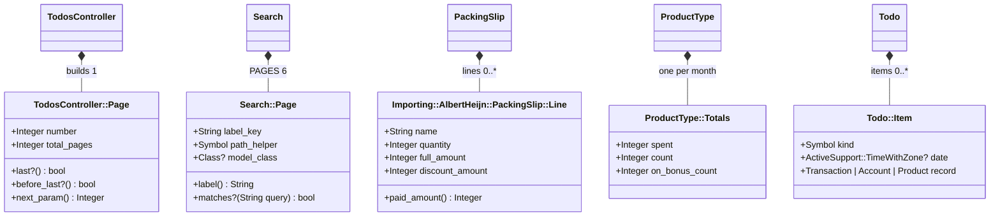

# Plan: Add inline RBS signatures

From `intent.md` (2026-11-06). Status: accepted.

## Design

### Domain terms

- No domain term changes. The touched code uses the glossary terms **Packing slip**, **Delivery** and **Product type**; new prose says "delivery", never "order" (the identifier `order_number` stays).
- Tooling terms, used in this plan only and not added to `GLOSSARY.md`:
  - **Signature**: an inline RBS method type, `#: (Type name) -> Type`, on the comment line directly above a `def`.
  - **Attribute type**: a trailing `#: Type` on the same line as a Struct attribute or a single-name `attr_*`.
  - **Reopened class**: `class X ... end`, written directly after `X = Struct.new(...)`, holding the methods the Struct block held.
  - **Run-once script**: a file under `db/data`, `db/cable_migrate` or `db/queue_migrate`.

### Diagrams

The three Structs that lose their block, after the change. `ProductType::Totals` and `Todo::Item` keep their shape and only gain attribute types.



ER, sequence and state diagrams: not affected. No table, message flow or state changes.

### Signatures

Placement rules (verified against rubocop-rbs_inline 2.0.0 with a scratch file and the repository's `.rubocop.yml`):

- A method signature is a leading `#:` line, the last comment line directly above the `def`. Endless defs need it too; a trailing `#:` after `def x = ...` does not count.
- Existing comments stay. The `#:` line goes directly under the last existing comment line, YARD tags included. No blank `#` separator is required.
- An `attr_*` takes a trailing `#: Type` on its own line. A multi-name `attr_reader` whose names differ in type splits into one `attr_reader` per name. A `#:` line above an `attr_*` is an offense.
- A Struct attribute takes a trailing `#: Type`. The `Struct.new(` call goes multi-line, one attribute per line; `keyword_init: true` takes no type. Columns align as `Style/RbsInline/StructClassCommentAlignment` computes; fix the column with `bundle exec rubocop -a --only Style/RbsInline/StructClassCommentAlignment`. Never autocorrect `MissingStructClassAnnotation`: it writes `#: untyped`.
- A `def self.x` followed by `private_class_method :x` is still public to the cop. It gets a signature like any public method (51 such helpers).
- `initialize` gets `-> void`.
- A `scope` gets no `#:`. A `#:` above a `scope` is an offense.
- Consecutive `#:` lines are overloads. Use them only where a nil input gives a nil output, such as `Cents.to_euros`.

Type vocabulary for the recurring cases:

| Case | Rule | Example |
|---|---|---|
| Controller action | `() -> void` | `TodosController#index` `#: () -> void` |
| Controller `before_action` target that is public | `() -> void` | |
| Helper that returns HTML on every path | `-> ActiveSupport::SafeBuffer`, `?` when a path returns nil | `ChartsHelper` chart tags |
| Helper that can return plain text | `-> String` or `String?` | `MoneyHelper#cents_to_currency` `#: (Integer? cents, **untyped options) -> String?` |
| Money | `Integer` cents, `Integer?` when nil is possible | `Cents.from_euros` `#: (Numeric euros) -> Integer` |
| Euros computed | `BigDecimal` | `Cents.to_euros` `#: (Integer cents) -> BigDecimal` and `#: (nil cents) -> nil` |
| MCP tool `call` | keyword types from `input_schema`: JSON `integer` is `Integer`, `number` is `Numeric`, `string` is `String`, `boolean` is `bool`; optional keys `?key: T?`; `server_context: untyped`; result `MCP::Tool::Response` | `SetBudgetAmount.call` `#: (budget_id: Integer, category_id: Integer, amount: Numeric, server_context: untyped) -> MCP::Tool::Response` |
| MCP helpers in `Assistant::Tool` | real types | `answer`, `problem` `#: (String message) -> MCP::Tool::Response`; `euros` `#: (Integer cents) -> String`; `cents_from` `#: (Numeric amount) -> Integer?`; `day` `#: (String? text) -> Date?` |
| Relation | `ActiveRecord::Relation` (house style, as `Receipt::PaymentMatching`) | `ProductType#purchases` `#: () -> ActiveRecord::Relation` |
| Loaded records | `Array[Model]` | `Todo#items` `#: () -> Array[Todo::Item]` |
| Hash with open keys | `Hash[K, V]` | `ProductType#monthly_totals` `#: () -> Hash[Date, ProductType::Totals]` |
| Hash with fixed keys | `Hash[Symbol, V]` with `V` the union of value types; no `@rbs!` alias | `Search#results` `#: () -> Hash[Symbol, Array[Search::Page \| Account \| Transaction \| Chattel \| Category]]` |
| Closed set of classes | union | `Todo::Item` `:record #: Transaction \| Account \| Product` |
| `date` column / `datetime` column | `Date` / `ActiveSupport::TimeWithZone`; `?` when the column is nullable or a path gives nil | `PackingSlip` `attr_reader :delivered_on #: Date` |
| Predicate | `bool` when every path gives true or false; the real type otherwise | `Todo#show_upload_form?` `#: () -> bool` |
| Keyword args | `name: T`, optional `?name: T` | `Search#initialize` `#: (query: String?) -> void` |
| Splat | `*T name` | `Monetary.monetary` `#: (*Symbol names) -> void` |
| Job `perform`, cable `connect` | `-> void` | `ApplicationCable::Connection#connect` `#: () -> void` |
| Line over 120 characters | drop the parameter names first | `#: (Integer, Integer) -> String` |

A new `untyped` is allowed in exactly two places: `server_context` on tool `call` (the mcp gem builds it and no tool reads it), and `**untyped options` passed straight to Rails (`cents_to_currency`). Any other new `untyped` needs a comment above the signature saying why the value truly varies, as the two existing `#: (untyped basket) -> Receipt` signatures in `app/models/receipt/recordable.rb` already do (the basket is any `BasketMail` reader, and its test passes a local Struct). Those two stay unchanged. `# @rbs skip` and `# @rbs override` are never used.

Struct syntax. Text after `#:` is a comment, so each attribute's comma comes before its `#:`, and the closing parenthesis goes on its own line. Exact shapes, with columns as the alignment cop computes them:

```ruby
  Page = Struct.new(
    :number,      #: Integer
    :total_pages  #: Integer
  )

  class Page
    #: () -> bool
    def last?      = number >= total_pages
    #: () -> bool
    def before_last? = number < total_pages
    #: () -> Integer
    def next_param = number + 1
  end
```

```ruby
  Page = Struct.new(
    :label_key,    #: String
    :path_helper,  #: Symbol
    :model_class,  #: Class?
    keyword_init: true
  )
```

```ruby
      Line = Struct.new(
        :name,            #: String
        :quantity,        #: Integer
        :full_amount,     #: Integer
        :discount_amount  #: Integer
      )

      class Line
        #: () -> Integer
        def paid_amount = full_amount - discount_amount
      end
```

```ruby
  Totals = Struct.new(
    :spent,          #: Integer
    :count,          #: Integer
    :on_bonus_count  #: Integer
  )
```

```ruby
  Item = Struct.new(
    :kind,   #: Symbol
    :date,   #: ActiveSupport::TimeWithZone?
    :record  #: Transaction | Account | Product
  )
```

Touched classes with a shape change:

- `TodosController`: shows the todo list one page at a time.
  - `Page` as shown above; `class Page` directly after the Struct:
    - `last?` `#: () -> bool`
    - `before_last?` `#: () -> bool`
    - `next_param` `#: () -> Integer`
  - `index` `#: () -> void`
- `Search`: collects search results and navigation pages for the global search dialog.
  - `Page` as shown above; `class Page` directly after the Struct, before `PAGES`. The YARD `@!attribute` block stays above `Page =`:
    - `label` `#: () -> String`
    - `matches?` `#: (String query) -> bool`
  - `attr_reader :query #: String`
  - `initialize` `#: (query: String?) -> void`
  - `results` `#: () -> Hash[Symbol, Array[Search::Page | Account | Transaction | Chattel | Category]]`
  - `any_results?` `#: () -> bool`
- `Importing::AlbertHeijn::PackingSlip`: reads one packing slip mail into a delivery's lines and totals.
  - `Line` as shown above; `class Line` directly after the Struct:
    - `paid_amount` `#: () -> Integer`
  - `attr_reader :order_number #: String`, `attr_reader :delivered_on #: Date`, `attr_reader :total_amount #: Integer`, `attr_reader :lines #: Array[Importing::AlbertHeijn::PackingSlip::Line]`
  - `self.parse` `#: (String mail) -> PackingSlip?`
  - `self.readable?` `#: (Array[String] blocks) -> bool`
  - `initialize` `#: (Array[String] blocks) -> void`
- `Importing::AlbertHeijn::OlderPackingSlip` and `Importing::AlbertHeijn::OrderConfirmation`: the same four split `attr_reader`s; `readable?` `#: (Array[String] tokens) -> bool`; `initialize` `#: (Array[String] tokens) -> void`.
- `Importing::ING::Row`: one row of an ING CSV export. The multi-line `attr_reader` splits into one `attr_reader` per name. Read each type from `initialize` and the import fixture; a CSV text column is `String?` only where an empty field gives nil.
- `ProductType::Totals` as shown above.
- `Todo::Item` as shown above. Its YARD `@!attribute` block contradicts this (it says `Time` and omits `Product`); correct those two YARD lines, since the block is touched.
- `Receipt::PaymentMatching`: delete the `#` line and the `#: () -> ActiveRecord::Relation` line above `scope :unlinked_deliveries`. The prose comment stays.
- `Backup` in `script/admin/prepare-backup`: copies the primary SQLite database to `storage/backups`. `create` `#: () -> void`.

Every other flagged method (about 330) follows the vocabulary table. The executor reads each method's return paths and, for column types, `db/schema.rb`.

Not checked: this project declined Steep and rbs_rails (`intent.md`, Out of scope). `Style/RbsInline/InvalidTypes` checks the RBS syntax only, not whether a type name exists.

### Complexity

- No runtime path changes. The query count of every request is unchanged: comments do not run.
- The three Struct rewrites define the same methods once at class load, as before. The moved method bodies refer to no constant other than `I18n`, so the wider lexical scope of the reopened class changes nothing.
- Diff size: about 375 added `#:` lines, about 20 split `attr_reader` lines, about 35 lines of Struct reshaping, 2 deleted lines, 2 small unit tests, one `Gemfile.lock` change.

### Invariants

- Every method the cop sees as public in `app/` and `script/admin/prepare-backup`, and every `attr_*`, has a signature. Enforced by `Style/RbsInline/MissingTypeAnnotation` in `bundle exec rubocop`, lefthook pre-push and `ci / lint`.
- Every Struct attribute has an attribute type, and no `Struct.new` takes a block. Enforced by `MissingStructClassAnnotation` and `StructNewWithBlock`.
- A `#:` line sits directly above a `def`, never above a `scope` or `attr_*`. Enforced by `MethodCommentSpacing`.
- Every signature parses as RBS. Enforced by `InvalidTypes`.
- A new `untyped` appears only in the two allowed places or with a reason comment. Enforced by review: `git diff main -U0 -- app script | grep -E '^\+.*#:.*untyped'`.
- No disable comment, `# rbs_inline: disabled`, `# @rbs skip` or `.rubocop.yml` edit. Enforced by review: `git diff main -- .rubocop.yml` is empty and `git diff main | grep -E 'rubocop:disable|rbs_inline: disabled|@rbs skip'` is empty.
- Behaviour is unchanged. Enforced by the full test suite, with the named tests in Proof.

### Alternatives

1. **Smallest diff, house types (chosen).** `Integer` for cents, plain `ActiveRecord::Relation`, `Numeric` for JSON numbers, existing YARD comments kept, split `attr_reader`s. It matches the existing signatures (`Category.add_household_expense`, `Receipt::PaymentMatching.link_payments`) and the intent's named types. Selected parts of alternative 2 are taken in: nil overloads, nullability from the schema, `SafeBuffer` only where every path is safe, closed unions.
2. **Most informative types.** A `Cents::t` type alias declared with `# @rbs!`, rbs_rails-style relation names (`Receipt::ActiveRecord_Relation`, `..._AssociationRelation`), record types for fixed-key hashes, literal-symbol unions. Rejected: nothing checks these names, so `ActiveRecord_Relation` versus `ActiveRecord_AssociationRelation` mistakes and alias typos drift silently; `@rbs!` aliases are a new construct in this repository; it costs two to three times the authoring effort; and the intent names plain `ActiveRecord::Relation`.
3. **Make private helpers private to the cop.** Move the 51 `def self.x` + `private_class_method :x` helpers into `class << self; private; ... end`, so they need no signature. Rejected: it reshapes about 20 files and grows the diff for a chore; a signature on a private helper is harmless and informative.

## Design decisions

- **Signatures on the 51 `private_class_method` helpers.** The intent puts private methods out of scope "because the gem asks only for public ones", but the cop sees these as public. They get signatures; this follows the intent's own rule "every public method that rubocop flags" and its acceptance criterion `0 offenses`. No behaviour changes.
- **Existing YARD tags stay.** The personal ruby-style rule says "no YARD tags", but removing 374 tags in 67 files is an orthogonal cleanup. It is proposed as a separate change, not done here. Only the `Todo::Item` `@!attribute` lines that contradict the new attribute types are corrected.
- **Offense count in the run-once scripts.** The intent says ten offenses sit in run-once scripts; rubocop reports 19 offenses in 10 files (`db/data` 16, `db/cable_migrate` 2, `db/queue_migrate` 1). That leaves 391 offenses in `app/` and `script/`. The decision (exclude them in the gem) is unchanged.
- **Two characterisation tests.** `TodosController::Page#last?` has no caller and no test reaches `#next_param` directly; `PackingSlip::Line#paid_amount` is reached only through receipt recording. Both get a unit test before the move, per the intent's constraint.
- **Commit order.** Signatures land folder by folder in separate commits, so each commit is one logical change and rubocop's remaining count drops visibly. The gem bump is the last commit, as the intent decides.

No step contradicts `intent.md`'s `## Decisions`.

## Integration points

- `rubocop-eirvandelden` (GitHub gem, `Gemfile` line 64, locked at `32d259fcdc1e`): the bump picks up the release that excludes `db/*_migrate` and `db/data` from `Style/RbsInline/MissingTypeAnnotation`. This delivery makes that change itself (amendment below), in a worktree of `~/Developer/rubocop-eirvandelden`, and opens a draft pull request there. Etienne merges it.
- `sqlite3` (Gemfile.lock 2.10.1): bundler-audit flags GHSA-4fqr-96q8-xrfx, fixed in 2.10.2. `bundle update sqlite3` is approved in `intent.md`.
- `rubocop-rbs_inline` 2.0.0 (dependency of the gem): its cops decide placement. No version change.
- `ci / lint` GitHub Actions job: no workflow edit; it turns green when rubocop does.
- lefthook pre-push: runs rubocop, herb, brakeman, bundler-audit and tests. From a worktree, push with the worktree's `bin/` first on `PATH` and after `npm install` (see `AGENTS.md` Gotchas). No push until every check passes; never `LEFTHOOK=0` or `--no-verify`.

## Files that change

- `test/controllers/todos_controller_page_test.rb` (new): unit test of `TodosController::Page`.
- `test/models/importing/albert_heijn/packing_slip_test.rb`: one unit test of `Line#paid_amount`.
- `app/controllers/todos_controller.rb`: Struct rewrite, attribute types, signatures.
- `app/models/search.rb`: Struct rewrite, attribute types, signatures.
- `app/models/importing/albert_heijn/packing_slip.rb`: Struct rewrite, split `attr_reader`, signatures.
- `app/models/product_type.rb`, `app/models/todo.rb`: Struct attribute types, signatures; `todo.rb` YARD correction.
- `app/models/receipt/payment_matching.rb`: two comment lines deleted above the scope.
- `app/models/importing/albert_heijn/older_packing_slip.rb`, `order_confirmation.rb`, `app/models/importing/ing/row.rb`: split `attr_reader`, signatures.
- Signatures only, in every other file rubocop flags: 33 files in `app/controllers` (116), 9 in `app/helpers` (13), 2 in `app/jobs` (2), 1 in `app/channels` (1), the remaining files in `app/models` (184 in total with the above) and 24 in `app/tools/assistant` (74).
- `script/admin/prepare-backup`: one signature on `Backup.create`.
- `Gemfile.lock`: `sqlite3` bump, then `rubocop-eirvandelden` revision bump, in two commits. `Gemfile` does not change.
- In `~/Developer/rubocop-eirvandelden` (own worktree and branch `exclude-run-once-scripts`): `config/rails.yml`, `test/shared_configuration_test.rb`, `CHANGELOG.md`.

Nothing in `db/`, `test/` (other than the two tests), `.rubocop.yml`, `config/` or `.github/` changes.

## Order of work

1. Run `bundle exec rubocop app script` and record `391 offenses` as the failing check. Run `bin/rails test` and record it green.
2. Write `TodosController::PageTest` and the `paid_amount` test. Run them: both pass against the current code, since they pin behaviour before the move. Commit `test: pin todo paging and packing slip paid amount`.
3. Rewrite `TodosController::Page`, `Search::Page` and `PackingSlip::Line` (Struct plus reopened class, attribute types, signatures on the moved methods). Run the two new tests, `test/models/search_test.rb`, `test/integration/searches_test.rb`, `test/integration/todos_index_test.rb`, `test/integration/pagination_navigation_test.rb` and `test/models/importing/albert_heijn/packing_slip_test.rb`. One commit per Struct.
4. Add attribute types to `ProductType::Totals` and `Todo::Item`; correct the `Todo::Item` YARD lines. Run `test/models/product_type_test.rb` and `test/models/todo_test.rb`. Commit.
5. Delete the two comment lines above `scope :unlinked_deliveries`. Commit.
6. Add signatures to `app/controllers`. Run `bundle exec rubocop app/controllers` until it reports no offenses. Commit.
7. Same for `app/helpers`, `app/jobs` and `app/channels`. Commit.
8. Same for `app/models`, including the split `attr_reader`s. Commit; split into `app/models/importing`, `app/models/concerns` and the rest when the diff is long.
9. Same for `app/tools`. Commit.
10. Add the signature to `script/admin/prepare-backup`. Commit.
11. Run `bundle exec rubocop app script` (expect `no offenses`), `git diff main --stat -- db` (expect empty), the untyped and disable-comment greps from Invariants, and the full `bin/rails test` plus `bin/rails test:system`.
12. Bump `sqlite3`: `bundle update sqlite3`. Confirm `Gemfile.lock` changes only `sqlite3` (version and checksums). Run `bundle exec bundler-audit check` (expect no vulnerabilities) and the full `bin/rails test`. Commit `chore: bump sqlite3 for GHSA-4fqr-96q8-xrfx`.
12a. Gem change. In `~/Developer/rubocop-eirvandelden`, create a worktree with `worktree-create exclude-run-once-scripts` (never `git worktree add`; the main checkout has an uncommitted `Gemfile.lock` that stays untouched). In `config/rails.yml`, add `'**/db/*_migrate/**/*'` and `'**/db/data/**/*'` to the `Style/RbsInline/MissingTypeAnnotation` `Exclude`, and widen its comment to run-once scripts: migrations and data migrations. In `test/shared_configuration_test.rb`, add tests next to `test_a_rails_project_does_not_demand_a_signature_on_a_migration`: no offense in a Rails project for `db/data/...rb`, `db/cable_migrate/...rb` and `db/queue_migrate/...rb`, and still an offense for `app/models/...rb`. Add a `CHANGELOG.md` line. Run that repository's tests and rubocop (its `AGENTS.md` names the commands). Commit, push the branch to `origin` (eirvandelden), and open a draft pull request with the repository's PR template, if it has one. Then send `Decision needed: merge rubocop-eirvandelden PR <url>` to the coordinator and stop. Never merge it.
12b. Check that the `rubocop-eirvandelden` change that excludes `db/*_migrate` and `db/data` is merged on its `main`. If not, stop and ask Etienne (intent constraint). If merged, run `bundle update rubocop-eirvandelden`, confirm `Gemfile.lock` changes only that gem's revision (and its dependencies only if the gem itself changed them), run `bundle exec rubocop` (expect `0 offenses`). Commit `chore: bump rubocop-eirvandelden to exclude run-once scripts`.
13. Run the full suite and all linters once more (`bundle exec rubocop`, `npx @herb-tools/linter app/views/`, `bundle exec brakeman --no-pager -q`, `bundle exec bundler-audit check`).
14. Hand the branch to the autonomous delivery chain, which the coordinator drives (playbook §7a): the Claude `reviewer` agent reviews the diff (no Codex diff review: `intent.md` says `Codex review: no`); every finding closes as fixed or dismissed with a reason; `deliver` opens the draft pull request; then `gh pr checks <pr> --watch` proves `ci / lint` green. Nobody merges; Etienne's `/finish` is the merge approval.

## Risks

- **Wrong precise types that nothing checks.** No type checker runs, so a wrong `Integer` or a missing `?` misleads a reader. Mitigation: read every return path and `db/schema.rb` for nullability; the reviewer samples signatures against code.
- **Struct alignment columns.** Hand-counted columns break `StructClassCommentAlignment`. Mitigation: the targeted autocorrect named in Signatures.
- **Line length.** Long tool signatures can exceed 120 characters. Mitigation: drop parameter names first; never a `#|` continuation unless that still does not fit.
- **The reopened class hides a constant.** A moved method that used a constant of the enclosing class would resolve differently. Checked: the moved bodies use only Struct members and `I18n`.
- **The `sqlite3` bump pulls other gems.** Mitigation: step 12 confirms the lock diff names `sqlite3` only.
- **The gem change is not merged in time.** Lint stays red on `db/` offenses. The intent's rule applies: stop at step 12 and ask Etienne. Steps 1 to 11 still land and cut lint from 410 to 19 offenses.
- **The gem bump pulls in other cop changes.** A newer gem revision may enable more cops. Mitigation: step 12 runs full rubocop after the bump; a new offense outside the intent becomes a question to Etienne, not a disable comment.
- **Rejected:** `Cents::t` aliases and rbs_rails relation names (alternative 2), restructuring private helpers (alternative 3), YARD removal (separate change), `Data.define` (out of scope).

## Proof

- On this branch, after the gem bump, `bundle exec rubocop` reports `0 offenses` → check: `bundle exec rubocop` after step 12.
- `ci / lint` on the pull request is green → check: `gh pr checks <pr> --watch` after `deliver` opens the pull request (step 14).
- New signatures name the domain class, not `untyped` → check: `git diff main -U0 -- app script | grep -E '^\+.*#:.*untyped'` lists only `server_context`, `**untyped options` and lines with a reason comment above them; the reviewer samples ten signatures against their method bodies.
- `TodosController#index` reads `#: () -> void` → check: `grep -B1 -n 'def index' app/controllers/todos_controller.rb` shows `#: () -> void`.
- `Search` returns the same results for the same query → `test/models/search_test.rb` (all tests, including `results includes pages matching nav labels`) and `test/integration/searches_test.rb`.
- `TodosController` paginates the same → `test/integration/pagination_navigation_test.rb` `todo pagination is clamped and hides next on the last page`, and `test/controllers/todos_controller_page_test.rb` (below).
- A packing slip reads the same lines, amounts and discounts → `test/models/importing/albert_heijn/packing_slip_test.rb` (all tests) and `test/models/receipt/recordable_test.rb`.
- The full test suite stays green → check: `bin/rails test` and `bin/rails test:system`.
- In the gem, a Rails project gets no `MissingTypeAnnotation` offense in `db/data`, `db/cable_migrate` or `db/queue_migrate`, and still gets one in `app/models` → the new tests in `test/shared_configuration_test.rb` (step 12a).
- `bundler-audit` reports no vulnerabilities and `ci / scan_ruby` is green → check: `bundle exec bundler-audit check` after step 12; `gh pr checks <pr> --watch`.
- `db/data/20260315000002_seed_account_aliases.rb` gains no signature and raises no offense → check: `git diff main -- db/data/20260315000002_seed_account_aliases.rb` is empty and `bundle exec rubocop db/data/20260315000002_seed_account_aliases.rb` reports no offenses after step 12.
- Query count: unchanged on every request, since only comments and Struct shapes change → check: no query-count test needed; the full suite runs.
- Invariant: no disable comment, `@rbs skip` or `.rubocop.yml` edit, enforced by review → check: `git diff main -- .rubocop.yml` empty and `git diff main | grep -E 'rubocop:disable|rbs_inline: disabled|@rbs skip'` empty.
- Invariant: no `Struct.new` takes a block, enforced by `Style/RbsInline/StructNewWithBlock` → check: `bundle exec rubocop app script`.

Per changed file, the unit tests expected:

- `app/controllers/todos_controller.rb` (`TodosController::Page`), in `test/controllers/todos_controller_page_test.rb`: `the last page knows it is last`, `a page before the last is before last`, `the next page number is one more`.
- `app/models/importing/albert_heijn/packing_slip.rb` (`PackingSlip::Line`), in `test/models/importing/albert_heijn/packing_slip_test.rb`: `a line's paid amount is its full amount less its bonus`.
- Every other changed file gains comments only and no new public behaviour; its existing tests cover it.

Test setup: `TodosController::Page.new(number, total_pages)` and `PackingSlip::Line.new(name, quantity, full_amount, discount_amount)` built directly with plain values; no fixtures, no database.

---
Domain skills applied: rails-architecture, ruby-style, rails-testing, software-design, glossary, diagrams, dependencies.

## Critique

### Round 1 (codex exec -p terra)

- The inline `Struct.new(:a #: T, :b #: T)` forms are invalid Ruby, because text after `#:` is a comment and the commas would be lost → fixed (Signatures now shows the exact multi-line Struct shapes for all five Structs, comma before each `#:`, closing parenthesis on its own line)
- The `untyped` invariant and Proof check are already false: `app/models/receipt/recordable.rb` has two existing `#: (untyped basket) -> Receipt` signatures for a duck-typed basket → fixed (the rule now covers new `untyped` only, names the two existing ones as kept, and the check greps added lines with `git diff main -U0`)
- Order of work stops before review, `deliver` and CI, yet a Proof line is checked after delivery → fixed (step 14 hands over to the coordinator's chain: Claude reviewer only, finding closure, `deliver`, `gh pr checks --watch`; no Codex diff review)

## Amendment (2026-11-06, coordinator)

Etienne settled the plan stage's three `Decision needed:` lines (recorded in `intent.md` Decisions): hold pushes until every pre-push check passes; bump `sqlite3` in this change (step 12); make the `rubocop-eirvandelden` exclusion change from this delivery (step 12a), with Etienne merging its pull request before step 12b.
