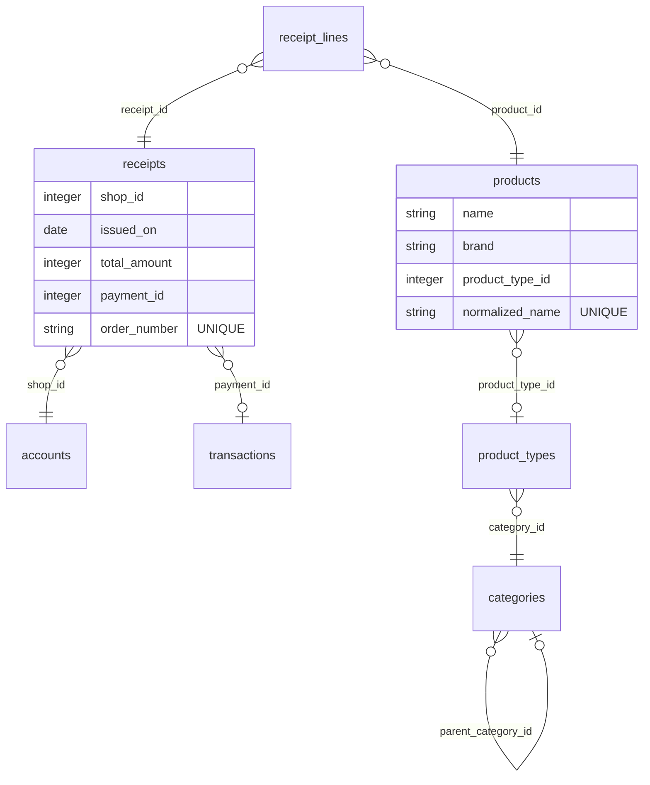
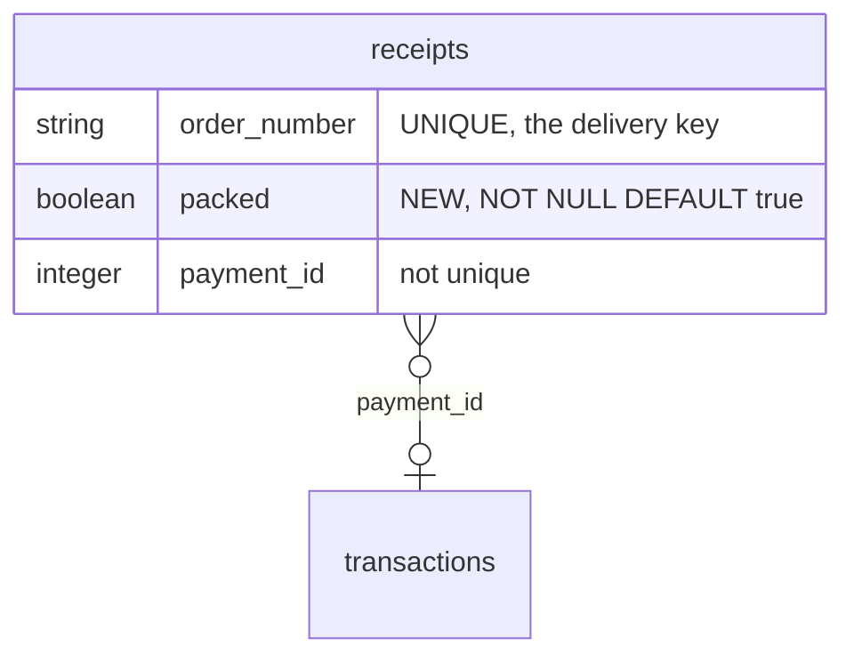
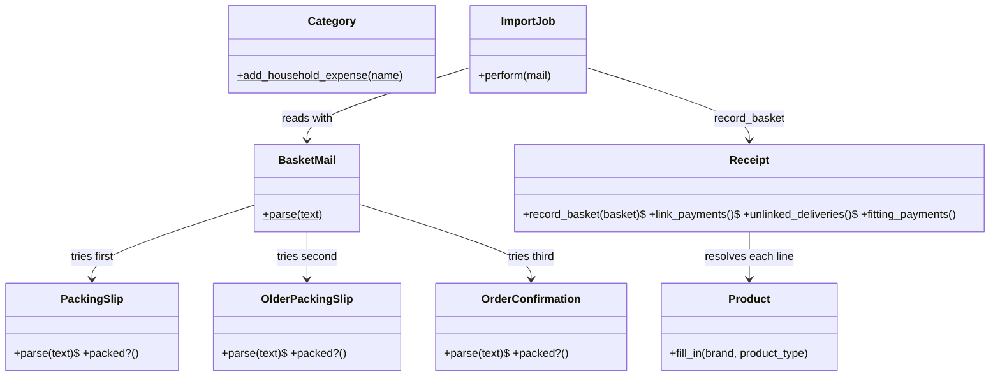
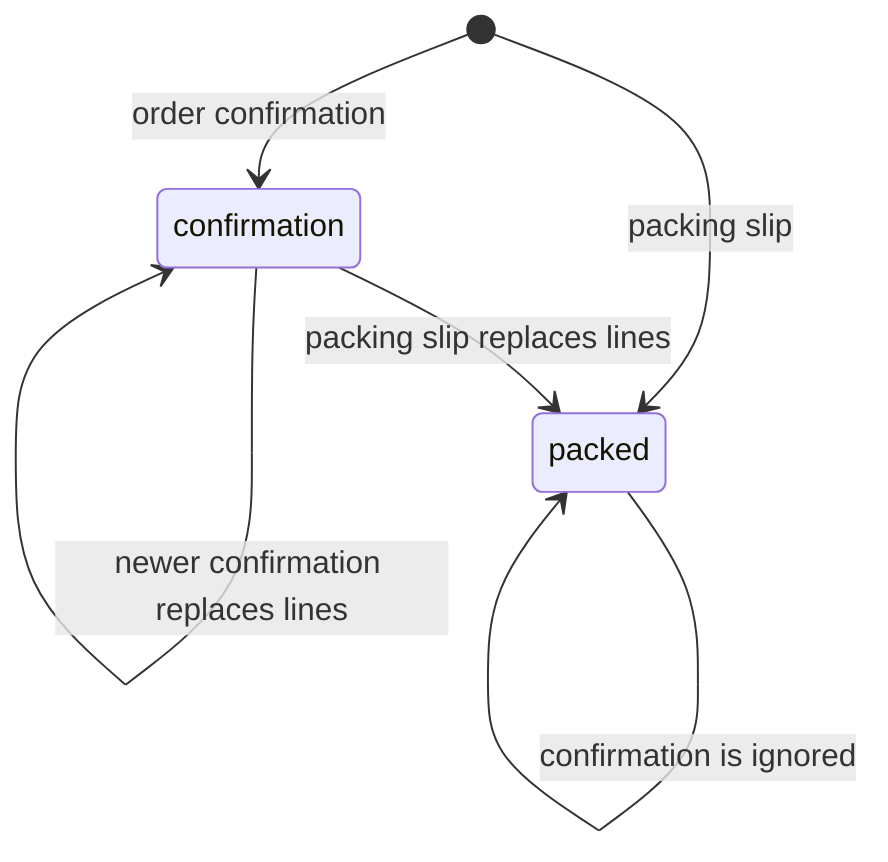

# Plan: Albert Heijn products and product types from the mailbox

From `intent.md` (2026-10-22). Status: accepted.

The work runs in three stages, in this order, as `intent.md`'s flagged concerns ask. Each stage leaves the app green and useful on its own: (1) read and import baskets, (2) classify products, (3) link deliveries to payments.

## Design

### Domain terms

From the glossary:

- **Packing slip**: the mail that lists what was packed for a delivery. It covers the current "zijn ingepakt / komen eraan" mail and the older "Alsjeblieft, hier is je pakbon" mail.
- **Door-card payment**: the card payment at the door when a delivery arrives. Its bank note carries a pasvolgnr and no order number.
- **Product type**: a shopping word for what a product is, such as "Naturel chips". It carries the category its groceries book to.

Words used as `intent.md` uses them, not yet in the glossary (auto mode adds no term without Etienne's agreement; see the report):

- **Delivery**: a receipt that carries an Albert Heijn order number.
- **Order confirmation**: the mail Albert Heijn sends when an order is placed ("Bedankt voor jouw bestelling"). It lists what was ordered, not what was packed.
- **Packed basket**: the lines of a delivery as read from a packing slip. Stored as `receipts.packed`.

No avoided word is used. "Invoice" appears only for Albert Heijn's own invoice behind the login, which is a different thing from a packing slip.

### Diagrams

Before, from `db/schema.rb` (rails-erd needs a database the worktree does not have, so this is drawn by hand):



After: one new column on `receipts`. Every other table is unchanged.



Touched objects:



The agent's run, over the MCP tools:

```mermaid
sequenceDiagram
  participant Agent
  participant Import as import_albert_heijn_mail
  participant Classify as classify_product
  participant Link as link_deliveries_to_payments
  participant Receipt
  Agent ->> Import : one call per basket mail
  Import ->> Receipt : record_basket(BasketMail.parse(mail))
  Agent ->> Classify : one call per product it is sure of
  Agent ->> Link : once, after classifying
  Link ->> Receipt : link_payments
  Receipt ->> Receipt : link, then rewrite_payment_splits
  Link -->> Agent : linked deliveries, and every unlinked one
```

A delivery's basket source:



### Signatures

`Importing::AlbertHeijn::BasketMail` (new module): the one entry point that turns an Albert Heijn mail into a basket.

```ruby
READERS = [ PackingSlip, OlderPackingSlip, OrderConfirmation ].freeze

# The basket the mail describes, or nothing when no reader understands it
#: (String text) -> (PackingSlip | OlderPackingSlip | OrderConfirmation)?
def self.parse(text)
```

It returns the first non-nil `parse`. It returns nil when a reader raises `ArgumentError` or `Date::Error` on a mail that looked right, and when the basket has no lines.

`Importing::AlbertHeijn::PackingSlip` (changed): reads the current packing slip. Gains one method.

```ruby
#: () -> bool
def packed? = true
```

`Importing::AlbertHeijn::OlderPackingSlip` (new): reads the older "Alsjeblieft, hier is je pakbon" mail. `Importing::AlbertHeijn::OrderConfirmation` (new): reads an order confirmation; `delivered_on` is the planned delivery day. Both have the same duck type as `PackingSlip` and reuse `PackingSlip::Line`:

```ruby
#: (String mail) -> instance?
def self.parse(mail)
attr_reader :order_number #: String
attr_reader :delivered_on #: Date
attr_reader :total_amount #: Integer
attr_reader :lines #: Array[PackingSlip::Line]
#: () -> bool
def packed?               # OlderPackingSlip true, OrderConfirmation false
```

Bonuses fold into their lines in every reader, as `PackingSlip` does today. Where the readers share parsing (Dutch month names, amounts), move the shared method to a small module `Importing::AlbertHeijn::Reading`, included by all three. No base class. The two new readers read the mail as a list of lines and step over table headings; `PackingSlip` also refuses a mail that says "Bedankt voor je bestelling", so a confirmation never reads as a packing slip.

`Receipt::Recordable` (new concern on `Receipt`): keeps one delivery per order number, with the best basket known.

```ruby
FIRST_DELIVERY_ON = Date.new(2022, 11, 1)
SHOP_NAME = "Albert Heijn B.V."

# Records the basket as the delivery of its order number, and returns that delivery
#
# A confirmation never replaces a packed basket, and a basket equal to the one recorded writes
# nothing. A changed basket on a linked delivery splits its payment again.
#: (PackingSlip | OlderPackingSlip | OrderConfirmation basket) -> Receipt
def self.record_basket(basket)
```

`record_basket` finds or builds the receipt and calls its public `record(basket)`, so the private helpers stay private without `send`. Private: `keeps_packed_basket?(basket)`, `same_basket?(basket)` (compares issued_on, total, packed and each line's name, quantity and amounts in memory), `replace_basket(basket)`, `albert_heijn` (not `shop`, which would hide the association). The body moves here from `ImportJob#record`. `albert_heijn` resolves `Account.resolve_for_import(account_number: nil, description: "", name: SHOP_NAME)`.

`Receipt::PaymentMatching` (new concern on `Receipt`; not `Linkable`, which names a Transaction concern already): links deliveries to the payments that confidently paid them.

```ruby
DOOR_CARD_WINDOW = 3.days
DOOR_CARD_SHORTFALL_PERCENT = 15

# Deliveries no payment is linked to yet, for a person to confirm
#: () -> ActiveRecord::Relation
scope :unlinked_deliveries, -> { where.not(order_number: nil).where(payment_id: nil) }

# Links every unlinked delivery that has exactly one confident payment, and splits that payment
# by the basket. Returns the deliveries it linked.
#: () -> Array[Receipt]
def self.link_payments
```

`ordered_payments`, `door_card_payments` and `settle_with(payment)` are public, because the class method `link_payments` has to call them on each delivery without `send`; each is documented as such. `ordered_payments` (Credits whose `original_note` or `note` names `AE<order_number>` as a whole token, `/\bAE#{order_number}\b/`, so `AE732868893` never matches order `73286889`), `door_card_payments` (Credits whose `original_note` or `note` starts with `Pasvolgnr`, booked from `issued_on - 3 days` to `issued_on + 3 days`, with `amount <= total_amount` and `amount * 100 >= total_amount * 85`), `settle_with(payment)` (in one transaction: re-check that no receipt holds the payment, then `update!(payment:)`, then `rewrite_payment_splits`; it returns false when the re-check finds another receipt). The SQLite adapter opens every transaction with `BEGIN IMMEDIATE` (`default_transaction_mode: :immediate`), so two links of the same payment run one after the other, and the second sees the first. Every candidate query is scoped to `Credit`s whose debitor carries the shop's name and that pay no receipt yet (`where.missing(:receipt)`); the AE match is not scoped by shop, since the order number is decisive.

`link_payments` rules:

1. A delivery with exactly one ordered payment is linked to it. Two or more: not linked. The order number is decisive, so the link is made even when the basket costs more than the payment; `rewrite_payment_splits` then refuses and the splits stay as they are. This is how the acceptance criterion reads: linked, and "the payment's splits follow the basket when it fits".
2. A delivery with no ordered payment is matched by door card. A door-card candidate must also pass `basket_fits?`: an inferred link never stands on a basket that does not fit. It links only when it has exactly one door-card candidate, and that payment is a door-card candidate of no other unlinked delivery.
3. A delivery with any ordered payment is never door-card matched.

Note shapes, from the dev database's imported rows (333 of 356 Albert Heijn credits are door-card payments, all 20 incasso payments name an AE number):

- Ordered payment: `Naam: Albert Heijn B.V. Omschrijving: AE74532780 IBAN: NL46INGB0702493368 Kenmerk: ... Machtiging ID: ALBERT.HEIJN.AE74532780.002462902 ...`. The number appears twice; it is still one payment.
- Subscription, never an order: `Naam: Albert Heijn B.V. Omschrijving: Abonnement Albert Heijn - AE732868893 ...`.
- Door-card payment: `Pasvolgnr: 900 06-03-2026 09:58 Transactie: P00448 Term: --- Valutadatum: 06-03-2026`, in both `note` and `original_note`.

Fixtures copy these shapes, with the household's account numbers replaced.

`Receipt#fitting_payments` (changed, bug fix): `Credit`s whose debitor carries the shop's name, in `BOOKING_WINDOW`, that pay no other receipt. Today it asks for `Debit`s with creditor = shop, which in imported data are refunds (`Importable#build_from_import`: money out is a `Credit` with the shop as debitor).

`Product` (changed): one new method.

```ruby
# Fills in what an assistant read, keeping every brand and product type already present
#: (?brand: String?, ?product_type: ProductType?) -> bool
def fill_in(brand: nil, product_type: nil)
```

`Category` (changed): one new class method.

```ruby
HOUSEHOLD_EXPENSES = "Huishoudelijke uitgaven".freeze

# The child of Huishoudelijke uitgaven with this name, created with the group's direction when missing
#: (String name) -> Category
def self.add_household_expense(name)
```

Name matching ignores case. It raises `ActiveRecord::RecordNotFound` when the group is missing.

`Importing::AlbertHeijn::ImportJob` (changed): thin. `perform(mail)` reads with `BasketMail.parse` and, when it gets a basket, calls `Receipt.record_basket`. Its existing tests stay.

New MCP tools in `app/tools/assistant/`, each a `Tool` subclass registered in `AssistantController#tools`, each `#: (..., server_context: untyped) -> MCP::Tool::Response`:

- `ImportAlbertHeijnMail(mail:)`: the plain-text body of one mail. Unreadable → `problem`, nothing saved. Delivered before `FIRST_DELIVERY_ON` → `problem`, nothing saved. Otherwise answers the receipt id, order number, date, line count, "packed" or "ordered", whether a packed basket was kept over this confirmation, and the ids of its unclassified products. The description says: import every mail first, classify, then call `link_deliveries_to_payments`.
- `ListUnclassifiedProducts`: `id: name (brand, type)` for `Product.unclassified`, at most 250, with a held-back line like `ListCategories`.
- `ListProductTypes`: `id: name - category full name`, then the brands in use.
- `CreateProductType(name:, category_id:)`: finds the type by name, ignoring case, or creates it; refuses the Transfer category and reports validation errors.
- `CreateHouseholdCategory(name:)`: `Category.add_household_expense`. No parent parameter.
- `ClassifyProduct(product_id:, brand:, product_type_id:)`: both optional; calls `Product#fill_in`; answers what it set and what it kept because it was already present.
- `LinkDeliveriesToPayments`: calls `Receipt.link_payments`; answers each linked delivery with its payment, then every unlinked delivery with order number, date and total.
- `ListUnlinkedDeliveries`: `Receipt.unlinked_deliveries`, oldest first.

Annotations, following the existing tools (a repeat call with the same input has no further effect → `idempotent_hint`; a call that rewrites what is already there → `destructive_hint`; a list → `read_only_hint`):

- `read_only_hint: true`: `ListUnclassifiedProducts`, `ListProductTypes`, `ListUnlinkedDeliveries`.
- `idempotent_hint: true`: `ImportAlbertHeijnMail` (same mail, same delivery), `CreateHouseholdCategory` (find or create), `ClassifyProduct` (fills blanks only), `CreateProductType` (find or create by name, ignoring case; an existing type keeps its category, and the answer names it).
- `destructive_hint: true`: `LinkDeliveriesToPayments`, because it replaces the splits of the payments it links.

CRC cards:

| Class | Responsibility | Collaborators |
| --- | --- | --- |
| BasketMail | Picks the reader that understands a mail. | PackingSlip, OlderPackingSlip, OrderConfirmation |
| OlderPackingSlip, OrderConfirmation | Read one mail layout into a basket. | Cents, PackingSlip::Line |
| Receipt::Recordable | Keeps one delivery per order number with the best basket known. | Product, ReceiptLine, Account |
| Receipt::PaymentMatching | Links a delivery only to a payment that fits it alone. | Transaction |
| Product | Takes an assistant's brand and type without losing one already present. | ProductType |
| Category | Places an assistant's new category under Huishoudelijke uitgaven. | none |
| Each tool | Turns one agent request into one model message. | the model it names |

Not checked: journal_administration has no Steep or rbs_rails setup.

### Complexity

N = lines in a basket, D = unlinked deliveries, C = categories in a basket.

- `BasketMail.parse`: no queries, O(mail length), at most three readers.
- `ImportAlbertHeijnMail`, same basket again: at most 4 queries (the receipt, its lines, their products; the shop is only resolved when something is written), no writes.
- `ImportAlbertHeijnMail`, new or changed basket: about 3N + 8, the same as today's `ImportJob` (per line: one or two to resolve the product, one insert). A linked delivery adds `rewrite_payment_splits` (about 4 + C).
- `LinkDeliveriesToPayments`: 1 query for the unlinked deliveries, then 2 per delivery (ordered and door-card candidates), then about 6 + C per link. The AE lookup is a `LIKE '%AE<n>%'` scan of the notes, with no index; about 20 000 transactions make that cheap in SQLite. About 175 deliveries on the first run cost a few thousand queries in one call; each link has its own transaction.
- `ListUnclassifiedProducts`: 2 queries, whatever the number of products.
- `ClassifyProduct`: 3 queries. `CreateProductType`: 3. `CreateHouseholdCategory`: 2 or 3. `ListProductTypes`: 2. `ListUnlinkedDeliveries`: 1.

### Invariants

- One receipt per order number. Enforced by the existing unique index on `receipts.order_number` and `find_or_initialize_by` in `record_basket`.
- An order confirmation never replaces a packed basket. Enforced by the `keeps_packed_basket?` guard in `record_basket`.
- An unreadable mail saves nothing. Enforced by `BasketMail.parse` returning nil before any write, and by `Receipt.transaction` around the record.
- An assistant never changes a brand or a product type that is already present. Enforced by `Product#fill_in`, the only path the tools have. This covers every hand-set value.
- A category an assistant creates is a child of Huishoudelijke uitgaven with its direction. Enforced by `Category.add_household_expense`, the only path the tools have.
- A delivery is linked automatically only to a payment that fits it alone, in both directions. Enforced by `link_payments`.
- An automatic link never takes a payment another receipt holds, and never replaces a link. Enforced by `where.missing(:receipt)` on every candidate query and by `unlinked_deliveries`.
- A payment charged to an appropriation keeps its splits, and a basket dearer than its payment changes no splits. Enforced by the existing guards in `Receipt#rewrite_payment_splits`; an order-number link is still made.
- A door-card link is never made on a basket dearer than the payment. Enforced by `basket_fits?` in the door-card candidates.

### Alternatives

- Deepest modules: one `Receipt.record(mail)` that reads, records and links in one call, and drops `ImportJob`. Rejected: linking at import time runs before the agent classifies, so the payment splits would never follow the classified basket, and the tool can report only "receipt or nil".
- Safest linking and cheapest queries: a unique partial index on `receipts.payment_id`, per-field `*_set_by_hand` columns on products, a basket digest column, `insert_all` for lines and products, and a batched sweep. Rejected: three migrations; the unique index fails a deploy where two receipts already share a payment; `insert_all` skips the validations on `ReceiptLine` and `Product`; the per-field columns make `ProductsController` mark its edits, while fill-blanks meets the acceptance criterion with no column. Kept from it: ambiguity checked in both directions, the whole-token AE match, the date guard, `add_household_expense`.
- Least change (chosen base): keep `PackingSlip`, `ImportJob`, `rewrite_payment_splits` and the payment-link flow, one additive column. Changed from it: the readers go behind `BasketMail` so the tool and the job share one entry point; linking moves from import time into its own tool, so it runs after classification; no new Todo item, because the receipts list already shows each receipt as "not settled".

## Design decisions

- Linking is its own tool, `link_deliveries_to_payments`, not part of the import. The intent wants the payment's splits to follow the basket; that needs the products classified first. The tool descriptions give the agent the order: import, classify, link.
- Fill-blanks protects hand-set values with no new column. The cost: the agent cannot correct its own earlier guess; only a person can, on the products page. `ProductsController` stays unchanged.
- "Within 3 days of delivery" means booked from 3 days before to 3 days after the delivery date. That is the literal reading. A wider window gives more candidates, so it can only make fewer links, never a wrong one.
- "At most 15% under the mail total" means `0.85 × total ≤ amount ≤ total`. A payment above the total does not fit.
- The shop is resolved by the name "Albert Heijn B.V." instead of "Albert Heijn". Payment candidates are `Credit`s whose debitor carries the shop's name. The dev database holds four accounts named "Albert Heijn B.V." (incasso on one, door-card payments on another), and the old name "Albert Heijn" would create a fifth, empty account. Matching by name reaches all four with no merge. A renamed account drops out, which errs toward fewer links.
- `Receipt#fitting_payments` is fixed in this change, in its own commit, because a person confirms an unlinked delivery through it. Its tests move to a new `credit_grocery` fixture; `debit_grocery` stays, since other tests use it.
- `ImportAlbertHeijnMail` refuses a delivery before 2022-11-01. The intent puts those orders out of scope; the app checks it, the agent decides what to hand over.
- `CreateProductType` accepts any category except Transfer. The intent lets a type use any existing category that fits; only new categories are limited to Huishoudelijke uitgaven.
- No new person-facing page. The receipts list already marks each receipt "not settled", and the receipt page already lets a person pick its payment. `ListUnlinkedDeliveries` and the link tool's answer give the agent the list for its report.
- `intent.md`'s `## Decisions` say "do both the import and the classification in one job" and "link deliveries to payments in this job, not in a separate one". This plan reads "job" as the one change and the one agent run that the flagged concerns describe ("Etienne chose to keep them as one intent"), not as one MCP call. One call cannot do the classification: the constraints give every judgement call to the agent, and the app only offers tools. So the agent's single run calls import, then classify, then link, all in this one change. If Etienne meant one MCP call, the plan is wrong on this point.
- The intent's guard "a basket costing more than its payment is refused" is kept as `rewrite_payment_splits` keeps it: the splits are refused. An order-number link is still made, as the acceptance criterion for order 74532780 asks. A door-card link is never made on a basket that does not fit.

## Integration points

- `/mcp` (`AssistantController#tools`): eight new tools.
- The email MCP server: the agent reads Albert Heijn mails there and passes each mail's plain-text body. The app never reads mail.
- `Receipt#rewrite_payment_splits` and `Transaction#ensure_remainder_split`: unchanged, reached from the new link path.
- The receipt page and `Receipts::PaymentLinksController`: unchanged code, but `fitting_payments` now offers the real payments.
- Budgets: a category the agent creates under Huishoudelijke uitgaven shows up in budgets as any child category does.

## Files that change

Stage 1, import:

- `db/migrate/<ts>_add_packed_to_receipts.rb`: `add_column :receipts, :packed, :boolean, default: true, null: false`. Additive.
- `db/schema.rb`: the new column only. Do not commit an unrelated re-dump.
- `app/models/importing/albert_heijn/basket_mail.rb`: new.
- `app/models/importing/albert_heijn/reading.rb`: new, shared parsing helpers, only if the readers share code.
- `app/models/importing/albert_heijn/older_packing_slip.rb`, `order_confirmation.rb`: new.
- `app/models/importing/albert_heijn/packing_slip.rb`: `packed?`; shared helpers move to `Reading`.
- `app/models/receipt.rb`: include the concerns.
- `app/models/receipt/recordable.rb`: new.
- `app/jobs/importing/albert_heijn/import_job.rb`: delegates to `BasketMail` and `Receipt.record_basket`.
- `app/tools/assistant/import_albert_heijn_mail.rb`: new.
- `app/controllers/assistant_controller.rb`: register the tools (each stage adds its own).
- `test/fixtures/files/albert_heijn_older_packing_slip.txt`, `albert_heijn_order_confirmation.txt`: new, real mails with the household's details replaced.
- `test/test_helpers/assistant_requests.rb`: new; `ask_assistant`, `refused?`, `post_to_assistant` and `assistant_headers` move here from `test/integration/assistant_test.rb`, which includes it. Each including test does its own setup: `host! "localhost"`, a user, and `regenerate_assistant_token`.

Stage 2, classify:

- `app/models/product.rb`: `fill_in`; the class comment says an assistant may fill blanks too.
- `app/models/category.rb`: `HOUSEHOLD_EXPENSES`, `add_household_expense`.
- `app/tools/assistant/list_unclassified_products.rb`, `list_product_types.rb`, `create_product_type.rb`, `create_household_category.rb`, `classify_product.rb`: new.
- `test/fixtures/categories.yml`, `product_types.yml`: add "Huishoudelijke uitgaven" with children "Boodschappen" and "Huishoudelijk", and product types "Komkommer" and "Naturel chips" where they are missing.

Stage 3, link:

- `app/models/receipt.rb`: `fitting_payments` fix (own commit, regression test first).
- `app/models/receipt/payment_matching.rb`: new.
- `app/tools/assistant/link_deliveries_to_payments.rb`, `list_unlinked_deliveries.rb`: new.
- `test/fixtures/transactions.yml`: `credit_grocery` (Credit, debitor `albert_heijn`, creditor `checking`); `ordered_grocery` (Credit, 131.66, note "Omschrijving: AE74532780").
- `test/models/receipt_test.rb`, `test/integration/receipts_test.rb`, `test/integration/payment_basket_test.rb`: point the payment-link tests at `credit_grocery`.

Tests (all stages): `test/integration/albert_heijn_deliveries_test.rb` (new, acceptance), `test/models/importing/albert_heijn/*_test.rb`, `test/models/receipt/recordable_test.rb`, `test/models/receipt/payment_matching_test.rb`, `test/models/product_test.rb`, `test/models/category_test.rb`, `test/tools/assistant/*_test.rb`.

## Order of work

0. Get two real mails from the mailbox through the email MCP server: the older pakbon for the delivery of 2023-09-01, and one order confirmation for an order that has no packed-basket mail. Save their plain-text bodies as fixtures, with names, address and links replaced. If the email MCP server is unavailable, stop and report; never invent a mail layout.

Stage 1, import:

1. Move `ask_assistant`, `refused?`, `post_to_assistant` and `assistant_headers` into `test/test_helpers/assistant_requests.rb`. Run `test/integration/assistant_test.rb` green.
2. Write the acceptance test "importing the current packing slip records one receipt per order number and importing it again changes nothing" in `test/integration/albert_heijn_deliveries_test.rb`, through `ask_assistant("import_albert_heijn_mail", mail:)`. Run it; watch it fail on the unknown tool.
3. Add the migration and `PackingSlip#packed?`, `BasketMail`, `Receipt::Recordable` (moving `ImportJob#record` there), and `ImportAlbertHeijnMail`. Green the test; keep `test/jobs/importing/albert_heijn/import_job_test.rb` green.
4. Acceptance tests for the unreadable mail and the delivery before 2022-11. Green them.
5. Acceptance test for the older pakbon of 2023-09-01. Write `OlderPackingSlip` red/green against its fixture. Extract `Reading` if it shares code with `PackingSlip`.
6. Acceptance tests for the confirmation-only order, and for a packing slip that later replaces it. Write `OrderConfirmation`. Add the test that a confirmation after a packing slip keeps the packed lines.
7. Run the full suite and the linters. Commit stage 1.

Stage 2, classify:

8. Acceptance tests for "AH Komkommer", "AH Allesreiniger oceaan", the two naturel chips, the unsure product, the hand-set product and the new category, through the classification tools. Watch them fail.
9. `Product#fill_in` and `Category.add_household_expense`, unit tests first. Then the five tools. Green the tests.
10. Run the full suite and the linters. Commit stage 2.

Stage 3, link:

11. Regression test: `fitting_payments` offers a `Credit` with the shop as debitor, and not a refund `Debit`. Watch it fail. Fix `fitting_payments`; move the payment-link tests to `credit_grocery`. Commit alone.
12. Acceptance tests for order 74532780, the two door-card candidates, and the charged payment. Watch them fail.
13. `Receipt::PaymentMatching` unit tests, then the code. Then the two tools. Green the tests.
14. Run the full suite, `bundle exec rubocop`, `npx @herb-tools/linter app/views/`, `bundle exec brakeman --no-pager -q`, `bundle exec bundler-audit check`, `bundle exec i18n-tasks normalize`. Commit stage 3.

Verification (after stage 3):

15. Copy the development database into this worktree and run the app on port 3001 with `DISABLE_SSL=1`, as the project memory "Run a worktree locally" says. Do not commit the re-dumped schema.
16. Over the local `/mcp`, as an agent: import every Albert Heijn basket mail from 2022-11 on from the mailbox, classify the products, then link. Record the evidence in the change folder: counts of receipts, lines and products; unclassified products; linked and unlinked deliveries; the receipt and splits of order 74532780; and every mail that was refused. Production stays out of scope.

## Risks

- The older pakbon and the order confirmation layouts are not in the repository. If the mailbox shows a layout the plan did not foresee (for example, a confirmation without per-line amounts), stage 1 stops and reports rather than guesses.
- The email MCP server needs `unlock` before the session starts; without it, step 0 and step 16 cannot run.
- A delivery linked before its products were classified keeps the splits of that moment. A later classification does not re-split. Re-importing a changed basket does; an unchanged one writes nothing. Re-splitting on reclassification is out of scope.
- Matching payments by the shop's account name skips payments booked on an account with another name.
- The AE scan has no index. It is cheap at today's size; a note index would be a later change.
- Fill-blanks means an agent's wrong guess is permanent until a person corrects it.
- Rejected: linking at import time, per-field hand-set columns, a unique index on `receipts.payment_id`, a basket digest column, `insert_all`. Reasons are under `### Alternatives`.

Out of scope, as `intent.md` lists: contacting Albert Heijn, reading mail inside the app, a scheduled import, orders before 2022-11, deals.ah.nl orders, pack size and price per unit, other shops, changing the shop on existing transactions, deploying and the production run. Also out of scope here: a person-facing page for unlinked deliveries, and re-splitting on reclassification.

## Proof

- Importing the current packing slip records one receipt for its order number, one line per product, bonuses folded in; importing it again changes nothing → `test/integration/albert_heijn_deliveries_test.rb` `test "a packing slip becomes one delivery, and handing it over again changes nothing"`
- Importing the older pakbon of 2023-09-01 records its products and total → `test/integration/albert_heijn_deliveries_test.rb` `test "an older pakbon becomes a delivery whose products and total match the mail"`
- An order with only a confirmation is recorded from it, and a later packing slip replaces its lines → `test/integration/albert_heijn_deliveries_test.rb` `test "an order confirmation is recorded until its packing slip replaces the lines"`
- "AH Komkommer" gets brand "AH", type "Komkommer", booked to Huishoudelijke uitgaven - Boodschappen → `test/integration/albert_heijn_deliveries_test.rb` `test "the assistant classifies a cucumber as groceries"`
- "AH Allesreiniger oceaan" gets a cleaning type booked to Huishoudelijke uitgaven - Huishoudelijk → `test/integration/albert_heijn_deliveries_test.rb` `test "the assistant books a cleaner to Huishoudelijk, not to Boodschappen"`
- "AH Naturel chips" and another brand's naturel chips share "Naturel chips" → `test/integration/albert_heijn_deliveries_test.rb` `test "naturel chips of two brands share one product type"`
- A product the agent cannot tell stays unclassified and is listed → `test/integration/albert_heijn_deliveries_test.rb` `test "a product the assistant leaves alone stays on the unclassified list"`
- A hand-set brand and type survive a later agent run → `test/integration/albert_heijn_deliveries_test.rb` `test "a brand and type set by hand survive the assistant"`
- With no fitting category, the agent creates one under Huishoudelijke uitgaven and the type uses it → `test/integration/albert_heijn_deliveries_test.rb` `test "a new category lands under Huishoudelijke uitgaven and its type books to it"`
- Order 74532780 links to the 131.66 payment naming AE74532780, and its splits follow the basket → `test/integration/albert_heijn_deliveries_test.rb` `test "a delivery links to the payment whose note names its order number"`
- Two door-card candidates within 3 days and 15%: not linked, listed → `test/integration/albert_heijn_deliveries_test.rb` `test "two fitting door-card payments leave the delivery unlinked and listed"`
- A charged payment keeps its splits after its delivery is linked → `test/integration/albert_heijn_deliveries_test.rb` `test "a payment charged to an appropriation keeps its splits when linked"`
- An unreadable mail is skipped and reported, nothing saved → `test/integration/albert_heijn_deliveries_test.rb` `test "a mail nobody can read is refused and saves nothing"`
- The import run on a copy of the dev database → check: step 16, evidence recorded in the change folder.
- Query count: `list_unclassified_products` answers in two queries whatever the number of products → `test/tools/assistant/list_unclassified_products_test.rb` `test "lists the products in two queries however many there are"`
- Query count: importing the same basket again reads four queries and writes nothing → `test/models/receipt/recordable_test.rb` `test "an unchanged basket is read in four queries and writes nothing"` (asserts at most four)
- Invariant: a confirmation never replaces a packed basket, enforced by `Receipt.record_basket` → `test/models/receipt/recordable_test.rb` `test "a confirmation after a packing slip keeps the packed lines"`
- Invariant: an assistant never changes a brand or type already present, enforced by `Product#fill_in` → `test/models/product_test.rb` `test "fill_in keeps a brand and type already present"`
- Invariant: an assistant's category is a child of Huishoudelijke uitgaven, enforced by `Category.add_household_expense` → `test/models/category_test.rb` `test "add_household_expense places the category under Huishoudelijke uitgaven"`
- Invariant: one payment fitting two deliveries links neither, enforced by `Receipt.link_payments` → `test/models/receipt/payment_matching_test.rb` `test "a door-card payment that fits two deliveries links neither"`
- Invariant: a payment held by a receipt is never offered or linked again, enforced by `where.missing(:receipt)` and the re-check in `settle_with` → `test/models/receipt/payment_matching_test.rb` `test "a payment another delivery holds is not linked"`
- Invariant: a door-card link is never made on a basket dearer than the payment, enforced by `basket_fits?` in the door-card candidates → `test/models/receipt/payment_matching_test.rb` `test "a door-card payment smaller than the basket is not linked"`
- Each new tool tells a client how it behaves → `test/integration/albert_heijn_deliveries_test.rb` `test "the new tools say which only read, which can be repeated, and which rewrite splits"` (reads `tools/list` and checks `readOnlyHint`, `idempotentHint` and `destructiveHint` as listed under `### Signatures`)

Per changed file, the unit tests expected:

- `app/models/importing/albert_heijn/basket_mail.rb`: `BasketMail.parse reads a packing slip`, `reads an older pakbon`, `reads an order confirmation`, `returns nothing for a newsletter`, `returns nothing when a reader trips over a malformed amount`.
- `app/models/importing/albert_heijn/older_packing_slip.rb`: `reads the order number, delivery date and total`, `reads one line per product with its bonus folded in`, `returns nothing for a current packing slip`, `is packed`.
- `app/models/importing/albert_heijn/order_confirmation.rb`: `reads the order number, planned delivery date and total`, `reads one line per product`, `returns nothing for a packing slip`, `is not packed`.
- `app/models/importing/albert_heijn/packing_slip.rb`: `is packed`.
- `app/models/receipt/recordable.rb`: `record_basket creates a delivery for a new order number`, `replaces the lines of a changed basket`, `keeps a packed basket over a confirmation`, `lets a packing slip replace a confirmation`, `splits a linked payment again when the basket changes`, `books the delivery to the Albert Heijn B.V. account`.
- `app/models/receipt/payment_matching.rb`: `link_payments links the payment that names the order number`, `does not match a longer AE number`, `leaves a delivery with two ordered payments unlinked`, `links the only door-card payment that fits`, `ignores a door-card payment more than 15% under the total`, `ignores a door-card payment above the total`, `ignores a door-card payment more than 3 days away`, `ignores a door-card payment smaller than the basket`, `links an ordered payment smaller than the basket and leaves its splits`, `leaves a delivery with two door-card candidates unlinked`, `does not link a payment another receipt took inside the same transaction`, `unlinked_deliveries lists deliveries without a payment`.
- `app/models/receipt.rb`: `fitting_payments offers a payment to the shop`, `does not offer a refund from the shop`, `does not offer a payment another receipt holds`.
- `app/models/product.rb`: `fill_in sets a blank brand and type`, `keeps a brand already present`, `keeps a type already present`.
- `app/models/category.rb`: `add_household_expense creates a child with the group's direction`, `returns the existing child, whatever its case`.
- `app/jobs/importing/albert_heijn/import_job.rb`: the existing tests stay green.
- Each new tool: one test for its answer and one for each refusal (unknown id, duplicate name, Transfer category, unreadable mail, delivery before 2022-11).

Test setup: fixtures, no factories. Mail text from `test/fixtures/files/`: the existing packing slip, plus the two new anonymised real mails. Categories "Huishoudelijke uitgaven", "Boodschappen", "Huishoudelijk"; product types "Komkommer", "Naturel chips"; transactions `credit_grocery` and `ordered_grocery`. Door-card candidates are built in the test with `Credit.create!` and a "Pasvolgnr:" note. The charged-payment test reuses `test/test_helpers/appropriation_payments.rb`. MCP calls go through `ask_assistant` from `test/test_helpers/assistant_requests.rb`.

---
Domain skills applied: software-design, glossary, diagrams, rails-architecture, rails-api-design (MCP tool shape), rails-testing, object-oriented-design.

## Critique

### Round 1 (codex exec -p terra)

- The plan contradicts the decisions "import and classification in one job" and "link in this job", and claims no conflict → fixed (`## Design decisions` now names the reading of "job" as the one change and one agent run, why one MCP call cannot classify, and that Etienne should correct it if he meant one call)
- Linking before `rewrite_payment_splits` turns the dearer-basket refusal into a saved link → fixed (a door-card candidate must pass `basket_fits?`; an order-number link stays, because the acceptance criterion for order 74532780 links it and splits only "when it fits"; both recorded under `## Design decisions` and `## Proof`)
- Payment matching rests on unverified bank data and fixtures lack representative rows → fixed (probed the dev database read-only: 333 of 356 Albert Heijn credits start with `Pasvolgnr` in both note columns, all 20 incasso payments name an AE number; the note shapes are now in `### Signatures` and the fixtures copy them)
- The shared MCP test helper misses `assistant_headers` and the token setup → fixed (the helper also takes `assistant_headers` and `refused?`; each including test does its own host and token setup)
- The one-payment invariant is not safe under concurrent calls → fixed (`settle_with` re-checks inside the transaction, and SQLite's `BEGIN IMMEDIATE` default serialises the two; a unit test covers the re-check)
  - A test with two real threads is not added: SQLite tests run in a transaction per test, and a threaded test there is flaky rather than proving anything.
- The new tools have no annotations and no metadata test → fixed (annotations listed per tool under `### Signatures`; the creates are find-or-create; a `tools/list` acceptance test checks the hints)
- The ER diagram hides `order_number` and its unique index → fixed (before and after diagrams show `order_number` UNIQUE and the new `packed` column)
