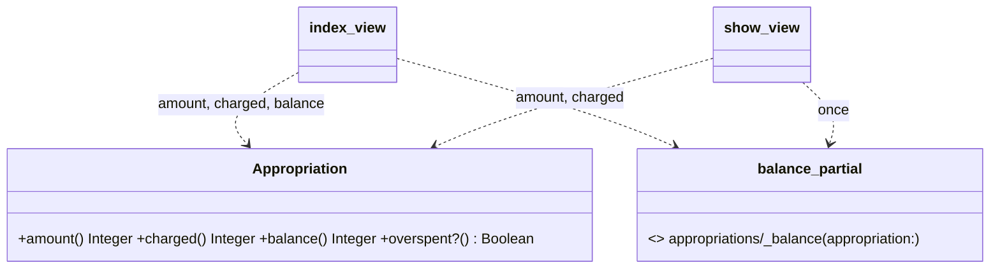
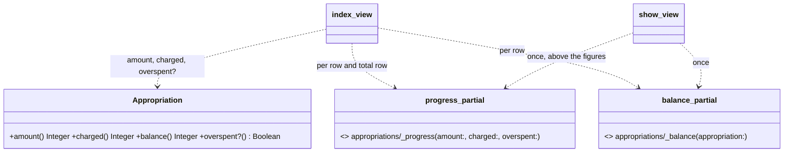

# Plan: Show a progress bar per appropriation

From `intent.md` (2026-11-06). Status: accepted.

## Design

### Domain terms

- **Appropriation** — as in `GLOSSARY.md`. The intent's "potje" is the glossary term for the savings sub-account, not for the appropriation; this change does not touch potjes.
- **Amount**, **charged**, **balance** (shown as "Left"), **overspent** — the existing readers on `Appropriation`, unchanged.
- **Progress bar** (new view term, not a domain term) — a native `<progress>` that shows what is charged against the amount. Its `max` is the amount, its `value` is what is charged held between 0 and the amount.
- **Used** (new column header) — the list's header above the bar column, so that no column is called "Charged". It is a UI label only and does not go in the glossary.

### Diagrams

Before:



After:



### Signatures

No new public Ruby method. `Appropriation`, `AppropriationsController` and `AppropriationsHelper` stay as they are.

`app/views/appropriations/_progress.html.erb` (new) — draws one progress bar of what is charged against an amount, marked when overspent.

```erb
<%# locals: (amount:, charged:, overspent:) %>
<%# amount: Integer cents, > 0; charged: Integer cents, may be negative or above amount; overspent: bool %>
```

- It renders `<progress max="<amount>" value="<charged.clamp(0, amount)>" aria-label="<label>"><label></progress>`.
- `<label>` is `t("appropriations.progress.charged", charged: cents_to_currency(charged), amount: cents_to_currency(amount))`, for example "€ 25,00 of € 100,00 charged". It carries the real charged sum, also when the bar is clamped. The same text is the fallback content for a browser without `<progress>`.
- When `overspent` is true, `<mark title="<%= t("appropriations.balance.overspent") %>">` wraps the bar. This is the same element and title as `_balance.html.erb` uses.

`app/views/appropriations/index.html.erb`:

- `labels[:charged]` becomes `labels[:used]` with `t(".used")`.
- Each row: the Charged cell becomes `<td role="cell" data-label="<%= labels[:used] %>"><%= render "appropriations/progress", amount: appropriation.amount, charged: appropriation.charged, overspent: appropriation.overspent? %></td>`.
- The total row: the view first sets `total_amount = @appropriations.sum(&:amount)` and `total_charged = @appropriations.sum(&:charged)`. Its Amount cell shows `total_amount`, its Used cell renders the partial with `amount: total_amount, charged: total_charged, overspent: total_charged > total_amount`, and its Left cell shows `cents_to_currency(total_amount - total_charged)`, unmarked as today.

`app/views/appropriations/show.html.erb`: renders the partial with `@appropriation.amount`, `@appropriation.charged` and `@appropriation.overspent?` as the first child of `<article>`, above the `<dl>`. The `<dl>` does not change.

`app/assets/stylesheets/local/modules/appropriations.css` (new, imported from `local/modules/index.css`):

- `td progress { min-inline-size: 8rem; }` so the bar keeps a readable width in the wide table, where a cell with a 100%-wide child can shrink to nothing.
- `mark:has(> progress) { display: block; padding: 0; background: none; }` and `mark > progress::-webkit-progress-value, mark > progress::-moz-progress-bar { background-color: var(--color-red); }` so an overspent bar reads as a red full bar instead of a bar on a yellow band. Final values are set during the browser check (Order of work step 9).

`config/locales/{en,nl,it}.yml`:

- Add `appropriations.index.used`: en "Used", nl "Gebruikt", it "Utilizzato".
- Add `appropriations.progress.charged`: en "%{charged} of %{amount} charged", nl "%{charged} van %{amount} geboekt", it "%{charged} di %{amount} imputato".
- Remove `appropriations.index.charged`; `test/i18n_test.rb` refuses unused keys. `appropriations.show.charged` stays, the show page still uses it.

`test/test_helpers/appropriation_assertions.rb`: `assert_appropriation_row(purpose, recipient, appropriated, charged, balance)` keeps its signature. It now matches purpose, amount and balance in that order in the row text, and finds a `progress[max=appropriated]` in the row whose `aria-label` holds `currency(charged)`. It no longer relies on a Charged cell.

Not checked: the project has no Steepfile and no steep or rbs_rails gem; the change adds no Ruby method that would carry a `#:` signature.

### Complexity

- No new query. `Appropriation#charged` is memoized per instance. `@appropriations` holds the same instances as `@appropriations_per_person` (`AppropriationsController#index`), so the rows, `overspent?` and the total sums all read the memoized value.
- The list keeps its per-appropriation cost: `charged` runs four sum queries (`charged_on` for Credit and Debit, each one sum over transactions and one over split parts), and the bar, `overspent?` and the total sums add none. Each extra appropriation therefore adds exactly four queries to the year page. The existing test "the year page works out what is charged once per appropriation" only counts split-part reads; a new slope test proves the total.
- The show page reads `charged` twice (bar and figure) through the memo; the existing test "the show page runs as many queries for three charged split parts as for one" keeps holding.
- One extra partial render per row: N + 1 renders for N appropriations, no I/O.

### Invariants

- The bar's `value` lies between 0 and its `max`. Enforced by `charged.clamp(0, amount)` in `_progress.html.erb`. Proven by the overspent test (value equals max) and the refund test (value 0).
- The bar's `max` is greater than 0. Enforced by `validates :amount, comparison: { greater_than: 0 }` for a row; the total row only renders when the list is not empty, so its sum of positive amounts is positive.
- A row's bar is marked overspent exactly when its balance is. Both read `Appropriation#overspent?`. Proven by the overspent test, which checks both marks.
- The list has no Charged column. Enforced by the index view's labels. Proven by the column header test.

### Alternatives

1. **Chosen: one partial with plain figures (`amount:, charged:, overspent:`).** No model, controller or helper change; the rows, the total row and the show page share one partial. Cost: the total row works out `total_charged > total_amount` in the view, a copy of the rule in `Appropriation#overspent?` (connascence of algorithm, kept inside one view).
2. **Rejected: a `Spendable` concern holding `balance`, `overspent?` and a new `used`, included by `Appropriation` and by a new `Appropriation::Total = Data.define(:amount, :charged)` built in the controller.** It removes the copied rule and lets the partial take one object. But it moves `Appropriation#balance` and `#overspent?` into a concern, and `intent.md` puts changes to `#balance` out of scope. It adds a concern and a value object for one footer row.
3. **Rejected: a public helper `appropriation_progress(amount:, charged:)` in `AppropriationsHelper`** that builds the tag with `tag.progress` and decides overspent itself. It would get unit tests, but it moves markup into Ruby, the existing overspent mark lives in a partial, and the helper would also copy the overspent rule — for the rows as well, not only the total.

## Design decisions

- **The bar column is headed "Used"** (`appropriations.index.used`), not "Charged". The criterion says the list shows "no Charged column"; a bar under a Charged header would read as that column. The stacked layout needs a `data-label` for the cell, so the column cannot stay unnamed. Recorded as a decision Etienne may revisit.
- **The total row's bar is marked overspent when the total charged exceeds the total appropriated.** The intent asks for a bar "for the sums of all rows" and marks an overspent bar; it is silent on the total. The total row's Left cell stays unmarked, as today, because the intent does not ask to change it. Recorded as a decision Etienne may revisit.
- **The bar value is clamped in the view** rather than left to the browser. A `<progress>` whose value is negative or above its max is not conforming HTML, even though browsers clamp it. Clamping keeps the markup valid and the test of the drawn state exact.
- **The accessible name carries the real figures.** The `aria-label` states the charged sum and the amount, so a screen reader hears "€ 130,00 of € 100,00 charged" for a full overspent bar.
- **The show page keeps its Amount, Charged and Balance figures.** `## Decisions` says "no information is removed"; the bar only joins them.
- **The new tests go in a new file `test/integration/appropriation_progress_test.rb`.** `appropriations_test.rb` (339 lines) and `appropriation_charges_test.rb` (342 lines) are long already. The new file includes `AppropriationAssertions` and `AppropriationPayments` for the `credit` helper.
- No conflict with `intent.md`'s `## Decisions`: the bar is on both pages, sits between Amount and Left with the Charged column gone, is full and marked when overspent, appears in the total row, and sits above the show page's figures.

## Integration points

- mvpa.css (gem `mvpa-css`) already styles `progress` and `mark`; the new local module only adjusts both inside the appropriations views.
- `test/i18n_test.rb` (missing, unused, eq-base, normalized, consistent interpolations) and `bundle exec i18n-tasks health` in CI check the locale changes.
- `test/integration/appropriation_charges_test.rb` calls `assert_appropriation_row` and `assert_appropriation_figures`; both keep their signatures.
- The MCP tool `list_appropriations` reads the model, not the views; it does not change.

## Files that change

- `test/integration/appropriation_progress_test.rb` — new; the acceptance tests in `## Proof`.
- `test/test_helpers/appropriation_assertions.rb` — `assert_appropriation_row` reads charged from the bar instead of a Charged cell.
- `app/views/appropriations/_progress.html.erb` — new partial.
- `app/views/appropriations/index.html.erb` — Used column with the bar per row and in the total row; Charged column gone.
- `app/views/appropriations/show.html.erb` — bar above the `<dl>`.
- `app/assets/stylesheets/local/modules/appropriations.css` — new; bar width in a table cell, overspent colour.
- `app/assets/stylesheets/local/modules/index.css` — import the new module.
- `config/locales/en.yml`, `config/locales/nl.yml`, `config/locales/it.yml` — add `index.used` and `progress.charged`, remove `index.charged`.

## Order of work

1. Write the acceptance test "the list shows purpose, amount, a bar and what is left, and no Charged column" in `test/integration/appropriation_progress_test.rb`. Run it with `bin/rails test test/integration/appropriation_progress_test.rb`. Watch it fail: no `progress` element, and a "Charged" header.
2. Write the remaining acceptance tests in `## Proof` (quarter bar, empty bar, overspent, refund surplus, total row, show page). Run them; watch each fail for the missing `progress` element.
3. Add the locale keys `appropriations.index.used` and `appropriations.progress.charged` in en, nl and it.
4. Create `_progress.html.erb`. Change the rows and the total row in `index.html.erb`; remove `appropriations.index.charged` from the three locales. Run `bundle exec i18n-tasks normalize`.
5. Change `assert_appropriation_row` to read charged from the bar. Run `bin/rails test test/integration/appropriations_test.rb test/integration/appropriation_charges_test.rb test/integration/appropriation_progress_test.rb`: the list tests go green.
6. Render the partial above the `<dl>` in `show.html.erb`. Run the show page test: green.
7. Add `appropriations.css` and its import.
8. Run `bin/rails test test/i18n_test.rb`, then `bin/rails test`, then `bin/rails test:system`.
9. Run the linters: `bundle exec rubocop`, `npm install` in the worktree, then `npx @herb-tools/linter app/views/`, `bundle exec brakeman --no-pager -q`, `bundle exec bundler-audit check`, `bundle exec i18n-tasks normalize` (expect no diff).
10. Verify as a human would: run the worktree locally, open the appropriations list of a year with an unspent, a partly charged and an overspent appropriation. Check the bar width in the wide table and in the stacked layout (narrow window, under 45rem of content width). Open an overspent appropriation's show page. Adjust the CSS values until the bar reads well in both layouts and in the dark theme.

## Risks

- **A `<mark>` around a block `<progress>`.** mvpa.css gives `mark` a yellow background and inline padding. Without the local CSS the overspent bar sits on a yellow band. The browser check in step 9 decides the final styling.
- **Bar width in the wide table.** A `progress` with `inline-size: 100%` inside an auto-width cell can shrink. The `min-inline-size` rule prevents it; the browser check confirms it.
- **The test helper change hides a regression.** If the bar's `aria-label` lost the charged figure, every `assert_appropriation_row` call would fail loudly, not pass silently — acceptable.
- **The Italian and Dutch labels.** "Gebruikt" and "Utilizzato" are new words in the UI; `i18n_test.rb` only proves they differ from English.
- Rejected: drawing the overspent part past the full length (out of scope in `intent.md`); a JavaScript or SVG bar (the native element is accessible and already styled by mvpa.css).

Out of scope: how an appropriation is charged; `Appropriation#charged` and `#balance`; marking the total row's Left cell; other pages that show appropriations (the transaction page's charge forms, the MCP tools).

## Proof

- The list shows Purpose, Amount, a bar and Left over for each appropriation, and no Charged column → `test/integration/appropriation_progress_test.rb` `test "the list shows purpose, amount, a bar and what is left, and no Charged column"` (header texts are Purpose, Amount appropriated, Used, Left; no header "Charged"; the third cell of each appropriation row, `tbody tr:has(td)`, holds a `progress` — the person heading rows hold one `th[colspan]` and no `td`).
- An appropriation of €100 with €25 charged shows a bar a quarter full, €100 on its left and €75 on its right → `test/integration/appropriation_progress_test.rb` `test "an appropriation a quarter charged shows a bar a quarter full between its amount and what is left"` (Christmas Etienne, €100, a €25 credit charged: cell 2 is € 100,00, cell 3 holds `progress[max=10000][value=2500]`, cell 4 is € 75,00).
- An appropriation with nothing charged shows an empty bar → `test/integration/appropriation_progress_test.rb` `test "an appropriation with nothing charged shows an empty bar"` (`progress[max=10000][value=0]`).
- An appropriation of €100 with €130 charged shows a full bar marked as overspent, and a left over of -€30 marked as it is today → `test/integration/appropriation_progress_test.rb` `test "an overspent appropriation shows a full bar and a balance, both marked as overspent"` (a €130 credit charged: `mark[title=Overspent] > progress[max=10000][value=10000]` with `aria-label` holding € 130,00, and `mark` with € -30,00 in cell 4).
- The total row shows a bar for the sums of all rows above it → `test/integration/appropriation_progress_test.rb` `test "the total row shows a bar for everything charged against everything appropriated"` (2026: `tfoot progress[max=45000][value=2500]` after the €25 charge).
- The show page shows the same bar above its Amount, Charged and Balance figures → `test/integration/appropriation_progress_test.rb` `test "the show page shows the bar above its figures"` (`article > progress + dl`, or `article > mark + dl` when overspent; the `dl` still holds Amount, Charged and Left).
- Invariant: the bar's value stays at 0 when refunds exceed charges, enforced by `charged.clamp(0, amount)` in `_progress.html.erb` → `test/integration/appropriation_progress_test.rb` `test "an appropriation with more refunded than charged shows an empty bar"` (a €20 debit charged: `progress[value=0]`, `aria-label` holding € -20,00).
- Invariant: the total row's bar is marked when the total charged exceeds the total appropriated, enforced by `overspent: total_charged > total_amount` in `index.html.erb` → `test/integration/appropriation_progress_test.rb` `test "the total row marks its bar when more is charged than appropriated in the year"` (2027, Birthday Chiara €60 with a €700 credit charged: `tfoot mark > progress`).
- Query count: each appropriation adds exactly four queries to the year page, so the bars add none → `test/integration/appropriation_progress_test.rb` `test "each appropriation adds only the queries that work out what is charged"` (count non-SCHEMA queries for `appropriations_path(year: 2026)`, create one more 2026 appropriation for an existing person (Birthday Serena, so the person preload stays one query), count again, assert the difference is 4).
- Query count: the list reads split parts at most twice per appropriation → `test/integration/appropriations_test.rb` `test "the year page works out what is charged once per appropriation"` (existing, must stay green).
- Query count: the show page adds no query per charge → `test/integration/appropriations_test.rb` `test "the show page runs as many queries for three charged split parts as for one"` (existing, must stay green).

Per changed file, the unit tests expected:

- `app/views/appropriations/_progress.html.erb`: no unit test; a partial is covered by the integration tests above.
- `test/test_helpers/appropriation_assertions.rb`: no test of its own; every existing `assert_appropriation_row` call in `appropriations_test.rb` and `appropriation_charges_test.rb` exercises it.
- No new public Ruby method, so no model or helper unit test.

Test setup: existing fixtures (`appropriations(:christmas_etienne)` €100 in 2026, `appropriations(:birthday_chiara_next_year)` €60 in 2027; 2026 totals €450). Charges are made with `AppropriationPayments#credit` / `#debit` and `update!(appropriation:)`, as `appropriation_charges_test.rb` does. Currency strings come from `AppropriationAssertions#currency`.

---
Domain skills applied: software-design, glossary, diagrams, rails-architecture, rails-ui, rails-testing.

## Critique

### Round 1 (codex exec -p terra)

- The list query proof overclaims "no new query": `split_part_reads` only counts SQL that names `transaction_splits`, so extra fixed queries would pass. → fixed (Complexity now states four queries per appropriation; Proof adds the slope test "each appropriation adds only the queries that work out what is charged"; the existing test is kept for split-part reads only)
- The column test says every `tbody` row's third cell holds a bar, but each `tbody` starts with a person heading row of one `th[colspan]`. → fixed (the column test scopes to appropriation rows, the rows that hold a td)
