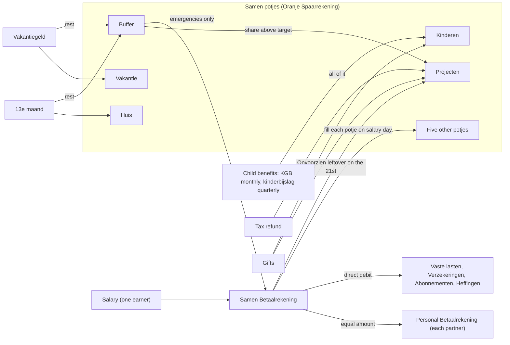

# Plan: Document the household budget method from 2026-11

From `intent.md` (2026-11-06). Status: accepted.

## Design

This change edits two Markdown files: `docs/household-finances.md` and `GLOSSARY.md`. No Ruby, ERB, JavaScript, migration, data or configuration changes. The design is the outline of the rewritten document and the money flow it draws.

### Domain terms

Agreed terms from `GLOSSARY.md`, used as defined there: Appropriation, Betaalrekening, Buffer, Kinderen, Onvoorzien, Oranje Spaarrekening, Potje, Projecten, Reserveringen, Samen, Vaste lasten. Kinderen, Onvoorzien and Projecten and the new Buffer definition were committed by the intent stage (`925b2445`).

Words the document introduces, each with an agent-supplied standard term in the `Words we use` table, not in the glossary (intent `## Decisions`):

- Huis — home maintenance and furnishing budget.
- Kindgebonden budget (KGB) — child-related budget, a government child allowance.
- Kinderbijslag — child benefit.
- 13e maand — thirteenth-month pay.
- Vakantiegeld — holiday allowance.
- Onvoorzien — contingency for unplanned costs.
- Kinderen — children's budget.

Avoided words: never "envelope" for a potje (only in the method name "envelope budgeting"), never "pot", "jar" or "main account". The intent uses none of them outside "envelope budgeting".

### Diagrams

The money flow the rewritten flowchart must show. The implementer draws it as a `flowchart LR` in the document, in the same style as today's block:



Five named potjes plus "Five other potjes" make the ten. The flowchart must not state a wrong count. The diagram does not claim in which account the child benefits land.

### Signatures

Not affected: no code changes.

Not checked: no Ruby changes, so `steep check` has nothing to check.

### Complexity

Not affected: no code path, no query.

### Invariants

- The document holds the method only: no euro amount, no account number, no potje code, no category id. Enforced by a full-document review, aided by the number-inventory check in `## Proof`.
- Every Dutch term the method introduces has an agent-supplied standard term in `Words we use`. Enforced by the table check in `## Proof`.
- A potje is called a potje, never an envelope. Enforced by the `envelope` grep in `## Proof`.
- Buffer is never called a surplus, except Etienne's personal potje "Etienne's Buffer". Enforced by the `surplus` grep in `## Proof`.
- `GLOSSARY.md` stays in alphabetical order. Enforced by the sort check in `## Proof`.
- One line per paragraph, list item and table row (playbook rule 26). Enforced by reading the diff.

### Alternatives

- A. Rewrite `docs/household-finances.md` in place, section by section, and add new sections for Income, Windfalls, Onvoorzien, Methods and App categories. Chosen: the document stays one baseline, and no sentence of the old method survives to contradict the new one.
- B. Keep the old text and add a "Changes from 2026-10-22" section on top. Rejected: agents would read two contradicting methods and have to reconcile them.
- C. Split the document into one file per topic (income, potjes, routines). Rejected: `AGENTS.md` and `CLAUDE.md` link one file as the baseline, and the document is short enough to stay one page.

No `architect` agents ran: the change touches no code object, so there is no object design to compare. The alternatives above are about document structure.

## Design decisions

- The intro says the method holds from 2026-10-22, the date Etienne accepted it. It states no rule for older transactions, because the intent gives none.
- The new sections sit in this order: intro, flowchart, Words we use, Income, Bank accounts and potjes, The Samen potjes, Salary routine, Windfalls, Onvoorzien, Personal accounts, Fixed costs, Spending routine, Buffer and Reserveringen, Appropriations, Methods, App categories, How the app sees this. Reason: income first, then where it goes, then the routines, then the reference parts.
- Potjes table rows follow the intent's order. All ten are `active`. The purpose of Boodschappen en huishouden, Auto en vervoer and Vrije tijd en hobby keeps the "purpose taken from the potje's name" marker, because the intent does not state their purpose. The other seven purposes come from the intent and drop the marker.
- The `Words we use` Buffer row changes from "emergency fund and surplus" to "emergency fund". The rows for Kindgebonden budget, Kinderbijslag, 13e maand and Vakantiegeld use "Dutch word" as source, not a URL. Reason: no source URL was checked, and the document must not invent one.
- The standard terms for the new words are the ones in `### Domain terms` above. They stay marked agent-supplied through the table header.
- The study loan end goes in Fixed costs, next to Studieschuld under Vaste lasten: "The study loan ends around late 2031; from then on, savings can rise."
- Etienne's personal potjes in Personal accounts stay as they are, including "Etienne's Buffer". The intent does not touch personal potjes, and the name differs from the Samen Buffer. The `surplus` check in `## Proof` therefore allows that one line.
- The sentence about "Steam Deck" being renamed stays. It names no former potje name; it explains why an account number, not a name, identifies a potje.
- The GLOSSARY Buffer entry gains the target and the overflow rule, because acceptance criterion 3 needs both files to state them. The intent stage's entry lacks the target.
- The methods section marks its standard terms as agent-supplied, like the rest of the document.
- No conflict with intent's `## Decisions` was found.

## Integration points

- `AGENTS.md` and `CLAUDE.md` link `docs/household-finances.md` as the baseline. The link and file path stay.
- Agents read the document through this repository; the MCP endpoint does not serve it (no reference in `app/`, `config/` or `lib/`).
- The category names come from the accepted intent, which describes the app after handoff A. `db/seeds.rb` proves only the `Parent - Child` naming form (`Inkomsten - Salaris`, `Vaste lasten - Energie`); it still holds `Schulden - Studieschuld` and no KGB or Kinderen category. The document writes `Inkomsten - Kindgebonden budget` and `Vaste lasten - Studieschuld` in that form. Seeds do not change.

## Files that change

- `docs/household-finances.md` — rewrite to the method accepted on 2026-10-22, as listed under Order of work.
- `GLOSSARY.md` — Buffer entry gains the target and the overflow rule. No other entry changes.

Nothing else changes. `docs/changes/budget-method-2026-11/` changes only through the stage scripts.

## Order of work

No acceptance criterion needs an automated test: the change is documentation. Each step ends with its `## Proof` check. One commit per step, `docs:` prefix.

1. `GLOSSARY.md`: rewrite the Buffer entry to one sentence: the potje for emergencies only, it never pays a known cost, it is filled from the leftovers of the 13e maand and the vakantiegeld up to a target of about three months of essential costs, above the target its share goes to Projecten, the standard term is emergency fund. Run the glossary checks.
2. Intro and Income. Add to the intro that the method holds from 2026-10-22; add no rule for older transactions. Add `## Income`: household income is the salary only, from one earner; Etienne's partner has no income. Child benefits are not household income. The KGB arrives monthly, around the 20th; the kinderbijslag arrives quarterly. All child benefits go to Kinderen and pay only for the children: clothing, furniture, hobbies, gifts, toys and parties, care and school, and their savings. Kinderen keeps about one quarter of the kinderbijslag, because it arrives per quarter.
3. The Samen potjes table: ten rows, current names, in this order and with these purposes:
   - Kinderen — children's budget — everything for the children: clothing, furniture and their rooms, hobbies, gifts, toys and parties, care and school, and their savings; receives all child benefits.
   - Boodschappen en huishouden — groceries and household budget — groceries and household; purpose taken from the potje's name.
   - Auto en vervoer — car and transport budget — car and transport; purpose taken from the potje's name.
   - Reserveringen — sinking fund — saving ahead for recurring costs.
   - Vrije tijd en hobby — leisure and hobbies budget — leisure and hobbies; purpose taken from the potje's name.
   - Cadeautjes — gifts budget — gifts for adults and the family; gifts for the children go to Kinderen.
   - Huis — home maintenance and furnishing budget — home maintenance and furnishing; the children's rooms go to Kinderen; receives the 13e maand.
   - Vakantie — holiday savings goal — holidays; receives the vakantiegeld.
   - Projecten — projects savings goal — projects; receives tax refunds, the monthly Onvoorzien leftover and Buffer's share above its target.
   - Buffer — emergency fund — emergencies only, never a known cost.
   - The section intro says the ten potjes are all active. Remove Cosimo, Kinderen kleding and every former name.
4. Salary routine, Windfalls and Onvoorzien.
   - Salary routine: the salary arrives in the Samen Betaalrekening. Then each Samen potje is filled, each partner gets the personal allowance, and Onvoorzien stays behind. Nothing says the leftover goes to Buffer.
   - `## Windfalls`: the 13e maand pays Huis, the rest goes to Buffer. The vakantiegeld pays Vakantie, the rest goes to Buffer. Tax refunds go to Projecten. Gifts are extra and go to Projecten or to the children. Once Buffer is above its target, its share of the 13e maand and the vakantiegeld goes to Projecten.
   - `## Onvoorzien`: Onvoorzien is not a potje. It is a small amount that stays on the Samen Betaalrekening after the monthly transfers. An unplanned cost is paid from it. When a potje runs empty, the Betaalrekening pays the rest, and that potje pays it back after the next salary-day transfers. Give the example from acceptance criterion 7: Boodschappen en huishouden empty → pay from the Betaalrekening → move the amount back from Boodschappen en huishouden after the next salary-day transfers. On the 21st, just before the salary, the leftover minus the KGB that arrived on the 20th moves to Projecten.
5. Personal accounts, Fixed costs, Spending routine.
   - Personal accounts: personal purchases go on the personal accounts; nobody pays them from Samen and pays back.
   - Fixed costs: the credit card bill is booked as a transfer linked to its purchases, not as a cost. Studieschuld is a Vaste lasten cost. The study loan ends around late 2031; from then on, savings can rise.
   - Spending routine: keep the pull-before-or-after rule; refer to Onvoorzien for an empty potje.
6. Buffer and Reserveringen, Appropriations.
   - Reserveringen: keep the animal insurance, trimsalon and dentist examples; add the yearly energy peak in April.
   - Buffer: emergencies only, never a known cost. Target about three months of essential costs. Filled from the leftovers of the 13e maand and the vakantiegeld. Above the target, its share of those windfalls goes to Projecten. Remove "No target size is recorded" and "both surplus and emergency fund".
   - Appropriations: appropriations for the children are saved for in Kinderen; the rest in Cadeautjes or Reserveringen. Remove the Christmas and Sinterklaas workaround.
7. `## Methods` and `## App categories`.
   - Methods: one list item per method, standard term first, then how the household applies it. Envelope budgeting: the potjes; a potje is still called a potje. Zero-based budgeting: on salary day every euro of the salary gets a destination — potjes, personal allowances, fixed costs, Onvoorzien. Sinking fund: Reserveringen. Pay yourself first: the potjes and savings are filled on salary day, before spending. Emergency fund: Buffer. Mark the terms agent-supplied.
   - App categories: `Kinderen` is a parent category for the children's spending. `Vaste lasten - Studieschuld` holds the study loan. `Inkomsten - Kindgebonden budget` holds every KGB payment; an analysis does not count it as household income. Names only, no ids.
8. `Words we use`: change the Buffer row to "emergency fund". Add rows for Onvoorzien, Kinderen, Huis, Kindgebonden budget (KGB), Kinderbijslag, 13e maand and Vakantiegeld with the standard terms from `### Domain terms`. Source: `GLOSSARY.md` for Onvoorzien and Kinderen, "household name" for Huis, "Dutch word" for the other four.
9. Flowchart: redraw per `### Diagrams`. Render it with `mmdc` to prove it parses.
10. Run every check in `## Proof`. Re-read the full diff for rule 26 (one line per paragraph) and for any sentence of the old method that survived.

## Risks

- A sentence of the old method survives in a section the steps do not name, for example "How the app sees this". Mitigation: step 10 greps for `salary leftover`, `surplus`, `Cosimo`, `Kinderen kleding`, `Cadeautjes en speelgoed`, `huishoudelijk en persoonlijke zorg` and `Christmas`, and re-reads every line that mentions Buffer.
- The flowchart fails to render or states a wrong potje count. Mitigation: `mmdc` render in step 9; five named potjes plus "Five other potjes" make ten.
- An agent-supplied standard term reads as Etienne's word. Mitigation: the table header and the methods section keep the "agent-supplied" mark.
- "How the app sees this" names "Buffer" as an example potje name. It stays: Buffer is still a current potje name.
- Rejected: adding Huis, Kindgebonden budget or the windfall words to `GLOSSARY.md` — intent's `## Decisions` adds only Kinderen, Onvoorzien and Projecten.
- Rejected: stating that kinderbijslag books under `Inkomsten - Kinderbijslag`. The seeds hold that category, but the intent does not name it and the live app is not checked.

## Proof

All checks run from the worktree root. Section checks use this helper, which prints one `##` section of the document:

```bash
section() { awk -v h="## $1" '$0==h{f=1;next} /^## /{f=0} f' docs/household-finances.md; }
```

- An agent books a KGB payment under Inkomsten - Kindgebonden budget, and does not count it as household income → check: `section "App categories" | grep -n "Inkomsten - Kindgebonden budget"` matches; `section Income` and `section "App categories"` each say child benefits are not household income (read).
- The Betaalrekening leftover moves to Projecten on the 21st; nothing says the salary leftover goes to Buffer → check: `section Onvoorzien | grep -n "21st"` shows the sentence that moves the leftover minus the KGB to Projecten; `grep -n "Buffer" docs/household-finances.md` and every hit read by hand: only windfall rests, emergencies, the target and the overflow to Projecten send money to or from Buffer.
- Document and glossary both say Buffer pays emergencies only, target about three months of essential costs, above the target its share goes to Projecten → check: `section "Buffer and Reserveringen" | grep -nE "emergencies only|three months|Projecten"` hits all three; `grep '^- \*\*Buffer\*\*' GLOSSARY.md | grep -cE "emergencies only|three months|Projecten"` is 1 and the line holds all three (read).
- Each windfall's destination is clear → check: `section Windfalls` names 13e maand → Huis then Buffer, vakantiegeld → Vakantie then Buffer, tax refunds → Projecten, gifts → Projecten or the children (read).
- Exactly ten potjes, all active, current names; Cosimo and Kinderen kleding appear nowhere → check: `section "The Samen potjes" | grep -c '| active |'` is 10 and `section "The Samen potjes" | grep -cE '^\| [A-Z]'` is 10 (data rows, header excluded by reading); `grep -nE "Cosimo|Kinderen kleding|Cadeautjes en speelgoed|huishoudelijk en persoonlijke zorg|unused" docs/household-finances.md GLOSSARY.md` finds nothing.
- A children's birthday party is paid from Kinderen; a gift for an aunt from Cadeautjes → check: in `section "The Samen potjes"` the Kinderen row lists parties and gifts for the children and the Cadeautjes row says gifts for adults and the family (read).
- Empty Boodschappen en huishouden → pay from the Betaalrekening, move back after the next salary-day transfers → check: `section Onvoorzien | grep -n "Boodschappen en huishouden"` shows the example sentence.
- Onvoorzien is not a potje → check: `section Onvoorzien | grep -n "not a potje"` matches.
- Personal purchases go on the personal accounts → check: `section "Personal accounts" | grep -ni "personal purchases"` shows the rule.
- A credit card bill is a transfer linked to its purchases → check: `section "Fixed costs" | grep -niE "credit card bill.*transfer.*linked"` matches.
- App categories names Kinderen, Studieschuld under Vaste lasten and Kindgebonden budget, without ids → check: `section "App categories" | grep -cE "Kinderen|Vaste lasten - Studieschuld|Inkomsten - Kindgebonden budget"` is at least 3, and `section "App categories" | grep -n "[0-9]"` finds nothing.
- The methods section names the five methods → check: for each of `envelope budgeting`, `zero-based budgeting`, `sinking fund`, `pay yourself first`, `emergency fund`, `section Methods | grep -ci "<term>"` is at least 1.
- `Words we use` has rows for Onvoorzien, Kinderen, Huis, Kindgebonden budget, Kinderbijslag, 13e maand and Vakantiegeld → check: `section "Words we use" | grep -cE "^\| (Onvoorzien|Kinderen|Huis|Kindgebonden budget|Kinderbijslag|13e maand|Vakantiegeld)"` is 7.
- `GLOSSARY.md` has Kinderen, Onvoorzien and Projecten, alphabetical, Buffer no longer mentions the salary leftover → check: `grep -o '^- \*\*[^*]*' GLOSSARY.md | sed 's/^- \*\*//' | LC_ALL=C sort -fc && echo sorted` prints `sorted`; `grep -cE "^- \*\*(Kinderen|Onvoorzien|Projecten)\*\*" GLOSSARY.md` is 3; `grep '^- \*\*Buffer\*\*' GLOSSARY.md | grep -ci "salary"` is 0.
- The flowchart shows one salary, child benefits flowing to Kinderen, the windfalls, and the leftover moving to Projecten → check: extract the Mermaid block to the scratchpad and run `mmdc -i <block>.mmd -o <block>.svg` without error; read the node and edge labels.
- No euro amount, account number, potje code or category id → check: read the whole document line by line for each of the four data types; this review is the proof. Aids: `grep -nE "€|EUR|euro|[0-9]+[.,][0-9]{2}|NL[0-9]{2}[A-Z]{4}" docs/household-finances.md` finds nothing; `grep -noE "[0-9]+" docs/household-finances.md | cut -d: -f2 | sort -u` lists only date parts (2025, 2026, 2031 and months and days), the days 20 and 21, and 13 from "13e maand".
- Invariant: no sentence calls Buffer a surplus, enforced by review → check: `grep -n "surplus" docs/household-finances.md` hits only the "Etienne's Buffer" potje in `section "Personal accounts"`.
- Invariant: a potje is never called an envelope, enforced by review → check: `grep -ni "envelope" docs/household-finances.md` hits only "envelope budgeting".
- Invariant: one line per paragraph, enforced by review → check: read the diff; no prose paragraph spans two lines.

Per changed file, the unit tests expected: none. Both files are documentation; there is no code to unit-test.

Test setup: none. The checks need only `grep`, `sort` and `mmdc` (installed at `/opt/homebrew/bin/mmdc`).

Out of scope: any amount, account number, potje code or category id; former potje names; changes in the app or at the bank, including the A6 linking of credit card bills; the "How the app sees this" import description; new glossary entries beyond the Buffer rewrite.

---
Domain skills applied: glossary, software-design (design section shape), diagrams (Mermaid flowchart).

## Critique

### Round 1 (Codex, terra)

- Keeping "Etienne's Buffer" as "emergency fund and surplus" makes the Buffer rule ambiguous and conflicts with the `surplus` check → fixed (personal potjes stay out of scope; the `surplus` check and a new invariant allow only that personal line)
- The intro invents a rule for transactions before 2026-10-22 → fixed (the intro states only the date; no rule for older transactions)
- KGB is described as income-dependent, a fact the intent does not give → fixed (standard term is now "child-related budget, a government child allowance")
- The plan overstates what the seeds support for the category names → fixed (Integration points says seeds prove only the naming form, hold `Schulden - Studieschuld`, and do not change)
- The leftover proof can false-pass on any "21st" or miss other wording → fixed (check scoped to the Onvoorzien section; every Buffer line read by hand)
- Several proof greps are not scoped to their section → fixed (a `section` helper scopes each check to its `##` section)
- The glossary salary grep already matches the Betaalrekening entry → fixed (check reads the Buffer entry only)
- The data-leak greps do not cover potje codes or category ids → fixed (a full-document review is the proof; the greps are aids)
- The former-name check misses the old Boodschappen name and the Steam Deck rename sentence → fixed (grep adds `huishoudelijk en persoonlijke zorg`; the Steam Deck sentence stays because it names no former name, recorded in Design decisions)
