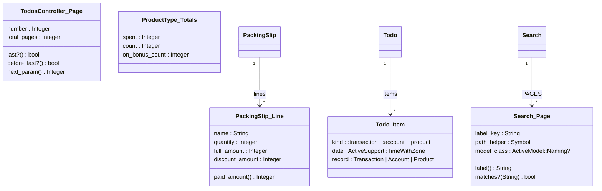

# Plan: Make main's pre-push hooks green: Rails 8.1.4.1, two gems, rubocop

From `intent.md` (2026-11-06). Status: accepted.

This plan replaces the earlier plan for the narrower intent "Bump Rails to 8.1.4.1". Etienne widened the intent on 2026-11-06 to also take in `addressable`, `sqlite3` and main's rubocop offenses, which settles both conflicts that the earlier plan raised.

## Design

### Domain terms

No domain term changes. `GLOSSARY.md` gets no new term. Working words for this plan only:

- **Signature** — the RBS 4 `#:` method type comment directly above a public `def` or `def self.`. An `attr_*` line takes a trailing `#: Type` on the same line.
- **Boundary type** — `untyped`, allowed only where a third party decides the value (see the allow-list under Signatures).

### Diagrams

The only object shapes that change are the three Structs whose methods move out of a `Struct.new` block into a reopened class of the same constant. Every other change is a comment.



The attribute types above are the expected ones from the code; the implementer confirms each against the constructors (`app/models/todo.rb:59-69`, `app/models/search.rb:36-41`, `app/models/product_type.rb:38`, the packing slip parser). ER, sequence and state diagrams: not affected, no table, flow or state changes.

### Signatures

The rubocop config comes from the `rubocop-eirvandelden` gem: `Style/RbsInline` in `opt_out` mode, `MissingTypeAnnotation` with `EnforcedStyle: method_type_signature` and `Visibility: public`. The locked revision `32d259f` of that gem excludes `db/migrate`, `db/*_migrate` and `db/data` from `MissingTypeAnnotation` (`config/rails.yml`). The offenses on 2026-11-06, under the Ruby in `.ruby-version` (4.0.7): 391 in total, in 110 files — 372 `MissingTypeAnnotation`, 15 `MissingStructClassAnnotation`, 3 `StructNewWithBlock`, 1 `MethodCommentSpacing`. By offense count: app/models 184, app/controllers 116, app/tools 74, app/helpers 13, app/jobs 2, app/channels 1, script/admin/prepare-backup 1. The intent's "410 offenses in 120 files" came from a run under Ruby 4.0.5 with an older build of the gem that still flagged `db/`; the outcome (zero offenses) is the same.

Conventions, from the `ruby-style` skill (personal projects) and the precise-types design:

1. Each type comes from the method body and its callers, never from an existing YARD tag alone. YARD has gone stale in places: `Todo::Item`'s YARD says `:transaction or :account`, the code also builds `:product` items with a `Product` record.
2. Concrete model classes (`Receipt`, `Credit`, `Account`). A relation return is `Model::ActiveRecord_Relation` (the constant Rails defines and rbs_rails uses), never bare `ActiveRecord::Relation`. A method that ends in `.to_a`, `.select` or `.map` returns `Array[Model]`.
3. Money is `Integer` (cents). A day is `Date`. A timestamp is `ActiveSupport::TimeWithZone`.
4. `T?` whenever a branch can return `nil`. `bool` only when every branch returns true or false; a truthy object is `boolish`.
5. Literal symbol unions where the code branches on symbols, for example `(:green | :orange | :red)?`.
6. Controller actions, callbacks, job `perform`, channel `connect` and `initialize` return `void`. A method that always raises returns `bot`.
7. Parameter names are written: `(Transaction payment) -> bool`. Keywords: `(query: String?)`, optional `?limit: Integer`. Blocks: `{ (Item) -> void }`.
8. Struct attributes: one per line, each with a trailing aligned `#: Type`.
9. `attr_*`: a trailing `#: Type` on the same line. Split `attr_reader :a, :b` into one line per attribute only when the types differ.
10. Assistant tools: `self.call` takes the keywords typed from its `input_schema` (`"string"` → `String`, `"integer"` → `Integer`) plus `server_context: untyped`, and returns `MCP::Tool::Response`. A `def self.x` followed by `private_class_method :x` counts as public for the cop, so it gets a signature too.
11. A type that pushes a line past the length limit gets a name, declared once with `# @rbs! type name = …` followed by a blank line.
12. `untyped` allow-list, in exactly three spellings: `server_context: untyped` (MCP), `**untyped` (options passed straight through to a Rails helper), and `Hash[String, untyped]` or `Hash[Symbol, untyped]` (params values and parsed external JSON). Nowhere else; the Proof list checks it with a command.
13. YARD type tags (`@param`, `@return`, `@!attribute`) on a method or Struct that gets a signature are removed in the same hunk, so one type source remains, as `ruby-style` asks for personal projects. Prose comments stay. YARD tags on methods that get no signature (private methods) stay untouched.

Examples:

```ruby
# app/controllers/todos_controller.rb — before
Page = Struct.new(:number, :total_pages) do
  def last?      = number >= total_pages
  def before_last? = number < total_pages
  def next_param = number + 1
end

# after
Page = Struct.new(
  :number,      #: Integer
  :total_pages  #: Integer
)

# Where the todo list stands in its pages
class Page
  #: () -> bool
  def last? = number >= total_pages

  #: () -> bool
  def before_last? = number < total_pages

  #: () -> Integer
  def next_param = number + 1
end
```

```ruby
# app/models/importing/albert_heijn/packing_slip.rb — after
attr_reader :order_number #: String
attr_reader :delivered_on #: Date
attr_reader :total_amount #: Integer
attr_reader :lines #: Array[Line]

# Reads a packing slip mail, or nothing when the mail is not one
#
#: (String mail) -> PackingSlip?
def self.parse(mail)
```

`Search::Page` follows the `TodosController::Page` shape and keeps `keyword_init: true`. Its reopened `class Page` sits directly after the `Struct.new` line and before `PAGES`.

The `MethodCommentSpacing` offense (`app/models/receipt/payment_matching.rb:18`, a `#:` above a `scope` call inside `included do`) is fixed by deleting that one `#:` line and keeping the prose. RBS::Inline never read it (no `def` follows it, and it does not parse `included do` blocks), so no type information is lost. An embedded `# @rbs!` declaration there would be equally inert, and turning the scope into a `def` would change behaviour (a scope returns `all` when its body returns nil). Typing scopes belongs to a separate, approved rbs_rails change.

Not checked: the project declined Steep and rbs_rails (no `Steepfile`, no `steep` gem, no `sig/`). The rubocop cops `InvalidComment` and `InvalidTypes` check each signature's RBS syntax; nothing checks that a type is true.

### Complexity

Not affected: signatures are comments, and a reopened Struct class defines the same methods on the same class object. No new code path, no new query.

### Invariants

- Every public `def`, `def self.` and `attr_*` in the cop's scope (everything outside `test/`, `spec/`, `db/migrate`, `db/*_migrate` and `db/data`) carries a signature. Enforced by `Style/RbsInline/MissingTypeAnnotation` in pre-push and CI.
- Every Struct attribute carries its own aligned `#:` type, and no `Struct.new` takes a block. Enforced by `MissingStructClassAnnotation`, `StructClassCommentAlignment` and `StructNewWithBlock`.
- No cop is disabled and nothing escapes a cop: no `# rubocop:disable`, no `# rbs_inline: disabled`, no `# @rbs skip`, no `# @rbs override` added, no change to `.rubocop.yml`. Enforced by a grep in the Proof list.
- `untyped` appears only in the three allow-listed spellings. Enforced by the `untyped` check in the Proof list.
- Behaviour does not change. The three Struct constructors keep their argument shapes (`Page.new(n, t)`, `Search::Page.new(label_key: …)`, `PackingSlip::Line.new(…)`). Enforced by the existing unit, integration and system suites.
- `Gemfile` does not change. `Gemfile.lock` changes only for the gems listed under Alternatives, option A1, and for `addressable` and `sqlite3`. Enforced by the lockfile diff check in the Proof list.

### Alternatives

Lockfile:

- A1 (chosen): `bundle lock --update rails`, then `bundle lock --conservative --update addressable sqlite3`, each followed by `bi`. `bundle lock --update rails` resolves exactly as `bundle update rails` does, without installing; `bi` installs (playbook rule 11 forbids `bundle install`). Dry runs on scratch copies on 2026-11-06 moved exactly: the 11 Rails framework gems, `rails` and `railties` 8.1.4 → 8.1.4.1; `rack` 3.2.7 → 3.2.8; `rails-html-sanitizer` 1.7.1 → 1.7.2; `loofah` 2.25.2 → 2.25.3; `nokogiri` 1.19.4 → 1.19.7 (all 8 platform variants); `io-console` 0.9.4 → 0.9.5. Then `addressable` 2.9.0 → 2.9.2 and `sqlite3` 2.10.1 → 2.10.2 (all 9 platform variants), nothing else.
- A2 (rejected): `bundle update --conservative rails`. It leaves `rack` 3.2.7, `loofah` 2.25.2 and `nokogiri` 1.19.4 locked with their advisories open.
- A3 (rejected): pin `gem "rails", "~> 8.1.4.1"` in `Gemfile`. The existing `~> 8.0` constraint already allows 8.1.4.1, and the intent changes only `Gemfile.lock`.

Signatures — two `architect` agents ran in parallel, one for the most precise types and one for the smallest, lowest-risk diff:

- S1 (chosen): precise signatures as listed under Signatures. Each type is derived from the body, YARD type tags go in the same hunk, `untyped` only on the allow-list. It costs reading each method, and in return the 391 new comments carry true information and remove stale YARD.
- S2 (rejected): a scripted `#: (?) -> untyped` above every flagged def, a trailing `#: untyped` on every flagged `attr_*`, and `rubocop -a --only Style/RbsInline/MissingStructClassAnnotation` for the Structs. It can never be false and is reviewable with one shell loop, but `(?) -> untyped` is exactly what rbs-inline infers for an unannotated method: on types it works like the forbidden `# @rbs skip`, it satisfies the letter of the cop and not its intent, and it clashes with the 26 real signatures already in the code.
- S2b (rejected): arity-mirrored `untyped` signatures generated with `rbs prototype rb` or a Prism script. `prototype` writes separate `.rbs` files with no line mapping, so the splice is fragile, and the types still say nothing. `typeprof` is not in the bundle (rule 11).
- S3 (rejected): copy the YARD types into signatures mechanically. Quick, but it carries the stale YARD types (`Todo::Item`) into the new source of truth.
- Escape hatches (rejected, forbidden by the intent): `# rbs_inline: disabled` per file, `# @rbs skip` per method, disabling or reconfiguring the cops.

## Design decisions

- Intent's `## Decisions` checked: separate commits for the Rails bump, the two gems and the rubocop fix in one pull request — the order of work follows it. No conflict.
- The intent says `bundle update rails` and `bundle lock --conservative --update addressable sqlite3`. The plan runs `bundle lock --update rails` + `bi` for the first, which resolves identically, because the playbook forbids `bundle install` and `bi` is the installer.
- The `io-console` 0.9.4 → 0.9.5 move counts as "Rails and its own dependent gems": `railties` depends on `irb`, which depends on `reline` and `io-console`.
- YARD type tags are removed where a signature replaces them (convention 13). The intent does not name this; it follows `ruby-style` and keeps comments-only, so it changes no behaviour.
- The rubocop fix comes after the lockfile commits, so the full suite runs once on the new gems with the signatures in place, and a test failure can be bisected by commit.

## Integration points

- Every Rails framework gem the app loads: Active Record on SQLite, Action Pack, Action View with `rails-html-sanitizer`, Active Storage, Action Mailbox, Action Text, Active Job on Solid Queue.
- `nokogiri` and `loofah` (HTML sanitizing and mail parsing in `app/models/importing/`), `rack` (the request layer, including `/mcp`), `addressable` (through `capybara` and `geared_pagination`), `sqlite3` (the database driver, native platform gems).
- The lefthook pre-push hook (`lefthook.yml`: rubocop, herb, brakeman, bundler-audit, tests) and CI (`.github/workflows/ci.yml`, which calls appkit's `rails-ci.yml`).
- Production behind kamal-proxy, for the `RemoteIp` change in GHSA-2gff-2mmg-m73p (see Risks).

## Files that change

- `Gemfile.lock` — commit 1: Rails and its dependents, as listed under A1.
- `Gemfile.lock` — commit 2: `addressable` and `sqlite3`.
- `app/controllers/todos_controller.rb`, `app/models/search.rb`, `app/models/importing/albert_heijn/packing_slip.rb`, `app/models/todo.rb`, `app/models/product_type.rb` — the five Structs get attribute types; the three block Structs get a reopened class.
- `app/models/receipt/payment_matching.rb` — the misplaced `#:` line above the scope is deleted; its prose stays.
- The other files that `bundle exec rubocop` lists under `MissingTypeAnnotation` (110 files in total with the above, under `app/models`, `app/controllers`, `app/tools`, `app/helpers`, `app/jobs`, `app/channels` and `script/admin/prepare-backup`) — signatures added, replaced YARD type tags removed. Comments only.

`Gemfile`, `.rubocop.yml`, tests, everything under `db/`, deploy files and CI files do not change.

## Order of work

No acceptance criterion needs a new test: the lockfile is configuration, and the signatures are comments. The Struct reopen is a behaviour-preserving refactor that the existing tests cover: `test/integration/pagination_navigation_test.rb` and `test/integration/todos_index_test.rb` (`before_last?`, `next_param`), `test/models/search_test.rb` (`label`, `matches?` over every `PAGES` entry), `test/models/importing/albert_heijn/packing_slip_test.rb` and `test/models/receipt/recordable_test.rb` (`paid_amount`), plus `test/models/todo_test.rb` and `test/models/product_type_test.rb` for the attribute-only Structs. `TodosController::Page#last?` has no caller in `app/` and no test; it moves verbatim, and its removal is an orthogonal cleanup for a separate branch. Checks run after each change.

0. Sync with the `sync` skill: fetch `origin/main` and rebase this branch on it (rebase, never merge). Confirm `ruby -v` prints the version in `.ruby-version` (4.0.7); the offense count differs under another Ruby's bundle. Baseline on the rebased, unchanged code: clear `tmp/cache/bootsnap`, run `bin/rails test` and `bin/rails test:system`, record the results. Save `bundle exec rubocop --format offenses` as the starting count (expect 391 on the 2026-11-06 main; a moved main may differ, and the target stays zero).
1. Run `bundle lock --update rails`, then `bi`. Run `git diff Gemfile.lock` and confirm only the A1 Rails list moved (with platform variants and checksums). Stop and report if any other gem moved. Run `bin/rails runner 'puts Rails.version'`, expect `8.1.4.1`. Commit `Gemfile.lock` alone: `Bump Rails to 8.1.4.1`.
2. Run `bundle lock --conservative --update addressable sqlite3`, then `bi`. Confirm only `addressable` and `sqlite3` moved. Run `bundle exec bundler-audit check`, expect "No vulnerabilities found". A new advisory on another gem is a stop-and-report, not a further update. Commit: `Bump addressable and sqlite3 for security advisories`.
3. Clear `tmp/cache/bootsnap`, run `bin/rails test` and `bin/rails test:system`, compare with step 0. A new failure belongs to the bumps: fix the code the test exercises, never the test.
4. Structs: before editing, save the output of the shape check from the Proof list. Type the five Structs and move the block methods of `TodosController::Page`, `Search::Page` and `Importing::AlbertHeijn::PackingSlip::Line` verbatim into a reopened `class X … end` (no superclass) directly after the `Struct.new`, each method with its signature and a blank line between defs. Run the shape check again and compare. Run the test files named above. Run `bundle exec rubocop` on the five files and confirm no `StructNewWithBlock` or `MissingStructClassAnnotation` remains. Commit: `Type the Structs and move their methods out of Struct.new blocks`.
5. Fix the `MethodCommentSpacing` offense in `app/models/receipt/payment_matching.rb` by deleting the one `#:` line above the scope, as Signatures says. Commit: `Remove the misplaced signature above the unlinked_deliveries scope`.
6. Add signatures per directory, one commit each, running `bundle exec rubocop <dir>` and the tests for that directory before each commit:
   1. `app/models` — `Add RBS signatures to models`.
   2. `app/controllers` — `Add RBS signatures to controllers`.
   3. `app/tools` — `Add RBS signatures to assistant tools`.
   4. `app/helpers` — `Add RBS signatures to helpers`.
   5. `app/jobs`, `app/channels`, `script/admin/prepare-backup` — `Add RBS signatures to jobs, channels and scripts`.

   Never run `rubocop -A` over the tree: an unsafe autocorrect can change behaviour. `rubocop -a` (safe only) is allowed on a single file when its result is read before staging.
7. Run `bundle exec rubocop`, expect "no offenses detected". Run the escape-hatch and `untyped` checks from the Proof list; each must exit 0.
8. Clear `tmp/cache/bootsnap`. Run `bin/rails test`, `bin/rails test:system`, `bundle exec brakeman --no-pager -q`, `bundle exec bundler-audit check`, `bundle exec i18n-tasks normalize` (expect no file change). Compare the tests with step 0.
9. Smoke-check the boot: start `DISABLE_SSL=1 bin/rails server -p 3001 -b 127.0.0.1` in the background, find the sign-in path with `bin/rails routes -g session` (the `Appkit` engine owns it), request it with `curl -s -o /dev/null -w '%{http_code}' http://127.0.0.1:3001<path>`, expect `200`, stop the server.
10. Run the whole pre-push hook on the clean tree: run `npm install` in the worktree (the herb hook needs `node_modules`), put the worktree's `bin/` first on `PATH` (the binstub gotcha in `AGENTS.md`), confirm `git status` is clean, then run `bundle exec lefthook run pre-push` (or `npx lefthook run pre-push` when lefthook is not in the bundle). Expect every command to pass. Before the push, fetch `origin/main` again; when it moved, rebase (`sync` skill), then rerun steps 7, 8 and this step's hook run on the rebased tree. Then push with `--force-with-lease` after a rebase, plain push otherwise.
11. Re-read the full diff against main. Every hunk is a lockfile move, a signature, a removed YARD type tag that the signature replaces, or one of the three Struct reopens.

## Risks

- A test breaks on 8.1.4.1 or on the `nokogiri`/`loofah`/`rails-html-sanitizer`/`rack`/`sqlite3` patch. Response: fix the code that the test exercises, within the intent's "unless 8.1.4.1 breaks a test" clause; never weaken the test.
- `nokogiri` and `sqlite3` ship native platform gems. The lockfile must keep every platform it lists today. Steps 1 and 2 check the variants.
- The audit database moves on. A new advisory on another gem stops the work and becomes a decision for Etienne; no further gem update without his approval (rule 11).
- A wrong type passes silently: without Steep, nothing checks that a signature is true. Mitigation: derive types from bodies and callers (convention 1), and the reviewer spot-checks unions and nilability.
- The Struct reopen changes load order: `Search::PAGES` calls `Page.new` at class load. The reopened `class Page` sits before `PAGES`, and `PAGES` calls no reopened method at load, so behaviour holds; the search tests prove it.
- The offense inventory depends on the Ruby and gem build: a run under Ruby 4.0.5 with an older `rubocop-eirvandelden` build reported 410 offenses including `db/`; the locked build under 4.0.7 reports 391 without `db/`. The pre-push hook and CI use the locked build. Step 0 checks `ruby -v`.
- The known date-flaky system test `BudgetsTest#test_suggesting_amounts_fills_in_historical_averages` (`test/system/budgets_test.rb`) fails on days a suggested amount ends in 0. Etienne chose to leave it until money moves to cents. It is not in the pre-push hook (which runs `rails test` only). See the system-test Proof line for how it is judged.
- The diff is large (110 files of comments). The per-directory commits keep review possible.
- Running rubocop from a worktree inside the main checkout loads the main checkout's `lib/rubocop/cop/locale/literal_message.rb` too and prints "already initialized constant" warnings. The offenses still name worktree files, so the count is valid; the warnings are noise, not offenses. Not fixed here.
- GHSA-2gff-2mmg-m73p changes `ActionDispatch::RemoteIp`: with `ip_spoofing_check` on (the default here), a request that carries both a `Forwarded` and an `X-Forwarded-For` header with different client addresses now raises `ActionDispatch::RemoteIp::IpSpoofAttackError`. Production runs behind kamal-proxy with `forward_headers: true` (`config/deploy.yml`). A local boot cannot exercise this. Post-deploy check for Etienne: one request through the proxy must succeed, and the production log must hold no `IpSpoofAttackError`. Any configuration change in response is a new decision, not part of this plan.
- Rejected: `bundle update` for all gems (rule 11), a `Gemfile` pin, `--conservative rails`, `untyped` everywhere, mechanical YARD copies, every cop escape hatch (see Alternatives).

## Out of scope

- Any other gem update, `Gemfile` edits, `.rubocop.yml` or `rubocop-eirvandelden` changes.
- Adding Steep or rbs_rails, or a `sig/` directory.
- Removing YARD tags from methods that get no signature, or any other comment cleanup.
- The MCP parity branch, which rebases on this change after delivery.
- Deployment and the post-deploy `RemoteIp` check, which is Etienne's.

## Proof

- `bundle exec bundler-audit check` reports no vulnerabilities → check: `bundle exec bundler-audit check` prints "No vulnerabilities found" (step 2 and step 8).
- `bundle exec rubocop` reports no offenses → check: `bundle exec rubocop` prints "no offenses detected" (step 7).
- The full test suite, system tests and Brakeman stay green → check: `bin/rails test` exits 0; `bin/rails test:system` exits 0, with exactly one tolerated exception: `BudgetsTest#test_suggesting_amounts_fills_in_historical_averages` when it also fails in the same day's step 0 baseline with the same "ends in 0" assertion — any other system failure, in the baseline or after, stops the work and is reported; `bundle exec brakeman --no-pager -q` reports no warnings (step 8).
- A branch with a clean tree passes the whole pre-push hook → check: `lefthook run pre-push` on a clean `git status` exits 0 (step 10), and the push succeeds through the hook.
- Rails runs 8.1.4.1 → check: `bin/rails runner 'puts Rails.version'` prints `8.1.4.1` (step 1).
- The app boots on the new gems → check: step 9's request to the sign-in path returns `200`.
- Invariant: only the listed gems move, enforced by the lockfile diff check → check: `git diff --stat origin/main -- Gemfile Gemfile.lock` lists only `Gemfile.lock`, and `git diff origin/main -- Gemfile.lock` holds only the A1 gems plus `addressable` and `sqlite3`.
- Invariant: no cop escape hatch, enforced by review → check: `! git diff origin/main | grep -qE '^\+.*(rubocop:disable|rbs_inline: disabled|@rbs skip|@rbs override)' && git diff --quiet origin/main -- .rubocop.yml` exits 0.
- Invariant: the three reshaped Structs keep superclass, members, `keyword_init` and public methods, enforced by the reopen shape → check, before and after step 4, identical output from `bin/rails runner 'p [TodosController::Page, Search::Page, Importing::AlbertHeijn::PackingSlip::Line].map { [it.superclass, it.members, it.keyword_init?, it.public_instance_methods(false).sort] }'`; and `test/integration/pagination_navigation_test.rb`, `test/integration/todos_index_test.rb`, `test/models/search_test.rb`, `test/models/importing/albert_heijn/packing_slip_test.rb`, `test/models/receipt/recordable_test.rb`, `test/models/todo_test.rb`, `test/models/product_type_test.rb` all green after step 4.
- Invariant: `untyped` only in the three allow-listed spellings → check: `! git diff origin/main -- app script | grep -E '^\+.*\buntyped\b' | grep -qvE 'server_context: untyped|\*\*untyped|Hash\[(String|Symbol), untyped\]'` exits 0.

Per changed file, the unit tests expected:
- `Gemfile.lock`: none. Configuration has no tests.
- Files that only gain signatures: none. Comments change no behaviour.
- `app/controllers/todos_controller.rb`, `app/models/search.rb`, `app/models/importing/albert_heijn/packing_slip.rb`: no new tests. The existing tests already exercise `Page#last?`, `Search::Page#label`/`#matches?` and `Line#paid_amount` through their public callers; the refactor keeps them green.

Test setup: the existing fixtures and suite; nothing new.

---
Domain skills applied: dependencies, rails-upgrade (patch release, no `load_defaults` change), ruby-style, software-design, glossary (no new term), diagrams.

## Critique

### Round 1 (codex exec -p terra)

- The system-test proof weakens the accepted criterion by tolerating a known failing system test as an unchanged baseline; make that failure a prerequisite fix. → fixed (the Proof line now tolerates exactly one named test, `BudgetsTest#test_suggesting_amounts_fills_in_historical_averages`, and only when it fails the same way in the same day's baseline; any other system failure stops the work)
  - Fixing that test is not done here: Etienne chose to leave the date-flaky test until money moves to cents, and the pre-push hook does not run system tests.
- The signature sweep includes `db/data`, `db/*_migrate` and `db/migrate`, which the inherited config excludes from `MissingTypeAnnotation`; regenerate the inventory. → fixed (verified: the locked gem revision `32d259f` excludes them, and under Ruby 4.0.7 rubocop reports 391 offenses in 110 files with none under `db/`; the earlier 410 came from Ruby 4.0.5 with an older gem build; every `db/` step, file and convention is removed, the invariant names the cop's real scope, and step 0 checks `ruby -v`)
- The embedded `@rbs!` declaration for `unlinked_deliveries` is inert inside `included do`, and `Receipt::ActiveRecord_Relation` has no project definition; remove the misplaced annotation and keep the prose. → fixed (step 5 deletes the one `#:` line and keeps the prose; scope typing is left to a separate rbs_rails change)
- The plan omits the rebase before pushing, so a moved main can reintroduce audit or lint failures. → fixed (step 0 rebases with the `sync` skill before the baseline; step 10 fetches again before the push, rebases when main moved, and reruns steps 7, 8 and the hook)
- Two negative Proof checks are not executable success checks: the escape-hatch grep succeeds on a match, and the `untyped` check relies on inspection. → fixed (both checks are now commands that exit 0 only when nothing forbidden is found; the `untyped` allow-list is three exact spellings named in convention 12 and encoded in the command)
