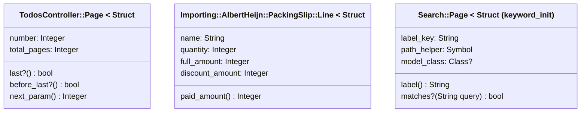

# Plan: Bump gems with open security advisories and clear rubocop on main

From `intent.md` (2026-11-06). Status: accepted.

## Design

### Domain terms

- No glossary term changes. Nothing is added to `GLOSSARY.md`. The glossary terms Delivery and Packing slip appear in touched code and keep their meaning.
- Working terms for this plan only:
  - **Advisory gem**: a gem that `intent.md` names: the Rails 8.1.4 components (`rails`, `railties`, `actioncable`, `actionmailbox`, `actionmailer`, `actionpack`, `actiontext`, `actionview`, `activejob`, `activemodel`, `activerecord`, `activestorage`, `activesupport`), `rack`, `nokogiri`, `loofah`, `rails-html-sanitizer`, `addressable` and `sqlite3`.
  - **Conservative patch update**: `bundle update <advisory gems> --conservative --patch --strict`. It moves only the named gems to their newest patch release and leaves every other gem on its current version.
  - **Signature**: an RBS inline comment the 1.0.0 cops require: `#: (Type name) -> Return` directly above a public `def`, or `#: Type` directly above an `attr_*`.
  - **Struct reopen**: a `class X ... end` written directly after `X = Struct.new(...)` that holds, unchanged, the methods the `Struct.new` block held before.
  - **Honest untyped**: `untyped` used only where no single class or union is true, or where the method body does not settle the type.

### Diagrams

Not affected: the change adds no object, message, association, table or state. Three Structs keep their members and methods; only where the methods are written moves:



### Signatures

The bump changes no Ruby. The rubocop fix adds signatures to every public method and `attr_*` the cops name, 391 places in 120 files. The convention per recurring shape:

| Shape | Signature | Example |
|---|---|---|
| Controller action | `#: () -> void` | `app/controllers/appropriations_controller.rb` (existing precedent) |
| MCP tool `self.call` | Keyword types follow its `input_schema`: integer → `Integer`, number → `Numeric`, string → `String`, boolean → `bool`, optional → `?name:`. `server_context: untyped`. Returns `MCP::Tool::Response` | `app/tools/assistant/set_budget_amount.rb`: `#: (budget_id: Integer, category_id: Integer, amount: Numeric, server_context: untyped) -> MCP::Tool::Response`; `app/tools/assistant/set_payment_provider.rb` takes `shared: bool` |
| `Assistant::Tool` class helpers made private with `private_class_method` | Real types | `#: (Integer? cents) -> String` above `self.euros` |
| Helper that returns HTML | `ActiveSupport::SafeBuffer` | `app/helpers/appropriations_helper.rb` (existing precedent) |
| Helper that returns text | `String` or `String?` | `app/helpers/money_helper.rb` |
| Money | `Integer` for cents; the parameter name says the unit (`cents`, `amount`) | `#: (Integer? cents) -> String` |
| Method that returns a relation | `ActiveRecord::Relation`, without type arguments | `app/models/receipt/payment_matching.rb:53` (existing precedent) |
| `scope` | No signature: the cops never ask for one, and rbs-inline does not attach one | see the MethodCommentSpacing fix |
| Migration and data migration `up`, `down`, `change` | `#: () -> void` | `db/data/*.rb`, `db/cable_migrate/*.rb`, `db/queue_migrate/*.rb` |
| Job `perform`, channel `connect`, `initialize` | argument types, `-> void` | `app/channels/application_cable/connection.rb` |
| Predicate | `bool`, never `Boolean` | `app/models/importing/albert_heijn/packing_slip.rb:23` |
| `attr_*` listing names of different types | one `#: untyped` line; the line is not split | `app/models/importing/albert_heijn/packing_slip.rb:21` |

Struct attribute annotations, with aligned trailing comments:

```ruby
Page = Struct.new(
  :number,       #: Integer
  :total_pages   #: Integer
)

class Page
  #: () -> bool
  def last?      = number >= total_pages
  #: () -> bool
  def before_last? = number < total_pages
  #: () -> Integer
  def next_param = number + 1
end
```

- `TodosController::Page`: as above.
- `Importing::AlbertHeijn::PackingSlip::Line`: `name` `String`; `quantity`, `full_amount`, `discount_amount` `Integer`; `paid_amount` `#: () -> Integer`.
- `Search::Page` (`keyword_init: true` stays): `label_key` `String`, `path_helper` `Symbol`, `model_class` `Class?`; `label` `#: () -> String`; `matches?` `#: (String query) -> bool`.
- `ProductType::Totals`: `spent`, `count`, `on_bonus_count` `Integer`.
- `Todo::Item`: `kind` `Symbol`; `date` from the column type in `db/schema.rb`; `record` the union of the classes `app/models/todo.rb` builds it from (read the file; the YARD tag omits `Product`).

Rules for every signature:

- Read the method body. A concrete type is used only when the body, `db/schema.rb`, the tool's `input_schema` or a test settles it. Otherwise use `untyped`. A wrong concrete type is worse than `untyped`, because nothing checks it.
- `untyped` is honest for: `server_context`, `**options` passed on to Rails, `public_send` results, strong-parameter values and duck-typed arguments.
- Keep existing YARD comments. The signature is the last comment line, directly above the `def` or `attr_*`, with no blank line between.
- Where a YARD tag disagrees with the body, trust the body. Do not edit the YARD tag; list the disagreement in the commit body.
- Never touch an existing signature in the 14 already annotated files.

Not checked: this project declined Steep and rbs_rails. Signatures are checked for syntax by rubocop's `Style/RbsInline/InvalidTypes` and by the rbs-inline parse in `## Proof`, not for truth.

### Complexity

Not affected: comments have no runtime cost. A Struct reopen defines the same methods on the same class at load time, so dispatch does not change. No query changes.

### Invariants

- `Gemfile` does not change. Check: `git diff --quiet main -- Gemfile`.
- In `Gemfile.lock`, only advisory gems change version, dependency list or checksum; `PLATFORMS`, sources, `DEPENDENCIES`, `RUBY VERSION` and `BUNDLED WITH` stay identical. Check: the lockfile check in `## Proof`.
- Every advisory gem reaches its minimum patched version and stays inside its current minor version. `--patch --strict` enforces it; the lockfile check proves it.
- Outside the three Struct reopen files, the Ruby diff adds only comment lines and deletes only the two comment lines in `app/models/receipt/payment_matching.rb`. Two more exceptions: `ProductType::Totals` and `Todo::Item` become one `Struct.new` member per line, each with a trailing `#:`, with the same members in the same order. Check: the comment-only check in `## Proof`.
- Each reopened class keeps its methods, bodies and visibility. Existing tests enforce it (see `## Proof`).
- `.rubocop.yml` does not change and no `rubocop:disable` comment is added. Check: `git diff --quiet main -- .rubocop.yml` and `git diff main -- app db script lib | grep -c 'rubocop:disable'` prints 0.
- Every signature parses as RBS and attaches. Check: the rbs-inline parse in `## Proof`.

### Alternatives

- **A. Accurate signatures with honest `untyped`, Struct methods moved into a reopened class (chosen).** Comments only, apart from three pure moves. The signatures tell a reader and a later type checker something true. The cost is reading each body.
- **B. `untyped` everywhere (rejected).** `#: (untyped) -> untyped` satisfies the cop fastest but documents nothing. The `ruby-style` skill wants real signatures on public methods, and a later Steep adoption would redo all 391.
- **C. Convert the three Structs to `Data.define` or plain classes (rejected).** `Data` is immutable and rejects positional and keyword arguments differently from `Struct`, so `Search::Page.new(label_key: ...)` and `PackingSlip::Line.new(name, quantity, ...)` would need checking and could change behaviour. That is a refactor, out of scope.
- Gem bump alternatives, decided in the earlier plan and unchanged: one commit per gem family is rejected because the families are coupled (actionview 8.1.4.1 needs rails-html-sanitizer >= 1.7.2, which needs loofah >= 2.25.3, which needs nokogiri >= 1.19.5), so no intermediate commit passes Bundler Audit; `bundle update rails` without `--conservative` is rejected because it also bumps i18n, zeitwerk and concurrent-ruby.

## Design decisions

- The three `StructNewWithBlock` offenses cannot be fixed with comments. The cop requires the methods to leave the `Struct.new` block. `intent.md` says "Annotations are comments only" and puts refactoring out of scope, but it also names these three offenses, forbids disable comments and config edits, and requires zero offenses. This plan resolves it with a pure move: same method bodies, same class, no behaviour change. This is the only non-comment Ruby change besides the member-per-line layout of `ProductType::Totals` and `Todo::Item`, which the annotation needs. This tension with intent's "comments only" constraint goes to Etienne as an open decision in the plan stage's report; the plan proceeds with the move, because no other route meets the intent's zero-offense criterion.
- `MethodCommentSpacing` in `app/models/receipt/payment_matching.rb:17-18`: delete the `#` spacer and the `#: () -> ActiveRecord::Relation` line above `scope :unlinked_deliveries`. The prose comment above it stays. Moving the type into an `@rbs!` block would type it as a module instance method, which is wrong.
- Migrations under `db/cable_migrate/` and `db/queue_migrate/` get `#: () -> void`. The gem excludes only `**/db/migrate/**`; widening that exclude is a `rubocop-eirvandelden` change, out of scope here.
- Existing YARD tags stay, although the `ruby-style` skill says personal projects use no YARD tags. Removing them is a refactor, out of scope.
- The bump lockfile is already staged in this worktree from the earlier plan's implementation. The first step verifies it with the lockfile check before committing; it reruns the update only if the check fails.
- Commit grouping follows the pre-commit hook. Lefthook runs `bundle exec rubocop --force-exclusion {staged_files}` on every staged `.rb` file, so each commit must leave every file it touches fully clean. Commits therefore group whole files, never one offense kind across a half-annotated file.
- No new tests. Signatures are comments; the three Struct moves are covered by existing tests. Configuration has no tests.
- `TodosController::Page#last?` has no caller in `app/`. It stays: removing it is a refactor, out of scope. Note it as an orthogonal follow-up.
- No conflict with `intent.md`'s `## Decisions`: Rails is bumped on this branch, and the rubocop offenses are fixed here by annotating.

## Integration points

- Bundler and the `gem.coop` source: the update fetches the new gem versions.
- Lefthook: pre-commit runs rubocop on staged `.rb` files; pre-push runs rubocop, herb, brakeman, Bundler Audit and `bundle exec rails test`. System tests do not run there. Both hooks live in `~/.config/git/hooks` and call lefthook.
- GitHub Actions CI (`.github/workflows/ci.yml`): calls the reusable `eirvandelden/appkit` Rails workflow with `run_system_tests: true`, plus a herb job. The pull request's CI result is the proof on Linux.
- Production deploy installs from the same `Gemfile.lock`. Deploy files do not change.
- `rubocop-eirvandelden` 1.0.0 and `rubocop-rbs_inline` 2.0.0: their cops define what a passing signature is. Neither gem changes.
- Code paths the advisory fixes can touch: Active Storage serving (`rails_blob_path(..., disposition: :inline)` in `app/views/transactions/show.html.erb`, `app/views/receipts/_basket.html.erb`, `app/views/chattels/show.html.erb`); multipart uploads (the `proof_of_purchase` file field); sanitizing (`simple_format(@chattel.notes)` in `app/views/chattels/show.html.erb`); cookies (the `session_token` cookie from `appkit`, covered by `test/integration/session_cookie_test.rb`); host handling (`allowed_hosts` in `app/controllers/assistant_controller.rb`, covered by the assistant integration tests).

## Files that change

- `Gemfile.lock` — the advisory gems move to their patched versions. Nothing else.
- `app/models/receipt/payment_matching.rb` — two comment lines above `scope :unlinked_deliveries` are deleted.
- `app/controllers/todos_controller.rb`, `app/models/importing/albert_heijn/packing_slip.rb`, `app/models/search.rb` — the `Struct.new` block methods move into a reopened class; members and methods get signatures; the rest of each file gets its signatures.
- `app/models/product_type.rb`, `app/models/todo.rb` — Struct member annotations, plus the file's other signatures.
- Every other file `bundle exec rubocop` names: 32 files under `app/controllers`, 9 under `app/helpers`, the rest of the 42 under `app/models`, 23 under `app/tools`, 2 under `app/jobs`, 1 under `app/channels`, 8 under `db/data`, 1 under `db/cable_migrate`, 1 under `db/queue_migrate`, and `script/admin/prepare-backup` — signature comments only.

## Order of work

No acceptance criterion needs a new test, so the work starts with the change and the checks run after it. Run all commands from the worktree root. Each commit stages files by name.

1. Gem bump. Run the lockfile check from `## Proof` against the staged `Gemfile.lock`. If `Gemfile.lock` is not staged or the check fails, run the conservative patch update and check again:
   ```
   bundle update rails railties actioncable actionmailbox actionmailer actionpack actiontext actionview activejob activemodel activerecord activestorage activesupport rack nokogiri loofah rails-html-sanitizer addressable sqlite3 --conservative --patch --strict
   ```
   Do not pipe its output into a file; the `useragent` GitHub gem prints "Fetching" lines to stdout. If gems are missing, install with `bi`, never `bundle install`.
2. Run `bundle exec bundler-audit check --update`: "No vulnerabilities found". Run `git diff --quiet main -- Gemfile`. Clear `tmp/cache/bootsnap`. Run `PATH="$PWD/bin:$PATH" bin/rails test`. Commit `Gemfile.lock` alone: `chore(deps): bump gems with security advisories`.
3. Run `bundle exec rubocop --format offenses` and record the starting count (410).
4. Fix `app/models/receipt/payment_matching.rb` (MethodCommentSpacing). Run `bundle exec rubocop app/models/receipt/payment_matching.rb` and `PATH="$PWD/bin:$PATH" bin/rails test test/models/receipt/payment_matching_test.rb`. Commit: `style: drop the signature above a scope in Receipt::PaymentMatching`.
5. Struct reopens. In `app/controllers/todos_controller.rb`, `app/models/importing/albert_heijn/packing_slip.rb` and `app/models/search.rb`: move the block methods unchanged into `class X ... end` directly after the `Struct.new` call, nested in the same owner. Annotate the members and the moved methods, and every other public method in those files. `bundle exec rubocop -a --only Style/RbsInline/MissingStructClassAnnotation <file>` may lay out the member lines; check `StructClassCommentAlignment` afterwards. Run `bundle exec rubocop <the three files>` and the tests that cover the moved methods: `test/models/importing/albert_heijn/packing_slip_test.rb`, `test/models/search_test.rb`, `test/integration/pagination_navigation_test.rb`, `test/integration/todos_index_test.rb`. Commit: `refactor: move Struct block methods into reopened classes`.
6. Struct member annotations in `app/models/product_type.rb` and `app/models/todo.rb`, with their other signatures. Rubocop on both files clean. Commit: `style: annotate Struct members in ProductType and Todo`.
7. `app/controllers` (remaining files). Rubocop on `app/controllers` clean. Commit: `style: add RBS signatures to controllers`.
8. `app/models` (remaining files). Rubocop on `app/models` clean. Commit: `style: add RBS signatures to models`.
9. `app/tools`. Rubocop on `app/tools` clean. Commit: `style: add RBS signatures to assistant tools`.
10. `app/helpers`, `app/jobs`, `app/channels`. Rubocop on those clean. Commit: `style: add RBS signatures to helpers, jobs and channels`.
11. `db/data`, `db/cable_migrate`, `db/queue_migrate`, `script/admin/prepare-backup`. Rubocop on those clean. Commit: `style: add RBS signatures to data migrations and scripts`.
12. A commit that grows past about 400 changed lines splits by subdirectory (for example `app/models/importing` apart). Each commit message body lists the YARD tags in its files that disagree with the method body.
13. Run every check in `## Proof`: full `bundle exec rubocop`, the comment-only check, the rbs-inline parse, `PATH="$PWD/bin:$PATH" bin/rails test`, `PATH="$PWD/bin:$PATH" bin/rails test:system`, `npx @herb-tools/linter app/views/` (run `npm ci` first if `node_modules` is missing), `bundle exec brakeman --no-pager -q`, `bundle exec bundler-audit check`.
14. Manual check (rule 22) for the gem bump. Copy the main checkout's development databases with the `using-sqlite-worktrees` skill's helper; if it misses `storage/db/`, copy each file with `sqlite3 <main checkout>/storage/db/<file> ".backup storage/db/<file>"`. Run `PATH="$PWD/bin:$PATH" bin/rails db:migrate`, then `DISABLE_SSL=1 PATH="$PWD/bin:$PATH" bin/dev -p 3001`, and browse `http://127.0.0.1:3001`. Sign in, then:
    - attach a PDF as proof of purchase on a transaction, save, and open the attachment link: the PDF shows;
    - set a chattel's notes to `<script>alert(1)</script><a href="javascript:alert(1)">x</a> line` and open the chattel: no alert runs, and the link has no `javascript:` href;
    - open the todo page and the search dialog: both render as before;
    - record the results, revert the chattel notes, and never commit the re-dumped `db/schema.rb`.
15. `git status --short` shows nothing outside the change folder. Push with the worktree's `bin/` first on `PATH`: `PATH="$PWD/bin:$PATH" git push`. The pre-push hook runs rubocop, herb, brakeman, Bundler Audit and the test suite again.
16. Hand over to the coordinator's chain: review, then `deliver`, then `gh pr checks --watch`.

## Risks

- A wrong concrete type stays silent, because no type checker runs. Mitigation: the "body settles it, else `untyped`" rule, and the reviewer samples helpers and Struct members against their bodies.
- A reopened `class Page` written outside its owner would define a new top-level `Page`. Mitigation: the reopen stays nested; the covering tests fail if the methods go missing.
- `Search::Page` relies on `keyword_init: true`. Mitigation: the keyword stays on the `Struct.new` call, and `test/models/search_test.rb` builds pages through `PAGES`.
- The diff is about 420 added lines in about 120 files. Each hunk is trivial, and per-directory commits keep review possible.
- A patch release changes behaviour the suite does not cover: Active Storage serving, multipart upload and sanitised notes have no test; step 14 covers them by hand.
- Session cookies from the Rails session store gain a `SameSite` attribute. The app's own `session_token` cookie comes from `appkit`, and its tests stay the guard.
- `test/system/budgets_test.rb` "suggesting amounts" is a known date flake: it fails on days a suggested amount ends in 0. Red on only that test is not a regression from this change. Never skip or weaken it.
- Newer patch releases may appear before step 1 reruns the update. The command then picks them up; `--patch --strict` keeps them inside the minor. The Proof versions are minimums.
- A patch release adds a deprecation warning. A fix that needs production code goes beyond this plan, so the implementer reports it to the coordinator instead of improvising.
- Rubocop prints "already initialized constant RuboCop::Cop::Locale::LiteralMessage" warnings in this worktree, because the main checkout's copy of `lib/rubocop/cop/locale/literal_message.rb` also loads. They are warnings, not offenses; do not change the require.
- Rejected: a full `bundle update`, a Rails minor upgrade, any `Gemfile` constraint change, editing `.rubocop.yml`, pinning `rubocop-eirvandelden` back, and `untyped`-everywhere signatures.

Out of scope: any other gem, Ruby, a Rails minor or major upgrade, `config.load_defaults`, deploy files, new tests, removing YARD tags, removing `TodosController::Page#last?`, a `db/*_migrate` exclude in `rubocop-eirvandelden`, Steep or rbs_rails adoption.

## Proof

- Bundler Audit reports no vulnerabilities → check: `bundle exec bundler-audit check --update` prints "No vulnerabilities found".
- `bundle exec rubocop` reports no offenses → check: `bundle exec rubocop` exits 0 with "no offenses detected"; `git diff --quiet main -- .rubocop.yml` exits 0; `git diff main -- app db script lib | grep -c 'rubocop:disable'` prints 0.
- The full test suite, system tests, rubocop, herb and brakeman pass → check: `PATH="$PWD/bin:$PATH" bin/rails test`, `PATH="$PWD/bin:$PATH" bin/rails test:system`, `bundle exec rubocop`, `npx @herb-tools/linter app/views/`, `bundle exec brakeman --no-pager -q`, all exit 0; then green CI on the pull request.
- The `Gemfile.lock` diff holds only the advisory gems and their direct dependencies → check: the lockfile check below exits 0 and prints "Lockfile OK"; `git diff --quiet main -- Gemfile` exits 0.
- Invariant: every advisory gem is at least its patched version and inside its current minor, enforced by `--patch --strict` → check: the lockfile check below.
- Invariant: `PLATFORMS`, sources, `DEPENDENCIES`, `RUBY VERSION`, `BUNDLED WITH` and the checksums of non-advisory gems are unchanged, enforced by `--conservative` → check: the lockfile check below.
- Invariant: the Ruby diff is comments only outside the three Struct reopen files and the two member-per-line Structs, enforced by review → check: the comment-only check below exits 0.
- Invariant: every signature parses and attaches, enforced by `Style/RbsInline/InvalidTypes` → check: `bundle exec rbs-inline --opt-out --output=<scratch>/sig app db script/admin/prepare-backup` exits 0, then `bundle exec rbs parse $(find <scratch>/sig -name '*.rbs')` exits 0. Verified on 2026-11-06 that both run and exit 0 on the current tree, `script/admin/prepare-backup` included.
- Invariant: the moved Struct methods behave as before, enforced by the existing tests → `test/models/importing/albert_heijn/packing_slip_test.rb` "a line says what was packed, how much of it, and what it cost" (`Line#paid_amount`); `test/models/search_test.rb` "results includes pages matching nav labels" (`Search::Page#label`, `#matches?`); `test/integration/pagination_navigation_test.rb` "todo pagination is clamped and hides next on the last page" (`TodosController::Page#before_last?`, `#next_param`).
- The app behaves as before → check: step 14's manual checks, plus the green suite and CI.

The comment-only check. Run from the worktree root. It exits 0 when clean; otherwise it prints every added or removed Ruby line that is not a comment, outside the three Struct reopen files, and exits 1. Verified on 2026-11-06: a sample diff with a `def` line is flagged, and Struct member lines pass.

```
out=$(git diff -U0 main -- app db script lib \
  ':!app/controllers/todos_controller.rb' ':!app/models/importing/albert_heijn/packing_slip.rb' ':!app/models/search.rb' \
  | grep -E '^[+-][^+-]' | grep -vE '^[+-][[:space:]]*#' \
  | grep -vE '^[+-][[:space:]]*:[a-z_]+,?[[:space:]]+#:' | grep -vE '^[+-][[:space:]]*\)?$' \
  | grep -vE '^[+-][[:space:]]*[A-Z][A-Za-z]* = Struct\.new\(')
test -z "$out" || { printf '%s\n' "$out"; false; }
```

The last three filters allow the Struct member lines in `app/models/product_type.rb` and `app/models/todo.rb`, which become one member per line with a trailing `#:`. Any line it prints must be explained or reverted.

The lockfile check. Save it to a scratch path outside the repository and run it from the worktree root with `bundle exec ruby <path>`. It also compares `RUBY VERSION`, `BUNDLED WITH` and `CHECKSUMS`, allowing checksum changes only for advisory gems. Verified on 2026-11-06: it fails on `main`'s lockfile with one "below" line per advisory gem, fails on a copy of the staged lockfile with one tampered `zeitwerk` checksum, and passes on the staged lockfile.

```ruby
require "bundler"

RAILS = %w[rails railties actioncable actionmailbox actionmailer actionpack actiontext actionview
           activejob activemodel activerecord activestorage activesupport].freeze
MINIMUM = RAILS.to_h { [it, "8.1.4.1"] }.merge(
  "rack" => "3.2.8", "nokogiri" => "1.19.5", "loofah" => "2.25.3", "rails-html-sanitizer" => "1.7.2",
  "addressable" => "2.9.1", "sqlite3" => "2.10.2"
).freeze

before_text = `git show main:Gemfile.lock`
after_text = File.read(ENV.fetch("LOCKFILE", "Gemfile.lock"))
before = Bundler::LockfileParser.new(before_text)
after = Bundler::LockfileParser.new(after_text)
errors = []
errors << "PLATFORMS changed" unless before.platforms.sort_by(&:to_s) == after.platforms.sort_by(&:to_s)
errors << "GIT/GEM sources changed" unless before.sources.map(&:to_lock) == after.sources.map(&:to_lock)
errors << "DEPENDENCIES changed" unless before.dependencies == after.dependencies
errors << "RUBY VERSION changed" unless before.ruby_version == after.ruby_version
errors << "BUNDLED WITH changed" unless before.bundler_version == after.bundler_version

index = ->(lock) { lock.specs.to_h { [[it.name, it.platform.to_s], it] } }
old_specs = index.(before)
new_specs = index.(after)
same = ->(a, b) { a && b && a.version == b.version && a.dependencies.sort_by(&:name) == b.dependencies.sort_by(&:name) }
changed = (old_specs.keys | new_specs.keys).reject { same.(old_specs[it], new_specs[it]) }.map(&:first).uniq
extra = changed - MINIMUM.keys
errors << "unexpected gems changed: #{extra.join(', ')}" if extra.any?

checksums = ->(text) { text[/^CHECKSUMS\n(.*?)(?:\n\n|\z)/m, 1].to_s.lines.map(&:strip).to_set }
checksum_names = (checksums.(before_text) ^ checksums.(after_text)).map { it[/\A\S+/] }.uniq
extra_checksums = checksum_names - MINIMUM.keys
errors << "unexpected CHECKSUMS changed: #{extra_checksums.join(', ')}" if extra_checksums.any?

MINIMUM.each do |name, minimum|
  old_version = old_specs.values.find { it.name == name }.version
  versions = new_specs.values.select { it.name == name }.map(&:version).uniq
  versions.each do |version|
    errors << "#{name} #{version} is below #{minimum}" if version < Gem::Version.new(minimum)
    errors << "#{name} #{version} left minor #{old_version.segments.first(2).join('.')}" unless version.segments.first(2) == old_version.segments.first(2)
  end
end

abort errors.join("\n") if errors.any?
puts "Lockfile OK. Changed: #{changed.sort.join(' ')}"
```

Per changed file, the unit tests expected:
- `Gemfile.lock`: none; configuration has no tests.
- Signature comments in every file: none; comments carry no behaviour.
- `app/controllers/todos_controller.rb`, `app/models/importing/albert_heijn/packing_slip.rb`, `app/models/search.rb`: none new; the existing tests named above cover the moved methods and must stay green unchanged.

Test setup: none new. The existing fixtures and suite run unchanged.

---
Domain skills applied: dependencies (named-gem update only, no new pins, no major skip, `bi` for installs), ruby-style (inline RBS `#:` signatures on public methods and `attr_*`), software-design (alternatives compared by two architects), rails-testing (no tests for comments, existing tests cover the moves).

## Critique

### Round 1 (codex exec -p terra)

- The intent permits comments only, but the plan moves methods into reopened classes; amend and re-accept the intent → dismissed: the intent itself names the three StructNewWithBlock offenses, requires zero offenses and forbids disable comments and config edits, so a pure move is the only route; the tension is recorded in Design decisions and raised to Etienne as a Decision needed line in the plan stage's report
- The signature table omits JSON Schema booleans, and `SetPaymentProvider` has `shared: boolean` → fixed (table maps boolean to `bool` and names `shared: bool`)
- The RBS proof generates signatures for `app db` only, but step 11 annotates `script/admin/prepare-backup` → fixed (the rbs-inline proof includes `script/admin/prepare-backup`, verified to generate and parse)
- The invariant says every other Ruby change is a comment, yet `ProductType::Totals` and `Todo::Item` need a multiline `Struct.new` → fixed (invariant, design decision and Proof line list both as exceptions)
- The comment-only pipeline exits 1 when clean and 0 on violations → fixed (wrapped so it exits 0 when clean and prints and exits 1 otherwise)
- The lockfile check ignores `RUBY VERSION`, `BUNDLED WITH` and unrelated `CHECKSUMS` changes → fixed (the check compares all three and allows checksum changes only for advisory gems; verified against main, the staged lockfile and a tampered copy)
