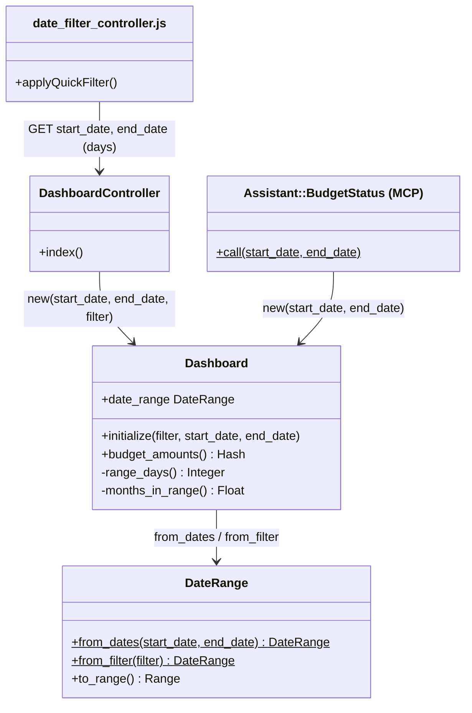
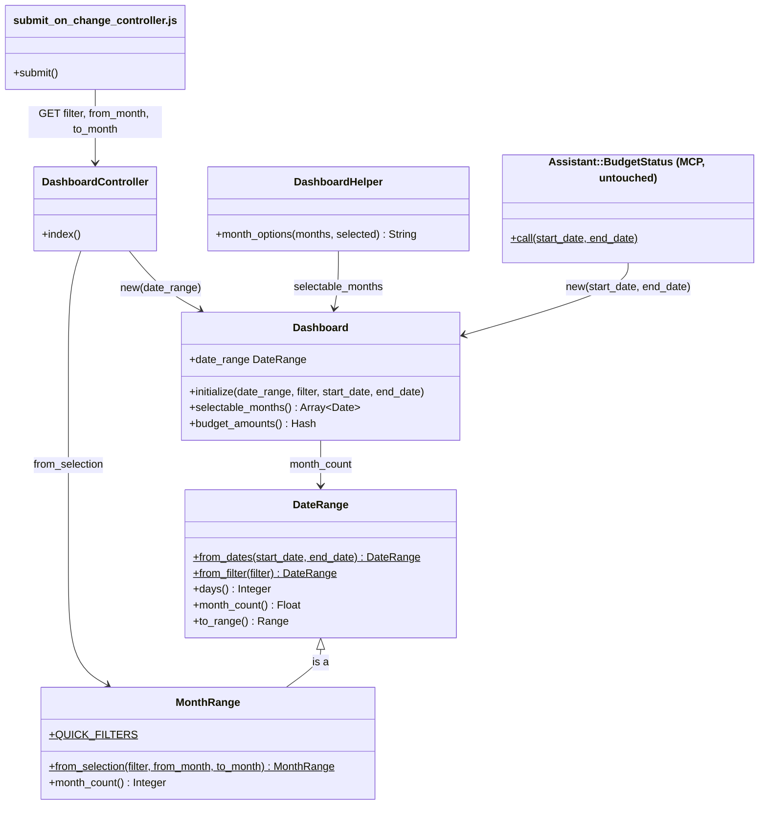
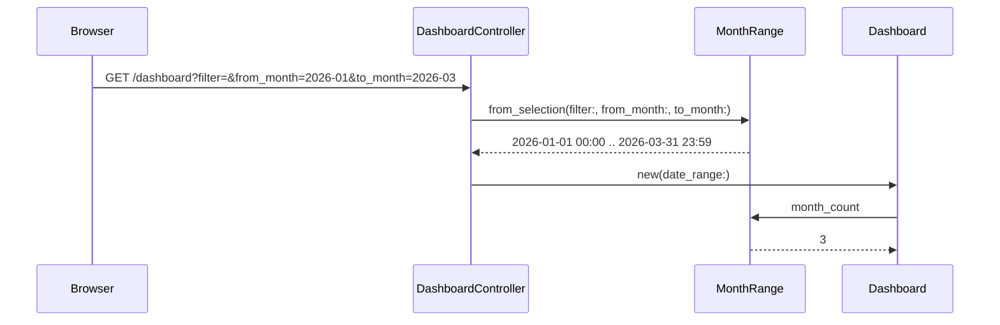

# Plan: Pick whole months on the dashboard

From `intent.md` (2026-10-22). Status: accepted.

## Design

### Domain terms

No `GLOSSARY.md` exists yet. These terms are proposals; none uses an avoided word.

- **Period** — the span the dashboard reports on: from 00:00 on the first day of its from month to the end of the last day of its to month. Held in a `MonthRange`.
- **From month / to month** — the first and last calendar month of a period, written `YYYY-MM` in the request (`from_month`, `to_month`).
- **Quick filter** — a named period relative to today: `current_month`, `last_month`, `three_months`, `current_year`, `last_year`.
- **Month count** — the number of months a span stands for when a monthly budget is scaled to it: whole calendar months for a period or any span of whole calendar months, days / 30 for any other span.
- **Budget goal** — the stored monthly `BudgetCategory#amount` times the month count (the dashboard's budget and target columns).

### Diagrams

Before:



After:





### Signatures

`DateRange` — an inclusive time span used to filter transactions. `from_dates`, `from_filter`, `FILTERS`, `initialize` and `to_range` do not change.

```ruby
# Number of calendar days in the span, both ends included.
#: () -> Integer
def days

# How many months a monthly budget counts for over this span: days / 30, the existing rule.
#: () -> Float
def month_count
```

`MonthRange < DateRange` — a period of whole calendar months, the only span the dashboard page builds. New file `app/models/month_range.rb`.

```ruby
# The quick filters the dashboard offers; each one is a whole-month period.
QUICK_FILTERS = %w[current_month last_month three_months current_year last_year].freeze #: Array[String]

# The period a dashboard visitor chose: a known quick filter wins, then the two months, else the current month.
#: (filter: String?, from_month: String?, to_month: String?, ?today: Date) -> MonthRange
def self.from_selection(filter:, from_month:, to_month:, today: Date.current)

# The number of calendar months in the period.
#: () -> Integer
def month_count
```

`MonthRange` keeps `DateRange#initialize(start_date, end_date)` and does not override it. It makes `new` and the inherited `from_dates` and `from_filter` private with `private_class_method :new, :from_dates, :from_filter`. So `from_selection` is the only public way to build one, and no caller can build a `MonthRange` with exact days.

Private class methods of `MonthRange`:

- `spanning(first_month, last_month) #: (Date, Date) -> MonthRange` is the one builder: `new(first_month.beginning_of_month.beginning_of_day, last_month.end_of_month.end_of_day)`. Every other builder goes through it.

- `quick_filter(filter, today) #: (String?, Date) -> MonthRange?` covers these filters:
  - `current_month`: this month.
  - `last_month`: last month.
  - `three_months`: three months ago through last month, as today.
  - `current_year`: January through this month.
  - `last_year`: January through December of last year.
  - Any other name: nil.
- `picked(from_month, to_month) #: (String?, String?) -> MonthRange?` returns nil when a month is unreadable or the to month is before the from month.
- `month(value) #: (String?) -> Date?` accepts only `/\A\d{4}-(0[1-9]|1[0-2])\z/`, so `2026-10-15` is unreadable.

`Dashboard` — financial dashboard data over one span.

```ruby
# A given date_range wins; else exact days (the MCP tool); else the filter, which defaults to the current month.
#: (?date_range: DateRange?, ?filter: String?, ?start_date: (String | Date)?, ?end_date: (String | Date)?) -> void
def initialize(date_range: nil, filter: nil, start_date: nil, end_date: nil)

# The months the pickers offer, newest first. Earliest: the first booked month or the span's first month.
# Latest: the last booked month, the current month or the span's last month.
#: () -> Array[Date]
def selectable_months

# Body unchanged; the private months_in_range becomes date_range.month_count.
#: () -> Hash[Category, BigDecimal]
def budget_amounts
```

The private `range_days` is replaced by `date_range.days` in `historical_averages`; its result does not change.

`DashboardHelper` — presentation of the dashboard filter form.

```ruby
# Option tags grouped per year, newest first, each month labelled with the locale's month_and_year format
# and valued YYYY-MM. The selected date is compared as YYYY-MM.
#: (Array[Date] months, selected: Date) -> ActiveSupport::SafeBuffer
def month_options(months, selected:)
```

`DashboardController#index` — `@dashboard = Dashboard.new(date_range: MonthRange.from_selection(filter: params[:filter], from_month: params[:from_month], to_month: params[:to_month]))`. It never reads `start_date` or `end_date`.

`submit_on_change_controller.js` — a new Stimulus controller with one action, `submit() { this.element.requestSubmit() }`. `eagerLoadControllersFrom` registers it automatically as `submit-on-change`.

Not checked: journal_administration has no Steep or rbs_rails. The `#:` comments document the types only.

### Complexity

- `MonthRange.from_selection`, `MonthRange#month_count`, `DateRange#days` and `DateRange#month_count` are O(1) and run no query.
- `Dashboard#selectable_months` runs 2 queries, `Transaction.minimum(:booked_at)` and `Transaction.maximum(:booked_at)`, memoized. The count does not depend on the number of transactions or months. `booked_at` has no index, so each is a table scan over one household's bank history. Building the list is O(m) for m months, about 12 per year of history.
- The view renders 2 × m options.
- Every other dashboard query is unchanged.

### Invariants

1. A period from `MonthRange.from_selection` starts at 00:00 on the first day of a month and ends at the end of the last day of a month. The private `MonthRange.spanning` enforces it: it is the only builder, because `new`, `from_dates` and `from_filter` are private on `MonthRange`.
2. A missing, unreadable, day-carrying or reversed month selection gives the current month. `MonthRange.month`, the reversed guard in `picked` and the fallback in `from_selection` enforce it.
3. A period's budget goal is the stored monthly amount times its integer month count. `MonthRange#month_count` and `Dashboard#budget_amounts` enforce it.
4. A span that is whole calendar months, from any caller (the MCP tool included), is a `MonthRange` and counts whole months. Any other span keeps the days / 30 budget goal. `DateRange.from_dates` returns a `MonthRange` when it starts on the first day of a month and ends on the last day of a month, and a plain `DateRange` otherwise. `Dashboard#initialize` builds its span through `DateRange.from_dates`, so the MCP tool needs no code change. (Amended after Etienne's decision: MCP counts whole months.)
5. The dashboard form has no field, option value or label with a day of the month. The view (selects only, no date field) and `month_options` enforce it.
6. The selected from month and to month are always among the options. `selectable_months` enforces it, because it widens its span to the period.

### Alternatives

- **A: least change.** It uses `<input type="month">` and keeps the quick filter in JavaScript. Rejected, for three reasons:
  - `date_filter_controller.js` also drives the transactions page's day fields (`app/views/transactions/_filters.html.erb`). Changing its targets and its `current_year` end breaks that page, which is out of scope.
  - Desktop Firefox and Safari show `type="month"` as a plain text box. Chrome labels it in the browser language, not the app locale.
  - The quick-filter month maths would stay duplicated in JavaScript and Ruby.
- **B: deepest module.** A new `Period` value object replaces `DateRange`. Rejected, because it touches four things outside this change:
  - It deletes `DateRange` and rewrites every `filter: "year_to_date"` test.
  - It rewrites `historical_averages` to a 12-month lookback, which is out of scope.
  - It shrinks the shared `date_filter_controller.js` to a submit action, which breaks the transactions page.
  - It removes the `start_date` and `end_date` locale keys that the transactions page still uses.
- **C: robust UI.** Month selects with a server-resolved quick filter. Chosen, with three changes:
  - From B, the whole-month rule lives in its own class, `MonthRange`. The dashboard request builds one, and so does `DateRange.from_dates` for a whole-month span, so the MCP tool counts months too.
  - From A, `DateRange` and `Dashboard` keep their entry points, so the MCP tool and the existing model tests stay as they are.
  - appkit's `auto-submit` controller submits on connect, not on change. A new `submit-on-change` controller handles the quick filter instead.

## Design decisions

- **The MCP tool counts whole months too.** `Assistant::BudgetStatus` calls `Dashboard.new` with exact days. Etienne decided that a span of whole calendar months scales by months there as well, so a whole October reports 1.480,00 through MCP and the dashboard alike. `DateRange.from_dates` returns a `MonthRange` for such a span and a plain `DateRange` for any other. `Assistant::BudgetStatus` keeps its code. Spans that are not whole months (for example 15 to 20 October) keep days / 30.
- **Month selects, not `<input type="month">`.** Desktop Firefox and Safari do not support the month input. The selects label months in the app locale through the existing `date.formats.month_and_year` (`"%B %Y"` in en, nl and it).
- **The quick filter resolves on the server.** The select gets `name="filter"` and submits on change. It renders blank after every request. A later Apply with changed months therefore sends `filter=""`, and the months win. The browser clock no longer decides month edges.
- **The month selects submit only through the Apply button.** Choosing a range needs two changes. A submit on the first change would show a period nobody chose.
- **`current_year` runs from January through the end of the current month**, as the intent decided. This lives in `MonthRange`. `DateRange.from_filter` and its `year_to_date` and `month_to_date` branches stay unchanged, but the dashboard request can no longer reach them.
- **The option span runs from the first booked month to the last booked month, widened to today and to the period.** Every month with transactions stays reachable, future-booked ones included. With no transactions, the span is the period and the current month.
- **The Italian locale gets the new keys too.** Intent names only nl and en. `it.yml` exists, and `test/i18n_test.rb` reports missing keys.
- **The old `dashboard.filters.start_date`, `end_date` and `current_year` keys stay.** The transactions page uses them.
- **`historical_averages` keeps its formula.** Intent puts it out of scope beyond whole-month periods, and its periods are whole months now.

## Integration points

- `Assistant::BudgetStatus` (the MCP `budget_status` tool) reads `Dashboard#budget_amounts`, `#active_budget`, `#budget_actuals` and `#date_range`. Its code stays unchanged. Its goal for a whole-month span now counts months.
- `app/views/transactions/_filters.html.erb` and `app/javascript/controllers/date_filter_controller.js` stay untouched and keep their day fields.
- `Budget` and `BudgetCategory` are read only.

## Files that change

- `app/models/date_range.rb` — public `days` and `month_count` (days / 30.0); `from_dates` returns a `MonthRange` for a whole-month span.
- `test/integration/assistant_test.rb` — an MCP test for 1 to 31 October 2026.
- `GLOSSARY.md` — new, from the Domain terms above, in its own commit `docs: glossary terms for dashboard-month-picker`.
- `app/models/month_range.rb` — new: `QUICK_FILTERS`, `from_selection`, `month_count`, private class methods `spanning`, `quick_filter`, `picked`, `month`, and `private_class_method :new, :from_dates, :from_filter`.
- `app/models/dashboard.rb` — `date_range:` keyword, `selectable_months`, `months_in_range` becomes `date_range.month_count`, `range_days` becomes `date_range.days`.
- `app/controllers/dashboard_controller.rb` — builds the period with `MonthRange.from_selection`; comments updated.
- `app/helpers/dashboard_helper.rb` — `month_options`.
- `app/javascript/controllers/submit_on_change_controller.js` — new, one `submit` action.
- `app/views/dashboard/index.html.erb` — the form changes as follows:
  - The form gets `data-controller="submit-on-change"`.
  - The quick filter `select` is named `filter` and has `data-action="change->submit-on-change#submit"`. Its first option is blank, labelled `-- t("dashboard.filters.select") --`. Each other option uses a literal key such as `t("dashboard.filters.current_month")`, so the i18n-tasks unused check stays accurate.
  - Two selects, `from_month` and `to_month`, use `month_options(months, selected: …)`. The view reads `@dashboard.selectable_months` once into the local `months`.
  - The Apply button stays.
- `config/locales/en.yml`, `nl.yml`, `it.yml` — add `dashboard.filters.from_month` and `dashboard.filters.to_month`. Proposed copy: en "From" / "Through", nl "Van" / "Tot en met", it "Da" / "A". Then run `bundle exec i18n-tasks normalize`.
- `test/models/month_range_test.rb` — new.
- `test/models/date_range_test.rb` — `days` and `month_count` cases.
- `test/models/dashboard_test.rb` — budget-goal, exact-day and `selectable_months` cases. Existing cases stay.
- `test/helpers/dashboard_helper_test.rb` — new.
- `test/integration/dashboard_test.rb` — these tests change:
  - Add the acceptance tests.
  - The `start_date` and `end_date` request tests become `from_month` and `to_month` tests.
  - The `input[type='date']` assertions become select assertions.
  - The `filter: "month_to_date"` and `"year_to_date"` requests become `current_month` and `current_year`.
- `test/system/dashboard_filters_test.rb` — the timezone test becomes a quick-filter test on the selects.

## Order of work

1. Write the acceptance test "October 2026 shows the stored monthly amount as the budget goal" in `test/integration/dashboard_test.rb`. Run it and watch it fail: it shows 1.529,33 today.
2. Add `DateRange#days` and `DateRange#month_count` with their unit tests. Point `Dashboard#months_in_range` and `range_days` at them. The existing suite stays green.
3. Add `MonthRange` with its unit tests. Then make `DateRange.from_dates` return a `MonthRange` for a whole-month span, with its unit tests and the MCP test for 1 to 31 October 2026. Watch the MCP test fail first: it shows 1.529,33 until this step.
4. Add the `date_range:` keyword to `Dashboard` and switch `DashboardController#index` to `MonthRange.from_selection`. Step 1's test goes green once the request uses `from_month` and `to_month`.
5. Add `Dashboard#selectable_months` and `DashboardHelper#month_options` with their unit tests and the query-count test.
6. Add `submit_on_change_controller.js` and rewrite the form in `index.html.erb`. Add the locale keys in en, nl and it, then run `i18n-tasks normalize`.
7. Write the remaining acceptance tests. Rewrite the integration tests that use `start_date`, `end_date` or date inputs, and rewrite the system test.
8. Run every check:
   - `bin/rails test`
   - `bin/rails test:system`
   - `bundle exec rubocop`
   - `npx @herb-tools/linter app/views/`
   - `bundle exec i18n-tasks normalize`, which must leave no diff
   - `bundle exec brakeman --no-pager -q`
   - `bundle exec bundler-audit check`
9. Load `/dashboard` in a browser on the worktree app. Pick October 2026, February 2026, January–March 2026 and each quick filter. Confirm that no day shows and that each goal matches.

## Risks

- **Two counting rules.** A `MonthRange` counts whole months; every other `DateRange` keeps days / 30. The class decides the rule, so a reader sees it from the type, not from a flag.
- **`from_dates` picks a class.** `DateRange.from_dates` now returns a `MonthRange` for a whole-month span, so `MonthRange` needs a private builder that `DateRange` can reach (for example `MonthRange.spanning` made public API of the pair, or a `DateRange` class method that calls `MonthRange.from_selection`-style construction). The implement stage chooses; invariant 1 and the "refuses to be built from exact days" test must still hold.
- **Long option lists.** Each select has about 12 options per year of history. Year optgroups and type-ahead soften this.
- **Date-dependent tests.** Fixture budgets and transactions sit relative to today. Acceptance tests with fixed months delete budgets in `setup`, as `DashboardTest::BudgetAmounts` already does, and create their own. Quick-filter tests use `travel_to`.
- **`assert_queries_count`.** Rails 8.1 includes it in `ActiveSupport::TestCase`. If it does not load, count with `ActiveSupport::Notifications` instead, without a new dependency.
- **Rejected:** `<input type="month">`, a JavaScript quick filter and replacing `DateRange` (see Alternatives and Design decisions).

Out of scope:

- The transactions page filters and `date_filter_controller.js`.
- `Assistant::BudgetStatus`'s code.
- The formula of `historical_averages`.
- Budget storage.
- Daily or weekly views.
- Removing the `year_to_date` and `month_to_date` filters from `DateRange`.

## Proof

- Selecting October 2026 shows the stored monthly amount (1.480,00, not 1.529,33) → `test/integration/dashboard_test.rb` `"October 2026 shows the stored monthly amount as the budget goal"`
- February 2026 shows the same goal as October 2026 → `test/integration/dashboard_test.rb` `"February 2026 shows the same budget goal as October 2026"`
- January to March 2026 shows three times the monthly amount → `test/integration/dashboard_test.rb` `"January to March 2026 shows three times the monthly budget goal"`
- The quick filter "this year" in October shows ten times the monthly amount and selects January through October → `test/integration/dashboard_test.rb` `"this year in October shows ten months of budget and January through October"`
- The quick filter "this year" in October counts spending from 1 January to 31 October → `test/models/dashboard_test.rb` `"current_year in October counts a January debit and not a November one"`
- "Last year" shows twelve times the monthly amount → `test/integration/dashboard_test.rb` `"last year shows twelve months of budget"`
- The dashboard shows no field or label with a day of the month → `test/integration/dashboard_test.rb` `"the filter form offers months and never a day"`, which asserts these points:
  - `input[type='date']` count 0.
  - A `label[for='from_month']` with `t("dashboard.filters.from_month")` and a `label[for='to_month']` with `t("dashboard.filters.to_month")`.
  - No label with `t("dashboard.filters.start_date")` or `t("dashboard.filters.end_date")`.
  - Every `from_month` and `to_month` option value matches `YYYY-MM`.
  - The selected options are the current month. Also `test/system/dashboard_filters_test.rb` `"quick filter this year selects January through the current month"`.
- A to month before the from month shows the current month → `test/integration/dashboard_test.rb` `"a to month before the from month shows the current month"`
- `/dashboard?start_date=2026-10-15&end_date=2026-10-20` shows the current month → `test/integration/dashboard_test.rb` `"old links with days show the current month"`
- Query count: the month pickers add two queries per request, however often the view asks → `test/models/dashboard_test.rb` `"selectable_months runs two queries"` (calls `selectable_months` twice inside one `assert_queries_count(2)`)
- Invariant: a selected period runs from the first day of a month to the last day of a month, enforced by `MonthRange.spanning` → `test/models/month_range_test.rb` `"from_selection with February 2026 runs from 1 to 28 February"`
- Invariant: no caller builds a `MonthRange` with exact days, enforced by `private_class_method :new, :from_dates, :from_filter` → `test/models/month_range_test.rb` `"refuses to be built from exact days"` (`MonthRange.new`, `.from_dates` and `.from_filter` raise `NoMethodError`)
- Invariant: an unreadable, day-carrying or reversed selection gives the current month, enforced by `MonthRange.month` and `picked` → `test/models/month_range_test.rb` `"from_selection falls back to the current month"` (cases: nil, `"October"`, `"2026-13"`, `"2026-10-15"`, reversed)
- Asking the MCP `budget_status` tool for 1 to 31 October 2026 reports the stored monthly amount, not 1.529,33 → `test/integration/assistant_test.rb` `"budget_status reports one month of budget for a whole October"`
- Invariant: a span that is not whole calendar months keeps days / 30, enforced by `DateRange.from_dates` and `DateRange#month_count` → `test/models/dashboard_test.rb` `"exact days that are not whole months keep the budget goal at days over thirty"` (`Dashboard.new(start_date: "2026-10-01", end_date: "2026-10-20")` gives 20/30 of the amount)
- Invariant: a whole-month span from exact days is a `MonthRange`, enforced by `DateRange.from_dates` → `test/models/date_range_test.rb` `"from_dates returns a MonthRange for 1 to 31 October"` and `"from_dates returns a plain DateRange for 15 to 20 October"`
- Invariant: the selected months are always among the options, enforced by `Dashboard#selectable_months` → `test/models/dashboard_test.rb` `"selectable_months includes a period before the first booking"`

Per changed file, the unit tests expected, named as behaviour:

- `app/models/date_range.rb`:
  - `DateRange#days counts both ends`
  - `DateRange#month_count is days over thirty`
- `app/models/month_range.rb`:
  - `MonthRange.from_selection prefers a known quick filter over months`
  - `ignores an unknown filter such as year_to_date`
  - `builds whole months from from_month and to_month`
  - `falls back to the current month`
  - `current_year runs January through the end of this month`
  - `three_months runs three months ago through last month`
  - `last_year runs January through December of last year`
  - `MonthRange#month_count counts one for October, one for February, three for January to March, twelve for a year`
  - `refuses to be built from exact days`
- `app/models/dashboard.rb`:
  - `Dashboard.new uses a given date_range`
  - `Dashboard#budget_amounts multiplies by the month count` (October 1×, February 1×, January–March 3×)
  - `exact days that are not whole months keep the budget goal at days over thirty`
  - `current_year in October counts a January debit and not a November one`
  - `Dashboard#selectable_months runs newest first from the first booked month through the current month`
  - `includes a future booked month`
  - `includes a period before the first booking`
  - `is the period and the current month when nothing is booked`
  - `runs two queries, however often it is called`
- `app/helpers/dashboard_helper.rb`:
  - `month_options labels each month in the current locale`
  - `values each month as YYYY-MM`
  - `groups months per year`
  - `marks the selected month`
- `app/controllers/dashboard_controller.rb`: covered by the integration tests above.
- `app/javascript/controllers/submit_on_change_controller.js`: covered by the system test.

Test setup: fixtures stay as they are. Budget-goal tests first delete the `BudgetCategory` and `Budget` rows in `setup`. Then they create one `Budget` from 2025-01-01 with no end, and one `BudgetCategory` for `categories(:housing)` at 1480. Fixed-month and quick-filter tests run inside `travel_to Time.zone.local(2026, 10, 22)`. The January/November test creates its own debits on 2026-01-15 and 2026-11-15 under `categories(:household)`. Integration tests compare the budget cell with `number_to_currency` under the signed-in user's locale. The empty-history test deletes the transactions it needs gone inside the test.

---
Domain skills applied: software-design, glossary, diagrams, rails-architecture, rails-ui, rails-testing, ruby-style.

## Amendment (coordinator, 2026-10-22)

Etienne decided after the plan stage that the MCP `budget_status` tool also counts whole months, and that the glossary terms are written. Changed: invariant 4, the MCP design decision, Integration points, Files that change, Risks, Out of scope and the Proof list. Order of work gains one step between 3 and 4: make `DateRange.from_dates` return a `MonthRange` for a whole-month span, with its tests and the MCP test.

## Critique

### Round 1 (codex exec -p terra)

- A whole-month MCP request would switch from days / 30 to one month, against the intent's constraint that the MCP endpoint stays untouched → fixed (whole months now live only in the new `MonthRange`, which only the dashboard request builds; the MCP tool keeps days / 30, guarded by the new test "exact days keep the budget goal at days over thirty"; whether MCP should also change goes to Etienne as a decision)
- `month_options` would compare a `Date` with `YYYY-MM` option values, so no option would render selected → fixed (the helper compares the selected date as `YYYY-MM`; the integration test asserts both selected options)
- `Transaction.minimum(:booked_at)` is nil with no bookings, so `selectable_months` would fail → fixed (the span falls back to the period and the current month; new unit test "is the period and the current month when nothing is booked")
- The option span stopped at the current month, so future-booked months were unreachable → fixed (the span also reads the latest `booked_at` through `Transaction.maximum`; the query-count claim is now two; new unit test "includes a future booked month")
- The "this year" proof used fixtures with no January transaction, so it could not show January spending counts → fixed (new model test creates debits on 2026-01-15 and 2026-11-15 and asserts the first counts and the second does not)

### Round 2 (codex exec -p terra)

- `MonthRange < DateRange` inherits `from_dates` and `from_filter`, which call `new` with exact times and clash with a month-only initializer → fixed (`MonthRange` keeps the parent initializer, builds only through the private `spanning`, and makes `new`, `from_dates` and `from_filter` private; new test "refuses to be built from exact days")
- The MCP compatibility proof is weak, because the existing assistant test uses exactly 30 days, where both rules agree; add an assistant test for 1 to 31 October expecting 1529.33 → dismissed: the model test "exact days keep the budget goal at days over thirty" makes the same `Dashboard.new(start_date:, end_date:)` call as the tool, over 1 to 31 October, and pinning the miscount in the assistant suite would make the open MCP decision harder to reverse
- The form proof would pass with a leftover "Start date" label → fixed (the integration test asserts the new from and to labels exist and the start and end date labels do not)
- The query-count test does not prove memoization, because one call costs two queries anyway → fixed (the test calls `selectable_months` twice inside one two-query assertion)

## Implementation notes (implement stage, 2026-10-22)

- `MonthRange.spanning` is public, so `DateRange.from_dates` can build a `MonthRange`; `new`, `from_dates` and `from_filter` stay private.
- The `#:` RBS comments are left out: this repository's rubocop rejects them (`Layout/LeadingCommentSpace`) and adds no linter disables. The types live in the YARD `@return` tags.
- `selectable_months` reads `Transaction.unscoped` so the default `booked_at` ordering does not enter the two aggregate queries.
- `test/system/dashboard_filters_test.rb` is rewritten but could not run here: ChromeDriver wants Chrome 156, the machine has 150.
