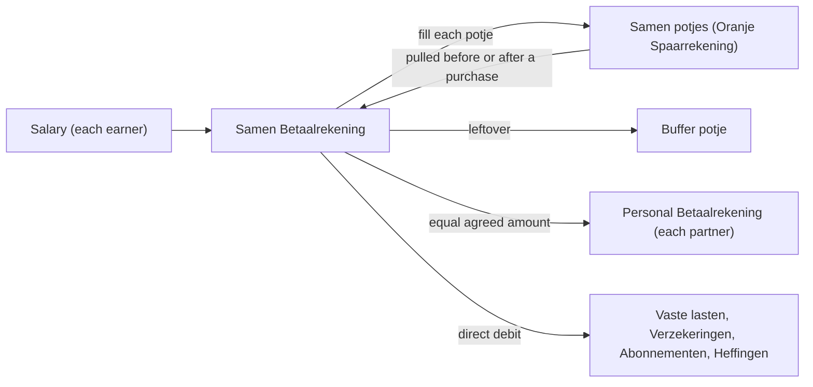

# Plan: Document how the household does its finances

From `intent.md` (2026-10-21). Status: accepted.

## Design

### Domain terms

Agreed terms from `GLOSSARY.md`, used as written: Appropriation, Betaalrekening, Buffer, Oranje Spaarrekening, Potje, Reserveringen, Samen, Vaste lasten. Glossary "Avoid" words (main account, pot, jar, envelope) do not appear in the document's prose; "envelope budgeting" appears once, in the term mapping table, as the standard term for the potje method.

ING's public product names, which the document cites with their URL (found through search on 2026-10-21; `ing.nl` pages timed out for direct fetch from the planning session):

- "Oranje Spaarrekening", with "tot wel 10 Spaarpotjes" per account — <https://www.ing.nl/particulier/sparen/oranje-spaarrekening>
- "Spaardoelen", ING's other name for the sub-accounts — <https://www.ing.nl/particulier/sparen/spaardoelen>
- "Betaalrekening" — <https://www.ing.nl/particulier/betalen/bankrekeningen>
- "En/of Betaalrekening", ING's joint current account — <https://www.ing.nl/particulier/betalen/bankrekeningen/gezamenlijke-rekening>
- "Creditcard", repaid monthly from the linked Betaalrekening — <https://www.ing.nl/particulier/betalen/creditcards/afschrijfdatum-creditcard>

No new glossary terms. "Spaarpotje" is ING's product name for a Potje; the document says so once and then uses "potje".

### Diagrams

The document carries one Mermaid flowchart of the monthly money path, because the reader is a non-expert:

The credit card stays out of the flowchart: `intent.md` does not say which Betaalrekening repays it.

Not affected beyond that: no class, ER or state change in the application.

### Signatures

Not affected: documentation only, no Ruby changes.

Not checked: no code changes, so `steep check` has nothing to check.

### Complexity

Not affected: no new code path, no queries.

### Invariants

- The document holds no euro amounts. Enforced by review and by the automated guard in `## Proof`.
- The document holds no IBAN, no potje account code and no family member's name other than Etienne and the potje names the intent lists. The repository is public on GitHub. Enforced by review and by the automated guard in `## Proof`.
- Every Dutch term has its standard term next to it. Enforced by the term table in `## Words we use` for finance terms and the standard-term column of the Samen potjes table for potje names; review checks each Dutch word in prose against them.
- Every standard term is flagged as agent-supplied, so Etienne can correct it. Enforced by the table's column header and its lead sentence.
- Every ING name carries a URL; a name not found on a public ING page carries "(not confirmed)".
- Markdown prose has one line per paragraph and list item (playbook rule 26).

### Alternatives

Two architects each proposed a design, with different goals.

- A. Lookup-first, for the analysis agent: numbered sections, rule IDs `R1`–`R7` and problem IDs `P1`–`P3`, separate tables for terms, ING names and potjes. Rejected as a whole: rule IDs must stay stable, so every later edit renumbers with care, and the tables make the document harder for Etienne and his wife to confirm. Kept from it: the Samen potjes as a table with a status column, and a "how the app sees this" section.
- B. Routine-first, for the household: sections follow the money through a month, each fact stated once, the term mapping only in one table. Chosen as the base. Changed: the standard term also stands in parentheses at the first use of each Dutch term in prose, because the criterion says "next to it" and a reader who skips the table still gets it.
- C. Several files under `docs/household-finances/`. Rejected: one reader reads it in one go, and one link from `AGENTS.md` is simpler.

## Design decisions

### Document outline

`docs/household-finances.md`, in this order. Each section names the criteria it covers.

1. `# Household finances` — who the document is for; it holds the method only, no amounts (the document never writes the word "euro" or the euro sign, so the guard in `## Proof` stays clean); current values live in the app; standard terms are supplied by an agent and Etienne may correct them; ING URLs date from 2026-10-21. Then the flowchart from Diagrams. Covers: no euro amounts, pointer to the app.
2. `## Words we use` — one table: Dutch term, standard term (agent-supplied), source (an ING URL, `GLOSSARY.md`, or "household name"). It links `GLOSSARY.md` for definitions and does not repeat them. Covers: each Dutch term has a standard term; ING names with URLs; glossary terms used.
3. `## Bank accounts and potjes` — the bank is ING; three debit accounts: the Samen Betaalrekening and one personal Betaalrekening for each partner; each has an Oranje Spaarrekening that holds its potjes (ING: "Spaarpotjes", up to ten per Oranje Spaarrekening); the household also has a credit card that pays some monthly subscriptions; potje names change over time ("Steam Deck" was renamed several times), so the account number identifies a potje, and the document never lists account numbers. Covers: ING and Oranje Spaarrekening next to a Betaalrekening; debit accounts and the credit card; renaming.
4. `## The Samen potjes` — a table of all ten: potje (the household name, kept in Dutch), standard term (agent-supplied, for example "Cadeautjes en speelgoed" → gifts and toys budget), purpose, status. "Cosimo" has status "unused". A potje name is a label, not a finance term, so it stays out of `## Words we use`; its standard term sits in this table. Covers: ten potjes, Cosimo unused, standard term per Dutch label.
5. `## Salary routine` — each salary arrives in the Samen Betaalrekening, then each Samen potje is filled, then the leftover moves to Buffer. Covers: salary.
6. `## Personal accounts` — each month an equal, agreed amount moves from Samen to each personal Betaalrekening; Etienne's active potjes are "Etienne's verzorging", "Steam Deck" and "Etienne's Buffer"; his wife's potjes are not recorded. Covers: personal transfer, personal potjes.
7. `## Fixed costs` — most Vaste Lasten, Verzekeringen, Abonnementen and Heffingen leave the Betaalrekening directly; costs saved for ahead go through Reserveringen instead; some subscriptions go through the credit card. Covers: fixed costs.
8. `## Spending routine` — a purchase is pulled from its potje shortly before or after it is paid, so what is left stays visible. Covers: spending.
9. `## Buffer and Reserveringen` — Reserveringen holds money saved ahead for recurring costs, for example the animal insurance, the trimsalon and the dentist; Buffer holds the salary leftover and anything no potje can pay; it is both surplus and emergency fund; no target size is recorded. Covers: Reserveringen, Buffer.
10. `## Appropriations` — most appropriations are saved for in "Cadeautjes en speelgoed" or "Reserveringen"; the app's Appropriation is the matching record; these two potjes are not funded enough, so Christmas and Sinterklaas are paid from "Kinderen kleding". Covers: both appropriation criteria.
11. `## How the app sees this` — every move into or out of a potje appears in the bank export; the import recognises the household's Oranje Spaarrekening by its name in the ING description, so both sides are household-owned, the row becomes a Transfer and gets the Transfer category; there is no potje-specific detection, so a move whose description does not name a household account is not recognised; budget suggestions leave the Transfer category out, and a budget cannot hold an allocation for it; the app holds the Oranje Spaarrekening as one Samen account, so no account record holds a potje and only the transaction's note text (the note and the original ING description) holds the potje's code, in the form `Naar Oranje spaarrekening <code> <description>` or `Van Oranje spaarrekening <code> <description>`. Covers: import, one Samen account.

`AGENTS.md` gets one line at the end of `## What this is`: `How the household runs its money, and the method to check transactions and budgets against: [docs/household-finances.md](docs/household-finances.md).`

### Choices

- Routine-first outline with a term table and a potje table (see Alternatives).
- The standard term stands in the table and, in parentheses, at the first use of each Dutch term in prose.
- Standard terms the document starts from, all agent-supplied: Betaalrekening → current account; Oranje Spaarrekening → savings account; Potje / Spaarpotje → savings sub-account, used as a budget category; the potje method → envelope budgeting; Buffer → emergency fund and surplus; Reserveringen → sinking fund; Vaste Lasten → fixed expenses; Verzekeringen → insurance premiums; Abonnementen → subscriptions; Heffingen → levies (local taxes and charges); Appropriation → earmarked funds; the monthly personal transfer → personal allowance; Samen → joint household account.
- Glossary conflict, resolved without editing the glossary: `GLOSSARY.md` lists "envelope" as a word to avoid for Potje, yet the standard name of the method is "envelope budgeting". The document uses "envelope budgeting" once, in the term table, as the name of the method, never as a synonym for potje.
- The repository is public, so the document holds no IBANs, potje codes, amounts, or names of Etienne's wife and children other than the potje names the intent requires. The note format uses `<code>` as a placeholder.
- ING names are product names (Betaalrekening, En/of Betaalrekening, Oranje Spaarrekening, Spaarpotjes, Spaardoelen, Creditcard). The names of single potjes are the household's own names; their source column says "household name". Whether Samen is an ING "En/of Betaalrekening" and whether the credit card is an ING card are not in `intent.md`, so the document marks both "(not confirmed)".
- `GLOSSARY.md` already holds the eight terms (commit `a9e43f8`), sorted and one bullet each; this change leaves it alone.

### Decision needed before implementation

`intent.md` names only five of the ten Samen potjes: Buffer, Reserveringen, Cadeautjes en speelgoed, Kinderen kleding and Cosimo. The document may hold only names Etienne confirms, so the other five names and their purposes must come from Etienne before step 2 of Order of work. The coordinator supplies them as an addendum to this plan; the implementer never guesses them.

Evidence for the coordinator, from the dev database read-only and the July 2026 spreadsheet, not to be copied into the document as names: monthly deposits in 2026 go to seven Samen potjes, described as groceries ("Boodschappen inleg"), leisure and hobbies ("vrije tijd en hobby"), fuel ("Inleg voor tanken"), the child benefit ("Kindgebonden budget"), gifts ("Cadeautjes en speelgoed"), the dog's insurance, dentist and trimsalon (Reserveringen) and Buffer. Spreadsheet lines that may be potjes: Klein Project, Groot Project, Project Baby, Extraatjes, Vakantie.

### Conflicts with intent's Decisions

None. Every outline section follows the `## Decisions` list. The missing potje names are a gap in the input, not a conflict.

## Integration points

- `AGENTS.md` (and `CLAUDE.md`, a symlink to it): gains one link line.
- `GLOSSARY.md`: read only. Its eight terms are already committed (`a9e43f8`); this change does not edit it.
- Application behaviour the document describes, read only, to keep the document true:
  - `app/jobs/importing/ing/import_job.rb` `perform` and `app/models/concerns/resolvable.rb` `resolve_for_import`: the counterparty resolves by account number, then by a household account number or name inside the description, then by name. No potje-specific code exists.
  - `app/models/concerns/importable.rb` `build_from_import`: a row whose both accounts are household-owned becomes a `Transfer`; it stores the ING description in both `note` and `original_note`.
  - `app/models/concerns/categorizable.rb` `assign_category_from_type`: a `Transfer` gets the `Transfer` category.
  - `app/models/budget.rb` `suggestion_totals_by_parent`: excludes the `Transfer` category from suggestions.
  - `app/models/budget_category.rb` `category_must_not_be_transfer`: a budget cannot allocate to the `Transfer` category.
  - `app/models/importing/ing/row.rb` `note`: the transaction note is the ING description, which holds "Naar/Van Oranje spaarrekening <code>".
  - The dev database holds one account named "Oranje Spaarrekening", owned by the Samen group, with no account number.
- Public ING web pages listed under Domain terms. No login, no credentials.

## Files that change

- `docs/household-finances.md` — new. The household finance method, as outlined in Design decisions.
- `AGENTS.md` — one new line that links to `docs/household-finances.md`.

`GLOSSARY.md` does not change. The spreadsheet `Potjes-Tabel 1.csv` stays outside the repository.

## Order of work

No criterion needs a test: the change is documentation only. Each step ends with its check from `## Proof

Run each check from the worktree root. Each command is self-contained and exits 0 when the check passes.

- A reader of `AGENTS.md` finds a link to `docs/household-finances.md` → check: `test "$(grep -c '](docs/household-finances.md)' AGENTS.md)" -eq 1`
- ING's own names, each with a public ING URL, unfound names marked → check: `test "$(grep -o 'https://www.ing.nl/[^ )>]*' docs/household-finances.md | sort -u | wc -l)" -ge 4`, then manual: each ING name sits next to a URL or "(not confirmed)".
- Salary arrives in Samen, fills the Samen potjes, leftover goes to Buffer → check: manual, section `## Salary routine`.
- Each month an equal, agreed amount moves from Samen to each personal account → check: manual, section `## Personal accounts`.
- Etienne's active personal potjes listed, his wife's not recorded → check: `for t in "Etienne's verzorging" "Steam Deck" "Etienne's Buffer"; do grep -qF "$t" docs/household-finances.md || exit 1; done`, then manual: the "not recorded" sentence.
- Potje names change over time, the account number identifies a potje → check: manual, section `## Bank accounts and potjes`.
- Accounts and potjes are debit accounts; a credit card pays some monthly subscriptions → check: manual, section `## Bank accounts and potjes`.
- Most fixed costs leave the Betaalrekening directly; costs saved ahead go through Reserveringen → check: `for t in "Vaste Lasten" Verzekeringen Abonnementen Heffingen; do grep -qF "$t" docs/household-finances.md || exit 1; done`, then manual: section `## Fixed costs`.
- The bank is ING; the potjes sit under the Oranje Spaarrekening next to a Betaalrekening → check: manual, section `## Bank accounts and potjes`.
- Every potje move is in the bank export; import marks it Transfer; budgets exclude Transfer → check: manual, section `## How the app sees this` against `app/models/concerns/resolvable.rb`, `app/models/concerns/importable.rb`, `app/models/budget.rb` and `app/models/budget_category.rb`.
- The app holds the Oranje Spaarrekening as one Samen account; only the note holds the potje code → check: manual, section `## How the app sees this`.
- All ten Samen potjes listed, "Cosimo" marked unused → check: `test "$(sed -n '/^## The Samen potjes/,/^## /p' docs/household-finances.md | grep -c '^| [^-]')" -eq 11` (header plus ten rows) and `grep 'Cosimo' docs/household-finances.md | grep -q unused`
- A purchase is pulled from a potje shortly before or after payment → check: manual, section `## Spending routine`.
- Reserveringen holds money saved ahead, with animal insurance, trimsalon and dentist as examples → check: `for t in trimsalon dentist insurance; do grep -qiF "$t" docs/household-finances.md || exit 1; done`
- Buffer holds the salary leftover and anything no potje covers; surplus and emergency fund; no target size → check: manual, section `## Buffer and Reserveringen`.
- Appropriations are saved for in "Cadeautjes en speelgoed" or "Reserveringen"; the app's appropriation is the matching record → check: manual, section `## Appropriations`.
- Those two potjes are underfunded, so Christmas and Sinterklaas come from "Kinderen kleding" → check: `for t in Christmas Sinterklaas "Kinderen kleding"; do grep -qF "$t" docs/household-finances.md || exit 1; done`
- The document does not record the known problems → check: `! grep -qiE 'known problems|## Known' docs/household-finances.md`.
- Each Dutch term has its standard term → check: manual, every Dutch term in prose appears in `## Words we use` or the potje table with a standard term.
- No euro amounts; the document points to the app for current values → check: `! grep -nEi '€|eur(o)?\b|[0-9]+[.,][0-9]{2}' docs/household-finances.md`, then manual: no figure in the file is an amount, and the pointer sentence exists.
- `GLOSSARY.md` lists the eight terms alphabetically, one bullet each, and the document uses them → check: `test "$(grep -c '^- \*\*' GLOSSARY.md)" -eq 8 && grep '^- \*\*' GLOSSARY.md | LC_ALL=C sort -c && for t in Appropriation Betaalrekening Buffer "Oranje Spaarrekening" Potje Reserveringen Samen "Vaste lasten"; do grep -qiF "$t" docs/household-finances.md || exit 1; done`
- Invariant: no IBAN or potje code, enforced by review → check: `! grep -nE 'NL[0-9]{2}[A-Z]{4}|[A-Z][0-9]{8}|[0-9]{6,}' docs/household-finances.md`, then manual: no identifier of any format.
- Invariant: no name of Etienne's wife or children other than the potje names in `intent.md`, enforced by review → check: manual.
- Invariant: one line per paragraph and list item, enforced by review → check: manual, no prose line ends mid-sentence.

Manual review checklist, done once after the commands pass: every number in the file (no amounts, no identifiers); every Dutch word (standard term present); every ING name (URL or "(not confirmed)"); every claim against `intent.md` (nothing beyond what it records, except the agent-supplied standard terms).

Per changed file, the unit tests expected: none. Documentation has no tests.

Test setup: none.

---
Domain skills applied: glossary, diagrams, software-design (design gate only; no code).

## Critique

### Round 1 (codex exec -p terra)

- The plan cannot meet the ten-potje criterion, because five names are missing and autonomous implementation cannot reach the chat → dismissed: the names exist only with Etienne and the intent forbids inventing them; step 1 of Order of work blocks implementation until they arrive, and the stage report raises it as a decision for Etienne.
- "Only the transaction note holds the potje code" is false, because `original_note` also stores the ING description → fixed (outline section 11 now says no account record holds a potje and only the note text, note and original description, holds the code)
- The plan overstates import behaviour: there is no potje-specific detection, the counterparty resolves through account number or the household account name in the description → fixed (section 11 and Integration points now describe resolution through `resolve_for_import` and say a move whose description names no household account is not recognised)
- The budget evidence is incomplete, because `BudgetCategory` also refuses a Transfer allocation → fixed (Integration points, section 11 and the Proof check now name `app/models/budget_category.rb`)
- Several Proof checks are not runnable as written: `$F` does not persist, a no-match grep exits 1, and `grep -c` counts lines, not terms → fixed (every check is now a self-contained command that exits 0 on success, with negated no-match greps and one grep per term; tested on samples)
- The no-amount and no-code checks are too weak for formats such as "100 euro" or other code shapes → fixed (wider regexes for euro words, decimals, IBANs and long digit runs, plus a manual review checklist for every number and identifier)
- Potje labels such as "Cadeautjes en speelgoed" get no standard term → fixed (the Samen potjes table gains a standard-term column, and the outline says potje names are labels kept in that table)

## Addendum: the ten Samen potjes

Supplied by the coordinator from Etienne's chat message, which listed all ten. This closes "Decision needed before implementation". Step 2 of Order of work may start.

Names are as Etienne wrote them, with one spelling fix: "persoonlije zorg" becomes "persoonlijke zorg". The purpose column marks what Etienne said and what the agent derived from the name.

- Boodschappen, huishoudelijk en persoonlijke zorg — groceries, household and personal care; purpose derived from the name.
- Vrije tijd en hobby — leisure and hobbies; purpose derived from the name.
- Auto en vervoer — car and transport; purpose derived from the name.
- Kinderen kleding — children's clothing; also pays Christmas and Sinterklaas, because the gift potjes are underfunded (Etienne).
- Cadeautjes en speelgoed — gifts and toys; most appropriations are saved for here or in Reserveringen (Etienne).
- Projecten — saving for projects; purpose derived from the name, since Etienne said most potjes are named after a category or a saving goal.
- Reserveringen — saving ahead for recurring costs such as the animal insurance, the trimsalon and the dentist (Etienne).
- Vakantie — saving for holidays; purpose derived from the name.
- Cosimo — currently unused (Etienne).
- Buffer — the salary leftover and anything no potje can pay; surplus and emergency fund (Etienne).

The document marks each derived purpose with "purpose taken from the potje's name", so Etienne can confirm or correct it in review.

## Addendum: change request after delivery

Etienne asked to drop the known problems from the document: "we don't need to save the known problems, we can pass that along to a new agent when analysis starts". `intent.md` now lists them as out of scope. The outline loses section 12, `## Known problems`, and the Proof check for three problems becomes a check that the document holds no such section. Nothing else in the plan changes.
