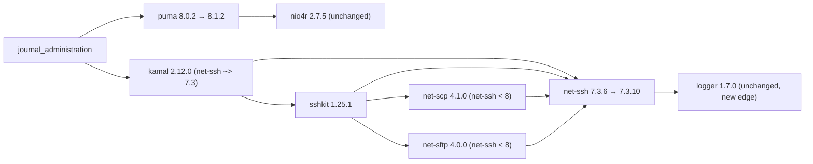

# Plan: Clear the bundler-audit advisories on puma and net-ssh

From `intent.md` (2026-11-23). Status: accepted.

## Design

### Domain terms

Not affected: no glossary term changes, and no new domain term enters the code. Working terms for this plan only: an **advisory** is a ruby-advisory-db entry that `bundler-audit check` matches against a locked gem version. The **audit gate** is any step that fails on such a match: the lefthook `pre-push: bundler_audit` command (`lefthook.yml`) and `bin/bundler-audit` in the shared CI workflow (`eirvandelden/appkit/.github/workflows/rails-ci.yml`).

### Diagrams

Not affected: no class, table or state changes. The only change is two version lines in the dependency graph:

### Signatures

Not affected: no Ruby class or method changes. `Gemfile` stays as it is (`gem "puma"` and `gem "kamal"` have no version constraint).

Not checked: journal_administration has no Steep or rbs_rails setup.

### Complexity

Not affected: no request path and no query changes.

### Invariants

- The lockfile holds no gem version with a known advisory. Enforced by the lefthook `pre-push: bundler_audit` command and by `bin/bundler-audit` in CI.
- net-ssh stays below 8. Enforced by kamal 2.12.0 (`net-ssh ~> 7.3`), net-scp 4.1.0 and net-sftp 4.0.0 (`< 8.0.0`). No Gemfile line is needed.
- Only puma and net-ssh change version. Enforced by `bundle update --conservative`, and checked by reading the lockfile diff (Order of work step 4).

### Alternatives

1. **Chosen: `bundle update --conservative <gem>` per gem, lockfile only.** puma 8.1.2 needs `nio4r ~> 2.0` (2.7.5 is locked) and net-ssh 7.3.10 needs `logger >= 0` (1.7.0 is locked). `--conservative` keeps those shared gems where they are, so the diff holds exactly two version bumps, one new dependency edge and two checksum lines.
2. **Rejected: plain `bundle update puma net-ssh`.** Without `--conservative`, Bundler also unlocks the named gems' dependencies. nio4r is shared with actioncable, so it could move too. The intent puts every other gem update out of scope.
3. **Rejected: Gemfile floors (`gem "puma", ">= 8.1.2"`, a direct `net-ssh` line).** The intent limits the change to `Gemfile.lock`. A targeted update never downgrades a locked gem, and Dependabot only moves forward, so a floor adds no protection. A direct net-ssh line also duplicates kamal's pin and makes a transitive gem a direct dependency.
4. **Rejected: a test that asserts gem versions or boots puma.** The playbook gives configuration no tests. A version assertion duplicates the audit gate and goes stale on the next advisory. An in-process integration test does not run puma or its plugins, so it does not prove the boot risk.

## Design decisions

- `--conservative` on each update. The intent says "`bundle update puma net-ssh`" and lists transitive dependencies as in scope. The dependency check above shows that no transitive gem needs to move, so `--conservative` gives the same two target versions with a smaller diff. This narrows the intent's command; it does not contradict its `## Decisions`.
- Two commits, one per gem (`build(deps): bump puma from 8.0.2 to 8.1.2`, `build(deps): bump net-ssh from 7.3.6 to 7.3.10`), so each is one logical change (playbook rule 18) and either can be reverted alone.
- The boot check runs in development with the Solid Queue puma plugin on (its development default). Production's `solid_queue_mode :async` does not run locally; it is a limitation for the PR body.

## Integration points

- puma: the app server in every environment, started by `bin/start-app` (`bin/rails server`) under `thrust` (`Procfile`) and by `bin/boot` in the Docker image. `config/puma.rb` loads `plugin :tmp_restart` and `plugin :solid_queue` (solid_queue 1.7.0).
- net-ssh: used only by Kamal deployment tooling (kamal, sshkit, net-scp, net-sftp). It is not loaded by the app (`gem "kamal", require: false`).
- Docker build: `bundle install` from `Gemfile.lock`; it picks up the new versions with no Dockerfile change.
- Dependabot (`.github/dependabot.yml`, bundler, weekly): an open Dependabot PR for puma or net-ssh becomes obsolete once this merges.
- MCP: no tool changes. This change adds or changes no UI action, so `test/integration/assistant_parity_test.rb` needs no `TOOL_FOR` or `EXCLUDED` entry.

## Files that change

- `Gemfile.lock` — `puma (8.0.2)` → `puma (8.1.2)`, `net-ssh (7.3.6)` → `net-ssh (7.3.10)`, a new `logger` dependency line under net-ssh, and the two matching `CHECKSUMS` lines. Nothing else.

No other file changes. If `db/schema.rb` changes during the boot check (a copied development database re-dumps it), leave it out of every commit.

## Order of work

No acceptance criterion needs a test: this is a dependency change with no code. Every Proof line is a check.

1. Set up the shell in the worktree. The non-interactive shell has system Ruby 2.6 first on `PATH`, and Rails binstubs resolve to the main checkout: `cd /Users/etienne.vandelden/Developer/journal_administration/.worktrees/fix-bundler-audit-advisories && export PATH="$PWD/bin:$HOME/.local/share/rv/rubies/ruby-4.0.7/bin:$PATH"`. Confirm `ruby -v` prints 4.0.7. Run `npm install` if `node_modules` is missing (the herb hook needs it).
2. Record the baseline: `bundle exec bundler-audit check --update`. Expect "Vulnerabilities found!" with 10 puma and 3 net-ssh advisories.
3. `bundle update --conservative puma`. `--conservative` limits indirect updates, not the target version, and `gem "puma"` has no constraint. Confirm `grep -E '^    puma \(' Gemfile.lock` prints `puma (8.1.2)`; if it resolves to any other version, stop and report. Check `git diff Gemfile.lock`: only the puma version line and its checksum line change. Commit `Gemfile.lock` alone: `build(deps): bump puma from 8.0.2 to 8.1.2`.
4. `bundle update --conservative net-ssh`. kamal's `~> 7.3` also allows a later 7.x minor. Confirm `grep -E '^    net-ssh \(' Gemfile.lock` prints `net-ssh (7.3.10)`; if it resolves to any other version, stop and report. Check `git diff Gemfile.lock`: only the net-ssh version line, the new `logger` line under it, and its checksum line change. If any other gem moves, stop and report. Commit `Gemfile.lock` alone: `build(deps): bump net-ssh from 7.3.6 to 7.3.10`.
5. `bundle exec bundler-audit check --update`. Expect "No vulnerabilities found".
6. Run the linters: `bundle exec rubocop`, `npx @herb-tools/linter app/views/`, `bundle exec brakeman --no-pager -q`, `bundle exec i18n-tasks normalize` followed by `git status --porcelain config/locales` (must be empty), `bundle exec i18n-tasks health`.
7. Run the tests: `bin/rails test`, then `bin/rails test:system`. One failure is known: `BudgetsTest#test_suggesting_amounts_fills_in_historical_averages` (`test/system/budgets_test.rb`) fails on days a suggested amount ends in 0, because its fixtures are relative to today. Etienne decided on 2026-10-16 to leave it until money moves to cents. If only that test fails, record it in the evidence and the PR body as a known date flake; do not skip, weaken or fix it on this branch. Any other failure blocks.
8. Boot check under puma 8.1.2. Copy the primary development database: `sqlite3 ../../storage/db/development.sqlite3 ".backup storage/db/development.sqlite3"`. Then run `bin/rails db:prepare`, as `bin/start-app` does, so the queue, cache and cable databases (`config/database.yml`) exist too; the Solid Queue plugin needs the queue database. Start `DISABLE_SSL=1 bin/rails server -p 3001` in the background. Check that the log shows `Puma version: 8.1.2`, the Solid Queue supervisor start, and no plugin error. Run `curl -s -o /dev/null -w '%{http_code}\n' http://127.0.0.1:3001/up` and expect `200`. Stop the server. Revert any `db/schema.rb` change with `git checkout -- db/schema.rb`.
9. Record the evidence (audit output, `/up` status, puma version line) with the `delivery-evidence` script.

## Risks

- puma 8.1 changes behaviour that `config/puma.rb` relies on (`plugin :tmp_restart`, `plugin :solid_queue`, `solid_queue_mode`). Step 8 covers development; production's `:async` mode is not exercised locally.
- `bundle update` needs network access to rubygems.org. puma 8.1.2 and net-ssh 7.3.10 are not installed locally yet.
- The playbook's dependency guard refuses `bundle install` and asks for `bi`. `bundle update <gem>` is a different command; if the guard refuses it, report it rather than work around it.
- Pushing runs every lefthook pre-push hook. In a worktree, Bundler hooks can fail on git-sourced gems while `GIT_DIR` is set. Run the checks directly first; skipping a hook needs Etienne's approval for this branch.
- A new advisory published between this plan and the implementation turns the audit red again. Step 5 uses `--update`, so it catches that; a new advisory on another gem is out of scope and gets reported.

Out of scope: a net-ssh 8.x or kamal upgrade, any other gem update, puma configuration changes, a Gemfile constraint, and changing the lefthook audit command to `--update`.

## Proof

- `bundle exec bundler-audit check` reports no vulnerabilities → check: `bundle exec bundler-audit check --update` prints "No vulnerabilities found".
- The test suite and all linters stay green → check: `bin/rails test`, `bin/rails test:system`, `bundle exec rubocop`, `npx @herb-tools/linter app/views/`, `bundle exec brakeman --no-pager -q`, `bundle exec i18n-tasks normalize` with no change under `config/locales`, `bundle exec i18n-tasks health`, all exit 0.
- The app boots in development under puma 8.1.2 and answers `/up` with 200 → check: Order of work step 8; the server log shows `Puma version: 8.1.2` and `curl` prints `200`.
- Invariant: only puma and net-ssh change version, enforced by `bundle update --conservative` → check: `git diff main -- Gemfile.lock` shows only the puma and net-ssh version and checksum lines and the new `logger` line under net-ssh.
- Invariant: net-ssh stays below 8, enforced by kamal 2.12.0's `net-ssh ~> 7.3` → check: `Gemfile.lock` locks `net-ssh (7.3.10)`.

Per changed file, the unit tests expected:
- `Gemfile.lock`: none. Configuration has no tests.

Test setup: none. The boot check uses a copy of the main checkout's development database.

---
Domain skills applied: dependencies, rails-testing.

## Critique

### Round 1 (Codex gpt-6.1-sol)

- The boot setup copies only the primary database and runs `db:migrate`, but the Solid Queue plugin needs the queue database, and queue, cache and cable are separate development databases → fixed (step 8 now runs `bin/rails db:prepare` after the copy, as `bin/start-app` does)
- `--conservative` limits indirect updates, not the target version; unconstrained puma and kamal's `~> 7.3` could resolve past the versions in intent's Decisions → fixed (steps 3 and 4 now confirm puma 8.1.2 and net-ssh 7.3.10 in `Gemfile.lock` before each commit and stop on any other version)
- Reporting the known budget system test failure instead of fixing it leaves an acceptance criterion unmet and ignores playbook rule 25 → dismissed: the failure is date-dependent and unrelated to the lockfile, and Etienne decided on 2026-10-16 to leave it until money moves to cents; step 7 now names the one test, forbids skipping or weakening it, and makes every other failure blocking
