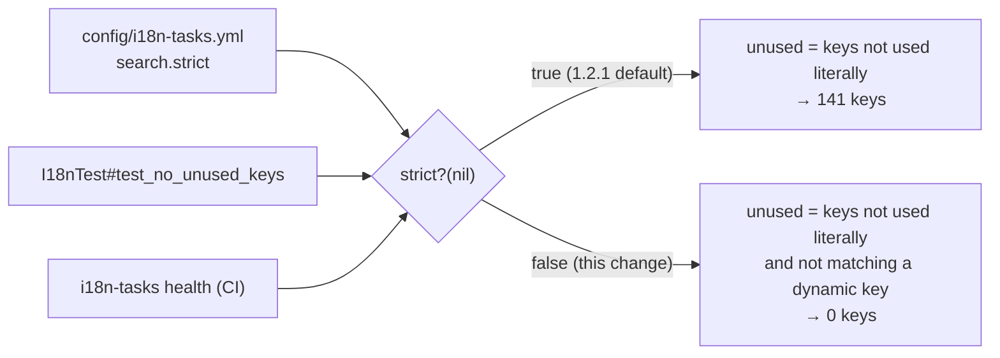

# Plan: Make the i18n unused-key check pass again on i18n-tasks 1.2.1

Author: Etienne van Delden de la Haije. Status: accepted (2026-11-26). Type: chore. Delivery: autonomous. Codex review: no.

## Problem

Main's Dependabot bump of `i18n-tasks` from 1.1.2 to 1.2.1 (PR #426) made `bundle exec i18n-tasks health` and `I18nTest#test_no_unused_keys` (`test/i18n_test.rb:15`) fail with 141 unused keys: 47 keys in each of the en, it and nl locales. CI runs both (`.github/workflows/ci.yml:35` and `:40`), so main and every branch off it have a red check. It is a pre-existing failure found while delivering `fix-bundler-audit-advisories` (playbook rule 25).

The 47 keys per locale, in eight groups: `menu.pages.*.label` (22), `menu.hubs.*.label` (7), `search.result_types.*` (5), `transactions.types.{credit,debit,transfer}`, `todos.index.{account,product,transaction}`, `people.household.{true,false}`, `payment_providers.{create,destroy}.success`, `language_names.{en,it,nl}`.

### Cause (confirmed)

The app reads every one of these keys through a dynamic key, built at runtime:

- `app/controllers/concerns/menu_map.rb:156` — `t("menu.hubs.#{key}.label")`
- `app/controllers/concerns/menu_map.rb:162` — `t("menu.pages.#{key}.label")`
- `app/views/searches/index.html.erb:7` — `t("search.result_types.#{type}")`
- `app/views/transactions/_filters.html.erb:9` — `t("transactions.types.#{type.downcase}")`
- `app/views/todos/index.html.erb:22` — `t(".#{item.kind}")`, which resolves to `todos.index.<kind>`
- `app/views/people/show.html.erb:9` and `app/views/people/index.html.erb:20` — `t("people.household.#{person.household?}")`
- `app/controllers/accounts/payment_providers_controller.rb:31` — `t("payment_providers.#{action_name}.success")`
- `app/helpers/application_helper.rb:7` — `I18n.t("language_names.#{locale}", default: locale)`

So no key is dead. The gem changed how it decides "used":

- In 1.1.2, `I18n::Tasks::UnusedKeys#unused_tree(strict: nil)` tested `(strict || !used_in_expr?(key))`. A `nil` `strict` is falsy, so a key that matched a dynamic expression such as `menu.pages.*.label` counted as used. `unused_keys` with no argument (what the test and `health` call) was therefore non-strict.
- In 1.2.1, `unused_keys` and `unused_tree` first resolve `strict = strict?(strict)` (`lib/i18n/tasks/used_keys.rb:144`), which reads `search.strict` from `config/i18n-tasks.yml`. That setting defaults to `true`. So the dynamic expressions no longer protect any key.
- Proof: on 1.2.1, `I18n::Tasks::BaseTask.new.unused_keys.leaves.count` is 141, `unused_keys(strict: false).leaves.count` is 0, and `bundle exec i18n-tasks unused --no-strict` reports "Every translation is in use".
- `search.strict` affects nothing else that CI checks: `missing_keys` hard-codes `used_tree(strict: true)` (`lib/i18n/tasks/missing_keys.rb:54,106`). Its other readers are `usages`, `unused`, `remove-unused` and the console.

Run commands with `PATH="$PWD/bin:$HOME/.local/share/rv/rubies/ruby-4.0.10/bin:$PATH"` (main uses Ruby 4.0.10).

## Proposed outcome

`bundle exec i18n-tasks health` and `bin/rails test test/i18n_test.rb` pass on i18n-tasks 1.2.1, with no gem version change. As on 1.1.2, a key read through a dynamic key counts as used by the unused-key check.

## Affected users and systems

- Every developer and every CI run: the `i18n` CI job (`i18n-tasks health`, `test/i18n_test.rb`) and the full test suite.
- The lefthook pre-push hooks that run the same checks.
- `config/i18n-tasks.yml` only. No application code, locale file or UI text changes.

## Constraints

- Etienne decided (2026-11-26) to fix it in configuration or usage markers, not by pinning `i18n-tasks` below 1.2. No gem is added, removed or changed.
- Never delete a key that the app uses, and never add a key to `ignore_unused` just to silence a real unused key. Each of the eight groups is checked above: all are used through a dynamic key, none is dead, so no key is removed.
- No test is skipped or weakened, and `test/i18n_test.rb` stays unchanged.
- Locale files stay normalized (`i18n-tasks normalize`).
- Branches off main. `fix-bundler-audit-advisories` rebases on top of this fix afterwards.
- Permissions: none needed. No gem, system tool, destructive migration or deploy file is touched (playbook rules 8, 9, 11, 12, 13). `.github/workflows/ci.yml` stays unchanged.

## In scope

- Set `search.strict: false` in `config/i18n-tasks.yml`, with a comment that names why.
- Verify `i18n-tasks health`, `test/i18n_test.rb`, the full suite and the linters.

## Out of scope

- Pinning, upgrading or removing `i18n-tasks`.
- Any other gem, any application behaviour, any UI text, any locale value.
- The eight existing `# i18n-tasks-use t("menu.pages.*.tile")` markers in `menu_map.rb:17-24`. They stay as they are; whether 1.2.1 makes them redundant is a separate question.
- The local system-test failure (Capybara CDP reset).
- Rebasing `fix-bundler-audit-advisories` (it happens after this change merges).

## Acceptance criteria

- `bundle exec i18n-tasks health` reports "Every translation is in use" and no missing keys, and exits 0.
- `bin/rails test test/i18n_test.rb` passes, unchanged, and the full `bin/rails test` run has no i18n failure.
- `bundle exec i18n-tasks normalize` leaves `config/locales` unchanged.
- A key that no code reads, directly or through a dynamic key, is still reported as unused. Example: a new `menu.unused_example` key in en, it and nl makes `i18n-tasks unused` list exactly those three keys, and none of the 141 dynamic keys.
- A key the code reads literally but no locale holds is still reported as missing. Example: with `search.strict: false`, removing `search.shortcut_hint` (read by `app/views/layouts/application.html.erb:53`) from the en locale makes `i18n-tasks missing` list it.
- The app shows the same labels as before: no application code and no locale value changes. `git diff main --stat` lists only `config/i18n-tasks.yml` and the change folder, and the full `bin/rails test` run passes.

## Decisions

- Fix it in `config/i18n-tasks.yml` or usage markers, no gem pin — Etienne's choice on 2026-11-26.
- Fix it on its own branch first (rule 25), then rebase `fix-bundler-audit-advisories` on top — Etienne's choice on 2026-11-26.

## Open questions

None.

## Design

### Domain terms

- **Dynamic key** — a translation key built at runtime, such as `t("menu.pages.#{key}.label")`. i18n-tasks sees it as the pattern `menu.pages.*.label`.
- **Strict mode** — the i18n-tasks setting `search.strict`. When `true`, a dynamic key does not mark any key as used. When `false`, every key that matches the pattern counts as used; each interpolation stands for one key segment.
- **Hub** — a task group in the rail (glossary term); its label is `menu.hubs.<key>.label`.

### Diagrams

### Signatures

Not affected: no Ruby class or method changes. The change is one YAML setting.

Not checked: the change has no Ruby signature to check.

### Complexity

Non-strict `unused_keys` scans the source a second time for dynamic expressions (`parse_cache.retain` in `unused_keys.rb:14`). On this repository `i18n-tasks health` stays within a few seconds. No request path and no database query is touched.

### Invariants

- A key read only through a dynamic key counts as used, in every locale. Enforced by `search.strict: false` in `config/i18n-tasks.yml`; proved by `test/i18n_test.rb` `test_no_unused_keys` (red before, green after).
- A key that matches no literal and no dynamic usage is still reported as unused. Enforced by i18n-tasks; proved by the manual check in `## Proof`.
- Missing-key detection stays strict. Enforced inside i18n-tasks: `missing_keys.rb:54` and `:106` pass `strict: true` explicitly, so `search.strict` never reaches it. Proved by the manual missing-key check in `## Proof`; `test_no_missing_keys` only shows that no key is missing today.

### Alternatives

1. **`search.strict: false` in `config/i18n-tasks.yml` (chosen).** One setting restores the non-strict dynamic-key handling that 1.1.2 applied by default, for the CLI and the test alike. It is not a full return to 1.1.2: 1.2.1 also counts a key as used when an ancestor is used (`key_used?`) and matches dynamic keys against depluralized keys. Both only widen "used", and neither is needed for this fix. It covers every current dynamic key and every future one with no extra work. Cost: a dead key under a dynamic prefix (say `menu.pages.old_page.label`) stays hidden. That was already true on 1.1.2, so it is no regression.
2. **`# i18n-tasks-use t("...")` markers next to each dynamic call.** Keeps strict mode, so dead keys under dynamic prefixes are found. Cost: 49 marker lines (47 keys, `people.household` in two views) spread over nine files, five of them ERB views (`<%# i18n-tasks-use t("...") %>`, one key per tag, works in 1.2.1). Each new menu page, hub, search result type or language needs a new marker, or CI goes red with a misleading "unused" error. The markers also repeat closed lists (`Transaction::TYPES`, the locales, the to-do kinds, the search types), so a stale marker hides a dead key too. It turns a gem-default change into a code change across views. Rejected: high upkeep for a check the project did not have before the bump.
3. **Patterns in `ignore_unused`, such as `menu.{pages,hubs}.*.label`.** Keeps strict mode for the rest of the app. Cost: it copies knowledge of the source into config, hides a dead key under each pattern exactly like alternative 1, and goes against the constraint not to use `ignore_unused` as a silencer. Rejected.

Passing `strict: false` in `test/i18n_test.rb` is not an option: the test must stay unchanged, and CI's `i18n-tasks health` would still fail.

## Design decisions

- The comment next to `strict: false` names the dynamic keys and the 1.2 change, so nobody flips it back to the default without knowing why.
- The existing `.tile` markers stay. Removing them is unrelated to this fix.

## Integration points

- i18n-tasks 1.2.1: `I18n::Tasks::UnusedKeys#unused_keys`, `I18n::Tasks::UsedKeys#strict?`.
- CI job `i18n` in `.github/workflows/ci.yml` (unchanged) and the lefthook pre-push hooks (unchanged).
- MCP parity: no MCP tool is needed. The change adds or changes no UI action, so `test/integration/assistant_parity_test.rb` and `TOOL_FOR`/`EXCLUDED` are not touched.

## Files that change

- `config/i18n-tasks.yml` — under `search:`, replace the commented `# strict: true` line with `strict: false`, preceded by a short comment: i18n-tasks 1.2 reads `search.strict` in `unused`, and the app reads menu, hub, search, transaction type, to-do, household, payment provider and language labels through dynamic keys.

## Order of work

1. Run `bin/rails test test/i18n_test.rb -n test_no_unused_keys` and watch it fail with "141 unused i18n keys". This is the existing test acting as the regression test.
2. Edit `config/i18n-tasks.yml` as `## Files that change` says.
3. Run `bin/rails test test/i18n_test.rb` and watch it pass.
4. Run `bundle exec i18n-tasks health` and check it exits 0.
5. Run `bundle exec i18n-tasks normalize` and check `git status config/locales` is clean.
6. Do the dead-key and missing-key checks from `## Proof`: their copies live in a scratch directory, and the commands run from the worktree root so `search.paths` (`app/`) and the Gemfile resolve. Nothing in the worktree changes.
7. Run the full `bin/rails test`, `bundle exec rubocop`, `npx @herb-tools/linter app/views/`, `bundle exec brakeman --no-pager -q` and `bundle exec bundler-audit check`.

## Risks

- A future dead key under a dynamic prefix goes unreported. Accepted: the same held on 1.1.2. A stricter check is alternative 2 and is a separate decision.
- A broad dynamic key hides more: `t(".#{item.kind}")` in `todos/index.html.erb:22` makes every single-segment key under `todos.index.*` count as used. Accepted for the same reason.
- A later i18n-tasks release changes the meaning of `strict` again. The comment in the config names the setting's purpose, and the I18n test catches a change.
- `remove-unused` now keeps keys that match a dynamic key. That is the safe direction.

## Proof

- `i18n-tasks health` is green → check: `bundle exec i18n-tasks health; echo $?` prints "Every translation is in use" and `0`.
- `test/i18n_test.rb` passes unchanged → `test/i18n_test.rb` `test_no_unused_keys` (red before, green after), and `git diff main -- test/i18n_test.rb` is empty.
- Locale files stay normalized → `test/i18n_test.rb` `test_files_are_normalized`, and check: `bundle exec i18n-tasks normalize && git status --porcelain config/locales` prints nothing.
- Scratch setup for the next two checks: copy `config/locales/*.yml` to `<scratch>/locales/`, and copy the changed `config/i18n-tasks.yml` to `<scratch>/i18n-tasks.yml` with `data.read` set to the absolute `<scratch>/locales/%{locale}.yml`. Add `menu.unused_example: x` to the three scratch locales, and remove `search.shortcut_hint` from the scratch `en.yml`. Run both commands from the worktree root.
- A dead key is still reported → check: `bundle exec i18n-tasks unused -c <scratch>/i18n-tasks.yml` lists exactly three keys, `menu.unused_example` in en, it and nl, and none of the 141 dynamic keys. (Dry run during planning: confirmed.)
- Invariant: missing-key detection stays strict, enforced by `missing_keys.rb:54,106` passing `strict: true` → check: `bundle exec i18n-tasks missing -c <scratch>/i18n-tasks.yml` lists `en search.shortcut_hint`. (Dry run during planning: confirmed.) `test/i18n_test.rb` `test_no_missing_keys` stays green on the real locales.
- The app shows the same labels → check: `git diff main --stat` lists only `config/i18n-tasks.yml` and `docs/changes/fix-i18n-unused-keys-1-2/`, and the full `bin/rails test` run passes.

Per changed file, the unit tests expected:

- `config/i18n-tasks.yml`: none. Configuration has no tests; `test/i18n_test.rb` already covers its effect.

Test setup: none beyond the existing fixtures and locale files.

---
Domain skills applied: software-design (alternatives), glossary (Hub), diagrams (flowchart), rails-testing (proof by existing test).

## Critique

### Round 1 (Codex gpt-6.1-sol)

- The scratch dead-key check ran inside the scratch directory, where `search.paths` (`app/`) and the Gemfile do not resolve → fixed (the checks now run from the worktree root with an absolute scratch config and locale path, and assert that none of the 141 dynamic keys show up; dry-run confirmed)
- A green `test_no_missing_keys` only asserts an empty result, so it cannot prove missing-key detection stays strict → fixed (added an acceptance criterion and a manual check that removes `search.shortcut_hint` from a scratch `en.yml` and expects `i18n-tasks missing` to list it; the invariant now cites `missing_keys.rb:54,106`; dry-run confirmed)
- "Restores the 1.1.2 behaviour exactly" overstates it, since 1.2.1 also adds ancestor matching (`key_used?`) and depluralized dynamic matching → fixed (Proposed outcome and Alternative 1 now say it restores non-strict dynamic-key handling, and name the two 1.2.1 additions as widening "used" only)
- The label criterion promised translated labels on pages whose tests assert structure, not text → fixed (the criterion now states that no application code or locale value changes, checked by `git diff main --stat` plus the full suite)
