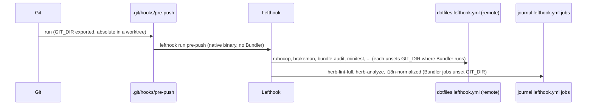

# Plan: Bundler-based git hooks work from a worktree

From `intent.md` (2026-11-22). Status: accepted.

## Context

A commit or push from a `.worktrees/*` checkout runs the lefthook hooks. Every Bundler-based hook exits with status 7 before it checks anything. Git exports `GIT_DIR` to its hooks. In a worktree it is absolute (`.git/worktrees/<name>`). Bundler then runs `git` inside its cached git-gem checkouts (`appkit`, `mvpa-css`) and reads the worktree's repository instead of the gem's. In the main checkout `GIT_DIR` is the relative `.git`, which resolves inside each gem checkout.

Etienne decided the direction on 2026-11-23. This repository follows dotfiles ADR 0001 ("Plain per-repo lefthook config, no global hooks"). `lefthook.yml` names the dotfiles `lefthook.yml` under `remotes:`. Where the shared config and a local job overlap, the shared job runs. Local jobs the shared config does not have stay. `lefthook install` runs once.

Facts verified in this worktree and in scratch repositories (lefthook 2.2.2):

- `GIT_DIR=<abs> bundle exec ruby -e 'puts :ok'` fails with the git-gem error; `unset GIT_DIR` first makes it print `ok`. `GIT_INDEX_FILE` left set does no harm.
- `lefthook dump` shows that only `lefthook.yml` loads. The tracked `.lefthook.yml` is ignored, so its herb-lint, `herb analyze` and i18n-normalized jobs never run today.
- `.git/hooks` holds only git's sample files. No lefthook hook is installed in this clone.
- A remote job overrides a local job of the same name. A local `skip: true` on a remote job's name still takes effect, because the remote job does not set `skip`. Jobs with names only the local config uses run next to the remote jobs.
- The shared jobs `rubocop`, `bundle-audit` and `minitest` unset `GIT_DIR` themselves. The shared `brakeman` job does not load Bundler and passes in the worktree with `GIT_DIR` set.
- `erb_lint` is not installed here: no gem, no binary. The shared `erb_lint` job would fail on every commit or push that holds an `.erb` file.
- The hook script that `lefthook install` writes calls `lefthook` on `PATH`, then the gem's native binary. It never starts lefthook through Bundler, so `GIT_DIR` cannot break it.
- `bin/lefthook` is a Bundler binstub. With `GIT_DIR` set it fails too, so manual checks call `lefthook` from `PATH`.

## Design

### Domain terms

Not affected: tooling only. `GLOSSARY.md` holds household-finance terms. The words hook, worktree, shared config and local job are tooling words, not domain terms.

### Diagrams



### Signatures

The complete new `lefthook.yml`:

```yaml
remotes:
  - git_url: https://github.com/eirvandelden/dotfiles.git
    ref: main
    refetch_frequency: 24h

# Jobs the shared dotfiles config does not have. Where both define a job, the shared one runs.
# Git exports GIT_DIR to its hooks. In a worktree it is absolute, and Bundler's git-sourced gems
# (appkit, mvpa-css) then read the wrong repository, so every Bundler job unsets it first.
pre-commit:
  commands:
    # erb_lint is not installed here; herb-lint checks ERB.
    erb_lint:
      skip: true
    herb-lint:
      glob: "*.erb"
      run: npx --no herb-lint {staged_files}
      fail_text: "herb-lint found ERB issues. Run: npx --no herb-lint --fix app/views/"
    i18n-normalized:
      glob: "config/locales/**/*.yml"
      run: |
        unset GIT_DIR
        bundle exec ruby ./bin/check_i18n_normalized
      fail_text: "Locale files must be normalized. Run: bundle exec i18n-tasks normalize"

pre-push:
  commands:
    erb_lint:
      skip: true
    herb-lint-full:
      run: npx --no herb-lint app/views/
      fail_text: "herb-lint failed on full view scan"
    herb-analyze:
      run: |
        unset GIT_DIR
        bundle exec herb analyze app/views/
      fail_text: "herb analyze failed"
    i18n-normalized:
      run: |
        unset GIT_DIR
        bundle exec ruby ./bin/check_i18n_normalized
      fail_text: "Locale files must be normalized. Run: bundle exec i18n-tasks normalize"
```

`.lefthook.yml` is deleted. `lefthook-local.yml` stays unchanged.

Not checked: configuration only, no Ruby signatures.

### Complexity

Not affected: no request path. A hook run adds the shared jobs. lefthook refetches the remote at most once every 24 hours, and an unreachable remote never fails a hook run (ADR 0001).

### Invariants

- Every job that runs through Bundler starts without `GIT_DIR`. The shared config enforces it for its own jobs, and `lefthook.yml` does it for `i18n-normalized` and `herb-analyze`. Checked by the worktree runs in `## Proof`.
- A job's exit status stays the check's exit status: `unset` only changes the environment. Checked by the rubocop-offence commit in `## Proof`.
- Where the shared config and `lefthook.yml` both name a job, the shared job runs. The only exception is the `erb_lint` skip. Checked with `lefthook dump`.

### Alternatives

- **Chosen: the shared config through `remotes:`, plus local jobs only where the shared config has none.** It follows ADR 0001 and Etienne's direction. The fix for the overlapping jobs lives in the shared config.
- **Rejected: prefix the five existing Bundler commands with `env -u GIT_DIR`.** It works, but it keeps a second set of hooks next to the dotfiles config, against ADR 0001. Etienne turned it down.
- **Rejected: a lefthook `templates:` placeholder for `bundle exec`.** It has the same objection as the prefixes.
- **Rejected: an `rc:` file that runs `unset GIT_DIR`.** Under `lefthook run`, a command still sees `GIT_DIR` with `rc` at top, hook or command level (tested). Only the installed hook script sources `rc`.

## Design decisions

- **The scope differs from `intent.md`, by Etienne's decision on 2026-11-23.** Intent puts only the Bundler commands of `lefthook.yml` in scope and the herb hooks out of scope. Etienne chose to replace the whole local hook set with the shared config plus the local jobs it lacks. That moves the herb jobs, the merge of `.lefthook.yml` and the deletion of `.lefthook.yml` into scope.
- **Acceptance criterion 1 changes with the shared jobs.** The shared `brakeman` and `bundle-audit` jobs run only when a push includes `Gemfile` (`glob: "Gemfile"`). The shared `minitest` job runs only the test files that match pushed `app/` files, and the shared `rubocop` job checks only pushed Ruby files. The full checks still run in CI (`eirvandelden/appkit` rails-ci, herb and i18n jobs in `.github/workflows/ci.yml`).
- **The shared `erb_lint` job is skipped.** The tool is not installed here. Adding it would be a new dependency, which the intent forbids. Herb is this repository's ERB linter. This is the one place where `lefthook.yml` overrides the shared config.
- **Herb runs as `npx --no herb-lint`, the newer form from `.lefthook.yml`.** It does not use `npx @herb-tools/linter`. `--no` refuses to download a package that is not installed.
- **The local jobs keep their `.lefthook.yml` names.** Those names do not collide with any shared job.
- **`lefthook install` is a one-time local step, never committed.** It writes `.git/hooks`, which the main checkout and every worktree share. From then on, every checkout of this clone runs the hooks.
- **`AGENTS.md` (which `CLAUDE.md` links to) gets its hooks line updated.** The current line says that every lint and the tests run on `git push`. That is no longer true.

## Integration points

- dotfiles `lefthook.yml` (`https://github.com/eirvandelden/dotfiles.git`, `main`): fetched by lefthook into `.git/info/lefthook-remotes`.
- `.git/hooks`: written by `lefthook install`, shared by every checkout of this clone, including other agents' worktrees.
- CI (`.github/workflows/ci.yml`): unchanged, runs no git hooks.

## Files that change

- `lefthook.yml`: replaced by the content in `### Signatures`.
- `.lefthook.yml`: deleted. Its jobs move into `lefthook.yml`.
- `AGENTS.md`: the line "All of the above (plus tests) run automatically on `git push` via lefthook." becomes: "lefthook runs the shared dotfiles hooks plus the herb and i18n checks on commit and push. Run `lefthook install` once per clone."

## Order of work

No criterion needs a code test: this is configuration.

1. Before the change, record the failure. In the worktree, run `GIT_DIR=$(git rev-parse --git-dir) sh -c 'bundle exec ruby ./bin/check_i18n_normalized'`. It must fail with the git-gem error.
2. Replace `lefthook.yml`, delete `.lefthook.yml`, and update the `AGENTS.md` line. Commit as one change.
3. Run `npm install` in the worktree, so `npx --no herb-lint` finds the package (known worktree gotcha).
4. Run `lefthook install` once. Use `lefthook` from the rv Ruby `PATH`, not `bin/lefthook`. Then check `lefthook dump`: it lists the shared jobs plus `herb-lint`, `herb-lint-full`, `herb-analyze` and `i18n-normalized`, and shows `skip: true` on `erb_lint`.
5. Run the checks in `## Proof` in order.
6. Push the branch with a real `git push`, so the installed hooks run for real.

## Risks

- **bundler-audit fails today on real advisories:** msgpack 1.8.5 needs 1.8.7 or later, puma 8.0.2 needs 8.0.3 or later, and net-ssh 7.3.6 needs `~> 7.3.10` or `>= 8.1.2`. Once the hooks are installed, any push that includes `Gemfile` is refused until those gems are upgraded. This branch's push does not include `Gemfile`. The upgrade is a separate branch (playbook rule 25). The `--all-files` check in `## Proof` reports these advisories, and that report counts as a real result, not exit status 7.
- **`lefthook install` affects every checkout of this clone.** Other agents' worktrees then run the hooks on their next commit or push. A branch that pushes `Gemfile` then hits the bundler-audit advisories above.
- **The shared `minitest` job calls `bin/rails test`.** A Rails binstub resolves `APP_ROOT` to the main checkout. In a worktree it can boot the main checkout's app. The intent leaves this gotcha out of scope, so this change does not touch it.
- **The main checkout reads its own `lefthook.yml` until this branch merges.** Criterion 4 can only be proven in full after merge (see `## Proof`). The consent guard blocks `LEFTHOOK_CONFIG`, so a run of the new config from the main checkout before merge is not possible.
- **The shared config can change under this repository.** A new shared job reaches it within 24 hours. That is ADR 0001's intended behaviour.

## Out of scope

- The Rails binstub `APP_ROOT` gotcha, the missing `node_modules` gotcha, and CI.
- Upgrading msgpack and puma.
- Adding `erb_lint`.
- Any change to the dotfiles shared config.

## Proof

- A push from a worktree runs the shared rubocop, brakeman, bundle-audit and minitest jobs and the local jobs, and each reports its real result instead of exit status 7. → check: in the worktree, run `GIT_DIR=$(git rev-parse --git-dir) lefthook run pre-push --all-files`. Every job reports its own output. Expected results: bundle-audit fails on the msgpack and puma advisories, and every other job passes. No job exits with status 7 or shows the git-gem error. Then do a real `git push -u origin HEAD`, and the hooks must pass.
- A commit of a staged Ruby file from a worktree runs rubocop on that file and reports its real result. → check: stage a clean change to one `.rb` file and run `GIT_DIR=$(git rev-parse --git-dir) lefthook run pre-commit`. The shared rubocop job reports "no offenses". Then unstage and restore the file.
- A rubocop offence in a worktree still blocks the commit: the hook is not silenced. → check: create `tmp_offence.rb` with an offence that autocorrect cannot fix (a camelCase method name, `def badName; end`, which `Naming/MethodName` flags without a correction), stage it, and run `git commit -m probe`. The commit must be refused by rubocop. Then unstage and delete the file. No commit remains.
- A push from the main checkout still runs every hook and passes as before. → check before merge, in the main checkout: `GIT_DIR=.git sh -c 'unset GIT_DIR; bundle exec ruby ./bin/check_i18n_normalized'` passes. Check after merge, once the main checkout is on the merged `main`: `GIT_DIR=.git lefthook run pre-push --all-files` shows the same jobs with the same results as the worktree run.
- Invariant: the effective config is the shared config plus the four local jobs, with `erb_lint` skipped → check: `lefthook dump`.
- Invariant: the local Bundler jobs run without `GIT_DIR` → check: `GIT_DIR=$(git rev-parse --git-dir) lefthook run pre-push --command i18n-normalized --command herb-analyze -f` passes in the worktree.

Per changed file, the unit tests expected:
- `lefthook.yml`, `.lefthook.yml`, `AGENTS.md`: none, because configuration and docs have no tests.

Test setup: rv Ruby 4.0.7 first on `PATH` (`~/.local/share/rv/rubies/ruby-4.0.7/bin`), because the system `/usr/bin/bundle` cannot load this bundle. `node_modules` must be installed in the worktree (`npm install`).

---
Domain skills applied: software-design (alternatives), glossary (no domain terms), dependencies (no new dependency; erb_lint not added).
