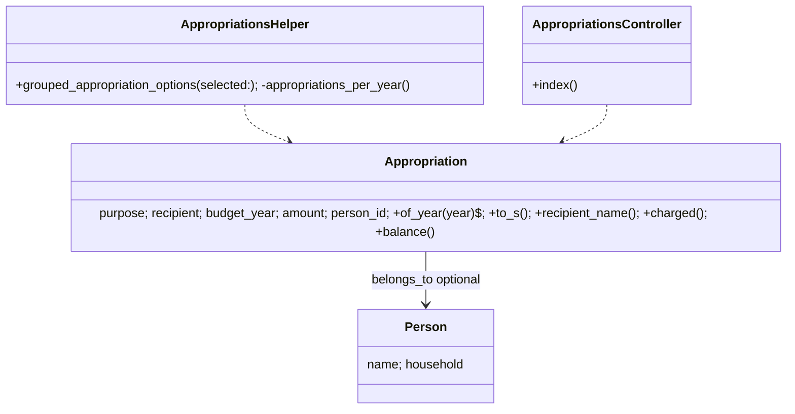
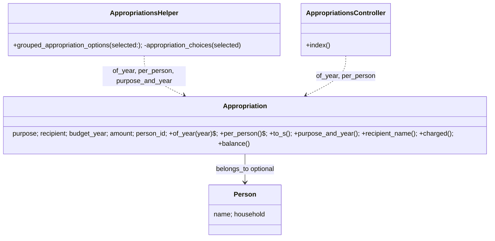
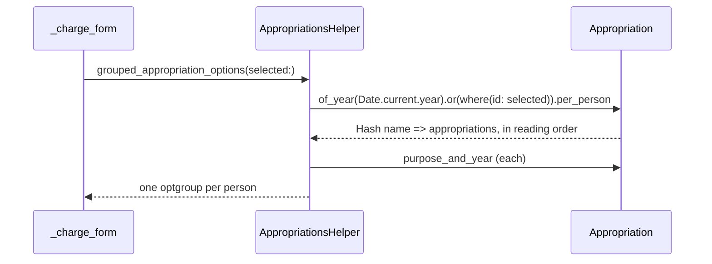

# Plan: Group appropriations by person

From `intent.md` (2026-10-25). Status: accepted.

## Design

### Domain terms

- **Appropriation** (glossary): a sum set aside for one purpose and one person in one budget year. Used unchanged.
- **Person** (AGENTS.md): the recipient of an appropriation. Code reads the name through the existing `Appropriation#recipient_name` (`person&.name || recipient`, the legacy column as fallback).
- **Purpose and year**: the short label of an appropriation inside its person's group, for example "Sinterklaas 2026". It is `Appropriation#to_s` without the person's name. No new glossary term: the method name says what it returns.
- No word of the intent is an avoided glossary word. "Group" in this change means an `<optgroup>` or an index section, never the domain `Group` (a set of people); the code says "per person" to keep that apart.

### Diagrams

Before:



After:





ER: Not affected: no schema change.

### Signatures

`app/models/appropriation.rb` — a sum the household sets aside for one purpose and recipient in one budget year. Gains two public methods; `#to_s` and `#recipient_name` stay unchanged.

```ruby
# Its appropriations per person's name: people by name, then purposes A to Z, then budget year, ignoring letter case
#: () -> Hash[String, Array[Appropriation]]
def self.per_person
  includes(:person).to_a
    .sort_by { |appropriation| [ appropriation.recipient_name.downcase, appropriation.purpose.downcase, appropriation.budget_year ] }
    .group_by(&:recipient_name)
end

# The name it goes by among its person's appropriations, e.g. "Sinterklaas 2026"
#: () -> String
def purpose_and_year = "#{purpose} #{budget_year}"
```

Called on any relation, for example `Appropriation.of_year(2026).per_person`; the class method runs inside the relation's scope. Ruby's `Hash` keeps insertion order, so the groups come out sorted. If the sort line passes 120 characters, extract the key into a private class method or wrap it; RuboCop decides.

`app/helpers/appropriations_helper.rb` — helpers for choosing an appropriation. Public signature unchanged.

```ruby
# Options for an appropriation select: this year's appropriations, one group per person,
# plus the selected one from any year
#: (?selected: Appropriation?) -> ActiveSupport::SafeBuffer
def grouped_appropriation_options(selected: nil)
  grouped_options_for_select(appropriation_choices(selected), selected&.id)
end

private

# This year's appropriations and the selected one as ["Purpose Year", id] pairs, keyed by the person's name
#: (Appropriation?) -> Hash[String, Array[[String, Integer]]]
def appropriation_choices(selected)
  Appropriation.of_year(Date.current.year).or(Appropriation.where(id: selected&.id)).per_person
    .transform_values { |appropriations| appropriations.map { |choice| [ choice.purpose_and_year, choice.id ] } }
end
```

`appropriations_per_year` goes. `where(id: nil)` renders `id IS NULL` and matches no row, so a blank selection adds nothing.

`app/controllers/appropriations_controller.rb` — `#index` only.

```ruby
# Lists the appropriations of one budget year per person, this year unless another is chosen.
#
# @action GET
# @route /appropriations
#: () -> void
def index
  @year = chosen_year
  @appropriations_per_person = Appropriation.of_year(@year).per_person
  @appropriations = @appropriations_per_person.values.flatten
end
```

`@appropriations` holds the same instances, flattened; the view uses it for `empty?` and the `tfoot` totals.

Methods this change adds or rewrites carry an inline RBS signature (`#:`) and no YARD type tags (`@param`, `@return`), as `ruby-style` asks of personal projects. The controller's `@action` and `@route` tags stay. Methods the change does not touch keep their YARD comments; converting them is out of scope.

Not checked: the project has no Steep or rbs_rails.

### Complexity

- `Appropriation.per_person`: at most 2 queries regardless of n: the appropriations, then the people preload, which Rails skips when no appropriation matches. Sort and group run in Ruby, O(n log n); n is one household's appropriations for one year.
- Picker: at most 2 queries per charge form, as today; n falls from every year to this year plus at most one row.
- Index: 2 queries for the list, plus the existing memoized `#charged` queries once per appropriation. The flat list and the groups share instances, so `tfoot` sums run no new `#charged` queries.

### Invariants

- People sort by name, ignoring letter case; purposes run A to Z inside a person, then budget year. Enforced in `Appropriation.per_person`.
- Every appropriation of the relation appears in exactly one group (`group_by` partitions). Enforced in `Appropriation.per_person`.
- The picker lists only appropriations of `Date.current.year`, plus the selected one, which stays marked as selected. Enforced in `AppropriationsHelper#appropriation_choices` and the `selected&.id` argument.
- The grand total covers every appropriation of the year, and `#charged` runs once per appropriation. Enforced by the controller flattening the same instances.
- `Appropriation#to_s` still reads "Purpose Recipient Year". The method is not touched.

### Alternatives

1. **Model-owned grouping (chosen).** `Appropriation.per_person` holds the one sort-and-group rule; picker and index both call it. `#purpose_and_year` owns the short label next to `#to_s`.
2. **Smallest change (rejected).** Sort and group inline in the helper, sort in the controller and `group_by` in the view; no new model method. Rejected: the same ordering rule lives in two places that must change together, and grouping logic sits in the view. The playbook puts business logic on the object that owns the data.
3. **Categories pattern on the index (rejected).** One `<article><h2>` and one table per person, as `app/views/categories/index.html.erb` does. Rejected: the grand total then needs a table of its own, and columns do not line up across people. The intent says the table gets one section per person and the grand total row stays, which is one table with row groups.

## Design decisions

- Method name `per_person`, not `per_recipient`: the intent and the glossary say "person"; `recipient` is the legacy column that AGENTS.md calls immutable history.
- The group key is the name string from `#recipient_name`, not a `Person` record, so a legacy appropriation without a person still lands in a group. A legacy `recipient` that differs from a person's name only in letter case forms a separate group; accepted, because every new appropriation has a person.
- Sort in Ruby, not SQL: case-insensitive on SQLite and covers the legacy fallback name.
- The year filter and "keep the selected one" stay in the helper: they are rules of the select, not of the domain. The assistant (MCP) tools keep charging any year (out of scope).
- "Current year" is `Date.current.year`, the same rule the index uses for its default year.
- Index markup: one `<table data-stack="medium">`, one `<thead>` without the Recipient column, one `<tbody role="rowgroup">` per person whose first row is `<tr role="row"><th scope="rowgroup" colspan="4" role="rowheader">Name</th></tr>`, one `<tfoot>` grand total without its empty recipient cell. The heading is a `th`, so the existing check that every `tbody td` has a `data-label` stays green; mvpa.css stacks a `th` row as a block at narrow widths.
- The codebase documents types with YARD; `ruby-style` asks personal projects for inline RBS (`#:`) and no YARD tags. The rule wins for the methods this change adds or rewrites; untouched methods keep YARD. No file in `app/` uses `#:` yet, so these are the first.
- Acceptance criterion 1 says "the group Serena ... then the group Chiara" and then "so Chiara comes first". The plan follows the rule: groups sort by name, Chiara before Serena.
- No conflict with intent's `## Decisions`: the picker shows only the current year, the index has no per-person subtotals, the selected appropriation stays listed.

## Integration points

- `app/views/appropriations/_charge_form.html.erb` renders the picker on a whole payment (`transactions/_whole_payment_charge`) and on each split part (`transaction_splits/_table`). Its call does not change.
- Assistant (MCP) tools and the show page use `Appropriation#to_s`; untouched.
- mvpa.css table stacking (`data-stack`, `data-label`) for the index at narrow widths.

## Files that change

- `app/models/appropriation.rb` — add `.per_person` and `#purpose_and_year`.
- `app/helpers/appropriations_helper.rb` — current year plus selected, grouped per person, labelled "Purpose Year"; replace `appropriations_per_year` with `appropriation_choices`.
- `app/controllers/appropriations_controller.rb` — `#index` sets `@appropriations_per_person` and the flat `@appropriations`.
- `app/views/appropriations/index.html.erb` — drop the Recipient column, one `tbody` per person with a heading row, keep one `tfoot`.
- `test/test_helpers/appropriation_assertions.rb` — `assert_appropriation_row(purpose, recipient, appropriated, charged, balance)` keeps its signature; it finds the `tbody` whose heading `th` reads `recipient`, asserts it exists, then asserts a `tr` inside it matching purpose and the three amounts. Update the module comment. Its callers do not change.
- `test/models/appropriation_test.rb` — unit tests for `.per_person` and `#purpose_and_year`.
- `test/helpers/appropriations_helper_test.rb` — replace the by-year test.
- `test/integration/appropriation_charges_test.rb` — picker acceptance tests.
- `test/integration/appropriations_test.rb` — index acceptance test.

## Order of work

1. Write the acceptance test for criterion 1 in `test/integration/appropriation_charges_test.rb` (picker groups per person, "Purpose Year" labels). Run it, watch it fail.
2. Add `Appropriation#purpose_and_year` and `Appropriation.per_person` with their unit tests.
3. Rewrite `AppropriationsHelper#grouped_appropriation_options` on top of them; replace the helper test. Criterion 1 goes green.
4. Write the acceptance tests for criteria 2 and 3 (no 2025 option; a payment charged to a 2025 appropriation keeps it selected in its person's group). Confirm green; fix the helper if not.
5. Write the acceptance test for criterion 4 in `test/integration/appropriations_test.rb`. Run it, watch it fail.
6. Change `AppropriationsController#index` and `index.html.erb`; update `assert_appropriation_row` to read per-person sections. Criterion 4 and the existing index tests go green.
7. Run `bin/rails test`, `bin/rails test:system` (responsive tables covers the index at phone width), `bundle exec rubocop`, `npx @herb-tools/linter app/views/`, `bundle exec brakeman --no-pager -q`, `bundle exec i18n-tasks normalize` (expect no change).
8. Check by hand: run the worktree locally, open a payment's edit page and the appropriations index at desktop and phone width.

## Risks

- Tests that render the charge form now depend on today's year. Every new picker test wraps itself in `travel_to Date.new(2026, 10, 25)`; existing tests only check the blank option and form actions, which do not depend on the year.
- `Appropriation.where(...).or(...)` fails when the two relations differ in structure. Both sides are plain `Appropriation` relations without joins; `includes` is applied after `or`, inside `per_person`.
- `assert_appropriation_row` changes how it reads the page. Its ~20 callers keep passing only if every recipient they name has a section; a wrong helper would hide regressions, so its first assertion is that the section exists.
- Rejected: per-person subtotals and changing `#to_s` (intent out of scope).

## Proof

- Picker shows one group per person sorted by name ("Chiara" before "Serena"), each with "Kerst 2026" and "Sinterklaas 2026" → `test/integration/appropriation_charges_test.rb` `test "the picker groups this year's appropriations per person, labelled by purpose and year"` (on 2026-10-25, adds Kerst 2026 for Chiara and Serena and Sinterklaas 2026 for Serena beside the fixtures; reads optgroup labels and option texts on the gift payment's edit page)
- An appropriation of 2025 does not appear in the picker → `test/integration/appropriation_charges_test.rb` `test "the picker leaves out appropriations of other years"`
- A payment charged to a 2025 appropriation still shows it selected in its person's group → `test/integration/appropriation_charges_test.rb` `test "the picker keeps a payment's appropriation from another year selected in its person's group"`
- The index for 2026 shows a heading per person with their appropriations under it, and one grand total → `test/integration/appropriations_test.rb` `test "the year page shows one section per person and one grand total"` (headings `%w[Chiara Cosimo Etienne Serena]` in order; Etienne's section holds Birthday then Christmas; no Recipient column header; one `tfoot` with the 45000 total)
- Query count: the picker loads its options with at most two queries, one when nothing matches → `test/helpers/appropriations_helper_test.rb` `test "loads the options with at most two queries"`
- Query count: the index works out what is charged once per appropriation → `test/integration/appropriations_test.rb` `test "the year page works out what is charged once per appropriation"` (existing)
- Invariant: people by name ignoring case, purposes A to Z, each appropriation once, enforced by `Appropriation.per_person` → `test/models/appropriation_test.rb` `test "per_person groups by name and orders purposes A to Z"`
- Invariant: picker lists only the current year plus the selected one, enforced by `AppropriationsHelper#appropriation_choices` → `test/helpers/appropriations_helper_test.rb` `test "offers only this year's appropriations"` and `test "keeps the selected appropriation from another year"`
- Invariant: `Appropriation#to_s` unchanged → existing `test/integration/appropriation_charges_test.rb` `test "a payment's page shows its appropriation, per part when split, without a way to change it"`

Per changed file, the unit tests expected, named as behaviour:
- `app/models/appropriation.rb`: `Appropriation.per_person groups by name and orders purposes A to Z`, `per_person ignores letter case in names and purposes`, `per_person keeps a legacy appropriation without a person under its recipient`, `#purpose_and_year reads "Birthday 2026"`.
- `app/helpers/appropriations_helper.rb`: `groups options per person by name`, `labels options by purpose and year`, `offers only this year's appropriations`, `keeps the selected appropriation from another year`, `marks nothing selected without a selection`, `loads the options with at most two queries`.
- `app/controllers/appropriations_controller.rb`, `app/views/appropriations/index.html.erb`: covered by the integration tests above and the existing index tests through `assert_appropriation_row`.

Test setup: fixtures `appropriations.yml` (2026 and 2027) and `people.yml`; extra appropriations created in the test where a criterion needs them (Kerst 2026, a 2025 record). Picker tests run inside `travel_to Date.new(2026, 10, 25)`. A legacy appropriation without a person is made by creating one with a person and then calling `update_columns(person_id: nil)`, since validation requires a person.

Out of scope: per-person subtotals, `Appropriation#to_s`, the show page, the assistant (MCP) tools, the year navigation.

---
Domain skills applied: rails-architecture, object-oriented-design, software-design, ruby-style, rails-ui, rails-testing, glossary.

## Critique

### Round 1 (codex exec -p terra)

- The design substitutes YARD for the inline RBS signatures that `ruby-style` requires on personal projects → fixed (Signatures use `#:` without YARD type tags for added or rewritten methods; Design decisions records the rule over codebase style)
- The claim that `.per_person` always runs two queries is too strong, since Rails skips the people preload on an empty result → fixed (Complexity, Proof and the helper test name now say at most two queries, one when nothing matches)
