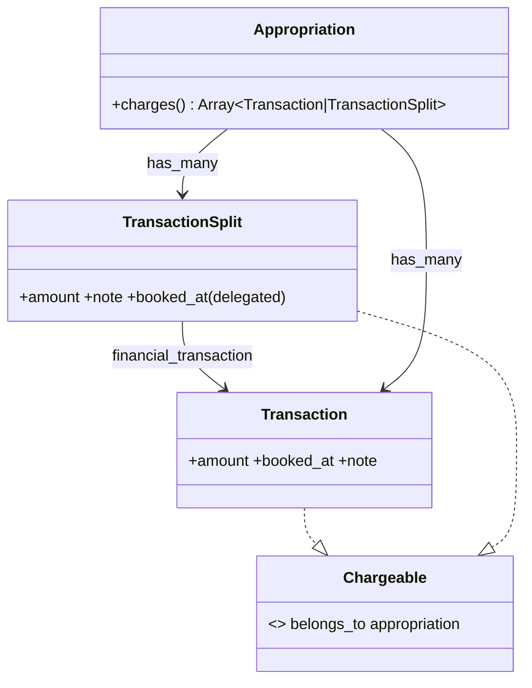
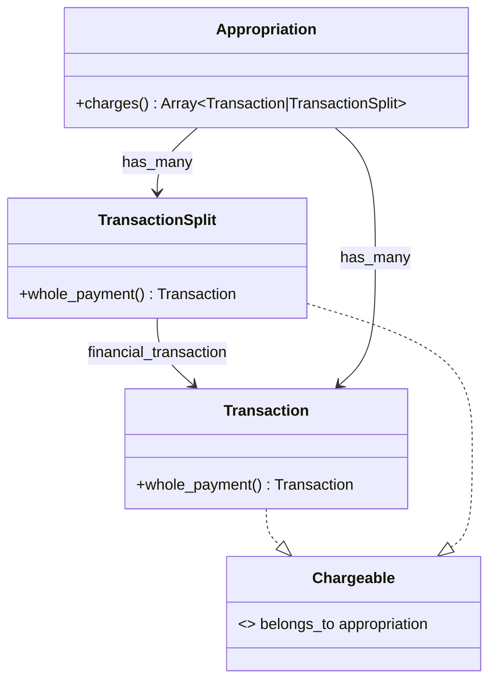
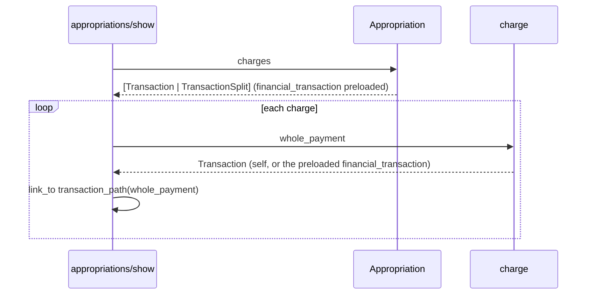

# Plan: Link appropriation charges to their transaction

From `intent.md` (2026-11-06). Status: accepted.

## Design

### Domain terms

- **Appropriation** — as in `GLOSSARY.md`.
- **Charge** (in use, not in the glossary yet) — one row of `Appropriation#charges`: a `Transaction` charged as a whole, or a `TransactionSplit` charged on its own.
- **Whole payment** (new message name) — the transaction a charge belongs to. A payment charged as a whole is its own whole payment. A split part's whole payment is the transaction it splits. The intent already says "whole-payment charge", and the transaction edit page already calls the whole-payment charge form `transactions/_whole_payment_charge`. Avoid: "original" (names the raw bank columns `original_note` and so on), "payment" (`Receipt#payment` names the bank transaction that paid a receipt), "parent" (the `Category` hierarchy term).

### Diagrams

Before:



After:





### Signatures

`Transaction` (`app/models/transaction.rb`) — a bank mutation between two accounts; the summary stays. One new public method:

```ruby
# The payment a charge belongs to; a payment charged as a whole is its own
#: () -> Transaction
def whole_payment = self
```

`TransactionSplit` (`app/models/transaction_split.rb`) — a portion of a transaction allocated to a category; the summary stays. One new public method:

```ruby
# The payment this part splits
#: () -> Transaction
def whole_payment = financial_transaction
```

`Chargeable` (`app/models/concerns/chargeable.rb`) — no code change. Its doc comment gains one line: "Every chargeable answers `whole_payment`, the transaction it belongs to."

`app/views/appropriations/show.html.erb` — the amount cell follows `app/views/shared/_recent_transactions.html.erb` lines 34–37:

```erb
<td>
  <%= link_to transaction_path(charge.whole_payment) do %>
    <data value="<%= charge.amount %>"><%= cents_to_currency charge.amount %></data>
  <% end %>
</td>
```

`Appropriation#charges` does not change.

Not checked: the project has no Steepfile and no steep or rbs_rails gem; the inline `#:` comments follow the existing style.

### Complexity

- `Appropriation#charges` already runs a fixed number of queries: the charged transactions, the charged splits, and one preload of their `financial_transaction`. The preload exists because `TransactionSplit` delegates `booked_at`.
- `Transaction#whole_payment` returns `self`: no query.
- `TransactionSplit#whole_payment` reads the association. On the show page `charges` preloads it, so it runs no query there. Outside that path it loads the transaction with one query, as `financial_transaction` always does.
- `transaction_path` reads only the id: no query.
- The show page therefore runs the same number of queries for one split-part charge as for three.

### Invariants

- Every charge answers `whole_payment` with a `Transaction`. Enforced by `Transaction#whole_payment` returning `self`, and by the required `belongs_to :financial_transaction` on `TransactionSplit`.
- The view holds no type check: it sends one message to every charge.
- Rendering the charge links adds no query per charge. Enforced by `includes(:financial_transaction)` in `Appropriation#charges`.
- An appropriation with no charges shows "Nothing is charged to this appropriation yet." and no payment link. Enforced by the existing `charges.empty?` branch in the view.

### Alternatives

1. **Chosen: `whole_payment` on `Transaction` and `TransactionSplit`.** Tell, Don't Ask: each charge answers which payment it belongs to, and the view sends one message without a branch. Cost: one one-line public method on each of two models.
2. **Rejected: a helper `charged_payment_path(charge)` in `AppropriationsHelper`** that does `transaction_path(charge.is_a?(TransactionSplit) ? charge.financial_transaction : charge)`. It keeps the models untouched, but it puts a type check in the view layer. The helper must know every kind of charge and how a split names its payment — connascence of type on the wrong object. The playbook puts this knowledge on the object that owns the data.
3. **Rejected: an inline `charge.try(:financial_transaction) || charge` in the view.** It is the same type check, hidden, and it depends on `Transaction` never answering `financial_transaction`.
4. **Rejected: a default `whole_payment = self` in `Chargeable`, overridden in `TransactionSplit`.** It enforces the shared name more strongly, but an override of a concern method is harder for a reader to find than two explicit one-line methods.

## Design decisions

- **A model method instead of a view-only change.** `intent.md`'s "Affected users and systems" says "No model, route or schema change is expected." That is an expectation, not an entry in `## Decisions`, and the agreed behaviour does not change. The design adds one query-free reader method to two models, so the view sends one message instead of checking types (alternative 2). No route, schema or locale changes.
- **The link wraps the amount in a `<data value>` element**, as the amount links in `shared/_recent_transactions.html.erb` and `transactions/_table.html.erb` do. This matches "Follow the existing table and link style" and `## Decisions` ("The amount cell carries the link").
- **The link text is the amount**, so no new i18n string is needed.
- **The tests go in `test/integration/appropriations_test.rb`**, next to the existing show-page tests ("an appropriation lists the payments and split parts charged to it").

## Integration points

- `transaction_path` from `resources :transactions` in `config/routes.rb`. It works for `Credit` and `Debit` records, as `shared/_recent_transactions.html.erb` already shows.
- The transaction page and its charge forms (`transactions/_whole_payment_charge`, `transaction_splits/appropriation_charge`) stay unchanged. The link only leads there.

## Files that change

- `test/integration/appropriations_test.rb` — four new integration tests (see Proof).
- `test/models/transaction_test.rb` — a unit test for `Transaction#whole_payment`.
- `test/models/transaction_split_test.rb` — a unit test for `TransactionSplit#whole_payment`.
- `app/models/transaction.rb` — add `whole_payment`.
- `app/models/transaction_split.rb` — add `whole_payment`.
- `app/models/concerns/chargeable.rb` — one doc comment line that states the `whole_payment` contract.
- `app/views/appropriations/show.html.erb` — the amount cell becomes a link to `transaction_path(charge.whole_payment)`.

## Order of work

1. Write the acceptance test "a whole payment charged to an appropriation links its amount to that payment" in `test/integration/appropriations_test.rb`. Run it with `bin/rails test test/integration/appropriations_test.rb -n "/links its amount to that payment/"`. Watch it fail: no `a[href]` in the amount cell.
2. Write the acceptance test "a split part charged to an appropriation links its amount to the payment it splits". Run it, watch it fail the same way.
3. Write the unit tests for `Transaction#whole_payment` and `TransactionSplit#whole_payment`. Run them, watch them fail with `NoMethodError`.
4. Add `Transaction#whole_payment` and `TransactionSplit#whole_payment`, and the doc line on `Chargeable`. Run the unit tests: green.
5. Change the amount cell in `app/views/appropriations/show.html.erb`. Run both acceptance tests: green.
6. Write "an appropriation with no charges says so and links no payment". It passes at once, because the `charges.empty?` branch already holds; it guards the criterion.
7. Write the query-count test "the show page runs as many queries for three charged split parts as for one". It must pass.
8. Run `bin/rails test test/integration/appropriations_test.rb test/integration/appropriation_charges_test.rb test/models/transaction_test.rb test/models/transaction_split_test.rb`, then `bin/rails test`, then `bin/rails test:system`.
9. Run the linters: `bundle exec rubocop`, `npx @herb-tools/linter app/views/appropriations/show.html.erb` (after `npm install` in the worktree), `bundle exec brakeman --no-pager -q`, `bundle exec bundler-audit check`, `bundle exec i18n-tasks normalize` (expect no diff).
10. Verify as a human would: run the worktree locally, open an appropriation with a whole-payment charge and a split-part charge, click each amount, and confirm each lands on the right transaction page.

## Risks

- **A whole-payment charge with no booking date** still renders a link; `transaction_path` needs only the id. The existing test "an appropriation lists a charged payment that has no booking date" keeps covering that row.
- **The `<data>` element changes the row text** that the existing `assert_select "tr", text: /…/m` tests match. The amount text stays the same, so those tests keep passing; step 8 confirms it.
- **`whole_payment` exists on every `Transaction`**, Transfers and uncharged payments included, although it only means something for a charge. It returns `self` and is harmless there.
- **Responsive tables**: `test/system/responsive_tables_test.rb` touches appropriation pages. The table cell keeps its structure, so the layout should not change; step 8 runs the system tests.

Out of scope: changing or removing a charge from the appropriation page; any change to the transaction page or its charge forms; other pages that list charges; glossary entries for "Charge" and "Whole payment".

## Proof

- The amount of a charge that is a whole payment links to the page of that transaction → `test/integration/appropriations_test.rb` `a whole payment charged to an appropriation links its amount to that payment`
- The amount of a charge that is a split part links to the page of its parent transaction → `test/integration/appropriations_test.rb` `a split part charged to an appropriation links its amount to the payment it splits`
- An appropriation with no charges still shows "Nothing is charged to this appropriation yet." and no link → `test/integration/appropriations_test.rb` `an appropriation with no charges says so and links no payment`
- Query count: the show page runs as many queries for three charged split parts as for one → `test/integration/appropriations_test.rb` `the show page runs as many queries for three charged split parts as for one`
- Invariant: every charge answers `whole_payment` with a `Transaction`, enforced by `Transaction#whole_payment` and `TransactionSplit#whole_payment` → `test/models/transaction_test.rb` `#whole_payment is the payment itself`, `test/models/transaction_split_test.rb` `#whole_payment is the payment it splits`

Per changed file, the unit tests expected:
- `app/models/transaction.rb`: `Transaction#whole_payment is the payment itself`
- `app/models/transaction_split.rb`: `TransactionSplit#whole_payment is the payment it splits`
- `app/views/appropriations/show.html.erb`: covered by the integration tests above.

Test setup: signed in as `users(:member)`. Whole payment: `transactions(:gift_payment).update!(appropriation:)` on `appropriations(:birthday_etienne)`; assert the link sits in the amount column of a charge row: `assert_select "tbody tr td:nth-child(3) a[href=?]", transaction_path(transactions(:gift_payment)), text: currency(4000)`. The split-part test uses the same `tbody tr td:nth-child(3)` scope. Split part: `transactions(:webshop_sinterklaas).transaction_splits.create!(amount: 6000, category: categories(:gifts), note: "Sinterklaas present for Chiara")`, then `part.update!(appropriation: appropriations(:sinterklaas_chiara))`, as the existing show-page test does; assert the link goes to `transaction_path(transactions(:webshop_sinterklaas))`. No charges: `appropriations(:christmas_etienne)` (no fixture carries a charge), `assert_select "article p", text: "Nothing is charged to this appropriation yet."` and `assert_select "article a[href^='/transactions/']", count: 0`. Query count: on `appropriations(:sinterklaas_chiara)`, create one 2000-cent split part of `transactions(:webshop_sinterklaas)` (10000 cents) and charge it; count every `sql.active_record` event whose `payload[:name]` is not `"SCHEMA"` around `get appropriation_path(...)`; create and charge two more 2000-cent split parts of the same transaction; count again; assert the counts are equal. Count all reads, not only those that name `transaction_splits` as `split_part_reads` does, because an unpreloaded `financial_transaction` would query `transactions`. Use the same `ActiveSupport::Notifications.subscribed` pattern as `split_part_reads`, in a new private helper. No new fixtures.

---
Domain skills applied: software-design, rails-architecture, rails-ui, rails-testing, object-oriented-design.

## Critique

### Round 1 (codex exec -p terra)

- The planned `td a[href=?]` selector accepts a matching link in any cell, so the tests do not prove that the amount cell carries the link → fixed (Test setup scopes both link tests to the third cell of a `tbody tr`, the amount column)
- The query proof copies `split_part_reads`, which only counts SQL that names `transaction_splits`, while an unpreloaded `financial_transaction` would query `transactions`; the "no query" claim also needs the preloaded path named → fixed (the query-count test counts every non-schema read, and Complexity names the preloaded show-page path)
- The query-test setup omits the amounts of the added split parts, and a 6000-cent first split leaves too little of the 10000-cent transaction → fixed (Test setup specifies three 2000-cent split parts of `webshop_sinterklaas`, each charged to `sinterklaas_chiara`)
