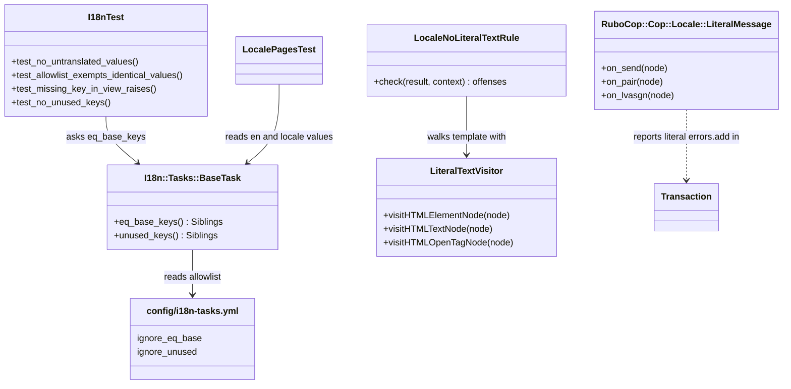
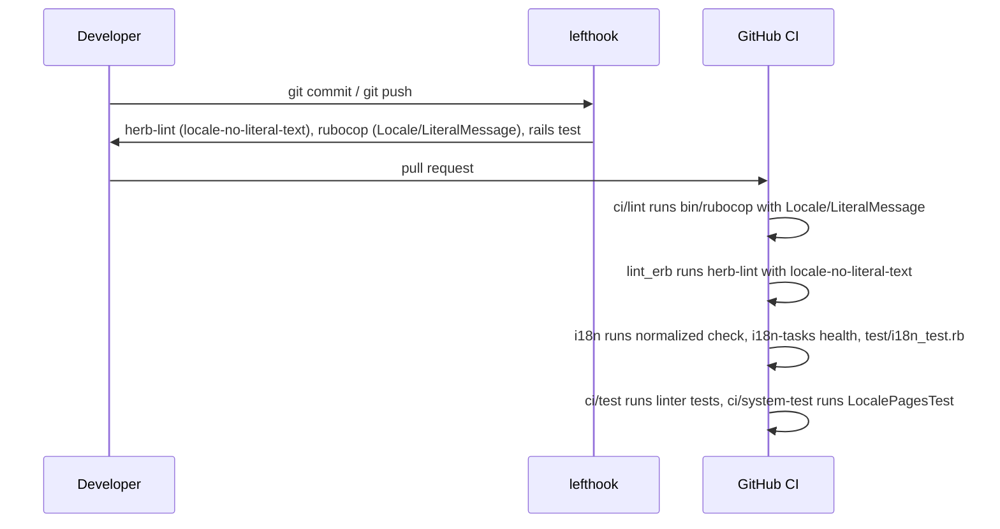

# Plan: Locale guardrails

From `intent.md` (2026-10-24). Status: accepted.

## Design

Every static check is a linter or a test gate that already exists in the toolchain: i18n-tasks for locale values, herb-lint for ERB, RuboCop for Ruby. Each linter gets a Minitest that feeds it concrete inputs. No new gem, no new npm package, no new application class.

### Domain terms

`GLOSSARY.md` holds household-finance terms only; none is touched and no `Avoid:` word is used. The terms below are tooling terms for this change. They stay in this plan and are not written to the glossary, because Etienne has not agreed them.

- **Missing translation** — a key that code looks up and the current locale lacks. In test and development it raises.
- **Untranslated value** — an `nl` or `it` leaf whose value equals the `en` leaf at the same key. i18n-tasks calls these "eq-base" keys (`I18n::Tasks::BaseTask#eq_base_keys`, command `i18n-tasks eq-base`).
- **Identical-value allowlist** — the `ignore_eq_base` key patterns in `config/i18n-tasks.yml`, under `all:`, `nl:` and `it:`. A key on it may keep the `en` value because that value is right in the other language (Dashboard, Status, Email, IBAN, language names, emoji and format strings).
- **Literal text** — text a user sees that is written in a template or a Ruby string literal instead of coming from a translation key.
- **Known English text** — the `en` values with a letter and no `%{`, minus every value of the target locale. The system test looks for these on `nl` and `it` pages.

### Diagrams

The before picture: no database table is touched, so there is no ER diagram. Today `I18nTest` asks `I18n::Tasks::BaseTask` for missing and unused keys, `.herb.yml` holds only built-in rules, `.rubocop.yml` only inherits `rubocop-eirvandelden`, and `Transaction` adds English error strings.





### Signatures

Config only, no classes:

- `config/environments/test.rb`: `config.i18n.raise_on_missing_translations = true` (uncomment) and `config.i18n.fallbacks = false`.
- `config/environments/development.rb`: `config.i18n.raise_on_missing_translations = true` (uncomment).
- `config/application.rb`: `config.autoload_lib(ignore: %w[assets rubocop tasks])`, so Zeitwerk never autoloads or eager-loads `lib/rubocop`.
- `config/i18n-tasks.yml`: an `ignore_eq_base:` section with `all:`, `nl:` and `it:` lists (the identical-value allowlist), and `ignore_unused` entries only for keys a dynamic lookup reads.
- `.rubocop.yml`: `require: [./lib/rubocop/cop/locale/literal_message.rb]` and `Locale/LiteralMessage: { Enabled: true, Include: [app/controllers/**/*.rb, app/models/**/*.rb] }`.
- `.herb.yml`: `locale-no-literal-text: { enabled: true, severity: error }` under `linter.rules`, so a reader sees the rule.

`.herb/rules/locale-no-literal-text.mjs` — reports literal text in ERB templates.

```js
// Reports text nodes, and placeholder/title/alt/aria-label values, that hold a letter outside ERB.
export default class LocaleNoLiteralTextRule extends ParserRule {
  static ruleName = "locale-no-literal-text"
  /** @param {ParseResult} result @param {LintContext} context @returns {LintOffense[]} */
  check(result, context)
}

// Not exported. Calls super in every hook so nested elements are seen.
class LiteralTextVisitor extends BaseRuleVisitor {
  /** Does not descend into script and style elements; pre content is user-visible and is checked. */
  visitHTMLElementNode(node)
  /** Offense when the content, with HTML entities (&nbsp; &times; &#160;) removed, matches /\p{L}/u. */
  visitHTMLTextNode(node)
  /** Offense per placeholder|title|alt|aria-label attribute whose literal (non-ERB) part matches /\p{L}/u. */
  visitHTMLOpenTagNode(node)
}
```

It imports only from `@herb-tools/linter`: `BaseRuleVisitor`, `ParserRule`, `getAttributes`, `getAttributeName`, `getTagName` (and `getAttributeValueNodes` if needed). The default severity is error.

`lib/rubocop/cop/locale/literal_message.rb` — reports a string literal that a controller or model shows to a user as a message.

```ruby
# Reports a string literal with a letter passed as a flash, notice, alert, validation or errors.add message.
class RuboCop::Cop::Locale::LiteralMessage < RuboCop::Cop::Base
  MSG = "Use a translation key for a user-facing message, not a literal string."
  RESTRICT_ON_SEND = %i[[]= notice= alert= add].freeze

  # Reports flash[:x] = "...", flash.now[:x] = "...", flash.notice = "..." and errors.add(:attr, "...").
  #: (RuboCop::AST::SendNode node) -> void
  def on_send(node)

  # Reports notice: "...", alert: "..." and message: "..." in any call (redirect_to, render, validates).
  #: (RuboCop::AST::PairNode node) -> void
  def on_pair(node)

  # Reports notice = "..." and alert = "..." assigned to a local or instance variable.
  #: (RuboCop::AST::AsgnNode node) -> void
  def on_lvasgn(node)
  alias on_ivasgn on_lvasgn
end
```

Node patterns stay private `def_node_matcher`s inside the class:

- `(send {(send nil? :flash) (send (send nil? :flash) :now)} :[]= _ $_)`
- `(send (send nil? :flash) {:notice= :alert=} $_)`
- `(send (send _ :errors) :add _ $_ ...)` and `(send nil? :errors ...)` variants as the receiver needs
- `(pair (sym {:notice :alert :message}) $_)`
- `({lvasgn ivasgn} {:notice :alert :@notice :@alert} $_)`

The captured node is an offense when it is a `str` or `dstr` that still holds a letter (`\p{L}`) after `%{...}` and `#{...}` parts are removed. `raise Error, "..."` is not reported: those messages are for developers. The namespace is `Locale`, not `I18n`, so `RuboCop::Cop::I18n` cannot shadow `::I18n`.

`test/i18n_test.rb` (`I18nTest < ActiveSupport::TestCase`) — gains `require "test_helper"` so it runs alone in the CI job.

```ruby
# Fails when an nl or it value still equals the en value and its key is not on the allowlist.
#: () -> void
def test_no_untranslated_values

# Proves eq_base_keys reports a copied English value and skips an allowlisted one, on tmpdir locale files.
#: () -> void
def test_allowlist_exempts_identical_values

# Proves a view that calls t("no.such.key") raises instead of falling back.
#: () -> void
def test_missing_key_in_view_raises

# Tightened from `<= 450` to assert_empty, to match `i18n-tasks health`.
#: () -> void
def test_no_unused_keys
```

`test/system/locale_pages_test.rb` (`LocalePagesTest < ApplicationSystemTestCase`) — shows the main pages in Dutch and Italian.

```ruby
PAGES = %i[root_path transactions_path accounts_path categories_path budgets_path
           appropriations_path receipts_path products_path chattels_path].freeze

#: () -> void
test "Dutch main pages show no English text"
#: () -> void
test "Italian main pages show no English text"

private
  # Visits every page, refutes .translation_missing and every known English text in the page chrome.
  #: (Symbol locale) -> void
  def assert_pages_in(locale)

  # Whole-word, case-sensitive pattern of the en values the locale should have translated.
  #: (Symbol locale) -> Regexp
  def known_english_text(locale)
```

`known_english_text` reads `I18n::Tasks::BaseTask.new.data`, keeps every `en` leaf string with a letter and no `%{`, drops every value that also appears in the target locale, and returns `Regexp.union` with `\b` anchors. The search covers the page chrome only (`nav, h1, h2, h3, label, th, button, summary, legend, [type=submit]`) so fixture data cannot cause a false alarm. Dutch: `users(:admin)` (locale `nl`). Italian: `users(:member).update!(locale: :it)`, then `sign_in_as`.

`Transaction` (`app/models/transaction.rb`) — a bank transaction, typed by account ownership. Its public interface does not change.

- Line 63: `inclusion: { in: TYPES, message: :invalid_type }`.
- Lines 150, 154, 158: `errors.add(:type, :transfer_needs_household_accounts)`, `:debit_needs_household_debitor`, `:credit_needs_household_creditor`.
- Keys under `activerecord.errors.models.transaction.attributes.type.*` in `en`, `nl`, `it`. STI subclasses find them through `lookup_ancestors`.

Not checked: journal_administration has no Steep or rbs_rails; adding them needs a dependency approval (playbook rule 11) and is out of scope.

### Complexity

- No new production path and no new query. `Transaction` validations do the same work with symbol messages.
- `eq_base_keys`: O(keys × locales) in memory, 0 queries.
- Herb rule: O(AST nodes) per template.
- Cop: O(AST nodes) per file; `on_send` fires only for the 4 names in `RESTRICT_ON_SEND`.
- Herb rule test: one `herb-lint` process per case, about 0.5–1 s each.
- System test: 9 pages × 2 locales = 18 visits, each with the page's existing query count.

### Invariants

1. A `t` call to a key missing in the current locale raises in test and development. Enforced by the environment config. Proven by `test_missing_key_in_view_raises`.
2. No `nl` or `it` value equals its `en` value unless its key matches `ignore_eq_base`. Enforced by `test_no_untranslated_values` (full suite and the CI `i18n` job).
3. No ERB template under `app/views` holds a letter in a text node or in a literal `placeholder`, `title`, `alt` or `aria-label` value. Enforced by the herb rule at severity error in `lint_erb` and lefthook.
4. No controller or model passes a string literal with a letter as a flash, `notice`, `alert`, `message:` or `errors.add` message. Enforced by `Locale/LiteralMessage` in `bin/rubocop`.
5. The locale files are normalized and have no missing or unused keys. Enforced by `i18n-tasks health` in CI and by `I18nTest`.
6. Zeitwerk never loads `lib/rubocop`. Enforced by `autoload_lib(ignore:)`. Proven by eager load in every CI test run (`config.eager_load = ENV["CI"].present?`).
7. A `Transaction` type error shows in the user's locale. Enforced by the `activerecord.errors.models.transaction` keys. Proven by a model test, because `raise_on_missing_translations` does not cover ActiveModel error lookup and i18n-tasks ignores `activerecord.*`.
8. Production keeps `config.i18n.fallbacks = true`. `production.rb` is not touched.

### Alternatives

- **A. Least change** — all checks as Minitest tests in `test/i18n_test.rb`: the English-message check is a regex over `app/{controllers,models}/**/*.rb`, the herb rule is tested from the same file. Rejected: a regex matches inside comments and heredocs and misses multi-line calls, it reports no file:line in the editor, and `I18nTest` grows past the class-length limit.
- **B. Lint-first (chosen)** — herb custom rule plus a project RuboCop cop, each proven by Minitest on concrete inputs; untranslated values through i18n-tasks' own `eq_base_keys` and `ignore_eq_base`. Chosen: each offense shows as file:line at edit time, in pre-commit and in CI, and it reuses three tools the project already runs.
- **C. Deepest module** — the same as B for i18n-tasks, but the herb rule tested through a fixture file and the cop tested through `RuboCop::Minitest::AssertOffense` with a class-name-derived cop. It converges on B; its whole-word chrome search for known English text is taken into B's system test.
- Rejected inside B: enabling `Rails/I18nLocaleTexts` (it misses `errors.add(:x, "...")`, `dstr` and `flash.notice =`); a `node:test` unit test of the herb rule (it would import the transitive `@herb-tools/node-wasm` and not prove that `.herb/rules` is auto-loaded); a value-based allowlist (it needs a custom i18n-tasks method, where key patterns need none).

## Design decisions

- **Allowlist by key, not value.** `ignore_eq_base` is built into i18n-tasks 1.1.2 (`IgnoreKeys`, `MissingKeys#eq_base_keys`), so the allowlist needs no code. A new cognate key needs one more line. Prefer leaf keys; use a wildcard only on subtrees that hold formats only (`date.formats.*`, `time.formats.*`, `number.*.format`, `number.*.units.*`, `support.array.*`), never all of `number.*`.
- **`categories.main` stays, spelled `Hoofdcategorieën`, on `ignore_unused`.** It is one of the 9 unused keys, so `i18n-tasks health` needs it gone, but acceptance criterion 8 requires `nl.yml` to show `Hoofdcategorieën`. Keeping it meets both criteria literally. Deleting it instead would change an agreed criterion, so that choice goes to Etienne.
- **The other 8 unused keys are deleted** after a grep confirms no code reads them (`transaction_splits.{create,update,destroy}.success`, `users.profiles.edit.locale_{en,it,nl}` — `locale_options_for_select` uses `language_names.*` — `budgets.destroy.confirm`, `dashboard.filters.choose`). A key that a dynamic lookup reads goes on `ignore_unused` instead.
- **`test_no_unused_keys` is tightened to zero**, because acceptance requires `i18n-tasks health` green and the 450 threshold then means nothing.
- **`en.home` and `en.journal` are fixed**: they hold the Dutch "🏠 Thuis" and "📔 Journaal" today. After the fix `it.home` may equal `en.home` ("Home"); translate it or allowlist it under `it:`.
- **`BulkUpdatable::MissingCategoryError` stays unchanged.** Its English message never reaches a user: `Accounts::TransactionsBulkController` rescues it and shows `t(".no_category")`. The merchant-reassignment alert interpolates `PaymentProvider::MoveFailed#message`, which is built from `Transaction` validation errors; localizing those errors localizes the alert.
- **The cop does not report `raise` strings.** `Cents` and other models raise developer-facing `ArgumentError` text.
- **The CI `i18n` job is extended, not duplicated.** It keeps `bin/check_i18n_normalized` (also used by `.lefthook.yml`), then runs `bundle exec i18n-tasks health`, then `bin/rails db:test:prepare` and `bin/rails test test/i18n_test.rb` as two separate steps, both with `RAILS_ENV: test` and `CI: true` (Rails parses everything after a Rake task on one `bin/rails` line as further Rake tasks). The herb rule test, the cop test and the system test run in the existing appkit `ci` job, whose test job already runs `npm ci`.
- **The herb rule test drives the real CLI.** It writes each case to a `Dir.mktmpdir` under `Rails.root/tmp` and runs `node_modules/.bin/herb-lint --json --force --no-timing <file>` with `chdir: Rails.root`, so it proves `.herb/rules` is loaded. Sample files never live under `app/views` or `test/fixtures`, so lefthook's pre-commit herb hook never sees a deliberately bad file.

No step contradicts `intent.md`'s `## Decisions`: items 1–5 and 7 are in one change, item 6 stays out, the hardcoded-text check is a herb rule, `ci.yml` is edited for item 7 only, and every existing violation is fixed here.

## Integration points

- i18n-tasks 1.1.2 (`eq_base_keys`, `ignore_eq_base`, `health`).
- `@herb-tools/linter` 0.11.1 custom rules in `.herb/rules/*.mjs`, auto-loaded by `herb-lint`, the lefthook herb hooks and the Herb language server.
- RuboCop 1.92 with `rubocop-eirvandelden` shared config and `rubocop-minitest` 0.41 (`RuboCop::Minitest::AssertOffense`).
- Zeitwerk `autoload_lib`.
- GitHub Actions: `.github/workflows/ci.yml` local jobs plus the reusable `eirvandelden/appkit` `rails-ci.yml` (not edited).
- `ApplicationController#switch_locale` and `User#locale` (read only).

## Files that change

- `config/environments/test.rb` — raise on missing translations, fallbacks off.
- `config/environments/development.rb` — raise on missing translations.
- `config/application.rb` — `rubocop` added to `autoload_lib(ignore:)`.
- `config/i18n-tasks.yml` — `ignore_eq_base` allowlist; `ignore_unused` for `categories.main` and any dynamic key.
- `config/locales/en.yml`, `nl.yml`, `it.yml` — fix `en.home`, `en.journal`, `it.admin.users.form.password`, `nl.categories.main`, every other genuine untranslated value; remove unused keys; add `layouts.admin.title` and the `activerecord.errors.models.transaction.attributes.type.*` keys; normalize.
- `app/views/layouts/admin.html.erb` — line 10 `<title>` from `t(".title", app: Rails.application.class.module_parent_name)`.
- `app/models/transaction.rb` — symbol messages for the inclusion validation and the three `errors.add` calls.
- `.herb/rules/locale-no-literal-text.mjs` — new herb rule.
- `.herb.yml` — list the rule at severity error.
- `lib/rubocop/cop/locale/literal_message.rb` — new cop.
- `.rubocop.yml` — require and enable the cop.
- `test/i18n_test.rb` — new tests, tightened unused-keys test, `require "test_helper"`.
- `test/lib/herb/locale_no_literal_text_test.rb` — new, proves the herb rule through the CLI.
- `test/lib/rubocop/cop/locale/literal_message_test.rb` — new, proves the cop.
- `test/models/transaction_test.rb` — new test for the localized type error.
- `test/system/locale_pages_test.rb` — new, nl and it pages.
- `.github/workflows/ci.yml` — extend the `i18n` job (approved for item 7 only).

## Order of work

1. Write `test_missing_key_in_view_raises` in `test/i18n_test.rb` (add `require "test_helper"`). Run `bin/rails test test/i18n_test.rb -n test_missing_key_in_view_raises`; watch it fail because the view renders a `translation_missing` span instead of raising.
2. Set `raise_on_missing_translations = true` and `fallbacks = false` in `test.rb`, and `raise_on_missing_translations = true` in `development.rb`. Run the step 1 test green. Run the full suite (`bin/rails test`, then `bin/rails test:system`) and fix every missing key it now exposes in the locale files or the code, never in the test.
3. Write `test_allowlist_exempts_identical_values` and `test_no_untranslated_values`; watch the second fail on today's values.
4. Fix the genuine untranslated values (`it.admin.users.form.password`, `en.home`, `en.journal`, and every other one `bundle exec i18n-tasks eq-base` shows that is not a cognate or format string). Fix `nl.categories.main` to `Hoofdcategorieën`. Fill `ignore_eq_base` with the remaining legitimate keys, one key or narrow glob per line with a short reason comment. Run `i18n-tasks normalize`. Both tests green.
5. Tighten `test_no_unused_keys` to `assert_empty`; watch it fail. Grep each of the 9 unused keys; delete the dead ones, put `categories.main` (and any dynamic key) on `ignore_unused`. `bundle exec i18n-tasks health` exits 0.
6. Write `test/lib/herb/locale_no_literal_text_test.rb` with the cases in `## Proof`; watch them fail because the rule does not exist.
7. Write `.herb/rules/locale-no-literal-text.mjs`, list it in `.herb.yml`. Confirm how herb presents `<script>`/`<style>` content and ERB-mixed attribute values, and pin both in the test. Rule test green.
8. Run `npx --no herb-lint app/views/`; fix `app/views/layouts/admin.html.erb:10` with `layouts.admin.title` in `en`, `nl`, `it`, and any other offense. Herb-lint green.
9. Write `test/lib/rubocop/cop/locale/literal_message_test.rb`; watch it fail because the cop does not exist.
10. Write `lib/rubocop/cop/locale/literal_message.rb`, add `rubocop` to `autoload_lib(ignore:)`, require and enable the cop in `.rubocop.yml`. Cop test green.
11. Write the `Transaction` localized-type-error test in `test/models/transaction_test.rb`; watch it fail. Change `transaction.rb` to symbol messages and add the keys in `en`, `nl`, `it`. Test green; `bundle exec rubocop` reports no `Locale/LiteralMessage` offense.
12. Write `test/system/locale_pages_test.rb`; run it, fix every English text or missing key it finds in the locale files.
13. Extend the `i18n` job in `.github/workflows/ci.yml` as `## Design decisions` says.
14. Verify: `CI=1 bin/rails test`, `bin/rails test:system`, `bundle exec rubocop`, `npx --no herb-lint app/views/`, `bundle exec i18n-tasks health`, `bundle exec i18n-tasks normalize` (no diff), `bundle exec brakeman --no-pager -q`, `bundle exec bundler-audit check`. Then the CI proof: temporarily copy an `en` value into `nl.yml`, run `bin/rails test test/i18n_test.rb` and watch it fail, then revert.

## Risks

- **Enabling raise in test and development surfaces hidden missing keys** anywhere `t` runs: views, controllers, mailers, MCP tools. That is the point, but it widens the fix list in step 2. Fix keys, never tests (playbook rule 14).
- **The herb rule test needs `node_modules`.** A fresh worktree needs `npm install` first (known gotcha); CI's appkit test job runs `npm ci`. Running `--force --json` on a file under `tmp/` (excluded in `.herb.yml`) is unverified: confirm that the force warning does not corrupt stdout JSON. Fallback: parse the default output for the rule name and exit status.
- **Herb AST shape is unverified** for `<script>` and `<style>` content and for attribute values that mix literal text and ERB. Steps 6–7 pin this with tests.
- **The cop file must satisfy the shared RuboCop config** (rubocop-yard docs, Obsession, method length). Split private helpers instead of disabling a cop.
- **`rubocop`, `rubocop-minitest` and `i18n-tasks` are in the `:development` group** but are required from tests. This already works for `i18n-tasks`, because `Bundler.setup` loads every group; it breaks if CI ever sets `BUNDLE_WITHOUT=development`.
- **The system test's known-English heuristic can give false alarms** on a word that is legitimately identical (it is then on the allowlist and so excluded) or on short words inside other words (whole-word anchors limit this). Expect to tune the chrome selector list once.
- **Key-pattern allowlist can admit too much** if a glob is broad. Keep globs to format-only subtrees.
- **The budget-suggestion system test is date-flaky** (red on days an amount ends in 0); unrelated to this change, do not fix it here.

Out of scope: model-assisted review of locale diffs (item 6), form-label keys and `<html lang>` (done in #388), new languages, production fallback behaviour, translating user-entered data, MCP tool response text in `app/tools`, `raise` messages for developers.

## Proof

- A view that calls `t("no.such.key")` fails the test suite → `test/i18n_test.rb` `test_missing_key_in_view_raises`
- An `nl` value still equal to the English text fails the i18n test unless allowlisted → `test/i18n_test.rb` `test_allowlist_exempts_identical_values`, and `test_no_untranslated_values` on the real files
- `<p>Save</p>` fails `herb-lint`; `<%= t(".save") %>` passes → `test/lib/herb/locale_no_literal_text_test.rb` `test_literal_paragraph_text_is_reported`, `test_translated_text_is_not_reported`
- A controller that sets `notice = "Saved"` is reported → `test/lib/rubocop/cop/locale/literal_message_test.rb` `test_reports_notice_variable_assignment`, `test_reports_notice_option`
- With locale `nl`, the dashboard shows no English text and no "translation missing" span; the same for `it` → `test/system/locale_pages_test.rb` `Dutch main pages show no English text`, `Italian main pages show no English text`
- A pull request that adds a missing or untranslated key fails CI → check: the `i18n` job runs `i18n-tasks health` and `test/i18n_test.rb`; locally copy an `en` value into `nl.yml`, run `bin/rails test test/i18n_test.rb`, see it fail, revert; the PR's `i18n` job is green
- On `main` after this change, the full suite, `herb-lint`, `i18n-tasks health` and RuboCop are green → check: step 14 commands, and green CI on the pull request
- `it.yml` shows `Password` translated and `nl.yml` shows `Hoofdcategorieën` → `test/i18n_test.rb` `test_no_untranslated_values` (Password), and check: `grep -n "Hoofdcategorieën" config/locales/nl.yml`
- Query count: no new query on any page → check: no production query path changes (config, locale and validation-message edits only)
- Invariant: Zeitwerk never loads `lib/rubocop`, enforced by `autoload_lib(ignore:)` → check: `CI=1 bin/rails test` (eager load)
- Invariant: a `Transaction` type error shows in the user's locale, enforced by `activerecord.errors.models.transaction.attributes.type.*` → `test/models/transaction_test.rb` `test_type_error_is_localized_in_dutch`
- Invariant: unused keys stay at zero, enforced by `I18nTest` → `test/i18n_test.rb` `test_no_unused_keys`

Per changed file, the unit tests expected, named as behaviour:

- `.herb/rules/locale-no-literal-text.mjs`: `test_literal_paragraph_text_is_reported`, `test_translated_text_is_not_reported`, `test_literal_placeholder_is_reported`, `test_translated_alt_is_not_reported`, `test_mixed_title_with_literal_word_is_reported`, `test_entities_and_numbers_are_not_reported`, `test_script_content_is_not_reported`, `test_pre_text_is_reported`.
- `lib/rubocop/cop/locale/literal_message.rb`: `test_reports_notice_variable_assignment`, `test_reports_notice_option`, `test_reports_flash_index_assignment`, `test_reports_flash_now_interpolated_string`, `test_reports_flash_notice_writer`, `test_reports_errors_add_string`, `test_reports_validation_message_string`, `test_accepts_translated_notice`, `test_accepts_errors_add_symbol`, `test_accepts_raise_string`, `test_accepts_emoji_only_notice`.
- `app/models/transaction.rb`: `test_type_error_is_localized_in_dutch`.
- `test/i18n_test.rb`: the four tests above.

Test setup: existing fixtures (`users(:admin)` nl, `users(:member)` en, switched to `it` in the system test). The allowlist test writes `en.yml`/`nl.yml` to a `Dir.mktmpdir` and builds `I18n::Tasks::BaseTask.new(locales: %w[en nl], data: { read: ["#{dir}/%{locale}.yml"] }, ignore_eq_base: { all: ["same"] })`. The herb test writes ERB to a tmpdir under `Rails.root/tmp` and runs the CLI with `chdir: Rails.root`. The cop test does `require "rubocop/minitest/support"` (it loads `rubocop`, `RuboCop::Minitest::AssertOffense` and includes it into `Minitest::Test`; `test_helper` loads no RuboCop support), requires the cop file by absolute path, and sets `cop_class` explicitly.

---
Domain skills applied: software-design, glossary, diagrams, rails-architecture, rails-testing, rails-ui (i18n), ruby-style, dependencies (none added).

## Critique

### Round 1 (codex exec -p terra)

- The CI step `bin/rails db:test:prepare test test/i18n_test.rb` treats the file path as a Rake task → fixed (the `i18n` job runs `bin/rails db:test:prepare` and `bin/rails test test/i18n_test.rb` as two separate steps)
- The cop test cannot load `RuboCop::Minitest::AssertOffense` because `test_helper` requires no RuboCop support → fixed (Test setup now requires `rubocop/minitest/support`, which loads RuboCop and includes AssertOffense into `Minitest::Test`)
- Skipping `<pre>` content contradicts the literal-text rule, since `<pre>` text is user-visible → fixed (the visitor skips only `script` and `style`; `test_pre_text_is_reported` added)
- `raise_on_missing_translations` covers only Action View, not model, controller, mailer or MCP `I18n.t` calls → dismissed: activesupport 8.1.4 `i18n_railtie.rb` lines 93–96 also replace the default `I18n.exception_handler` with one that raises, so direct `I18n.t` misses raise too; only ActiveModel attribute and error lookup needs `:strict`, which invariant 7 covers with its own model test
- The system test drops an English value that appears anywhere in the target locale, so a legitimate `English` language name could hide an accidental one → dismissed: the subtraction prevents false alarms on allowlisted cognates such as `Type` and `Status`; a copied English value is already caught key by key in `test_no_untranslated_values`, and the system test targets chrome text that bypasses the locale files
