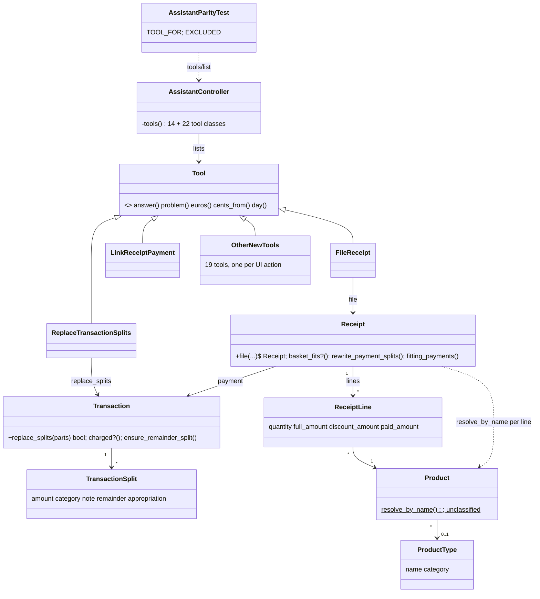
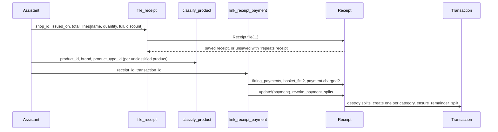

# Plan: MCP parity, slice 1: receipt to splits

From `intent.md` (2026-10-25). Status: accepted.

## Context

An assistant at `/mcp` reaches the books through `AssistantController`, which lists 14 `Assistant::Tool` classes in `app/tools/assistant/`. Each tool is a class method `self.call(..., server_context:)` that finds records, sends one model message and answers with `answer(text)` or `problem(text)`. Amounts cross the boundary as euros with two decimals (`euros`, `cents_from`), days as strict `YYYY-MM-DD` (`day`). This change adds 22 tools so an assistant can file a pasted receipt, link it to its payment, split the payment and classify products, plus a parity test and an `AGENTS.md` rule that keep the MCP in step with the UI.

## Design

### Domain terms

- **Payment** — the bank `Transaction` that paid a receipt (`Receipt#payment`).
- **Split** (a part) — an explicit `TransactionSplit`. **Remainder split** — the generated row that holds what no explicit split covers; `Splittable#ensure_remainder_split` rebuilds it.
- **Charged** — the payment, or one of its splits, carries an appropriation (`Transaction#charged?`).
- **Basket** — the lines of a receipt; **basket total** — what they add up to.
- **Unclassified product** — a `Product` without brand or `ProductType` (`Product.unclassified`). **Classify** — give a product its brand and product type.
- **Filing** (new) — creating a receipt with its lines in one step; refused when a receipt with the same shop, issue date and total exists.
- **Link a payment** — settle a receipt against its payment and split the payment by the basket; the term comes from the existing `payment_link` resource.
- **Parity map** (new) — the list in the parity test that pairs each routed UI `controller#action` with its MCP tool, or with the reason it has none.

No term conflicts with `GLOSSARY.md`, which holds household money terms only.

### Diagrams





### Signatures

`Transaction` (through `Splittable`, `app/models/concerns/splittable.rb`): a bank booking that divides into splits.

```ruby
# Refuses a charged payment, since replacing its splits would drop those charges
#: (Array[{ amount: Integer, category: Category?, note: String? }] parts) -> bool
def replace_splits(parts)
```

- Returns false, adding `errors.add(:transaction_splits, :charged)`, when `charged?`.
- Otherwise, inside `transaction`: `transaction_splits.destroy_all`, `transaction_splits.create!(part)` per part, `ensure_remainder_split`.
- Rescues `ActiveRecord::RecordInvalid => error`, copies `error.record.errors.full_messages` onto `errors[:base]`, rolls back, returns false.

`Receipt` (`app/models/receipt.rb`): one grocery invoice and its basket.

```ruby
# Products are found by name the way the importer finds them, so a name nobody has seen starts unclassified
#: (shop: Account, issued_on: Date, total_amount: Integer, lines: Array[{ name: String, quantity: Numeric, full_amount: Integer, discount_amount: Integer }], ?order_number: String?) -> Receipt
def self.file(shop:, issued_on:, total_amount:, lines:, order_number: nil)
```

- Builds each line with `product: Product.resolve_by_name(name)` and `paid_amount: full_amount - discount_amount`.
- Saves with `save(context: :file)` inside `transaction`, raising `ActiveRecord::Rollback` on failure so products made on the way disappear.
- New private validation `must_not_repeat_a_filed_receipt, on: :file` adds `errors.add(:base, :repeats_filed_receipt, receipt: existing.id)` when a receipt with the same shop, issue date and total exists, or when the given `order_number` is already taken (the database index on `order_number` is unique, so this turns a `RecordNotUnique` into a plain refusal). The import job never uses the `:file` context, so its re-import by order number keeps working.

`Assistant::Tool` (`app/tools/assistant/tool.rb`): one new private class helper, shared by most new tools.

```ruby
# The books' own reason for refusing a record, as a problem
#: (ActiveRecord::Base record) -> MCP::Tool::Response
def self.refusal(record) = problem(record.errors.full_messages.to_sentence)
```

New tool classes in `app/tools/assistant/`, all `self.call(..., server_context:)`, amounts in euros, days as `YYYY-MM-DD`:

| Tool | Mirrors | Input (required in bold) | Annotation |
|---|---|---|---|
| `FindTransactions` | `transactions#index` | type, category_id, account_id, from, until, uncategorized, query, limit | read_only |
| `ShowTransaction` | `transactions#show` | **transaction_id** | read_only |
| `CreateTransaction` | `transactions#create` | **debitor_account_id**, **creditor_account_id**, **amount**, **booked_on**, interest_on, category_id, note | — |
| `UpdateTransaction` | `transactions#update` | **transaction_id**, amount, booked_on, interest_on, category_id, note | idempotent |
| `DeleteTransaction` | `transactions#destroy` | **transaction_id** | destructive |
| `CreateTransactionSplit` | `transaction_splits#create` | **transaction_id**, **amount**, category_id, note | — |
| `UpdateTransactionSplit` | `transaction_splits#update` | **transaction_id**, **transaction_split_id**, amount, category_id, note | idempotent |
| `DeleteTransactionSplit` | `transaction_splits#destroy` | **transaction_id**, **transaction_split_id** | destructive |
| `ReplaceTransactionSplits` | no route | **transaction_id**, **splits**[{**amount**, category_id, note}] | destructive |
| `ListReceipts` | `receipts#index` | limit | read_only |
| `ShowReceipt` | `receipts#show` | **receipt_id** | read_only |
| `FileReceipt` | no route | **shop_id**, **issued_on**, **total_amount**, order_number, **lines**[{**name**, **quantity**, **full_amount**, discount_amount}] | — |
| `DeleteReceipt` | no route | **receipt_id** | destructive |
| `LinkReceiptPayment` | `receipts/payment_links#create` | **receipt_id**, **transaction_id** | destructive |
| `UnlinkReceiptPayment` | `receipts/payment_links#destroy` | **receipt_id** | idempotent |
| `ListProducts` | `products#index` | unclassified, limit | read_only |
| `ShowProduct` | `products#show` | **product_id** | read_only |
| `ClassifyProduct` | `products#update` | **product_id**, name, brand, product_type_id | idempotent |
| `ListProductTypes` | `product_types#index` | — | read_only |
| `ShowProductType` | `product_types#show` | **product_type_id** | read_only |
| `CreateProductType` | `product_types#create` | **name**, **category_id** | — |
| `UpdateProductType` | `product_types#update` | **product_type_id**, name, category_id | idempotent |

Tool behaviour that the UI controllers already define, copied rather than moved:

- The single-split tools save, then call `ensure_remainder_split`, as `TransactionSplitsController` does. They find a part only among `explicit_transaction_splits`, so the remainder split cannot be edited or deleted by hand.
- `DeleteTransactionSplit` refuses a charged part: "Part #N is charged to <appropriation>; remove that charge in the app first." See Design decisions.
- `LinkReceiptPayment` takes the steps of `Receipts::PaymentLinksController#create`: `fitting_payments.find_by(id:)` (refused with the list of fitting payments when nil), `basket_fits?`, `charged?`, then `update!(payment:)` and `rewrite_payment_splits` in one database transaction. It answers with the splits written, with their ids, so the assistant can charge each one next. When `rewrite_payment_splits` returns false it says the payment is linked but not split, and why: it names the unclassified products when there are any, and otherwise says the basket has nothing to split (no lines, or only free ones). A receipt linked to another payment is refused ("unlink first"); linking the same payment again re-splits it. A payment that already paid another receipt is refused, naming that receipt, and no split changes; the UI does not check this, but two baskets rewriting one payment's splits would silently undo each other.
- `FileReceipt` refuses a shop that is one of our own accounts (`Account#external?` false): a receipt comes from a shop.
- `UnlinkReceiptPayment` and `DeleteReceipt` say the splits already written stay, as the UI's unlink does.
- `DeleteTransaction` calls `destroy`; `false` becomes `refusal(transaction)`, and `ActiveRecord::InvalidForeignKey` (a chattel bought with it) becomes a problem naming the chattels.
- List tools follow `FindAccounts`/`FindUncategorizedTransactions`: a `DEFAULT_LIMIT`/`HIGHEST_LIMIT`, newest first, and a "Showing X of Y" line when more exist.
- Show tools print ids for everything an assistant may act on next (splits, lines, products, fitting payments).

Not checked: the project has no Steep or rbs_rails.

### Complexity

- `replace_splits` with o old and n new parts: about 2 (charge check) + o deletes + 3n (insert, balance sum, transfer/charge reads) + 4 (remainder) queries, in one database transaction. n is the number of parts an assistant sends, about ten at most.
- `Receipt.file` with l lines: 1 duplicate lookup, 1 receipt insert, per line 1 product lookup (+1 insert for a new product) and 1 line insert; about 2 + 3l queries in one database transaction.
- `LinkReceiptPayment`: about 6 queries for the guards, plus `rewrite_payment_splits` (one insert per basket category plus the remainder).
- List and show tools preload what they print (`includes`), so their query count does not grow with the rows listed.
- Single create, update and delete tools: a constant 3 to 8 queries each.
- Parity test: one `tools/list` request, no database queries of its own.

### Invariants

- The explicit splits of a payment never total more than its amount — `TransactionSplit#amount_does_not_exceed_balance` and `Splittable#amount_must_cover_explicit_splits`, unchanged.
- A Transfer has no splits — `TransactionSplit#financial_transaction_must_not_be_transfer`, unchanged.
- A charged payment never has its splits replaced — the guard in `Transaction#replace_splits`; `Receipt#rewrite_payment_splits` keeps its own guard.
- A replace changes all splits or none — the database transaction in `replace_splits`.
- Filing never creates a receipt that repeats one on shop, issue date and total — the `on: :file` validation on `Receipt`. No database constraint, so two simultaneous filings can both pass; accepted for one household.
- A refused filing leaves no products behind — the rollback in `Receipt.file`.
- Only a fitting payment can be linked — `fitting_payments.find_by` in `LinkReceiptPayment`, as in the UI.
- The assistant never links one payment to two receipts — the check in `LinkReceiptPayment`.
- A receipt filed by the assistant comes from an external account — the check in `FileReceipt`.
- The assistant never deletes a charged part or the remainder split — `DeleteTransactionSplit` and the explicit-only lookup.
- A request without a valid token or from another host is refused — `AssistantController`, unchanged.
- Every routed UI action has a tool or a stated exclusion — the parity test.

### Alternatives

1. **Smallest change, plus two model messages** (chosen). Tools mirror the UI controllers; only filing and replace-all, which no model method covers, get model code. The UI, the importer and existing tests stay untouched.
2. **Deep models, one source of truth** (rejected). Remainder sync becomes a `TransactionSplit` callback, a `before_destroy` refuses charged parts, `Receipt#link_payment` replaces the controller's guards, and the import job and `PaymentLinksController` move onto the same messages. Rejected for this slice: it changes UI behaviour the intent did not ask for (a charged part can no longer be removed in the UI; a non-fitting payment turns from a 404 into an alert), it hides the remainder rebuild in callbacks that also fire inside `rewrite_payment_splits` and dependent destroys, and it widens the diff into the importer and controller tests. The consolidation is a sound follow-up of its own.
3. **One generic CRUD tool per model** (rejected, considered while comparing the two). A `transactions` tool with an `action` argument halves the class count but gives the client one vague description per model, loses per-tool `destructive_hint` annotations, and breaks the existing one-task-per-tool style.

## Design decisions

- **A charged part is refused on delete, not deleted with a note.** The intent lists "a charged split cannot be dropped silently" among the rules a tool surfaces as a refusal, and the replace-all tool refuses charged payments the same way. The UI still deletes a charged part; this slice does not change the UI. There is no MCP tool to remove a charge yet (appropriation gaps are a later slice), so the refusal tells the assistant to remove the charge in the app.
- **Filing takes `shop_id`, not a shop name.** The assistant finds the shop with `find_accounts`, as every other tool names records by id. Products are taken by name, as the intent says.
- **A line takes full amount and discount; the paid amount is derived.** `ReceiptLine` refuses a paid amount that does not equal full minus discount, so asking for all three only invites a refusal.
- **`CreateTransaction` takes both accounts; the type follows from them.** The UI form shows the accounts as disabled fields, so the UI cannot create a valid transaction today; the domain rule is that the type follows from account ownership, so the tool does not take a type. `UpdateTransaction` leaves accounts and type alone, as the UI form does; moving a counterparty stays with the existing merchant tools.
- **The duplicate rule is a validation context, not an always-on validation.** The import job finds deliveries by order number and must keep updating them; an always-on rule would make a corrected slip raise.
- **`Receipt#rewrite_payment_splits` keeps its own loop** rather than calling `replace_splits`. Merging them is an orthogonal refactor; it is listed for a separate change.
- **The parity map lives in the test file** and its granularity is `controller#action`, skipping the form pages `new` and `edit`. It reads tool names from a real `tools/list` request, so it tests what a client sees. Framework routes (`rails/*`, `turbo/*`, `active_storage/*`, `action_mailbox/*`) are skipped by prefix; every app and `appkit/*` controller must be mapped or excluded with a reason. A stale exclusion (no matching route) fails too.
- **"This repository's plan and intent checklist" is a new `## MCP parity` section in `AGENTS.md`.** The repository has no checklist file; the intent and plan stages read `AGENTS.md` first, so the line lives there. The global `intent`/`plan` skills in the dotfiles are out of this repository and untouched.
- **New public methods get inline RBS signatures (`#:`) and a one-line summary, no YARD tags**, as the personal-project rule in `ruby-style` says. Existing methods keep their YARD comments; converting them is out of scope. The project has no Steep, so nothing checks the signatures.
- **New assistant integration tests go in new files per area.** `test/integration/assistant_test.rb` is 677 lines; its private request helpers move to `test/test_helpers/assistant_requests.rb` so the new files can share them.

No conflict with `intent.md`'s `## Decisions`.

## Integration points

- MCP clients through `/mcp`: 22 new entries in `tools/list`, with descriptions and annotations.
- `TransactionSplitsController`, `Receipts::PaymentLinksController`, `TransactionsController`, `ProductsController`, `ProductTypesController`: read as the reference behaviour, not changed.
- `Importing::AlbertHeijn::ImportJob` and `Product.resolve_by_name`: the importer's product resolution is reused, the job is not changed.
- `config/locales/{en,nl,it}.yml`: two new error messages, kept normalized with `i18n-tasks`.
- `AGENTS.md`: new rule section.

## Files that change

- `app/models/concerns/splittable.rb` — add `replace_splits`.
- `app/models/receipt.rb` — add `Receipt.file` and the `on: :file` duplicate validation.
- `config/locales/en.yml`, `nl.yml`, `it.yml` — `activerecord.errors.models.transaction.attributes.transaction_splits.charged` and `activerecord.errors.models.receipt.attributes.base.repeats_filed_receipt` (with `%{receipt}`).
- `app/tools/assistant/tool.rb` — add the private `refusal(record)` helper.
- `app/tools/assistant/*.rb` — the 22 new tool classes in the table above.
- `app/controllers/assistant_controller.rb` — list the 22 new tools, alphabetically as today.
- `test/test_helpers/assistant_requests.rb` — new module with `ask_assistant`, `refused?`, `post_to_assistant`, `assistant_headers`, moved from `assistant_test.rb`.
- `test/integration/assistant_test.rb` — include the module, drop the moved helpers.
- `test/integration/assistant_receipts_test.rb`, `assistant_transactions_test.rb`, `assistant_transaction_splits_test.rb`, `assistant_products_test.rb` — acceptance tests.
- `test/integration/assistant_parity_test.rb` — the parity test with `TOOL_FOR` and `EXCLUDED`.
- `test/models/receipt_test.rb`, `test/models/transaction_test.rb` — unit tests of the two model messages.
- `test/tools/assistant/<tool>_test.rb` — one unit test file per new tool.
- `AGENTS.md` — `## MCP parity` section: the rule, and the checklist lines for intent and plan.

## Order of work

1. Move the request helpers to `test/test_helpers/assistant_requests.rb`; run `test/integration/assistant_test.rb` green.
2. Write the acceptance test "the assistant files a pasted receipt with its lines" in `assistant_receipts_test.rb`, run it, watch it fail (unknown tool).
3. `Receipt.file` with its unit tests and the locale message; then `FileReceipt`, registered in the controller; acceptance test green. Add the duplicate and unknown-product acceptance tests and make them pass.
4. `ListReceipts`, `ShowReceipt`, `DeleteReceipt`, each with its unit test.
5. `ListProducts`, `ShowProduct`, `ClassifyProduct`; acceptance test "classifying a product takes it off the unclassified list".
6. `ListProductTypes`, `ShowProductType`, `CreateProductType`, `UpdateProductType`.
7. `LinkReceiptPayment`, `UnlinkReceiptPayment`; acceptance test "linking splits the payment by the basket", then the whole-flow test that charges a returned split with `charge_to_appropriation`.
8. `CreateTransactionSplit`, `UpdateTransactionSplit`, `DeleteTransactionSplit`; acceptance tests for the remainder, the over-amount refusal and the Transfer refusal.
9. `Transaction#replace_splits` with its unit tests and locale message; `ReplaceTransactionSplits`; acceptance tests for the charged refusal and the all-or-nothing replace.
10. `FindTransactions`, `ShowTransaction`, `CreateTransaction`, `UpdateTransaction`, `DeleteTransaction`; acceptance test for delete and its refusal.
11. The token and host acceptance test against a new tool.
12. `assistant_parity_test.rb` with `TOOL_FOR` and `EXCLUDED`; then the test that a new unmapped route fails it.
13. `AGENTS.md` section.
14. `bundle exec i18n-tasks normalize`, rubocop, herb lint, brakeman, bundler-audit, full `bin/rails test`.

## Risks

- **Count of tools.** 22 more tools lengthen `tools/list` for every client. Descriptions stay one or two sentences.
- **Copied controller steps drift.** `LinkReceiptPayment` and the split tools repeat controller steps; a later change to one side must reach the other. The parity test catches a missing tool, not a diverging one. Mitigation: each tool's comment names the controller action it mirrors.
- **Duplicate rule false positive.** Two shopping trips at one shop on one day with the same total are refused; the refusal names the existing receipt, so a person can tell.
- **Charged part refusal blocks the assistant** until a later slice adds a tool to remove a charge.
- **Remainder split on replace.** `replace_splits` destroys the remainder with the other splits and rebuilds it from the payment's category, as `rewrite_payment_splits` does.
- **Deleting a transaction drops its charged parts**, as the UI does today (dependent destroy). Not changed in this slice.
- Rejected: callbacks for the remainder, a `before_destroy` on charged parts, moving the controllers and the importer — see Alternatives.

Out of scope: accounts, account aliases, transaction links; categories, budgets and appropriations gaps (including removing a charge); chattels, people, groups; users, tokens, admin, bank-file import; attaching the invoice PDF; editing a receipt or its lines; any UI change; merging `rewrite_payment_splits` with `replace_splits`; moving controllers or the importer onto the new model messages.

## Proof

- The whole flow with no UI step: file, classify, link, then charge a split the link returned → `test/integration/assistant_receipts_test.rb` `a pasted receipt ends as a split payment with a part charged to an appropriation`
- Pasting a receipt makes the assistant file it with its lines, and the receipt shows the shop, the date, the total and each line → `test/integration/assistant_receipts_test.rb` `the assistant files a pasted receipt with its lines`
- Linking a receipt to its payment splits the payment per category, and the splits add up to the basket → `test/integration/assistant_receipts_test.rb` `linking a receipt splits its payment the way the basket divides`
- Splitting a payment by 30.00 groceries and 12.50 household leaves a remainder split for the rest → `test/integration/assistant_transaction_splits_test.rb` `two parts leave the rest of the payment in a remainder split`
- Splitting a payment for more than its amount is refused with the books' own reason → `test/integration/assistant_transaction_splits_test.rb` `a part bigger than what is left of the payment is refused with the books' reason`
- Splitting a Transfer is refused → `test/integration/assistant_transaction_splits_test.rb` `a transfer cannot be split`
- Replacing all splits of a payment with a charged part is refused, and nothing changes → `test/integration/assistant_transaction_splits_test.rb` `replacing the parts of a charged payment is refused and changes nothing`
- Replacing all splits of an uncharged payment gives the new set in one step, or nothing at all → `test/integration/assistant_transaction_splits_test.rb` `replacing the parts swaps the whole set` and `a replacement with one bad part changes nothing`
- Filing a receipt twice is refused the second time and names the existing receipt → `test/integration/assistant_receipts_test.rb` `filing the same receipt twice is refused and names the first one`
- A product nobody has seen before appears as an unclassified product → `test/integration/assistant_receipts_test.rb` `a product nobody has seen before is listed as unclassified`
- Classifying a product sets its brand and product type, and it leaves the unclassified list → `test/integration/assistant_products_test.rb` `classifying a product takes it off the unclassified list`
- Deleting a transaction gives the delete, or the books' refusal → `test/integration/assistant_transactions_test.rb` `the assistant deletes a transaction` and `deleting a transaction a chattel was bought with is refused`
- A request without a valid token, or from another host, is refused as today → `test/integration/assistant_test.rb` existing token and host tests, plus `test/integration/assistant_receipts_test.rb` `filing a receipt without a valid token is turned away`
- A new routed UI resource with no MCP tool and no exclusion fails the parity test → `test/integration/assistant_parity_test.rb` `every routed UI action has a tool or a stated exclusion` and `an unmapped route is reported by name`
- Query count: list and show tools do not grow with the rows they print → `test/integration/assistant_receipts_test.rb` `listing receipts runs as many queries for three receipts as for one`
- Invariant: a replace changes all splits or none, enforced by the database transaction in `Splittable#replace_splits` → `test/models/transaction_test.rb` `replace_splits leaves the old parts when one new part is refused`
- Invariant: a charged payment never has its splits replaced, enforced by `Splittable#replace_splits` → `test/models/transaction_test.rb` `replace_splits refuses a payment with a charged part`
- Invariant: filing never repeats a receipt, enforced by the `on: :file` validation on `Receipt` → `test/models/receipt_test.rb` `filing refuses a receipt with the same shop, day and total`
- Invariant: a refused filing leaves no products behind, enforced by the rollback in `Receipt.file` → `test/models/receipt_test.rb` `a refused filing creates no products`
- Invariant: the import job still updates a delivery by order number, unaffected by the duplicate rule → `test/jobs/importing/albert_heijn/import_job_test.rb` existing tests stay green
- Invariant: the assistant never deletes a charged part or the remainder → `test/tools/assistant/delete_transaction_split_test.rb` `refuses a charged part` and `cannot find the remainder split`
- `AGENTS.md` carries the parity rule and checklist lines → check: `grep -n "MCP parity" AGENTS.md`

Per changed file, the unit tests expected, named as behaviour:

- `app/models/concerns/splittable.rb`: `Transaction#replace_splits swaps the parts and rebuilds the remainder`, `refuses a charged payment`, `refuses a transfer with the books' reason`, `leaves the old parts when one new part is refused`.
- `app/models/receipt.rb`: `Receipt.file saves the receipt with its lines`, `finds a known product by name however it is capitalised`, `starts an unknown product unclassified`, `derives the paid amount from full and discount`, `refuses a receipt with the same shop, day and total`, `refuses an order number already taken`, `a refused filing creates no products`.
- `app/tools/assistant/file_receipt.rb`: `files a receipt and lists its lines`, `refuses an unknown shop`, `refuses one of our own accounts as the shop`, `refuses an order number already filed and names that receipt`, `refuses an amount with a fraction of a cent`, `refuses a day it cannot read`, `names the receipt it repeats`.
- `list_receipts.rb`: `lists receipts newest first with shop, day, total and payment`, `says when more exist than shown`.
- `show_receipt.rb`: `shows the lines with product ids and the fitting payments`, `refuses an unknown receipt`.
- `delete_receipt.rb`: `deletes the receipt and its lines and says the splits stay`, `refuses an unknown receipt`.
- `link_receipt_payment.rb`: `links and lists the splits written`, `refuses a payment that does not fit and lists the ones that do`, `refuses a basket bigger than the payment`, `refuses a charged payment`, `links without splitting and names the unclassified products`, `links without splitting and says an empty basket has nothing to split`, `refuses a receipt linked to another payment`, `refuses a payment that paid another receipt and changes no split`.
- `unlink_receipt_payment.rb`: `unlinks and says the splits stay`, `says when nothing was linked`.
- `list_products.rb`: `lists products with brand and type`, `lists only unclassified products when asked`.
- `show_product.rb`: `shows the product with its purchases`, `refuses an unknown product`.
- `classify_product.rb`: `sets brand and product type`, `refuses an unknown product type`, `passes on the books' refusal`.
- `list_product_types.rb`: `lists types with their category`.
- `show_product_type.rb`: `shows the type with its latest purchase per product`, `refuses an unknown type`.
- `create_product_type.rb`: `creates a type booked to a category`, `refuses a name already taken`.
- `update_product_type.rb`: `renames a type or moves it to another category`, `refuses an unknown type`.
- `create_transaction_split.rb`: `adds a part and keeps the remainder`, `refuses a part bigger than what is left`, `refuses a transfer`.
- `update_transaction_split.rb`: `changes a part and keeps the remainder`, `refuses a part of another payment`.
- `delete_transaction_split.rb`: `removes a part and keeps the remainder`, `refuses a charged part`, `cannot find the remainder split`.
- `replace_transaction_splits.rb`: `replaces the parts and lists them`, `refuses a charged payment`, `refuses an unknown category`.
- `find_transactions.rb`: `filters by type, category, account and period`, `lists only uncategorized ones when asked`, `searches note and amount`, `refuses a period that ends before it starts`.
- `show_transaction.rb`: `shows parts with ids, charges and the remainder`, `names the receipt it paid`.
- `create_transaction.rb`: `creates a debit between our account and a shop`, `passes on the books' refusal`, `refuses an unknown account`.
- `update_transaction.rb`: `changes amount, days, category and note`, `refuses an amount below its parts`.
- `delete_transaction.rb`: `deletes a transaction`, `refuses one a chattel was bought with`.
- `app/tools/assistant/tool.rb`: `refusal` is private; covered through the tools above.

Test setup: existing fixtures (`transactions(:debit_grocery)`, `transactions(:transfer_savings)`, `transactions(:uncategorized)` for an unsplit 25.00 payment, `receipts(:albert_heijn_friday)`, `products(:andrelon_shampoo)` unclassified, `product_types(:naturel_chips)`, `categories(:groceries)`, `categories(:household)`, `appropriations(:birthday_etienne)`); the remainder test creates its own unsplit Debit of 50.00 between `accounts` fixtures, since 30.00 + 12.50 does not fit the 25.00 fixture. Integration tests call `/mcp` with `host! "localhost"` and a regenerated token, through `AssistantRequests`. No faked boundaries.

---
Domain skills applied: rails-architecture, object-oriented-design, software-design, rails-testing, rails-api-design, glossary, diagrams.

## Critique

### Round 1 (codex exec -p terra)

- `FileReceipt` accepts `order_number`, which the database keeps unique, so a repeated number would raise instead of refusing → fixed (the `on: :file` validation also refuses a taken order number and names that receipt; unit tests added)
- A payment can be linked to two receipts, since `fitting_payments` ignores existing links → fixed (`LinkReceiptPayment` refuses a payment that paid another receipt and changes no split; invariant and unit test added)
- `FileReceipt` accepts one of our own accounts as the shop → fixed (refused unless `Account#external?`; invariant and unit test added)
- Single-split create and update can change a charged payment, against the rule that a charged payment cannot be re-split → dismissed: a payment charged as a whole already refuses any part (`TransactionSplit#financial_transaction_must_not_be_charged_as_a_whole`); a payment charged per part may get another part or an edited part in the UI today, and the intent maps "re-split" to the replace-all tool, which refuses
- The "unclassified products" fallback after linking is inaccurate, since `rewrite_payment_splits` also returns false for an empty or all-free basket → fixed (the answer distinguishes unclassified products from a basket with nothing to split; unit test added)
- The plan chose YARD over inline RBS, against the personal-project rule in `ruby-style` → fixed (new public methods get `#:` signatures and a one-line summary; Signatures and Design decisions updated)
- No proof covers the whole no-UI flow ending in a charge → fixed (whole-flow integration test added to Proof and Order of work; `LinkReceiptPayment` answers with split ids)
