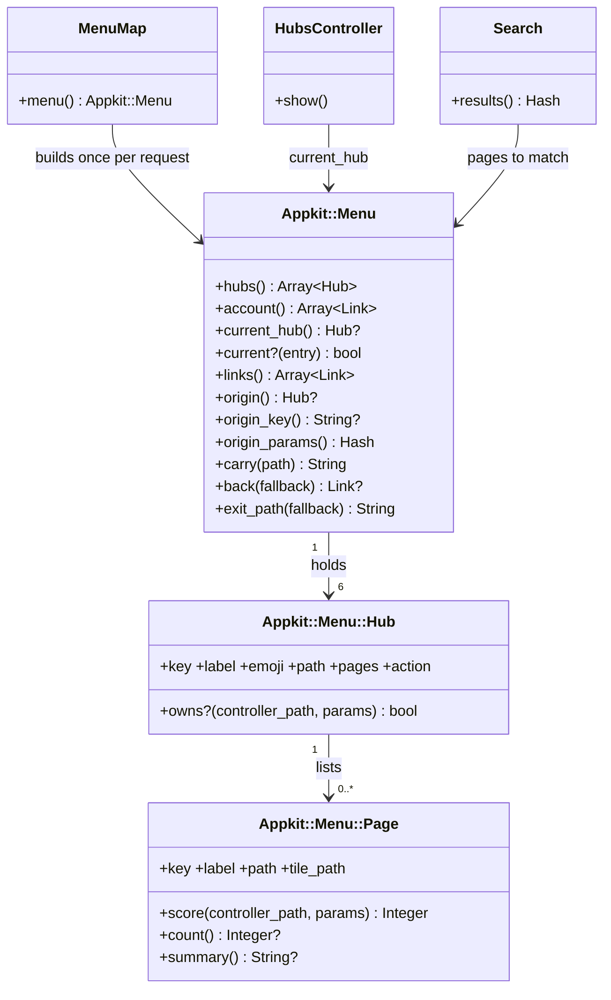
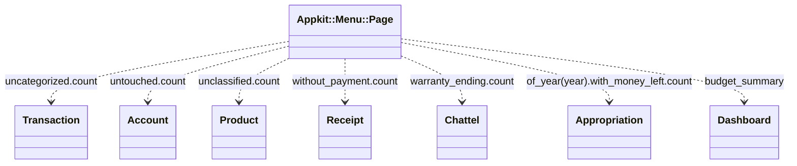
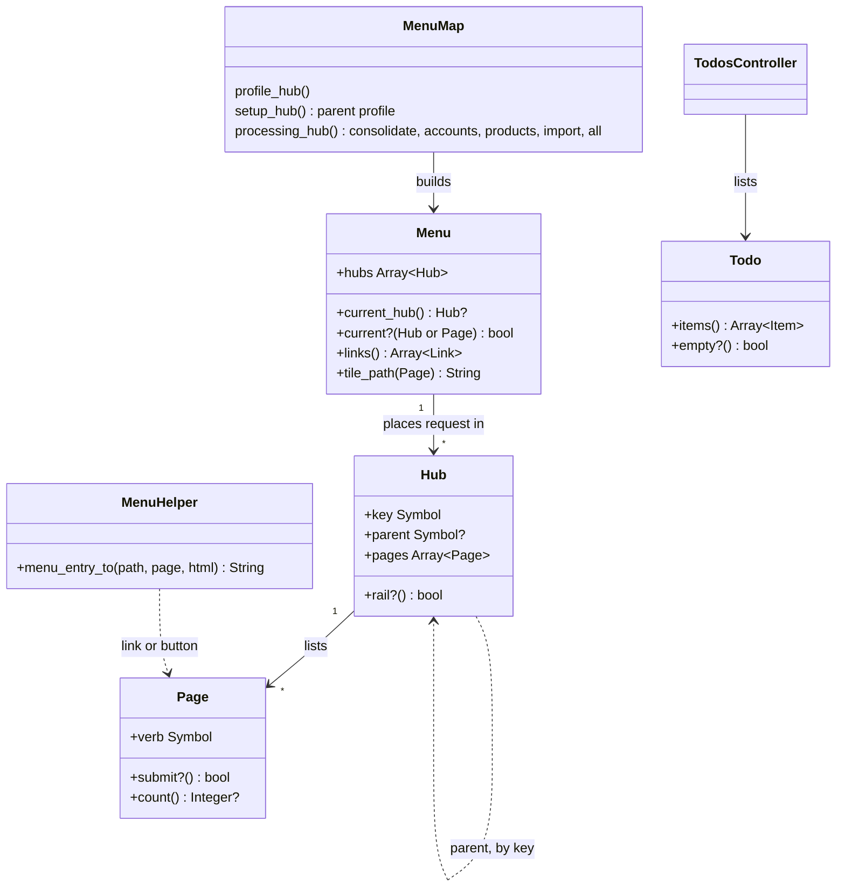

# Plan: Navigate by task hubs

From `intent.md` (2026-10-25, amended and accepted again 2026-11-11). Status: accepted.

## Design

### Domain terms

Glossary terms used: **Hub**, **Hub column**, **Landing page**, **Rail**, **Beheer**, **Appropriation** (Begrotingspost). A hub is never a "section" or a "tab"; "tab bar" names only the rail's phone form.

New terms, proposed by this plan for the glossary:

- **Menu map** — the one description of the hubs, their pages and the account menu; the rail, the hub column, the landing pages and search all draw from it.
- **Page** — one entry of a hub: a label, the controllers it owns, an optional filter, its list path, its tile path and an optional count or summary.
- **Tile** — a page's entry on a landing page, with the count written out, also when it is 0.
- **Badge** — the count next to a page in the hub column; a count of 0 shows no badge.
- **Origin** — the hub whose landing page started the current flow; it travels as the `from` query parameter.

Hub keys are English, like the app's routes: `overview` (Overzicht), `processing` (Verwerken), `planning` (Plannen), `records` (Administratie), `shopping` (Boodschappen) and `setup` (Beheer). Labels come from i18n.

### Diagrams

Before: a hand-written flat nav in `layouts/application.html.erb`, a separate `layouts/admin.html.erb`, `TodosController` + `Todo`, `Search::PAGES` as a second page list, and hand-written "Terug" links per view. appkit's `_nav` exists but this app does not render it.

After, the touched objects:



Where the counts come from, one named scope or method each on the owning model:



The origin flow, for the acceptance criteria on Categoriseren:

```mermaid
sequenceDiagram
  participant U as Browser
  participant H as HubsController
  participant T as TransactionsController
  participant M as Appkit::Menu
  U ->> H : GET /hubs/processing
  H -->> U : tile href = carry(tile_path) = /transactions?filter=no_category&from=processing
  U ->> T : GET /transactions?filter=no_category&from=processing
  T ->> M : back
  M -->> U : "‹ Verwerken" to /hubs/processing; rows link to carry(transaction_path)
  U ->> T : GET /transactions/7?from=processing
  M -->> U : "‹ Categoriseren" to the filtered list with from
  U ->> T : GET /transactions/7/edit?from=processing, then PATCH with hidden from
  T -->> U : redirect to carry(transaction_path) = /transactions/7?from=processing
  U ->> T : DELETE /transactions/7 with hidden from
  T ->> M : exit_path(transactions_url)
  M -->> U : redirect to /hubs/processing
```

### Signatures

appkit (`~/Developer/appkit`), generic, knows no app models:

```ruby
# Places one request in the menu map: which hub and page are current, where the origin leads.
class Appkit::Menu
  #: (hubs: Array[Appkit::Menu::Hub], account: Array[Appkit::Menu::Link], controller_path: String, action_name: String, params: Hash[String, untyped]) -> void
  def initialize(hubs:, account:, controller_path:, action_name:, params:)
  #: () -> Array[Appkit::Menu::Hub]      the rail hubs and Beheer, in map order
  attr_reader :hubs
  #: () -> Array[Appkit::Menu::Link]     account menu entries; the partial appends Uitloggen
  attr_reader :account
  #: () -> Appkit::Menu::Hub?
  def current_hub
  #: (Appkit::Menu::Hub | Appkit::Menu::Page) -> bool
  def current?(entry)
  #: () -> Array[Appkit::Menu::Link]     every hub and page as a label and path, for search
  def links
  #: () -> Appkit::Menu::Hub?            the hub named by params["from"], nil for an unknown key
  def origin
  #: () -> String?                       the validated origin key, for hidden_field_tag :from
  def origin_key
  #: () -> Hash[Symbol, String]          {from: key} or {}, for button_to params: and url options
  def origin_params
  #: (String) -> String                  the path plus from=<origin key>, unchanged without an origin
  def carry(path)
  #: (?String?) -> Appkit::Menu::Link?   the title-bar back link; nil on a list without an origin
  def back(fallback = nil)
  #: (String) -> String                  where a delete lands: the origin landing page, else the fallback
  def exit_path(fallback)
end

# A hub: its landing page, its pages and the controllers it owns without a page.
class Appkit::Menu::Hub
  #: (key: Symbol, label: String, emoji: String, path: String, ?pages: Array[Appkit::Menu::Page], ?controllers: Array[String], ?action: Appkit::Menu::Link?) -> void
  attr_reader :key, :label, :emoji, :path, :pages, :action
  #: (String, Hash[String, untyped]) -> bool   its landing page (hubs#show with id = key) or a page-less controller it owns
  def owns?(controller_path, params)
end

# One page of a hub and what needs attention there; count and summary are lazy and memoized.
class Appkit::Menu::Page
  #: (key: Symbol, label: String, path: String, controllers: Array[String], ?filter: Hash[String, String], ?tile_path: String?, ?count: (^() -> Integer)?, ?summary: (^() -> String)?) -> void
  attr_reader :key, :label, :path
  #: () -> String                        the filtered list a tile opens; defaults to path
  def tile_path
  #: (String, Hash[String, untyped]) -> Integer
  # 2: a filtered page whose controller and filter both match.
  # 1: an unfiltered page whose controller matches (any action, so show, edit and new too).
  # 0: otherwise; a filtered page never matches without its filter, so a transaction edit scores Journaal 1, Categoriseren 0.
  def score(controller_path, params)
  #: () -> Integer?
  def count
  #: () -> String?
  def summary
end

Appkit::Menu::Link = Data.define(:label, :path)
```

appkit views: `appkit/shared/_nav.html.erb` (replaced: rail, hub column; locals `menu:`, `user_name:`; yields the top of the rail for the app's search button) and `appkit/shared/_account_menu.html.erb` (new: a `<details>` with the account links, then the Uitloggen `button_to`; locals `menu:`, `user_name:`, `avatar: false`). In the rail the summary is the user's name. With `avatar: true` the summary is "👤" with `aria-label` set to the user's name; the Overzicht title bar renders that form. The nav omits the badge when the count is 0 or nil.

App:

```ruby
# Draws this household's menu map for the current request.
module MenuMap  # controller concern, included in ApplicationController; helper_method :menu, :tile_text
  #: () -> Appkit::Menu
  def menu
  #: (Appkit::Menu::Page) -> String?   a tile's text: its count written out, also 0, or its summary
  def tile_text(page)
  #: (ActiveRecord::Base) -> String     the record's own page, keeping the origin when there is one
  def carried_path(record)
end

# Shows a hub's landing page: one tile per page.
class HubsController < ApplicationController
  #: () -> void                          unknown key raises ActiveRecord::RecordNotFound (404)
  def show
end

class Account
  #: () -> ActiveRecord::Relation        never edited since import: updated_at = created_at
  scope :untouched
end

class Receipt
  #: () -> ActiveRecord::Relation        payment_id IS NULL
  scope :without_payment
end

class Chattel
  WARRANTY_NOTICE = 90.days
  #: () -> ActiveRecord::Relation        active, warranty_expires_at in Time.current..WARRANTY_NOTICE.from_now
  scope :warranty_ending
end

class Appropriation
  #: () -> ActiveRecord::Relation        amount > charged, in one SQL query; matches balance.positive?
  scope :with_money_left
  # SQL: appropriations.amount > (correlated subquery A) + (correlated subquery B), with
  #   A = SUM(CASE type WHEN 'Credit' THEN amount WHEN 'Debit' THEN -amount ELSE 0 END)
  #       FROM transactions WHERE transactions.appropriation_id = appropriations.id
  #   B = the same CASE over transaction_splits.amount, joined to their transaction for its type,
  #       WHERE transaction_splits.appropriation_id = appropriations.id
  # Two separate scalar subqueries, never one multi-join, so rows are not multiplied. Each COALESCEs to 0.
end

class Dashboard
  BudgetSummary = Data.define(:planned, :spent)   # with #left #: () -> Integer, planned - spent
  #: () -> Dashboard::BudgetSummary?    built from the existing budget_amounts and budget_actuals over the debit categories; nil without an active budget
  def budget_summary
end

class Search
  # PAGES goes; matching_pages reads the menu map's links (label and path).
  #: (query: String, ?pages: Array[Appkit::Menu::Link]) -> void
  def initialize(query:, pages: [])
end
# SearchesController passes pages: menu.links; searches/_result_page links to page.path instead of page.path_helper.
```

Not checked: journal_administration declined Steep and rbs_rails; its inline `#:` comments document the types only. The appkit classes are checked in appkit with `steep check`.

### Complexity

Added queries per request, on top of today's authentication queries:

| Request | Added queries |
|---|---|
| Rail, account menu, current page, origin | 0 (the map is static Ruby; `Current.user` is loaded) |
| Any page in Verwerken (hub column) | 3 COUNTs |
| Any page in Plannen (hub column) | 1 COUNT (Begrotingsposten); Budgetten has no count |
| Any page in Administratie | 1 COUNT (Bezittingen) |
| Any page in Boodschappen | 2 COUNTs |
| Overzicht, Beheer, account pages | 0 |
| Verwerken, Administratie, Boodschappen landing page | the same COUNTs; tile and badge share the memoized count |
| Plannen landing page | 1 COUNT plus the queries of `Dashboard#budget_summary` for the current month (the active budget, its categories, the grouped debit and credit totals); a fixed number, independent of rows. The implementer measures the exact number and pins it in the query-count test. |
| `/todo` | 0 (route-level redirect) |

`Appropriation.with_money_left` is one query whatever the number of appropriations. Today's Ruby `balance` costs four sums per appropriation, so a Ruby count would cost 4N on every Plannen page. Current-page resolution is an in-memory score over about 20 pages.

### Invariants

- A tile and its badge show the same number in one request. Enforced by `Page#count` memoization and one `menu` per request. Proof: integration test on the Verwerken landing page.
- A tile's count equals the row count of the list it opens. Enforced by the count and the controller filter calling the same named scope. Proof: one integration test per filtered list.
- `with_money_left` holds exactly the appropriations whose `balance` is positive. Enforced by one SQL expression next to `charged_on`. Proof: `AppropriationTest` compares both over fixtures with debits, credits and charged splits.
- At most one hub and one page are current. Enforced by the highest `Page#score`, ties to map order, so Verwerken (first) owns its filtered lists. Proof: `Appkit::MenuTest` and the highlight acceptance tests.
- `from` only counts when it names a hub in the map, so `carry` and `exit_path` never forward an unknown value. Enforced by the guard in `Appkit::Menu#origin`. Proof: `Appkit::MenuTest`.
- A non-admin's map holds no Gebruikers and no admin dashboard. Enforced in `MenuMap`; `Admin::BaseController#ensure_admin` still guards the pages. Proof: integration test.
- A chattel whose warranty ends within 90 days counts; one at 120 days, one already expired, and one that left possession do not. Enforced by `Chattel.warranty_ending`. Proof: `ChattelTest`.

### Alternatives

Three architects each designed for one goal.

- **Deepest modules (chosen as the base).** appkit owns `Menu`, `Hub`, `Page`, the matching and the origin rules; callers know only `menu`, `carry`, `origin_key`, `origin_params`, `back`, `exit_path`. It replaces its route-recognition matching with explicit `controllers:` and `filter:` per page, which a reader can see in the map.
- **Least change (rejected).** A duck-typed appkit partial with no Ruby, and `default_url_options` that adds `from` to every generated URL, plus an `after_action` that rewrites the delete redirect. Rejected: the origin drifts to every record linked from a page, the delete landing depends on callback order, hand-written "Terug" links stay next to "‹ hub", and `Search::PAGES` stays a second page list.
- **Cheapest queries (partly taken).** One SQL "tally" per hub that folds all COUNTs into one `SELECT`, and a hand-written monthly `Budget#spending`. Taken: the SQL `with_money_left` scope, which removes the 4N cost. Rejected: the tally (raw SQL assembly to save at most two queries) and the separate spending query (a second definition that can disagree with the dashboard).

## Design decisions

- **Origin is a hub key, not a page key.** On a record page the back link targets the origin hub's page that owns the record's controller, so the hub key is enough. On a list opened with an origin the back link goes to the landing page.
- **Explicit carry, not implicit.** Only list rows, Bewerken/Tonen links, Annuleren, every form on a show or edit page of a hub page's resource, the delete form and the redirects of their controllers carry `from`. A link from a transaction to its account does not, so an origin never drifts to unrelated records.
- **Every hub page takes part.** Beheer has tiles too, so the origin rules apply to all pages in the map. The matrix under Files that change lists every resource and what carries the origin.
- **Origin restores the opened list.** Only tiles set an origin, and a hub holds at most one page per controller, so the origin hub's page for a record's controller, with its `tile_path`, is exactly the list the user opened.
- **Tile versus hub-column target.** A tile opens `tile_path`, filtered where its count is filtered. The hub column opens `path`, the page itself. For Bezittingen, Facturen and Boodschappen's Producten the hub column therefore opens the full list; for Verwerken's pages both are the filtered list.
- **Hub-column links carry no origin.** The page belongs to its own hub, so its back link follows today's rules.
- **Shared filtered list.** `/products?filter=unclassified` scores highest on Verwerken's Producten classificeren, so it lights Verwerken also when opened from the Boodschappen tile; its back link still reads "‹ Boodschappen". This follows intent's flagged concern: the owner lights, the origin leads back.
- **Back-link label.** A list from a tile shows "‹ <hub>"; a record shows "‹ <page>" (for example "‹ Categoriseren"); a record without an origin shows "‹ <owning page>" (for example "‹ Journaal") to its index, the same target as today.
- **Tile count as text, not `<data>`.** mvpa.css hides `<data value="0">` inside a link, and a tile is a link, but a tile must show 0. The tile writes the count in its translated text ("12 transacties zonder categorie"); the hub-column badge uses `<data value>`.
- **The badge is left out at 0** by appkit's nav as well as hidden by mvpa.css, so a test can check it without CSS.
- **Budgetten summary reuses `Dashboard`** for the current month: `budget_summary` adds up the existing `budget_amounts` and `budget_actuals` over the debit categories, so refunds and splits count as they do on the dashboard, and the tile and the dashboard agree.
- **The phone avatar is "👤"**, labelled with the user's name; the app has no avatar image. The Begrotingsposten count is this year's appropriations with money left.
- **Hand-written back links.** `_title_bar` gains a `back:` local and renders `menu.back(back)` as the first item of the title bar's `<nav>`, so mvpa.css (#49) draws it as a page-action link with no local CSS; the title bar renders its `<nav>` when there is a back link or a control. Show and edit views of the tile resources (transactions, accounts, products, receipts, chattels, budgets, appropriations) switch to it. The `new` views keep their "Terug" link, since no tile opens them. The users and profile views are left to `ui-review-bug-fixes`.
- **Admins** are checked with `administrator?`, as `Admin::BaseController#ensure_admin` does.
- **One plan file for all phases.** The plan skill asks for one file per phase; the hand-over allowed only `plan.md`, so the phases below sit in this file, each with its gate.
- **Begrotingsposten tile opens a money-left filter.** `/appropriations?filter=money_left` lists this year's `Appropriation.with_money_left`; the hub column opens the full list. Etienne chose this on 2026-10-25, and intent's "New filtered lists" now names it.
- **The mvpa.css rail slice adopts this plan's markup contract** (`nav.rail`, `nav.hub-column`, `ul.tiles`, phone-only search and 👤 in title bars). Etienne decided this on 2026-10-25; class names may still be negotiated in that slice.
- **Phasing.** The implement stage delivers phase A as a verified appkit pull request and then pauses until Etienne merges it. Phase B starts after that merge; phase C waits for the mvpa.css rail slice. The badges slice merged on 2026-10-26 (#45, `890d132`).
- **Amount links keep `<data>` outside the link.** mvpa.css (#45) draws every `a data` as a count pill and hides `a data[value="0"]`. The transaction amount cells therefore render `<data value><a>amount</a></data>`: the amount stays a link to the transaction, reads as plain text, and a zero amount stays visible.
- **Account menu in the title bar's `<nav>`.** On Overzicht `_account_menu` (`avatar: true`) renders inside the title bar's `<nav>`, as `shared/_actions_menu` does, so mvpa.css already draws it as a pull-down; the rail slice adds only the phone-only visibility rule.
- **The shell owns its header track.** mvpa.css (#47) gives the nav-only sidebar track only to `body > header:has(> nav:only-child)`, so Overzicht (rail only) and the other hubs (rail plus hub column) would get different layouts. The rail slice styles `body > header:has(> nav.rail)` with its own tracks: one for the rail, and a second one when `nav.hub-column` is present. The markup stays as the contract says.
- Conflicts with intent's `## Decisions`: none found.

## Integration points

- **appkit** (`github: "eirvandelden/appkit"`): `_nav` replaced, `_account_menu` and `Appkit::Menu*` added. Its own branch and pull request, merged before this app bumps it with `bundle update appkit` (approved in intent).
  - Phase A runs from appkit's `docs/changes/navigation-hubs/plan.md` (commit `7791bce`), whose critique changed the API this plan's Signatures show. Phase B follows appkit's version: `Hub` takes `landing:` (Overzicht lands on `dashboard#index`, the other hubs on `hubs#show` with their id); `Appkit::Menu.new` takes no `action_name:` and gets `params: request.parameters`; `Link` is a plain class; a hub may hold only one page per controller; the layout calls `render layout: "appkit/shared/nav", locals: { menu:, user_name: } do … end` with the search button as the block. Beheer (`setup`) is a hub with `rail: false`, so it gets a hub column and highlighting but no rail entry. Landing-page tiles link with `menu.tile_path(page)`, which starts the origin; `carry` only forwards an existing one. A record request (an `id`) always belongs to the unfiltered page, even with a filter in its query.
- **mvpa.css** (`github: "eirvandelden/mvpa.css"`): two upstream slices. `sheets-segmented-control-badges` (badges) merged on 2026-10-26 (#45, `890d132`); the rail/hub column/tile grid slice has no intent yet. This app bumps with `bundle update mvpa-css` (approved) after the rail slice merges. Markup contract this plan emits, for the rail slice to style:
  - `body > header` holds the shell: `nav.rail` (search `li`, hub `li`s with emoji and label, the account `li` with `<details>`), then `nav.hub-column` (an `h2` linking to the landing page, a `ul` of page links, each with `<data value>` when the count is above 0).
  - The rail marks the owning hub with `aria-current="true"`; the hub column marks the page with `aria-current="page"`. mvpa.css styles only `aria-current="page"` today, so the rail slice styles `"true"`.
  - `body > header` holds two `<nav>`s on a hub page and one on Overzicht. The rail slice gives `body > header:has(> nav.rail)` its own tracks (rail, plus hub column when present) instead of relying on #47's `nav:only-child` track.
  - A landing page renders `ul.tiles` of `li > a` tiles in `main`.
  - Every title bar renders a search button; the Overzicht title bar also renders the account menu inside its `<nav>` (a `<details>` pull-down). The rail slice shows these only at phone width and hides the rail's own search and account entry there.
  - mvpa.css already ships the nav link rows with emoji and hover, the `details` disclosure, the hub column `h2`, the phone tab bar with its pop-up, the corner badges and the title-bar pull-down. The rail slice still needs: the rail and hub column tracks above, the `aria-current="true"` style, hiding the search button and the account `<li>` in the phone bar, hiding `nav.hub-column` at phone width (the bar scrolls sideways without it), and the `ul.tiles` grid with the link wiggle excluded. It aligns or drops the "Landing tile" demo example.
  - No local CSS for the shell; anything missing goes upstream. The app's `local/layout/main_navigation.css` (styles every `nav`) goes, and the `body > header` rules in `local/layout/application_page.css` are removed or narrowed so they do not override the rail.
- **Search dialog**: the rail's search button keeps `data-action="click->search-dialog#open"`; ⌘K stays bound by `search_dialog_controller.js`.
- **appkit Voorkeuren** renders this app's layout, so `menu` must resolve there. appkit's sign-in, first-run and session-transfer pages use appkit's `login` layout and stay outside the shell.

## Files that change

Phase A, appkit repository (`~/Developer/appkit`, its own worktree on branch `navigation-hubs`, made with `worktree-create`):

- `app/models/appkit/menu.rb`, `app/models/appkit/menu/hub.rb`, `app/models/appkit/menu/page.rb` — new, the generic menu map (place them where appkit keeps its models; check autoloading in the dummy app).
- `app/views/appkit/shared/_nav.html.erb` — replaced by the rail and hub column.
- `app/views/appkit/shared/_account_menu.html.erb` — new.
- `config/locales/*.yml` — labels for the rail and account menu landmarks and Uitloggen.
- `test/models/appkit/menu_test.rb` — new; `test/helpers/appkit/nav_test.rb` — rewritten; `test/dummy/app/views/layouts/application.html.erb` — renders the new nav.
- `sig/` — regenerated from inline RBS.
- `CHANGELOG.md` — "Changed" entry and an `### Upgrading` entry written as steps an agent in another app can follow: build an `Appkit::Menu` per request, render `_nav` with `menu:` and `user_name:`, move Voorkeuren into the account links, drop any reliance on the old home link and app-name heading.

Phase B, this app:

- `config/routes.rb` — add `resources :hubs, only: :show`; `get "todo", to: redirect("/hubs/processing"), as: :todo` replaces `todos#index`.
- `app/controllers/concerns/menu_map.rb` — new; the map with every hub, page, filter, count and admin-only entry.
- `app/controllers/application_controller.rb` — include `MenuMap`.
- `app/controllers/hubs_controller.rb`, `app/views/hubs/show.html.erb` — new; tiles, the Importeren action in Verwerken's title bar, the Budgetten summary or "no active budget" text.
- `app/controllers/admin/base_controller.rb` — drop `layout "admin"`.
- Origin matrix, one row per hub page's resource. "List" = row links through `menu.carry`; "Show/edit" = `back:` in the title bar instead of a hand-written "Terug", Bewerken/Tonen and Annuleren through `menu.carry`, every form with `hidden_field_tag :from, menu.origin_key`, every `button_to` with `params: menu.origin_params`; "Controller" = `create`/`update` redirects through `menu.carry`, `destroy` through `menu.exit_path`.

  | Resource | List | Show/edit | Controller |
  |---|---|---|---|
  | transactions | `transactions/index` and its row partial | `transactions/show`, `edit`, `_form`, the split, link and charge partials on the edit page | `transactions`, `transaction_splits`, `transaction_links`, `transactions/appropriation_charges`, `transaction_splits/appropriation_charges` |
  | accounts | `accounts/index` | `accounts/show`, `edit`, `_form`, the alias, merge and provider forms | `accounts` and `accounts/*` |
  | products | `products/index` | `products/show`, `edit` | `products` |
  | receipts | `receipts/index` | `receipts/show` (payment link `button_to`s) | `receipts/payment_links` |
  | chattels | `chattels/index` and its table partial | `chattels/show`, `edit`, `_form` | `chattels` |
  | budgets | `budgets/index` | `budgets/show`, `edit`, `_form` | `budgets`, `budgets/suggestions` |
  | appropriations | `appropriations/index` | `appropriations/show` (fallback `appropriations_path(year:)`), `edit`, `_form` | `appropriations` |
  | categories | `categories/index` | `categories/show`, `edit`, `_form` | `categories` |
  | product_types | `product_types/index` | `product_types/show`, `edit`, `_form` | `product_types` |
  | people | `people/index` | `people/show`, `edit`, `_form` | `people` |
  | groups | `groups/index` | `groups/show`, `edit`, `_form` | `groups` |
  | admin users | `admin/users/index` | `admin/users/show`, `edit`, `_form` | `admin/users` |

  The implementer reads each listed file first and changes only the links, forms and redirects that exist; a view without a back link today gets `back:` only on show and edit.
- `app/controllers/{products,receipts,chattels,appropriations}_controller.rb` — index reads the new filters; `accounts_controller.rb` index uses `Account.untouched`.
- `app/models/{account,receipt,chattel,appropriation,dashboard,search}.rb` — scopes and methods above; `Search` drops `PAGES` and `Todo`.
- `app/controllers/searches_controller.rb` — `Search.new(query: params[:q], pages: menu.links)`; `app/views/searches/_result_page.html.erb` — `link_to page.path`.
- `app/views/layouts/application.html.erb` — renders `appkit/shared/nav` with the search button as its block; the search dialog stays.
- `app/views/shared/_title_bar.html.erb` — `back:` local, the back link as the first `<nav>` item, the phone search button; the `<nav>` renders when there is a back link or a control.
- `app/views/shared/_action_row.html.erb`, `app/views/shared/_delete_form.html.erb` — `hidden_field_tag :from, menu.origin_key` when there is an origin; Annuleren through `menu.carry`.
- `app/views/dashboard/index.html.erb` — the account menu (`avatar: true`) in its title bar's `<nav>`.
- `app/assets/stylesheets/local/layout/main_navigation.css` — removed, with its line in the layout index; `local/layout/application_page.css` — `body > header` rules removed or narrowed.
- `config/locales/{nl,en,it}.yml` — hub, page, tile and back-link strings; remove `main_nav.*` and `todos.*` keys that go unused; `bundle exec i18n-tasks normalize`.
- Deleted: `app/models/todo.rb`, `app/controllers/todos_controller.rb`, `app/helpers/todos_helper.rb`, `app/views/todos/`, `app/views/layouts/admin.html.erb`, `test/models/todo_test.rb`, `test/integration/todos_index_test.rb`, `test/helpers/todos_helper_test.rb`.
- Tests rewritten: `test/integration/main_navigation_test.rb`, `test/system/main_navigation_menus_test.rb`, and the `todo` references in `test/integration/{index_pages,page_headings,pagination_navigation}_test.rb` and `test/system/responsive_tables_test.rb`.

Phase C, this app: `Gemfile.lock` (appkit and mvpa-css bumps), `app/views/transactions/_table.html.erb` and `app/views/shared/_recent_transactions.html.erb` (`<data>` outside the amount link), `app/assets/stylesheets/local/layout/title_bar.css` (deleted, with its `@import` in `local/layout/index.css`), and the system tests that need the mvpa.css layout.

## Order of work

Phase A (appkit). Gate: none.

1. Write `Appkit::MenuTest` for scoring, current hub, origin guard, `carry`, `back` and `exit_path`; watch it fail.
2. Build `Appkit::Menu`, `Hub`, `Page`, `Link` until it passes.
3. Rewrite `nav_test.rb` for the rail, hub column, badges (none at 0) and account menu; replace `_nav`, add `_account_menu`; update the dummy layout.
4. Locales, `sig/` regeneration, `steep check`, the CHANGELOG entry with `### Upgrading`.
5. Review and deliver the appkit pull request. Gate for phase B: Etienne merges it.

Phase B (app). Gate: the appkit pull request is merged; then `bundle update appkit`.

1. Write the acceptance test "the rail shows 🔍, Overzicht, Verwerken, Plannen, Administratie, Boodschappen and the user's name, and nothing else"; run it, watch it fail.
2. Model scopes and methods with their unit tests: `Account.untouched`, `Receipt.without_payment`, `Chattel.warranty_ending`, `Appropriation.with_money_left` (with its parity and query-count tests), `Dashboard#budget_summary`.
3. Filters in the products, receipts and chattels index actions; `AccountsController` uses `Account.untouched`.
4. `MenuMap` and the layout; the rail test goes green. Remove the admin layout.
5. `HubsController` and the landing page; the tile, badge, Budgetten and Beheer criteria.
6. `/todo` redirect; delete the Todo files and tests; `Search` reads the map.
7. Highlight criteria (transaction edit, budget show, Overzicht without hub column).
8. Origin, resource by resource through the matrix: title bar `back:`, action row and delete form fields, `carry` in list rows and show/edit links, nested forms, controller redirects; the Categoriseren chain, delete and search criteria, then the round-trip tests for products, receipts, chattels and one Beheer resource.
9. Dashboard title-bar account menu (👤) and the title-bar search button; remove `main_navigation.css` and narrow `application_page.css`.
10. Locales normalized; rubocop, herb-lint, brakeman, bundler-audit, the full test suite.

Phase C (app). Gate: the mvpa.css rail slice is merged (badges merged as #45); then `bundle update mvpa-css`.

0. Follow the `### Upgrading` steps in mvpa.css's CHANGELOG from `2be440b` to the new pin: #45 (`890d132`), #46, #47, #48, #49, #50 and the rail slice. The app imports the packaged `mvpa/mvpa.css`, so the "add partials to your stylesheet links" steps do not apply; #46 (period navigation) and #47 (nav-only header paint) need no app change, as no app `nav` matches them and the app paints no nav-only header.
   - #45 step 5: write the failing test first, then move `<data>` out of the amount link in `transactions/_table.html.erb:34-36` and `shared/_recent_transactions.html.erb:35-37` (`<data value><a>…</a></data>`). The plain-cell `<data>` in `receipts/index`, `appropriations/index` and `chattels/_table` stay.
   - #45 step 6: mvpa.css now ships the title-bar heading wrap. Delete `app/assets/stylesheets/local/layout/title_bar.css`, which holds only that rule, and its `@import` in `local/layout/index.css`.
1. System tests at phone width (five-tab bar, avatar only on Overzicht), at a width between phone and the hub-column breakpoint (no hub column, landing reachable from the rail), and no sideways scroll at laptop, narrow and phone width on the hub pages and the existing page list. Take the breakpoints from the merged mvpa.css.
2. Full suite, linters, and a look at each hub in the browser at the three widths. Check `tr.unconsolidated` (`local/modules/transactions.css`) and the form errors (`local/modules/form_errors.css`) in the dark themes, since #50 darkens the surfaces.

## Risks

- **Upstream dependencies.** The rail/hub-column/tile slice in mvpa.css has no intent yet, so the markup contract above may need a change when it is designed. The app pull request cannot merge before that slice and the appkit pull request. Until the rail slice lands, #47 gives Overzicht (one `nav`) and the other hubs (two) different header layouts; the slice's own `nav.rail` track removes that.
- **appkit consumers.** Replacing `_nav` breaks any other app that renders it; the `### Upgrading` entry is the mitigation.
- **Voorkeuren.** appkit's preferences page renders this app's layout. If it does not inherit `MenuMap`, the layout fails there. A test renders Voorkeuren with the shell. The login-layout pages are not affected.
- **Origin coverage.** The matrix is long; a missed form drops `from` and ends the flow early, which falls back to today's behaviour, not an error.
- **Admin layout's `turbo-cache-control: no-cache`** goes with the layout. Admin lists may show a cached copy for a moment on back navigation; accepted, as other app pages behave the same.
- **SQL and Ruby charge rules** (`with_money_left` and `charged_on`) are two definitions of one rule; the parity test keeps them in step.
- **Hidden hub column still counts.** At narrow widths the hub column is hidden by CSS but its COUNTs still run (at most three).
- **The journal's GET filter form** drops `from` when submitted, which ends the origin flow; accepted.
- **Parallel slices.** `ui-review-bug-fixes` also edits views; this plan leaves the users and profile views alone to limit conflicts. Rebase before delivery.

## Out of scope

- The mvpa.css work itself: rail, hub column, tile grid, badges (badges merged as #45).
- Segmented controls, sheets, a "Nieuwe categorie…" sheet.
- The Contracten page.
- The fixes in `ui-review-bug-fixes`.
- Renaming or moving existing resource routes.
- The dashboard's content.
- The MCP endpoint.
- New database indexes or migrations.

## Proof

- The rail shows 🔍, Overzicht, Verwerken, Plannen, Administratie, Boodschappen and the user's name, and nothing else → `test/integration/navigation_hubs_test.rb` `test_rail_shows_search_five_hubs_and_the_user_name_only`
- With 12 transactions without a category, the Categoriseren tile shows 12 and the hub column a 12 badge → `test/integration/navigation_hubs_test.rb` `test_categoriseren_tile_and_badge_count_uncategorized_transactions`
- With every account classified, the Rekeningen indelen tile shows 0 and no badge → `test/integration/navigation_hubs_test.rb` `test_rekeningen_indelen_shows_zero_and_no_badge`
- The Categoriseren tile opens the filtered journal with "‹ Verwerken" → `test/integration/origin_back_link_test.rb` `test_categoriseren_tile_opens_the_filtered_journal_with_a_verwerken_back_link`
- Transaction from that list → Bewerken → Opslaan returns to the transaction, whose back link returns to the filtered list, which leads back to Verwerken → `test/integration/origin_back_link_test.rb` `test_origin_survives_show_edit_and_save`
- Deleting a transaction opened from a Verwerken tile lands on the Verwerken landing page → `test/integration/origin_back_link_test.rb` `test_delete_from_a_verwerken_flow_lands_on_verwerken`
- A transaction opened from search shows a back link to the Journaal → `test/integration/origin_back_link_test.rb` `test_transaction_without_origin_links_back_to_the_journal`
- On a transaction's edit page the rail marks Administratie and the hub column Journaal → `test/integration/navigation_hubs_test.rb` `test_transaction_edit_highlights_administratie_and_journaal`
- On a budget's show page the rail marks Plannen and the hub column Budgetten → `test/integration/navigation_hubs_test.rb` `test_budget_show_highlights_plannen_and_budgetten`
- A chattel whose warranty ends in 60 days counts on the Bezittingen tile; one in 120 days does not → `test/integration/navigation_hubs_test.rb` `test_bezittingen_tile_counts_warranties_ending_within_90_days`
- A receipt without a linked payment counts on the Facturen tile, and the tile opens the filtered receipts list → `test/integration/navigation_hubs_test.rb` `test_facturen_tile_counts_and_opens_receipts_without_payment`
- With no active budget the Budgetten tile says so and opens Budgetten → `test/integration/navigation_hubs_test.rb` `test_budgetten_tile_without_active_budget`
- With one appropriation with money left and one spent in full, the Begrotingsposten tile shows 1 and opens the appropriations filtered to money left → `test/integration/navigation_hubs_test.rb` `test_begrotingsposten_tile_counts_and_opens_appropriations_with_money_left`
- Overzicht opens the dashboard, with no hub column → `test/integration/navigation_hubs_test.rb` `test_overzicht_is_the_dashboard_without_hub_column`
- Opening `/todo` lands on the Verwerken landing page → `test/integration/navigation_hubs_test.rb` `test_todo_redirects_to_verwerken`
- A non-admin sees Categorieën, Productsoorten, Gezinsleden and Groepen in Beheer, and no Gebruikers → `test/integration/navigation_hubs_test.rb` `test_member_sees_beheer_without_gebruikers`
- An admin sees Gebruikers and the admin dashboard in Beheer, inside the same rail and account menu → `test/integration/navigation_hubs_test.rb` `test_admin_sees_gebruikers_and_admin_dashboard_in_the_shell`
- At phone width the bottom bar shows exactly the five hubs, the Overzicht title bar holds the avatar and other title bars do not → `test/system/navigation_hubs_test.rb` `test_phone_tab_bar_and_avatar_only_on_overzicht`
- Narrower than the hub column but wider than a phone, the hub column is gone and the landing page is reachable from the rail → `test/system/navigation_hubs_test.rb` `test_narrow_window_hides_hub_column_and_keeps_landing_page`
- No page scrolls sideways at any width → `test/system/responsive_tables_test.rb` `test_no_page_scrolls_sideways_at_laptop_narrow_or_phone_width` (the page list gains the six landing pages, drops `todo_url`)
- A transaction amount, zero included, links to its transaction and is not drawn as a count pill → `test/integration/transaction_amounts_test.rb` `test_an_amount_link_sits_inside_its_data_element` (journal and dashboard lists: every amount `<a>` sits inside a `<data>`, no `a data` exists, and a zero amount's link shows its text)
- Query count: a Verwerken page adds exactly three COUNT queries, and its landing page runs each count once for tile and badge → `test/integration/hub_queries_test.rb` `test_verwerken_counts_run_once_per_request`
- Query count: the Plannen landing page runs the same number of queries with 1 and with 10 charged appropriations → `test/integration/hub_queries_test.rb` `test_plannen_landing_query_count_is_independent_of_appropriations`
- Query count: `Appropriation.with_money_left.count` runs one query → `test/models/appropriation_test.rb` `test_with_money_left_counts_in_one_query`
- Invariant: `with_money_left` equals the appropriations with a positive balance, enforced by the scope's SQL → `test/models/appropriation_test.rb` `test_with_money_left_matches_positive_balance` (several whole and split credits and debits per appropriation)
- Invariant: a record opened from a tile's filtered list returns to that list, enforced by `Appkit::Menu#back` → `test/integration/origin_back_link_test.rb` `test_products_receipts_chattels_and_categories_round_trip_to_their_tile_list`
- Invariant: nested forms on the transaction edit page keep the origin, enforced by the matrix's hidden fields and `menu.carry` redirects → `test/integration/origin_back_link_test.rb` `test_adding_a_split_keeps_the_origin`
- Search still finds pages, now from the menu map → `test/integration/searches_test.rb` (existing page-result test, updated to a hub page label)
- Invariant: an unknown `from` is ignored, enforced by `Appkit::Menu#origin` → appkit `test/models/appkit/menu_test.rb` `test_unknown_origin_is_ignored`
- Invariant: at most one current page, the higher score wins and ties go to map order, enforced by `Appkit::Menu#current_hub` → appkit `test/models/appkit/menu_test.rb` `test_filter_match_beats_controller_match`

Per changed file, the unit tests expected:

- appkit `app/models/appkit/menu.rb`: `Menu#current_hub picks the highest-scoring page`, `#current_hub on a transaction edit is the Journaal hub, not the filtered page's hub`, `#current_hub on hubs#show is the hub named by id`, `#current_hub falls back to a hub that owns the controller`, `#links lists every hub and page`, `#origin_key and #origin_params are empty without an origin`, `#origin returns the hub named by from`, `#origin ignores an unknown key`, `#carry adds from only with an origin`, `#back on a list with an origin leads to the landing page`, `#back on a record with an origin leads to the origin hub's page for that controller`, `#back without an origin uses the fallback and the owning page label`, `#back on a list without an origin is nil`, `#exit_path prefers the origin landing page`.
- appkit `app/models/appkit/menu/page.rb`: `Page#score is 2 for controller and filter`, `#score is 1 for an unfiltered page's controller`, `#score is 0 for a filtered page without its filter`, `#score is 0 otherwise`, `#count evaluates its lambda once`, `#tile_path defaults to path`.
- appkit `app/views/appkit/shared/_nav.html.erb`: `nav marks the current hub and page`, `nav shows a badge above 0 and none at 0`, `nav leaves out the hub column for a hub without pages`.
- appkit `app/views/appkit/shared/_account_menu.html.erb`: `account menu lists the links and ends with Uitloggen`, `avatar form shows 👤 labelled with the user name`.
- `app/models/account.rb`: `Account.untouched holds never-edited accounts only`.
- `app/models/receipt.rb`: `Receipt.without_payment excludes linked receipts`.
- `app/models/chattel.rb`: `Chattel.warranty_ending includes 60 days`, `excludes 120 days`, `excludes expired warranties`, `excludes chattels that left possession`.
- `app/models/appropriation.rb`: `with_money_left matches positive balance`, `excludes overspent and exactly spent`, `counts in one query`.
- `app/models/dashboard.rb`: `Dashboard#budget_summary adds up this month's planned and actual debit amounts`, `counts a refund against its spending`, `counts a split part in its own category`, `left is planned minus spent`, `is nil without an active budget`.
- `app/models/search.rb`: `Search matches hub and page labels from the menu map`.
- `app/controllers/concerns/menu_map.rb`: covered by the integration tests above (admin-only pages, filters, counts).
- `app/controllers/products_controller.rb`, `receipts_controller.rb`, `chattels_controller.rb`: `index with the filter lists only the matching records` (integration).
- `app/controllers/hubs_controller.rb`: `show renders the tiles of a hub`, `show returns 404 for an unknown hub`.
- `app/controllers/admin/base_controller.rb`: `admin pages render the app shell` (integration).
- Voorkeuren: `preferences page renders the rail` (integration).
- `app/controllers/searches_controller.rb`: `page results link to the menu map paths` (integration, in `searches_test.rb`).

Test setup: fixtures as today; tests create the 12 uncategorized transactions, the 60- and 120-day chattels, an unpaid receipt and charged appropriations inline. Query counts use Rails 8.1's `assert_queries_count` and `assert_queries_match`. Phase A uses appkit's dummy app. System tests run after the mvpa.css bump, with headless Edge locally and Chrome on CI.

## Amendment of 2026-11-11: phases D and E

Context: Etienne used the built branch (phases A–C, delivered for review at `05ba5570`) and changed the intent on 2026-11-11 (`intent.md`, accepted 2026-11-11). The account pop-up gives way to a 👤 Profiel hub, the phone bar gets six tabs, no title bar holds an avatar, and Verwerken gains Consolideren (renamed Categoriseren), Importeren and Alles. The intent's reachability audit lists what the old menu reached. Everything above this section stays as built unless this section says otherwise; where they disagree (the avatar, Categoriseren, the account menu, `rail: false`, the `/todo` redirect), this section wins.

### Design

#### Domain terms

- **Profiel hub**, **Beheer**, **Hub**, **Rail**, **Menu map**: as in `GLOSSARY.md` (updated 2026-11-11).
- **Parent hub** (new, appkit) — the rail hub that the rail marks while a hub without a rail item of its own is current. Beheer's parent hub is Profiel.
- **Submit page** (new, appkit) — a page whose tile and hub-column entry is a link that Turbo sends as a non-GET request (`data-turbo-method`), such as Uitloggen. It owns no controller, has no count or filter, and search leaves it out.
- **List origin** (new, appkit) — an origin that also names the page whose list started the flow, written `from=<hub>.<page>`, such as `processing.all`; a record opened from Alles returns to Alles.
- **Alles** — the Verwerken page that lists every open item of Consolideren, Rekeningen indelen and Producten classificeren in one list, newest first.

#### Diagrams

Before (appkit `d106f6b`): `Menu(hubs:, account: [Link])`; `Hub(rail: bool)`; `_nav` ends the rail with `_account_menu` (a `<details>` pop-up with the account links and a sign-out `button_to`); the host renders `_account_menu avatar: true` in the Overzicht title bar.

After:



#### Signatures

appkit (phase D, its own change in the appkit repository):

```ruby
# Places one request in the menu map. The account: keyword and #account are removed.
class Appkit::Menu
  # Raises ArgumentError when a hub's parent names no hub in the map, or names a hub that has a parent itself.
  #: (hubs: Array[Hub], controller_path: String, params: Hash[String, untyped]) -> void
  def initialize(hubs:, controller_path:, params:)
  # A page: true for the current page. A hub: true for the current hub, or for the current hub's parent hub.
  #: (Hub | Page) -> bool
  def current?(entry)
  # Every hub and every page that is not a submit page, once per path, for search.
  #: () -> Array[Link]
  def links
  # A submit page's own path, with no origin; otherwise as before.
  #: (Page) -> String
  def tile_path(page)
  # Carries the origin and names the current page as the list to return to: from=<origin hub>.<current page>. Without an origin, or when the current page is not in the origin hub, the same as carry.
  #: (String) -> String
  def carry_list(path)
  # origin, origin_key and carry read the hub part of a list origin; back(fallback) on a record returns to the named page's list when the origin names one, else to the origin hub's page for the controller, as before.
end

# A hub. parent: replaces rail: false.
class Appkit::Menu::Hub
  #: (key: Symbol, label: String, emoji: String, path: String, landing: Hash[String, String], ?pages: Array[Page], ?controllers: Array[String], ?action: Link?, ?parent: Symbol?) -> void
  def initialize(key:, label:, emoji:, path:, landing:, pages: [], controllers: [], action: nil, parent: nil)
  #: () -> Symbol?
  attr_reader :parent
  # True when the hub has no parent hub, so the rail lists it.
  #: () -> bool
  def rail?
end

# One page of a hub: it opens a list, or it sends one request.
class Appkit::Menu::Page
  # verb defaults to :get. Raises ArgumentError for a verb outside get, post, patch, put and delete, and for a submit page with controllers, a count, a summary or a filter.
  #: (key: Symbol, label: String, path: String, controllers: Array[String], ?filter: Hash[String, String], ?tile_path: String?, ?count: (^() -> Integer)?, ?summary: (^() -> String)?, ?verb: Symbol) -> void
  def initialize(key:, label:, path:, controllers:, filter: {}, tile_path: nil, count: nil, summary: nil, verb: :get)
  #: () -> Symbol
  attr_reader :verb
  # True when the page sends a request other than GET.
  #: () -> bool
  def submit?
end

# Renders a menu entry for a page as a link; a submit page's link carries data-turbo-method with its verb, so tiles and hub-column items keep the li > a markup mvpa.css styles.
module Appkit::MenuHelper
  #: (String, Appkit::Menu::Page, **untyped) { () -> untyped } -> ActiveSupport::SafeBuffer
  def menu_entry_to(path, page, **html_options, &block)
end
```

`_nav.html.erb` drops the `user_name` local and the account `<li>`, and renders hub-column entries through `menu_entry_to`, with no badge on a submit page. A submit entry stays an `<a>`, so mvpa.css styles it like the other tiles and items with no CSS change. `_account_menu.html.erb` and its `avatar:` option go. The `appkit.navigation.logout` key stays, for hosts to use as a label. The CHANGELOG `### Upgrading` entry: (1) remove `account:` from `Appkit::Menu.new`; (2) replace `rail: false` with `parent: <rail hub key>`; (3) turn the account links into pages of a rail hub, with a sign-out submit page last (`path: session_path, controllers: [], verb: :delete`); (4) render landing tiles with `menu_entry_to`; (5) drop `user_name:` from the `_nav` locals and every `render "appkit/shared/account_menu"`.

This app (phase E):

```ruby
module MenuMap
  # unchanged public helpers: menu, tile_text(page), carried_path(record)
  private
    # Overzicht, Verwerken, Plannen, Administratie, Boodschappen, Profiel, Beheer
    #: () -> Array[Appkit::Menu::Hub]
    def menu_hubs
    # Consolideren, Rekeningen indelen, Producten classificeren, Importeren, Alles; Alles counts the sum of the first three
    #: () -> Appkit::Menu::Hub
    def processing_hub
    # Gegevens, Voorkeuren, Beheer, Uitloggen (submit page, DELETE session_path); no counts
    #: () -> Appkit::Menu::Hub
    def profile_hub
    # parent: :profile instead of rail: false
    #: () -> Appkit::Menu::Hub
    def setup_hub
end

# The open items of Verwerken in one list, newest first. Restored from origin/main, with Account.untouched.
class Todo
  #: () -> Array[Item]
  def items
  #: () -> bool
  def empty?
end

# Lists Verwerken's open items, 20 per page. Restored from origin/main.
class TodosController < ApplicationController
  #: () -> void
  def index
end
```

`menu_account_links` goes. `hubs/show.html.erb` renders each tile with `menu_entry_to(menu.tile_path(page), page)`. `dashboard/index.html.erb` no longer renders the avatar. Routes: `get "todo", to: "todos#index", as: :todo` replaces the redirect.

Checked by: steep check

#### Complexity

- Verwerken landing and hub column: still three `SELECT COUNT` queries per request. Alles sums the memoized counts of the other three pages, so it adds none. Importeren has no count.
- Profiel pages have no counts; the Profiel landing adds no query.
- `Menu#current?` for a hub reads the memoized placement and one parent lookup: O(hubs), no query. `Menu#initialize` checks parents once: O(hubs²) with seven hubs.
- Alles (`/todo`): loading the list takes three queries, as on `origin/main`; the records load in full and are paged in Ruby (see Risks). Rendering one page adds queries per shown transaction (`todo_description` reads `uncategorized_amount`), bounded by the page size of 20, plus the navigation counts. The request's query count therefore does not grow with the number of open items beyond one page; a test pins it.

#### Invariants

- A hub's parent names a hub in the map that has no parent itself. Enforced by `Menu#initialize`. Test: appkit `menu_test.rb`.
- The rail marks exactly one hub: the current hub, or its parent hub. Enforced by `Menu#current?`. Test: on Categorieën the rail marks Profiel only.
- A submit page owns no controller and has no count, summary or filter, so it is never the current page and never shows a badge. Enforced by `Page#initialize`. Test: appkit `page_test.rb`.
- Search never offers a submit page, and offers each path once. Enforced by `Menu#links`. Test: appkit `menu_test.rb`; host search test.
- The Alles tile shows as many items as the Alles page lists. Enforced by `Todo` reading the same three scopes as the three counted pages (`Transaction.uncategorized`, `Account.untouched`, `Product.unclassified`). Test: `navigation_hubs_test.rb`.
- A record opened from Alles returns to Alles, and after Verwijderen… to the Verwerken landing page. Enforced by `Menu#carry_list` and `Menu#back`. Test: `origin_back_link_test.rb`.
- No title bar holds an account menu. Enforced by the removal of `_account_menu`. Test: `navigation_hubs_test.rb`.

#### Alternatives

1. Chosen: explicit `parent:` on Hub, `verb:` on Page, a shared `menu_entry_to` helper that renders a Turbo-method link.
   A `button_to` entry was rejected: it renders `li > form > button`, which mvpa.css #54 styles neither as a tile nor as a hub-column item, so it would need an mvpa.css change first. The host keeps label, emoji and order, and a wrong parent fails at boot.
2. Rejected: the rail marks a parent hub found by an equal path (a rail hub page whose path equals the off-rail hub's path). It adds no keyword, but a typo or an extra query parameter silently drops the highlight, and the map does not show the link.
3. Rejected: appkit builds the account hub itself from `account:` links plus a built-in sign-out. Every host gets a sign-out for free, but appkit then fixes the hub's label, emoji and order, which Etienne chose per app (👤 Profiel, Gegevens first, Uitloggen last).

### Design decisions

- The amendment needs an appkit change. It is a follow-up with its own intent, plan and pull request in the appkit repository (phase D). This app bumps appkit with the approved `bundle update appkit` after it merges, as for phase B.
- The Categoriseren page key becomes `consolidate` along with its label, so the map, the locale keys and the tests use the agreed word. Its filter parameter stays `no_category`, so existing links keep working.
- Alles restores `Todo`, `TodosController`, `TodosHelper`, `todos/index` and their tests from `origin/main`, changed only where this plan says: `Account.untouched` replaces the inline condition, record links use `menu.carry_list`, the title is "Alles", and the upload prompt (`show_upload_form?`) goes, since Importeren is now a page. The restored tests change with it: the `show_upload_form?` tests go, and the record-link assertions expect `from=processing.all` when the page was opened from the Alles tile. `todos#index` returns to the parity map's exclusions with a reason.
- mvpa.css needs no change for this app: without `<details>` in the rail, the phone bar shows the Profiel tab. Removing the account pop-up CSS and the title-bar copy rule from #54 is a separate mvpa.css change with its own intent; this app does not wait for it.
- Uitloggen is a Turbo-method link, not a `button_to`, so its tile and hub-column item use the markup mvpa.css already styles. Signing out needs JavaScript, as every Turbo page in this app does.

### Integration points

- appkit: phase D changes `Appkit::Menu` (parent, submit pages, list origin), `Menu::Hub`, `Menu::Page`, `_nav`, adds `Appkit::MenuHelper`, removes `_account_menu`, and adds an `### Upgrading` entry. The dummy app and `test/types/host_probe.rb` move from `rail: false` to `parent:`.
- mvpa.css: no change needed now; cleanup follow-up as above.
- MCP parity map: `todos#index` excluded again ("one list of what find_uncategorized_transactions, find_accounts and list_unclassified_products return").

### Files that change

Phase D (appkit repository, branch from its own intent):

- `app/models/appkit/menu.rb`, `menu/hub.rb`, `menu/page.rb` — as in Signatures.
- `app/helpers/appkit/menu_helper.rb` — new.
- `app/views/appkit/shared/_nav.html.erb` — no account `<li>`, entries through `menu_entry_to`.
- `app/views/appkit/shared/_account_menu.html.erb` — deleted.
- `test/models/appkit/menu_test.rb`, `menu/hub_test.rb`, `menu/page_test.rb`, a helper test, the nav view test, `test/dummy/app/controllers/application_controller.rb`, `test/types/host_probe.rb`.
- `CHANGELOG.md` — `### Upgrading` entry.

Phase E (this app):

- `app/controllers/concerns/menu_map.rb` — `processing_hub` with five pages, `profile_hub`, `setup_hub` with `parent: :profile`, no `menu_account_links`, `Menu.new` without `account:`.
- `app/views/hubs/show.html.erb` — tiles through `menu_entry_to`.
- `app/views/layouts/application.html.erb` — `_nav` without `user_name:`.
- `app/views/dashboard/index.html.erb` — no avatar.
- `config/routes.rb` — `/todo` routes to `todos#index`.
- `app/models/todo.rb`, `app/controllers/todos_controller.rb`, `app/helpers/todos_helper.rb`, `app/views/todos/index.html.erb` — restored, changed as in Design decisions.
- `config/locales/{nl,en,it}.yml` — `menu.pages.consolidate`, `import`, `all`, `profile_details`, `preferences`, `setup`, `sign_out`, `menu.hubs.profile`; `todos.index.*` restored for the kept keys; `menu.account.*` and `menu.pages.categorize` removed; `bundle exec i18n-tasks normalize`.
- `test/integration/assistant_parity_test.rb` — `todos#index` exclusion.
- `Gemfile.lock` — appkit bump after phase D merges.
- Tests: `test/integration/navigation_hubs_test.rb`, `test/integration/main_navigation_test.rb`, `test/integration/origin_back_link_test.rb`, `test/integration/searches_test.rb`, `test/system/navigation_hubs_layout_test.rb`, `test/system/responsive_tables_test.rb` (adds the Profiel landing page and `/todo` to its three-width matrix), `test/integration/hub_queries_test.rb`, restored `test/models/todo_test.rb`, `test/integration/todos_index_test.rb`, `test/helpers/todos_helper_test.rb`, `test/controllers/todos_controller_page_test.rb`.

### Order of work

Phase D runs first, in the appkit repository, from its own accepted intent. Phase E1 needs no appkit change; phase E2 needs the phase D merge.

1. E1: write the Consolideren acceptance test (the split transaction counts and lists), run it, watch it fail on the label; rename the page and its locale keys; green.
2. E1: Importeren page: tile, hub-column item, highlight on the upload page; title-bar action stays.
3. E1: restore the `Todo` files and tests from `origin/main`; route `/todo` to `todos#index`; add the Alles page with the summed count; apply the changes in Design decisions; parity exclusion.
4. E1: query-count test: the Verwerken landing still runs three `SELECT COUNT` queries.
5. Phase D merges. E2: `bundle update appkit`; follow appkit's `### Upgrading` steps.
6. E2: Profiel hub, Beheer `parent: :profile`, tiles through `menu_entry_to`, no avatar, `_nav` without `user_name:`; update the account and avatar tests to the new criteria.
7. E2: phone system test with six tabs; Uitloggen system tests from the tile and from the hub column; the Profiel landing page and `/todo` in the responsive matrix; look at the Uitloggen tile and item in the browser at the three widths and in the dark and e-ink themes.
8. Full suite, system tests, RuboCop, herb-lint, Brakeman, bundler-audit, i18n-tasks; review; deliver.

### Risks

- Phase D changes appkit's public API again (`account:` and `rail:` go). Only this app uses the hub API today; the Upgrading entry covers any other host.
- Alles loads every open record and pages in Ruby, as `origin/main` did; with 8558 open transactions on the development data, the page is slow. Accepted for now, since the intent restores the old list; paging in SQL is a separate change.
- Uitloggen depends on Turbo to send DELETE; with JavaScript off it would GET `session_path`. The app already requires Turbo; the system tests run with JavaScript.
- The rename touches translated strings in three locales; i18n-tasks catches missing and unused keys.

### Proof

- The rail shows 🔍, Overzicht, Verwerken, Plannen, Administratie, Boodschappen and 👤 Profiel, and nothing else; no rail item opens a pop-up → `test/integration/main_navigation_test.rb` `test_rail_shows_search_five_hubs_and_profiel`
- With 12 transactions that need consolidation, the Consolideren tile and badge show 12 → `test/integration/navigation_hubs_test.rb` `test_consolideren_tile_and_badge_count_transactions_to_consolidate`
- A € 100 transaction split into € 60 Boodschappen and € 40 without a category counts on Consolideren and shows in its list → `test/integration/navigation_hubs_test.rb` `test_partly_split_transaction_counts_on_consolideren`
- Clicking the Consolideren tile opens the filtered journal with "‹ Verwerken" → `test/integration/origin_back_link_test.rb` `test_consolideren_tile_opens_the_filtered_journal_with_a_verwerken_back_link`
- The Verwerken hub column lists Consolideren, Rekeningen indelen, Producten classificeren, Importeren and Alles, in that order → `test/integration/navigation_hubs_test.rb` `test_verwerken_hub_column_order`
- The Importeren tile and item open the upload; the title bar keeps Importeren → `test/integration/navigation_hubs_test.rb` `test_importeren_tile_item_and_title_bar_action`
- 2 transactions, 1 account and 1 product open: the Alles tile shows 4 and the page lists those 4, newest first → `test/integration/navigation_hubs_test.rb` `test_alles_tile_counts_and_lists_every_open_item`
- `/todo` shows Alles, with the rail on Verwerken and the hub column on Alles → `test/integration/navigation_hubs_test.rb` `test_todo_shows_alles_in_verwerken`
- 👤 Profiel shows the tiles Gegevens, Voorkeuren, Beheer and Uitloggen, and the same four in the hub column → `test/integration/navigation_hubs_test.rb` `test_profiel_landing_and_hub_column`
- Uitloggen, as a tile or in the hub column, signs out and shows the sign-in page → `test/system/navigation_hubs_layout_test.rb` `test_uitloggen_tile_signs_out` and `test_uitloggen_hub_column_item_signs_out`
- On Voorkeuren, the Beheer landing page and Categorieën, the rail marks Profiel → `test/integration/navigation_hubs_test.rb` `test_rail_marks_profiel_on_voorkeuren_and_beheer`
- At phone width the bar shows exactly six tabs and no title bar holds an avatar → `test/system/navigation_hubs_layout_test.rb` `test_phone_tab_bar_has_six_tabs_and_no_avatar`; `test/integration/navigation_hubs_test.rb` `test_no_title_bar_holds_an_avatar`
- Query count: the Verwerken landing runs three `SELECT COUNT` queries with Alles and Importeren added → `test/integration/hub_queries_test.rb` `test_verwerken_counts_run_once_per_request`
- Query count: the Profiel landing runs a pinned number of queries, with no count query → `test/integration/hub_queries_test.rb` `test_profiel_landing_runs_no_count_query`
- Query count: `/todo` runs the same number of queries with 25 and with 40 open transactions → `test/integration/hub_queries_test.rb` `test_alles_query_count_is_bounded_by_the_page`
- Invariant: a record opened from Alles returns to Alles; after Verwijderen… the user lands on Verwerken → `test/integration/origin_back_link_test.rb` `test_record_opened_from_alles_returns_to_alles`
- No page scrolls sideways, the Profiel landing page and Alles included → `test/system/responsive_tables_test.rb` `test_no_page_scrolls_sideways_at_laptop_narrow_or_phone_width`
- Invariant: search offers no submit page and each path once, enforced by `Menu#links` → appkit `test/models/appkit/menu_test.rb`; `test/integration/searches_test.rb` `test_search_does_not_offer_uitloggen`
- Invariant: a hub's parent is a rail hub, enforced by `Menu#initialize` → appkit `test/models/appkit/menu_test.rb`

Per changed file, the unit tests expected:

- appkit `menu.rb`: `current? marks the parent hub of an off-rail hub`, `links skips submit pages`, `links lists a path once`, `tile_path leaves a submit page without origin`, `carry_list names the current page`, `back on a record returns to a named list page`, `origin reads the hub of a list origin`, `refuses a parent that names no hub`, `refuses a parent that has a parent`.
- appkit `menu/hub.rb`: `rail? is false for a hub with a parent`, `parent is nil by default`.
- appkit `menu/page.rb`: `verb defaults to get`, `submit? for delete`, `refuses an unknown verb`, `refuses a submit page with controllers`, `with a count`, `with a summary`, `with a filter`.
- appkit `menu_helper.rb`: `menu_entry_to renders a plain link for a get page`, `renders a link with data-turbo-method for a submit page`.
- `app/models/todo.rb`: the restored `todo_test.rb`, plus `items uses Account.untouched`.

Test setup: fixtures as today; tests create the split transaction, the open items and the signed-in session inline. Phase E2 runs against appkit after phase D merges.

## Implementation notes

Phase B was built on appkit `d106f6b` (PR #24). Where the build departs from the text above:

- The title bar renders its `<nav>` always: it holds the back link, the controls and the phone search button, so a page with no controls still has the button.
- `MenuMap` names its helpers `menu_hub`, `menu_page` and `menu_link`, because `page` collides with geared_pagination. It adds `carried_path(record)` and the helper method `tile_text(page)`.
- `Appropriation.with_money_left` is one static SQL constant, so Brakeman sees no interpolation in the `where`.
- The English label of the Shopping hub is "Shopping", because "Groceries" is also a category name and the locale-pages system test treats it as untranslated text.
- Pages without a count (Journaal, Budgetten, Beheer pages) use `Page#summary` or no tile text; `tile_text` writes a count, also 0, for the rest.
- The `Todo` removal also dropped `main_nav.*`, `todos.*`, `layouts.admin.*` and `admin.nav.*` keys.
- View specs for the shared partials include `test/test_helpers/view_menu.rb`, since a view test has no controller to provide `menu`.
- After the rebase onto main's MCP parity rule, `hubs#show` is an exclusion in `test/integration/assistant_parity_test.rb` in place of `todos#index`: a landing page only counts and links, and `find_uncategorized_transactions`, `list_unclassified_products`, `list_receipts` and `budget_status` answer the same questions. The intent keeps the MCP endpoint out of scope.
- `transactions/_table` takes `carry_origin:` (default true); `accounts/show` passes false, so an account's transaction links never carry the origin.
- Saving a product returns to `menu.back(products_path)`: the origin's tile list, else the products list as before.
- Phase C follows the rail slice's accepted plan (mvpa.css `rail-hub-column-tiles`), which changed the markup contract above: both search buttons sit in a `<search>` element (the rail's first child; a direct child of the title bar's `<nav>`), and the landing page renders its tiles as `main > nav > ul` (labelled with the hub name) without `class="tiles"`. appkit still emits `class="hub-column"`; the rail slice selects `nav.rail + nav`, so the class is harmless.
- The phone and narrow-window system tests live in `test/system/navigation_hubs_layout_test.rb` (`NavigationHubsLayoutTest`), since `NavigationHubsTest` is the integration test's class. Narrow width is 900px: the rail slice hides the hub column below 1024px and shows the tab bar from 768px down.
- The amount-link test sits in the existing `transaction_amounts_test.rb` and checks the journal and the account edit page's recent transactions; the dashboard renders no transaction amounts.
- Phase C built against the rail branch's CSS, then bumped mvpa-css to `6e4fc63` (#54 merged) and deleted `title_bar.css`. The other Upgrading steps from #45 to #54 needed no change: the markup already matched, `lang` was set, and the app had no own rail, tile, header or week-navigation CSS. appkit still emits `class="hub-column"` (#54 step 1). No mvpa.css rule selects it, so the layout is right. Follow-up, for Etienne to start: an appkit change that drops `class="hub-column"` from `app/views/appkit/shared/_nav.html.erb`, then `bundle update appkit` here. The tests find the hub column as `nav.rail + nav`, as mvpa.css does, so that bump needs no test change. The coordinator's delivery account names it too.
- mvpa.css lays a tile link out as a flex row, so the tile wraps its label and text in one `<span>`, with a `<br>` that puts the label above the text. The README's tiles show one text; this app keeps the label, as the intent asks.
- Main's `todos_controller_page_test.rb` (#413) went with the `TodosController` removal.
- Dark themes, checked by screenshot at 1400px: `tr.unconsolidated` reads as a tinted row on the darker table surface. `form_errors.css` is unchanged: on the transaction edit form, with Rails' `field_with_errors` wrappers around the amount label and input, the red label and border read in solunized-dark, solunized-black and solunized-light. Its disabled inputs take the page colour, so in the dark themes they sit lighter than the darker surface and enabled inputs, with dimmed text, and still read as disabled.
- Seen in the browser, also before this change, and left to mvpa.css: table headers break mid-word (`th { overflow-wrap: anywhere }`), and on a phone the title bar's `<nav>` gets the tab bar's background (`header nav` in the mobile rules).
- Not built: `users` / profile views (left to `ui-review-bug-fixes`).

---
Domain skills applied: software-design, glossary, diagrams, rails-architecture, object-oriented-design, rails-ui (interaction-design reference), rails-testing, dependencies.

## Critique

### Round 1 (codex exec -p terra)

- `Page#score` let a filtered page match a transaction edit by controller, so map order would light Verwerken, and `HubsController#show` had no way to name its hub → fixed (a filtered page scores 0 without its filter; `Hub#owns?` takes params and matches hubs#show by id; unit tests for the edit and landing cases)
- The Search migration left `SearchesController` and `_result_page` on `path_helper` → fixed (`Menu#links`; the controller passes `pages: menu.links`; the partial links to `page.path`; search test listed in Proof)
- `origin_field` as a hash cannot render a hidden field, and nested split, link, charge and payment-link controllers drop `from` → fixed (`origin_key` for `hidden_field_tag`, `origin_params` for `button_to`; nested controllers and forms are rows of the origin matrix; a split round-trip test)
- A hub-only origin cannot restore a filtered list for Facturen, Bezittingen and Producten → dismissed: only tiles set an origin and a hub holds at most one page per controller, so `back` returns to that page's `tile_path`, the list the user opened; a round-trip test for products, receipts and chattels proves it
- Beheer resources were missing from the origin work → fixed (the origin matrix covers categories, product types, people, groups and admin users; a Beheer round trip is tested)
- Local CSS (`main_navigation.css`, `application_page.css`) would override the rail → fixed (removed or narrowed, listed in Files that change and Order of work)
- The phone avatar was unspecified → fixed (`_account_menu` with `avatar: true` shows 👤 labelled with the user's name; recorded in Design decisions)
- `with_money_left` needed a precise SQL design to avoid multiplied rows → fixed (two correlated scalar subqueries, specified in Signatures; the parity test uses several whole and split credits and debits)
- The Budgetten summary added new spending semantics instead of reusing `Dashboard` → fixed (`Dashboard#budget_summary` built from `budget_amounts` and `budget_actuals`; tests for refunds and splits; the query count is measured and pinned)
- The engine-layout risk named pages that use appkit's login layout → fixed (narrowed to Voorkeuren in Integration points and Risks)

### Round 2 (codex exec -m gpt-6.1-sol)

- A record opened from Alles would return to Consolideren, Rekeningen indelen or Producten classificeren, since `from=processing` names only the hub → fixed (list origin `from=<hub>.<page>` through `Menu#carry_list`, read by `Menu#back`; a round-trip test from Alles, and deletion still lands on Verwerken)
- A `button_to` submit entry renders `li > form > button`, which mvpa.css styles neither as a tile nor as a hub-column item → fixed (`menu_entry_to` renders a link with `data-turbo-method`, so the markup stays `li > a`; no mvpa.css change; browser check in Order of work)
- The three-query claim for Alles covered only list loading, while rendering reads `uncategorized_amount` per shown transaction → fixed (Complexity separates list loading from rendering, bounded by the page size; a query test compares 25 and 40 open transactions)
- A test that finds a sign-out button does not prove signing out → fixed (two system tests click Uitloggen, as a tile and in the hub column, and land on the sign-in page)
- The responsive matrix left out the Profiel landing page and `/todo` → fixed (both join `responsive_tables_test.rb`, listed in Files that change and Proof)
- The restored Todo tests cover the removed `show_upload_form?` and expect links without an origin → fixed (Design decisions name the removed tests and the `from=processing.all` record-link assertions)
- Proof lacked the Profiel query count, the Alles query bound and the submit-page summary and filter refusals → fixed (Proof lines and unit tests added)
