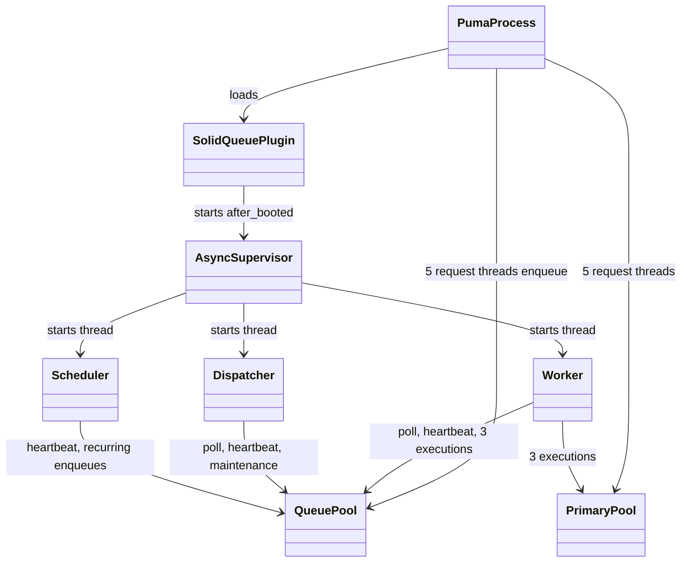

# Plan: Run Solid Queue in async mode inside Puma

From `intent.md` (2026-10-25). Status: accepted.

## Design

### Domain terms

No glossary term applies, and none is added: `GLOSSARY.md` holds household-finance terms only. Working terms for this plan:

- **Fork mode** — Solid Queue's `ForkSupervisor` forks one Ruby process per dispatcher, worker and scheduler. The default; development keeps it.
- **Async mode** — Solid Queue's `AsyncSupervisor` runs the dispatcher, worker and scheduler as threads inside the Puma process. Selected with `solid_queue_mode :async` in `config/puma.rb`.
- **Queue pool** — the Active Record connection pool of the `queue` database (`SolidQueue::Record`).
- **Primary pool** — the connection pool of the `primary` database, used by request threads and job execution threads.

### Diagrams

Production process layout after the change:



Boot and stop (Puma 8.0.2, so the plugin uses `after_booted`, `after_stopped` and `before_restart`):

```mermaid
sequenceDiagram
  participant L as Puma launcher
  participant P as solid_queue plugin
  participant S as AsyncSupervisor
  L ->> P: start(launcher)
  P ->> P: options[:solid_queue_mode] == :async
  L ->> P: after_booted
  P ->> S: Supervisor.start(mode: :async, standalone: false)
  S ->> S: start Dispatcher, Worker, Scheduler as threads
  S ->> S: supervise in its own thread
  L ->> P: after_stopped
  P ->> S: stop (join; exit! after shutdown_timeout)
```

### Signatures

No Ruby class or public method changes. The change is configuration only.

`config/puma.rb` replaces the single `plugin :solid_queue unless ...` line (line 51) with:

```ruby
unless [ "", "false" ].include?(run_jobs_in_puma.to_s)
  plugin :solid_queue
  # Production runs the dispatcher, scheduler and worker as threads in this process to save memory;
  # config/database.yml sizes the production pools for them. Development keeps the forks.
  solid_queue_mode :async if ENV.fetch("RAILS_ENV", "development") == "production"
end
```

`solid_queue_mode` is a Puma DSL method that `puma/plugin/solid_queue.rb` defines. `plugin :solid_queue` requires that file at once (`Puma::Plugins.find`), so the call must come after it and inside the same guard. Also update the comment block above line 51 so it says production runs the supervisor as threads.

`config/database.yml`, production only, overrides the inherited `pool` key on two entries:

```yaml
production:
  primary:
    <<: *default
    database: storage/db/production.sqlite3
    # Request threads plus the 3 job threads Solid Queue runs in the Puma process (config/queue.yml).
    pool: <%= ENV.fetch("RAILS_MAX_THREADS", 5).to_i + 3 %>
  ...
  queue:
    <<: *default
    database: storage/db/production_queue.sqlite3
    migrations_paths: db/queue_migrate
    # Request threads plus every Solid Queue thread in the Puma process (async mode, config/puma.rb).
    pool: <%= ENV.fetch("RAILS_MAX_THREADS", 5).to_i + 15 %>
```

The key stays `pool`. The `default` anchor already sets `pool`; a `max_connections` key with another value raises "Ambiguous configuration" in Active Record 8.1. With no `RAILS_MAX_THREADS` set (as in `config/deploy.yml`), primary is 8 and queue is 20. Cache and cable stay at 5.

Not checked: the project declined Steep and rbs_rails (neither is in the `Gemfile`), and no Ruby signature changes.

### Complexity

- No new query path. Poll, heartbeat and maintenance queries per interval are the same as in fork mode.
- Connections open lazily. A peak opens at most 20 queue and 8 primary connections; the reaper closes idle ones.
- Threads that can hold a queue connection at once in async mode, counted from solid_queue 1.7.0:

  | Source | Threads |
  |---|---|
  | Supervisor: supervise loop, heartbeat, prune timer | 3 |
  | Dispatcher: poll loop, heartbeat, concurrency maintenance | 3 |
  | Worker: poll loop, heartbeat, 3 execution threads | 5 |
  | Scheduler: run thread, heartbeat, 2 recurring task timers | 4 |
  | Solid Queue total | 15 |
  | Puma request threads that enqueue | 5 |
  | Queue pool | 20 |

- Memory: the fork supervisor and three forked processes go away (intent expects about 160 MB saved). Each extra SQLite connection can hold its own page cache (`cache_size: -20000`, about 20 MB), bounded by the database file size; the queue database is small.

### Invariants

1. In production with `SOLID_QUEUE_IN_PUMA=true`, Puma starts `AsyncSupervisor` and forks no `solid-queue-*` process. Enforced by the `RAILS_ENV == "production"` guard in `config/puma.rb`. Proved by the production-like `ps` check.
2. In development, Solid Queue still forks. Enforced by the same guard. Proved by the `bin/dev` `ps` check.
3. With `SOLID_QUEUE_IN_PUMA=false`, `solid_queue_mode` is never called, so Puma does not raise `NoMethodError`. Enforced because the call sits in the same `unless` block as `plugin :solid_queue`. Proved by the `SOLID_QUEUE_IN_PUMA=false` boot check.
4. The production queue pool is at least request threads + 15, and the production primary pool is at least request threads + 3. Enforced only by the values in `config/database.yml`; Solid Queue's own pool warning counts one worker (3 + 2 = 5) and never warns about async threads. Proved by the check that the boot log has no "Solid Queue needs at least" line and no `ActiveRecord::ConnectionTimeoutError` while a job runs and requests are served.

### Alternatives

- **A. Minimal config change, checks only (chosen).** `solid_queue_mode :async` behind the production guard; primary pool `+ 3`, queue pool `+ 15`; acceptance proved by recorded manual checks. Smallest diff, follows the playbook rule that configuration has no tests.
- **B. Config change guarded by `ConfigurationTest` assertions (rejected).** Adds tests that load `config/puma.rb` through `Puma::Configuration`, assert the mode per environment, recount Solid Queue's threads from `queue.yml` and `recurring.yml`, and pin `SolidQueue::VERSION` to 1.7. Rejected: the playbook says configuration has no tests; the thread count copies solid_queue internals into the test suite (connascence of algorithm); the version pin fails every Dependabot minor bump; and `ConfigurationTest` grows further past 100 lines.
- **C. A `SOLID_QUEUE_MODE` environment variable instead of the `RAILS_ENV` guard (rejected).** It allows switching async off in production without a code change, but needs `config/deploy.yml` or relies on a default that hides the choice; the intent keeps `deploy.yml` untouched and the fallback already exists (`SOLID_QUEUE_IN_PUMA=false` with `bin/jobs`).

## Design decisions

- The primary pool grows too (`+ 3`). The intent names only the queue pool, but in async mode jobs such as `Importing::ING::ImportJob` run in the Puma process and share the primary pool with the 5 request threads. Without it a busy moment can raise `ActiveRecord::ConnectionTimeoutError` in a job or a request, which breaks "jobs run as before". This changes no agreed behaviour.
- Cache and cable pools stay at 5. `app/` has no `Rails.cache` call and no broadcast from jobs, so job threads do not take those connections.
- Pools are written as `RAILS_MAX_THREADS + n` rather than a fixed number, so raising Puma threads keeps the job headroom.
- Production is selected with the `RAILS_ENV` check already used in `config/puma.rb`, matching the intent decision "async mode in production only".
- The YAML key stays `pool`, not `max_connections`. In Active Record 8.1.4 only the `HashConfig#pool` reader is deprecated; the YAML key is read as the fallback of `max_connections`. Renaming the `default` anchor's key would touch development and test, which are out of scope.
- No test changes, following playbook rule 3 ("Configuration has no tests"). `test/configuration_test.rb` exists and asserts on config files; extending it was considered (Alternative B) and rejected.

## Integration points

- Puma 8.0.2 plugin API (`plugin :solid_queue`, `solid_queue_mode`), from `solid_queue-1.7.0/lib/puma/plugin/solid_queue.rb`.
- Solid Queue 1.7.0 `AsyncSupervisor`, `config/queue.yml`, `config/recurring.yml` (unchanged).
- Kamal production env: `SOLID_QUEUE_IN_PUMA: true` in `config/deploy.yml` (unchanged). The container runs `bin/boot` → `Procfile` → `thrust bin/start-app` → `bin/rails db:prepare` and `bin/rails server`.

## Files that change

- `config/puma.rb` — wrap `plugin :solid_queue` in an `unless` block and add `solid_queue_mode :async` for production; update the comment above it.
- `config/database.yml` — production `primary` gets `pool: RAILS_MAX_THREADS + 3`; production `queue` gets `pool: RAILS_MAX_THREADS + 15`, each with a one-line comment.

Nothing else. Out of scope: `config/deploy.yml`, `config/queue.yml`, `config/recurring.yml`, `Procfile`, `bin/*`, development and test database blocks, Puma thread count, SQLite pragmas, the cable pool, any deploy or kamal command.

## Order of work

No acceptance criterion needs a test (configuration only), so the work starts with the change and the checks run after it.

1. Edit `config/puma.rb` as in `### Signatures`.
2. Edit `config/database.yml` as in `### Signatures`.
3. Run the production-like checks in `## Proof` from this worktree, with this worktree's `bin/` first on `PATH`. Record the commands and output as evidence in the change folder's review or the PR body.
4. Run the development checks in `## Proof`.
5. Run the full test suite and every linter.
6. Re-read the diff: only `config/puma.rb` and `config/database.yml` change. Delete nothing by hand; the production SQLite files the check creates are under the ignored `storage/` directory.
7. Commit as one change: `config(jobs): run Solid Queue as threads inside Puma in production`.

Production-like local boot, used by the checks below. No credentials are read; if boot asks for `RAILS_MASTER_KEY`, stop and report instead of reading secrets.

Never `export` these variables: every production command carries them itself, so a second shell and the later development checks never inherit production settings. In `## Proof`, `PROD` stands for this exact prefix, run from the worktree root:

```bash
env PATH="$PWD/bin:$PATH" RAILS_ENV=production SOLID_QUEUE_IN_PUMA=true SECRET_KEY_BASE_DUMMY=1 DISABLE_SSL=1 PORT=3001
```

Boot:

```bash
PROD bin/rails db:prepare
PROD bin/rails server        # in the background; Puma writes its pid to tmp/pids/server.pid
PUMA_PID=$(cat tmp/pids/server.pid)
```

Prepare the ING check data once, because the fresh production database has no household account for the fixture row's own account number:

```bash
PROD bin/rails runner 'Account.create!(name: "Async check", person: Person.create!(name: "Async check", household: true), account_numbers: [ AccountNumber.new(number: "NL54INGB0671255150") ])'
```

Stop the production server before the development checks, since both use `tmp/pids/server.pid`.

## Risks

- **Silent stop.** The async plugin path has no monitor: if the supervisor thread itself dies, Puma keeps serving and jobs stop without notice. `AsyncSupervisor` only replaces dead child threads. Accepted with the intent's choice of async mode.
- **Exit on slow shutdown.** If shutdown passes `SolidQueue.shutdown_timeout`, `AsyncSupervisor` calls `exit!`, ending the Puma process. Acceptable: Kamal restarts the container on deploy anyway.
- **Shared GVL.** A CPU-heavy job (ING CSV import via the queue) slows requests while it runs. Acceptable for 2 to 5 users.
- **Memory growth in one process.** A leak in a job now grows Puma; nothing recycles it.
- **Pool offsets drift.** `+ 3` and `+ 15` must change with `threads` in `config/queue.yml`, the number of recurring tasks and Solid Queue internals. The comments link the files; nothing checks them (Alternative B rejected).
- **Wrong checkout.** Rails binstubs resolve to the main checkout; running checks without this worktree's `bin/` first on `PATH` tests the wrong app.
- **Upload path does not use the queue.** `Transactions::ImportsController` calls `Importing::ING::ImportJob.perform_now` in the request thread, so the import check enqueues with `perform_later` to prove the queue runs it.
- **Production settings leaking into the development check.** An exported `RAILS_ENV=production` would make the development check boot async mode. The checks never export and strip both variables with `env -u`.

## Proof

- With async mode on, one Ruby process for Puma and no solid-queue-supervisor, -dispatcher, -scheduler or -worker process → check: with the production-like boot running, `ps -o pid,rss,command -p "$PUMA_PID"` shows the Puma process and its RSS; `pgrep -lP "$PUMA_PID"` prints nothing (no forked children); `PROD bin/rails runner 'pp SolidQueue::Process.pluck(:kind, :pid)'` lists Supervisor, Dispatcher, Worker and Scheduler, all with `$PUMA_PID`. Record the RSS.
- An enqueued job runs, and an ING CSV import job still completes → check: after the ING check data step, `PROD bin/rails runner 'require "csv"; Importing::ING::ImportJob.perform_later(CSV.read("test/fixtures/files/test_import.csv", col_sep: ";")[1])'`; within a few seconds `PROD bin/rails runner 'p SolidQueue::Job.last.finished_at, SolidQueue::FailedExecution.count, Transaction.count'` prints a time, `0` and `1`. The upload form is not a queue check: `Transactions::ImportsController` calls `perform_now` in the request thread.
- The recurring tasks in `config/recurring.yml` load, including `Appkit::SessionExpiryJob` → check: `PROD bin/rails runner 'pp SolidQueue::RecurringTask.pluck(:key, :class_name)'` lists `clear_solid_queue_finished_jobs` and `appkit_session_expiry` with `Appkit::SessionExpiryJob`.
- `/up` returns 200 → check: `curl -s -o /dev/null -w '%{http_code}\n' http://127.0.0.1:3001/up` prints `200`.
- In development, the forked processes still start and `bin/dev` still runs jobs → check: after the production server stops, in a shell without the production variables, run `env -u RAILS_ENV -u SOLID_QUEUE_IN_PUMA PATH="$PWD/bin:$PATH" bin/dev` in the background; `DEV_PID=$(cat tmp/pids/server.pid)`; `pgrep -lP "$DEV_PID"` shows one supervisor, and `pgrep -lP <that supervisor pid>` shows the dispatcher, worker and scheduler; `env -u RAILS_ENV -u SOLID_QUEUE_IN_PUMA PATH="$PWD/bin:$PATH" bin/rails runner 'Appkit::SessionExpiryJob.perform_later'`, and a few seconds later the same prefix with `runner 'p SolidQueue::Job.last.finished_at'` prints a time.
- The full test suite and every linter stay green → check: `bin/rails test`, `bin/rails test:system`, `bundle exec rubocop`, `npx @herb-tools/linter app/views/`, `bundle exec brakeman --no-pager -q`, `bundle exec bundler-audit check`, `bundle exec i18n-tasks normalize` with no diff.
- Invariant: `solid_queue_mode` only runs when the plugin is loaded, enforced by the `unless` block in `config/puma.rb` → check: with no other server running, `env PATH="$PWD/bin:$PATH" RAILS_ENV=production SOLID_QUEUE_IN_PUMA=false SECRET_KEY_BASE_DUMMY=1 DISABLE_SSL=1 PORT=3001 bin/rails server` boots, `/up` returns 200, and `PROD bin/rails runner 'p SolidQueue::Process.count'` prints `0`.
- Invariant: the production pools fit the in-process threads, enforced by `config/database.yml` → check: the production-like server log has no "Solid Queue needs at least" line and no `ActiveRecord::ConnectionTimeoutError` after the job check; `PROD bin/rails runner 'p ActiveRecord::Base.configurations.configs_for(env_name: "production").to_h { [_1.name, _1.max_connections] }'` prints primary 8 and queue 20.
- Invariant: shutdown is clean → check: `kill -INT "$PUMA_PID"` makes the server log the Solid Queue shutdown, and afterwards `PROD bin/rails runner 'p SolidQueue::Process.count'` prints `0`.

Per changed file, the unit tests expected:

- `config/puma.rb`: none — configuration.
- `config/database.yml`: none — configuration.

Test setup: none. The checks use the worktree's own ignored `storage/db/production*.sqlite3` files, created by `bin/rails db:prepare`, one disposable household person and account made by the ING check data step, and the existing `test/fixtures/files/test_import.csv`.

---
Domain skills applied: rails-ops, rails-guides (connection pools), software-design, diagrams, glossary.

## Critique

### Round 1 (codex exec -p terra)

- The primary-pool change exceeds the intent's scope, which names only the queue pool; amend intent.md to approve it → dismissed: in async mode the 3 job threads share the primary pool with 5 request threads, so the change is needed for "jobs run as before" and changes no agreed behaviour; this stage may not edit intent.md, so the report raises it as a decision for Etienne.
- The plan keeps the deprecated `pool` key; rename the default anchor's key to `max_connections` → dismissed: Active Record 8.1.4 deprecates only the `HashConfig#pool` reader, not the YAML key, and renaming the anchor would change development and test, which are out of scope; recorded under Design decisions.
- Production runner commands are not self-contained, because a second shell does not inherit exported variables → fixed (every production command now carries the `PROD` env prefix; nothing is exported)
- The development check can run with leftover production variables → fixed (development commands run under `env -u RAILS_ENV -u SOLID_QUEUE_IN_PUMA`, after the production server stops; added as a risk)
- The ING job input fails on a fresh production database, which has no household account for the row's own account number → fixed (an ING check data step creates a disposable household person and account; the check asserts a finished job, no failed execution and one transaction)
- The upload check needs a signed-in user and runs `perform_now`, so it does not test the queue → fixed (removed the upload from the queue proof; the Proof line says why)
- The process checks are not scoped to the started server → fixed (checks read the pid from `tmp/pids/server.pid` and inspect only its children, and in development the supervisor's children)
