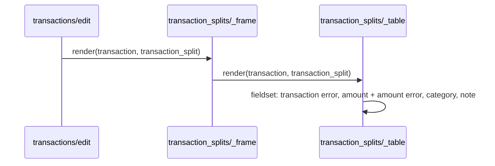

# Plan: Split form asks the amount before the category

From `intent.md` (2026-10-25). Status: accepted.

## Design

### Domain terms

- **Transaction**, **TransactionSplit**, **Category**: as `AGENTS.md` defines them. `GLOSSARY.md` has no entry for these words and no avoided word that the intent uses.
- **Add-split form**: the `form_with scope: :transaction_split` block at the bottom of `app/views/transaction_splits/_table.html.erb`. It is a working name for a view, not a new glossary term.

### Diagrams

`create.turbo_stream.erb`, `update.turbo_stream.erb` and `destroy.turbo_stream.erb` render the same `_frame`, so they get the new order without an edit.

### Signatures

Not affected: no Ruby class, method or partial `locals:` signature changes. Only markup inside the `<fieldset>` of `_table.html.erb` moves.

Not checked: the project has no Steep or rbs_rails, and no Ruby changes.

### Complexity

Not affected: the partial runs the same queries as before. Only the order of the tags changes.

### Invariants

- The add-split form lists its fields as `transaction_split[amount]`, `transaction_split[category_id]`, `transaction_split[note]`. Enforced by the markup order in `_table.html.erb`.
- Each label stays paired with its field. The form builder writes `for`/`id`; the label moves together with its field.
- The amount error `
` stays the element directly after the amount field. Enforced by moving the amount label, field and error as one block.
- The `financial_transaction` error `
` stays first in the fieldset. It is about the whole split, not one field.
- The splits table columns stay category, amount, note, appropriation, actions. The change does not touch `<thead>`, `<tbody>` or `<tfoot>`.

### Alternatives

1. **Minimal reorder (chosen).** Move the amount label, `number_field` and amount error block above the category label and select. One file, about six lines moved. Proved by one order test.
2. **Reorder plus error-placement guard (chosen in part).** Same markup move, plus a test that the amount error still follows the amount field. The guard test is taken: it is cheap and protects the one thing the move could break. Adding `aria-describedby` between errors and fields is rejected: the gap exists today and the intent does not ask for it.
3. **Shared field list for form and table.** One ordered list drives both the table columns and the form fields. Rejected: the intent keeps the table columns as they are, so form and table must differ. A shared list adds indirection for one partial.

## Design decisions

- The order test reads field `id`s and label `for`s from the add-split form, found by its `action` attribute. Locale text does not affect it, and the appropriation charge forms in the same frame are left out.
- No conflict with intent's `## Decisions`: table columns stay as they are, and no autofocus is added.

## Integration points

- `app/views/transactions/edit.html.erb` renders `transaction_splits/_frame`, which renders `_table`.
- The create, update and destroy Turbo Stream views re-render the same frame.
- No controller, model, helper, locale, MCP tool or JavaScript changes.

## Files that change

- `app/views/transaction_splits/_table.html.erb` — move the amount label, field and error block above the category label and select. Keep the `financial_transaction` error first and the note last.
- `test/integration/transaction_splits_test.rb` — add the order test to `EditPageRendering` and the error-placement test to `Create`.

## Order of work

1. Add test "add-split form asks amount, then category, then note" to `TransactionSplitsTest::EditPageRendering`. Run it and watch it fail: the ids come back with category first.
2. Add test "with invalid amount places the error under the amount field" to `TransactionSplitsTest::Create`. Run it; it passes before the move and guards the move.
3. In `app/views/transaction_splits/_table.html.erb`, cut the amount block (label, `number_field`, `errors[:amount]` block) and paste it above `f.label :category_id`. Keep one blank line between blocks.
4. Run both new tests, then `bin/rails test test/integration/transaction_splits_test.rb`, then the full `bin/rails test`.
5. Run `npx @herb-tools/linter app/views/transaction_splits/_table.html.erb` (after `npm install` in the worktree) and `bundle exec rubocop test/integration/transaction_splits_test.rb`.
6. Load the edit page of an uncategorized debit and check the form shows amount, category, note, in that order, and that Tab moves amount → category → note → submit.

## Risks

- The amount error could be left behind when the block moves. The error-placement test catches it.
- The form order no longer matches the table column order (category first). Accepted: the intent keeps the table columns.
- Errors are not linked to fields with `aria-describedby`. This gap exists today and stays out of scope.

Out of scope: the splits table columns, autofocus, the appropriation picker, and every other form.

## Proof

- On a transaction page, the add-split form shows the amount field before the category field, and the note field last → `test/integration/transaction_splits_test.rb` `TransactionSplitsTest::EditPageRendering` "add-split form asks amount, then category, then note"
- Invariant: label `for`s follow the same order as the fields, enforced by the markup order in `_table.html.erb` → `test/integration/transaction_splits_test.rb` "add-split form asks amount, then category, then note"
- Invariant: the amount error directly follows the amount field, enforced by moving the block as one unit in `_table.html.erb` → `test/integration/transaction_splits_test.rb` `TransactionSplitsTest::Create` "with invalid amount places the error under the amount field"

Per changed file, the unit tests expected:
- `app/views/transaction_splits/_table.html.erb`: no unit tests; a view partial is proved by the integration tests above.

Test setup: existing fixtures `users(:member)` and `transactions(:uncategorized)`. The order test does `get edit_transaction_url(debit)`, parses `Nokogiri::HTML5(response.body)`, takes `form[action="#{transaction_transaction_splits_path(debit)}"]`, and compares `fieldset input, fieldset select` ids and `fieldset label` `for`s with `%w[transaction_split_amount transaction_split_category_id transaction_split_note]`. The error test posts `amount: 999.99` as HTML and asserts `assert_select "input#transaction_split_amount + p"` with the `exceeds_transaction` message.

---
Domain skills applied: rails-ui, rails-testing, software-design, glossary, diagrams.

## Critique

### Round 1 (codex exec -p terra)

No findings.
