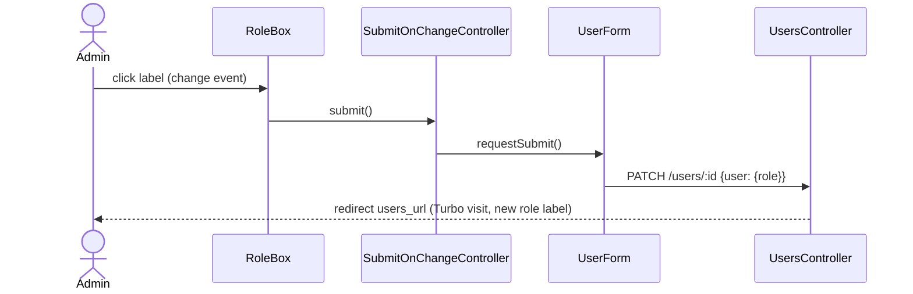
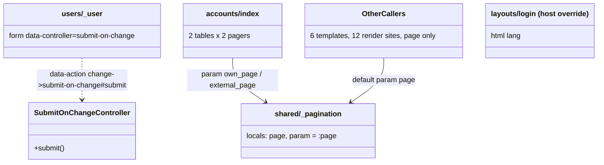

# Plan: UI review bug fixes

From `intent.md` (2026-10-22). Status: accepted.

Base: `origin/main` at 92372d4 (includes #378 eslint/stylelint and #387 category blank parent). The branch `ui-review-bug-fixes` is already rebased onto it. #387 touched only `CategoriesController` params and a data migration, not `categories/_form`, so the scope holds. #378 added eslint (`eslint.config.mjs`, recommended rules, browser globals) over `app/javascript`; the new Stimulus controller must pass it.

## Design

### Domain terms

No new domain terms; `GLOSSARY.md` stays unchanged. No word of the intent is on an `Avoid:` list. UI words used in this plan:

- **Role box**: the role checkbox of one row on `/users`. It carries the `hidden` attribute; its `<label>` is what the user clicks.
- **Submit on change**: a form that saves as soon as one of its fields changes, with no submit button.
- **Pager**: the `shared/_pagination` partial. **Page parameter**: the query key one pager writes (`page`, `own_page`, `external_page`).
- **Page language**: the `lang` attribute of `<html>`, equal to `I18n.locale` while the page renders.

### Diagrams

Before: `users/_user` names a `form` controller that does not exist, so the change event goes nowhere; `accounts/index` writes its own `nav.pagination` four times; `layouts/application`, `layouts/admin` and appkit's `layouts/login` have no `lang`.

### Signatures

- `app/javascript/controllers/submit_on_change_controller.js` (new): submits the form it is attached to. Eager-loaded as `submit-on-change` by the existing `eagerLoadControllersFrom("controllers", application)`.
  - `submit() // (): void` — calls `this.element.requestSubmit()`, so Turbo submits the form with its `_method=patch`.
- `app/views/users/_user.html.erb`: `form_with ... data: { controller: "submit-on-change" }`; the role box gets `data: { action: "change->submit-on-change#submit" }`. `hidden`, `id` and the `disabled` rule stay exactly as they are.
- `app/views/shared/_pagination.html.erb`: renders previous/next links for one page parameter. Strict locals become `<%# locals: (page:, param: :page) %>`; both `merge(page: ...)` calls become `merge(param => ...)`. The six other templates that render it (twelve render sites: `receipts/index`, `products/index`, `admin/users/index`, `shared/_recent_transactions`, `transactions/_table`, `todos/index`) do not change.
- `app/views/accounts/index.html.erb`: each of the two hand-written `<nav class="pagination">` blocks becomes `<%= render "shared/pagination", page: table[:page], param: table[:page_param] %>`.
- `app/views/users/profiles/edit.html.erb`: the `link_to t("common.back"), users_path` line goes; the title-bar block stays and yields nothing, so `shared/_title_bar` renders no `<nav>`.
- `app/views/layouts/application.html.erb`, `app/views/layouts/admin.html.erb`: `<html lang="<%= I18n.locale %>" ...>`.
- `app/views/layouts/login.html.erb` (new): host override of appkit's `layouts/login`, copied verbatim from the locked appkit revision (`bundle show appkit`, revision 9b5b30d), plus `lang="<%= I18n.locale %>"` on `<html>`. Host views win the lookup over engine views.
- `config/locales/{en,nl,it}.yml`, under `activerecord.attributes`:
  - `transaction`: `booked_at`, `category_id`, `id`, `creditor`, `debitor`, `interest_at`, `note`, `original_balance_after_mutation`, `original_note`, `original_tag`, `type`.
  - `category`: `direction`, `parent_category`.
  - `chattel`: `purchase_transaction_id`.
  - `Debit`, `Credit`, `Transfer` resolve to the `transaction` keys through STI `lookup_ancestors`; the `f.label` calls stay as they are.

Words:

| key | en | nl | it |
|---|---|---|---|
| transaction.id | Id | ID | ID |
| transaction.debitor | Debitor | Debiteur | Debitore |
| transaction.creditor | Creditor | Crediteur | Creditore |
| transaction.category_id | Category | Categorie | Categoria |
| transaction.note | Note | Opmerking | Nota |
| transaction.booked_at | Booked at | Boekingsdatum | Data registrazione |
| transaction.interest_at | Interest at | Rentedatum | Data valuta |
| transaction.type | Type | Type | Tipo |
| transaction.original_note | Original note | Oorspronkelijke omschrijving | Descrizione originale |
| transaction.original_balance_after_mutation | Original balance after mutation | Oorspronkelijk saldo na mutatie | Saldo originale dopo il movimento |
| transaction.original_tag | Original tag | Oorspronkelijk label | Etichetta originale |
| category.direction | Direction | Richting | Direzione |
| category.parent_category | Parent category | Hoofdcategorie | Categoria principale |
| chattel.purchase_transaction_id | Purchase transaction | Aankooptransactie | Transazione d'acquisto |

The nl/it words for debitor, creditor, note, booked_at and interest_at are the ones `transactions.table` already uses. `Hoofdcategorie` matches the existing `must_be_parent` error text. The en values equal today's humanized output, so English pages do not change.

Not checked: journal_administration has no Steepfile, and this change adds no Ruby methods.

### Complexity

- Role box: one PATCH per change through the existing `UsersController#update` (find + update), then one redirect to the index. A disabled box fires no event and sends nothing.
- Labels, page language and pager add no queries. The pager reuses the page objects the controller already loads.

### Invariants

- A change to an enabled role box saves the opposite role with no other click; enforced by `submit_on_change_controller.js` and its wiring in `users/_user`.
- Your own role box, and every role box a member sees, stay `disabled`; enforced by the existing `disabled:` expression in `users/_user` (and `ensure_can_administer` on `UsersController#update`).
- A pager link changes only its own page parameter and keeps every other query parameter; enforced by `request.query_parameters.merge(param => ...)` in `shared/_pagination`.
- With `param` left out, the pager writes `page`, so the twelve other render sites render the same links as today.
- `<html lang>` equals `I18n.locale` on the application, admin and login layouts; `ApplicationController#switch_locale` sets the locale (user locale, else `I18n.default_locale`, `en`). Appkit's session, first-run and transfer controllers inherit `::ApplicationController`, so the login layout gets the same locale.
- en, nl and it hold the same `activerecord.attributes` keys for the three forms; `test/i18n_test.rb` (missing keys, normalized files) enforces it.

### Alternatives

- **A. Generic `form_controller.js`** (smallest): add a `form` controller with `submit()`, so the existing `data-controller="form"` markup starts to work with no view change. Rejected: `form` says nothing about the behaviour, and the markup relies on Stimulus' default `input` event for a checkbox. One line of view change buys an intention-revealing name and an explicit `change` event.
- **B. Host `submit-on-change` controller** (chosen): as above. One repository, no gem bump, eslint-checked. It can move to appkit later without a markup change beyond the registration.
- **C. Appkit `submit-on-change` controller, `Appkit::FormsHelper#submit_on_change_form_with`, and `lang` in appkit's login layout**: most reusable, and no layout copy in the host. Rejected for this PR: it needs a separate appkit change and a `bundle update appkit` before the host commits can go green, which the intent's constraints make stop-and-ask, and it adds public appkit API that must then stay stable. Kept as the recommended follow-up for the login layout (see `## Design decisions`).

## Design decisions

- The role box listens to `change`, not Stimulus' default `input` event, so the wiring states the event it relies on.
- en gets the same keys as nl and it, with today's English text. The intent asks only for nl and it; the en keys make `i18n-tasks missing` (diff against base `en`) flag a future locale that lacks a label, and they change no English output.
- The signed-out page language needs the login layout, which lives in appkit. This plan overrides it in the host (`app/views/layouts/login.html.erb`), because the intent rules out dependency changes without asking. The copy drifts from appkit until a follow-up moves `lang` into appkit's login layout, bumps appkit and deletes the host copy; that follow-up is a separate change, not part of this PR.
- Profile edit keeps its title bar; only the Terug link goes. Its controls block becomes empty and `shared/_title_bar` already renders no `<nav>` for an empty block.
- One commit per fix, five commits, in the order of `## Order of work`.
- No conflict with `intent.md`'s `## Decisions`.

## Integration points

- Turbo: `requestSubmit()` on a `form_with` form goes through Turbo; the redirect to `users_url` becomes a Turbo visit that re-renders the index with the new role label.
- Stimulus eager loading via `@hotwired/stimulus-loading` and `pin_all_from "app/javascript/controllers"`; no importmap change.
- Appkit engine: `layouts/login` lookup (host view wins); `Appkit::SessionsController`, `FirstRunsController`, `Sessions::TransfersController` render it.
- i18n-tasks (`test/i18n_test.rb`, `bundle exec i18n-tasks normalize`).

## Files that change

- `app/javascript/controllers/submit_on_change_controller.js` — new; submits its form on change.
- `app/views/users/_user.html.erb` — wire the role box to `submit-on-change`.
- `app/views/users/profiles/edit.html.erb` — drop the Terug link.
- `config/locales/en.yml`, `config/locales/nl.yml`, `config/locales/it.yml` — the 14 attribute keys above.
- `app/views/layouts/application.html.erb`, `app/views/layouts/admin.html.erb` — `lang`.
- `app/views/layouts/login.html.erb` — new host override with `lang`.
- `app/views/shared/_pagination.html.erb` — optional `param` local.
- `app/views/accounts/index.html.erb` — render the shared pager.
- Tests: `test/system/user_roles_test.rb` (new), `test/integration/users_index_test.rb`, `test/integration/users/profiles_test.rb`, `test/integration/form_labels_test.rb` (new), `test/integration/page_language_test.rb` (new), `test/integration/pagination_navigation_test.rb`.

## Order of work

Setup in the worktree: put the worktree's `bin/` first on `PATH` (`export PATH="$PWD/bin:$PATH"`) and run `npm install` once, or the pre-push hooks boot the main checkout and herb-lint fails.

1. Role toggle (commit `Save a user's role when its role box changes`).
   1. Write `test/system/user_roles_test.rb`: tick a member's role box, untick another administrator's box. Run `bin/rails test test/system/user_roles_test.rb`, watch both fail (the role stays unchanged).
   2. Add `submit_on_change_controller.js`, wire `users/_user`. Run the system test green.
   3. Add the disabled-box tests to `test/integration/users_index_test.rb` (they guard existing behaviour and pass before and after).
   4. `npx eslint app/javascript`, `npx @herb-tools/linter app/views/`, commit.
2. Profile Terug (commit `Drop the back link from your own profile edit page`).
   1. Add the edit-page test to `test/integration/users/profiles_test.rb`, watch it fail; add the show-page Terug test (passes, guards it).
   2. Remove the link. Run the file green. Commit.
3. Form labels (commit `Translate the transaction, category and chattel form labels`).
   1. Write `test/integration/form_labels_test.rb`, run it, watch the nl and it tests fail on the English names.
   2. Add the keys to en, nl, it; run `bundle exec i18n-tasks normalize`. Run the file and `test/i18n_test.rb` green. Commit.
4. Page language (commit `Declare the page language on every layout`).
   1. Write `test/integration/page_language_test.rb`, watch it fail.
   2. Add `lang` to application and admin; copy appkit's `layouts/login.html.erb` from `$(bundle show appkit)/app/views/layouts/login.html.erb` into `app/views/layouts/` and add `lang`. Run green. Commit.
5. Pager (commit `Render the accounts pager through the shared partial`).
   1. Extend `test/integration/pagination_navigation_test.rb` with the external-table and kept-parameter tests; they pass before the refactor (refactor, not bug fix).
   2. Add `param:` to `shared/_pagination`, replace the four blocks in `accounts/index`. Run `pagination_navigation_test.rb`, `accounts_index_test.rb` and every caller's tests green. Commit.
6. Full suite: `bin/rails test`, `bin/rails test:system`, `bundle exec rubocop`, `npx @herb-tools/linter app/views/`, `npx eslint app/javascript`, `bundle exec brakeman --no-pager -q`, `bundle exec bundler-audit check`, `bundle exec i18n-tasks normalize` (no diff). Re-read the full diff against `origin/main`.

## Risks

- The role box is `hidden`; a system test must click its `<label>`, not the input. A clicked label of a hidden checkbox still toggles it and fires `change` in Chrome and Edge.
- The test must wait for the redirect (assert the new role label text) before it reads the database, or it races the PATCH.
- The new attribute keys also translate the show pages that call `human_attribute_name` for the same attributes (transaction show original fields, category show direction and parent, chattel show purchase transaction). That is wanted; no test asserts the English text there today.
- The host `layouts/login.html.erb` hides later appkit changes to its login layout. Mitigated by the appkit follow-up named in `## Design decisions`.
- Rejected: `form_controller.js` (vague name), appkit upstream in this PR (second repository and gem bump), `lang` on `layouts/mailer` (no mailer class inherits `ApplicationMailer`, so it renders nowhere) and on static `public/*.html` pages (not in the intent's view list).

Out of scope: the red invalid border (mvpa.css), the parent-category field on the category show page, navigation and menu highlighting, the admin user edit page, English labels outside the three forms, the untranslated option values of the direction and type selects.

## Proof

- An administrator on `/users` ticks the role box of a member; that member is now an administrator, without pressing another button → `test/system/user_roles_test.rb` `test "an administrator makes a member an administrator by ticking the role box"`
- An administrator on `/users` unticks the role box of another administrator; that user is now a member → `test/system/user_roles_test.rb` `test "an administrator makes another administrator a member by unticking the role box"`
- On `/users` the role box of your own row stays disabled, and a member sees every role box disabled → `test/integration/users_index_test.rb` `test "your own role box is disabled"`, `test "a member sees every role box disabled"`
- On your own profile edit page there is no "Terug" link; Annuleren still leads to your profile → `test/integration/users/profiles_test.rb` `test "your own profile edit page has no back link"`, existing `test "the edit form ends in an action row of Annuleren and Opslaan"`
- On another user's profile show page, "Terug" still leads to `/users` → `test/integration/users/profiles_test.rb` `test "another user's profile page links back to the users list"`
- A user with locale `nl` opening a transaction's edit page sees Dutch labels for debitor, creditor, category, note, booked at, interest at, type and the original import fields (and id) → `test/integration/form_labels_test.rb` `test "the transaction form labels its fields in Dutch"`
- A user with locale `nl` sees Dutch labels for direction and parent category on the category form, and for purchase transaction on the chattel form → `test/integration/form_labels_test.rb` `test "the category form labels direction and parent category in Dutch"`, `test "the chattel form labels the purchase transaction in Dutch"`
- A user with locale `it` sees Italian labels for the same fields → `test/integration/form_labels_test.rb` `test "the transaction form labels its fields in Italian"`, `test "the category form labels direction and parent category in Italian"`, `test "the chattel form labels the purchase transaction in Italian"`
- A user with locale `nl` gets `<html lang="nl">`; a user with locale `en` gets `<html lang="en">`; a signed-out visitor gets the default locale → `test/integration/page_language_test.rb` `test "a Dutch user gets lang nl"`, `test "an English user gets lang en"`, `test "the admin layout declares the user's language"`, `test "a signed-out visitor gets the default locale"`
- The accounts index shows the same previous/next links as today for own and external accounts, each paging its own table, now rendered through the shared pager → existing `test/integration/pagination_navigation_test.rb` `test "accounts pagination shows correct links on first and last page"`, new `test "external accounts pagination writes external_page"`, `test "accounts pagination keeps the other query parameters"`; existing `test/integration/accounts_index_test.rb` `test "own and external pagination params are independent"`
- Invariant: with `param` left out the pager writes `page`, enforced by the partial's default local → existing `test/integration/pagination_navigation_test.rb` `test "transactions pagination keeps filter params and does not show next on overflow pages"`, `test "todo pagination is clamped and hides next on the last page"`
- Invariant: en, nl and it hold the same label keys, enforced by i18n-tasks → `test/i18n_test.rb` `test_no_missing_keys`, `test_files_are_normalized`

Per changed file, the unit tests expected:

- `app/javascript/controllers/submit_on_change_controller.js`: no JS unit test runner exists; covered by the role toggle system tests, and `npx eslint app/javascript` passes.
- `app/views/shared/_pagination.html.erb`: covered by the integration tests above (the `param` local and its `page` default).
- Views and locale files: covered by the integration tests above.

Test setup: fixtures only. `users(:admin)` is an nl administrator, `users(:member)` an en member. The untick test first runs `users(:member).update!(role: :administrator)`. The Italian tests first run `users(:admin).update!(locale: :it)` before `sign_in_as`. Forms: `transactions(:debit_grocery)`, `categories(:groceries)`, `chattels(:one)`; the admin sees the admin-only original fields. Label assertions use the literal words from the table above, scoped to `form label`. Pager tests create accounts as `create_accounts` does today; the external variant creates external accounts (no household owner). Page language tests: signed-in GET `dashboard_index_path` and `admin_root_path`; signed-out GET `new_session_path`, asserting `html[lang=?]`, `I18n.default_locale.to_s`.

---
Domain skills applied: rails-ui (interaction-design: immediate feedback, Back/Cancel links), rails-testing, hwc-stimulus-fundamentals, software-design, glossary, diagrams.

## Critique

### Round 1 (codex exec -p terra)

- The appkit login-layout choice is left as an open decision although the accepted intent has no open questions; choose the host override and record appkit as a follow-up → fixed (`## Design decisions` now decides the host override and names the appkit change as a separate follow-up, not part of this PR)
- "Every layout" omits `layouts/mailer.html.erb`; add `lang` and a mailer assertion → dismissed: no mailer class inherits `ApplicationMailer` (`app/mailers` holds only `application_mailer.rb`), so the layout renders nowhere and cannot be asserted; the intent's view list names only the application and admin layouts
- The plan excludes the transaction form's `id` label although the intent says every labelled attribute is translated → fixed (added `activerecord.attributes.transaction.id` in en, nl and it, removed it from out of scope, and the Dutch transaction label test covers it)
- The plan says seven existing pager callers stay unchanged; there are six templates with twelve render sites → fixed (Signatures, diagram and Invariants now name the six templates and twelve render sites)
