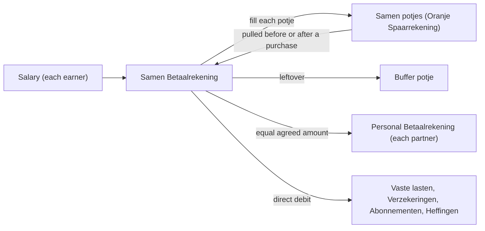

# Household finances

This document describes how the household runs its money. It holds the method only, with no amounts. Current values live in the app. Agents use it as the baseline when they categorize transactions, suggest budgets or analyse spending. Etienne described the method. Where a term is marked "agent-supplied", an agent chose the standard financial term, and Etienne may correct it. The ING page URLs below date from 2026-10-21.

## Words we use

The household uses Dutch terms. The standard financial term stands next to each one. [`GLOSSARY.md`](../GLOSSARY.md) defines the agreed terms. This table does not repeat the definitions.

| Dutch term | Standard term (agent-supplied) | Source |
| --- | --- | --- |
| Betaalrekening | current account | <https://www.ing.nl/particulier/betalen/bankrekeningen> |
| En/of Betaalrekening | joint current account | <https://www.ing.nl/particulier/betalen/bankrekeningen/gezamenlijke-rekening> |
| Oranje Spaarrekening | savings account | <https://www.ing.nl/particulier/sparen/oranje-spaarrekening> |
| Potje (ING: Spaarpotje) | savings sub-account, used as a budget category; the method is envelope budgeting | <https://www.ing.nl/particulier/sparen/oranje-spaarrekening> |
| Spaardoelen | savings goals, ING's other name for the sub-accounts | <https://www.ing.nl/particulier/sparen/spaardoelen> |
| Creditcard | credit card | <https://www.ing.nl/particulier/betalen/creditcards/afschrijfdatum-creditcard> |
| Samen | joint household account | household name |
| Buffer | emergency fund and surplus | `GLOSSARY.md` |
| Reserveringen | sinking fund | `GLOSSARY.md` |
| Vaste lasten (Vaste Lasten) | fixed expenses | `GLOSSARY.md` |
| Verzekeringen | insurance premiums | household name |
| Abonnementen | subscriptions | household name |
| Heffingen | levies, meaning local taxes and charges | household name |
| Appropriation | earmarked funds | `GLOSSARY.md` |
| Monthly personal transfer | personal allowance | household name |

## Bank accounts and potjes

The bank is ING. The household has three debit accounts: the Samen Betaalrekening, and one personal Betaalrekening for each partner. Whether Samen is an ING "En/of Betaalrekening" is not confirmed. Each Betaalrekening has an Oranje Spaarrekening next to it. The Oranje Spaarrekening holds that account's potjes. ING calls a potje a "Spaarpotje" and allows up to ten per Oranje Spaarrekening. The bank accounts and the potjes are all debit accounts. The household also has a credit card that pays some monthly subscriptions. Whether it is an ING card is not confirmed. Potje names change over time. "Steam Deck" was renamed several times. The account number identifies a potje, not its name. This document never lists account numbers.

## The Samen potjes

The Samen Oranje Spaarrekening holds ten potjes. The potje names are the household's own labels, kept in Dutch. The standard term column is agent-supplied. A purpose marked "purpose taken from the potje's name" is not confirmed by Etienne.

| Potje | Standard term | Purpose | Status |
| --- | --- | --- | --- |
| Boodschappen, huishoudelijk en persoonlijke zorg | groceries, household and personal care budget | groceries, household and personal care; purpose taken from the potje's name | active |
| Vrije tijd en hobby | leisure and hobbies budget | leisure and hobbies; purpose taken from the potje's name | active |
| Auto en vervoer | car and transport budget | car and transport; purpose taken from the potje's name | active |
| Kinderen kleding | children's clothing budget | children's clothing; also pays Christmas and Sinterklaas | active |
| Cadeautjes en speelgoed | gifts and toys budget | gifts and toys; most appropriations are saved for here | active |
| Projecten | projects savings goal | saving for projects; purpose taken from the potje's name | active |
| Reserveringen | sinking fund | saving ahead for recurring costs | active |
| Vakantie | holiday savings goal | saving for holidays; purpose taken from the potje's name | active |
| Cosimo | not applicable | none | unused |
| Buffer | emergency fund and surplus | the salary leftover and anything no potje can pay | active |

## Salary routine

Each salary arrives in the Samen Betaalrekening. Then each Samen potje is filled. The leftover moves to Buffer.

## Personal accounts

Each month an equal, agreed amount moves from Samen to each personal Betaalrekening. The standard term is personal allowance. Etienne's active potjes are "Etienne's verzorging", "Steam Deck" and "Etienne's Buffer". His wife's potjes are not recorded here.

## Fixed costs

Most Vaste Lasten (fixed expenses), Verzekeringen (insurance premiums), Abonnementen (subscriptions) and Heffingen (levies) leave the Betaalrekening directly. Costs saved up ahead go through Reserveringen (sinking fund) instead. Some monthly subscriptions go through the credit card. The exceptions are not listed.

## Spending routine

A purchase is pulled from its potje shortly before or after it is paid. This keeps what is left in the potje visible.

## Buffer and Reserveringen

Reserveringen holds money saved ahead for recurring costs. Examples are the animal insurance, the trimsalon and the dentist. Buffer holds the salary leftover and anything that no potje can pay. Buffer serves as both surplus and emergency fund. No target size is recorded.

## Appropriations

Most appropriations (earmarked funds) are saved for in "Cadeautjes en speelgoed" or in "Reserveringen". The app's Appropriation is the matching record. These two potjes are not funded enough, so Christmas and Sinterklaas are paid from "Kinderen kleding".

## How the app sees this

Every move into or out of a potje appears in the bank export. The import recognises the household's Oranje Spaarrekening by its name in the ING description. Both sides are then household-owned, so the row becomes a Transfer and gets the Transfer category. There is no potje-specific detection. A move whose description does not name a household account is not recognised. Budget suggestions leave the Transfer category out, and a budget cannot hold an allocation for it. The app holds the Oranje Spaarrekening as one Samen account. No account record holds a potje. Only the transaction's note text holds the potje's code, in the form `Naar Oranje spaarrekening <code> <description>` or `Van Oranje spaarrekening <code> <description>`. The note and the original ING description both carry it. For current values, use the app.

## Known problems

The household reports three problems. They are context for the analysis, not conclusions.

- Spending has outgrown the current budgets.
- Saving for large goals does not work.
- Some potjes are unused.
