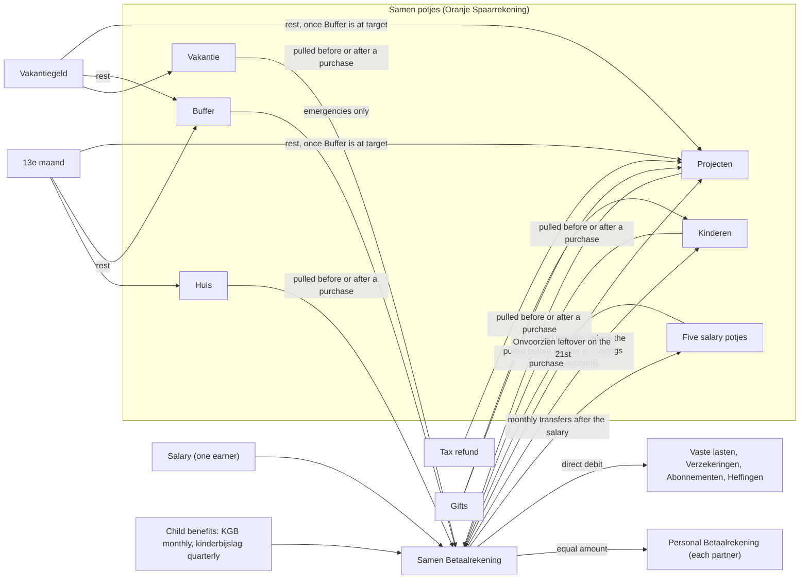

# Household finances

This document describes how the household runs its money. It holds the method only, with no amounts. Current values live in the app. Agents use it as the baseline when they categorize transactions, suggest budgets or analyse spending. Etienne described the method. The method holds from 2026-10-22, the date Etienne accepted it. Where a term is marked "agent-supplied", an agent chose the standard financial term, and Etienne may correct it. The ING page URLs below date from 2026-10-21.

## Words we use

The household uses Dutch terms. The standard financial term stands next to each one. [`GLOSSARY.md`](../GLOSSARY.md) defines the agreed terms. This table does not repeat the definitions.

| Dutch term | Standard term (agent-supplied) | Source |
| --- | --- | --- |
| Betaalrekening | current account | <https://www.ing.nl/particulier/betalen/bankrekeningen> |
| En/of Betaalrekening (not confirmed for this household) | joint current account | <https://www.ing.nl/particulier/betalen/bankrekeningen/gezamenlijke-rekening> |
| Oranje Spaarrekening | savings account | <https://www.ing.nl/particulier/sparen/oranje-spaarrekening> |
| Potje (ING: Spaarpotje) | savings sub-account, used as a budget category; the method is envelope budgeting | <https://www.ing.nl/particulier/sparen/oranje-spaarrekening> |
| Spaardoelen | savings goals, ING's other name for the sub-accounts | <https://www.ing.nl/particulier/sparen/spaardoelen> |
| Creditcard (not confirmed as an ING card) | credit card | <https://www.ing.nl/particulier/betalen/creditcards/afschrijfdatum-creditcard> |
| Samen | joint household account | household name |
| Buffer | emergency fund | `GLOSSARY.md` |
| Reserveringen | sinking fund | `GLOSSARY.md` |
| Vaste lasten (Vaste Lasten) | fixed expenses | `GLOSSARY.md` |
| Verzekeringen | insurance premiums | Dutch word |
| Abonnementen | subscriptions | Dutch word |
| Heffingen | levies, meaning local taxes and charges | Dutch word |
| Trimsalon | pet grooming salon | Dutch word |
| Onvoorzien | contingency for unplanned costs | `GLOSSARY.md` |
| Kinderen | children's budget | `GLOSSARY.md` |
| Huis | home maintenance and furnishing budget | household name |
| Kindgebonden budget (KGB) | child-related budget, a government child allowance | Dutch word |
| Kinderbijslag | child benefit | Dutch word |
| 13e maand | thirteenth-month pay | Dutch word |
| Vakantiegeld | holiday allowance | Dutch word |
| Appropriation | earmarked funds | `GLOSSARY.md` |

## Income

Household income is the salary only, from one earner. Etienne's partner has no income. Child benefits are not household income. The KGB arrives monthly, around the 20th. The kinderbijslag arrives quarterly. Child benefits pay only for the children: clothing, furniture, hobbies, gifts, toys and parties, care and school, and their savings. The KGB first pays the children's own savings accounts, and the rest goes to Kinderen. The kinderbijslag goes to Kinderen. Kinderen holds about one quarter's worth of kinderbijslag in reserve, because it arrives only four times a year.

## Bank accounts and potjes

The bank is ING. The household has three debit accounts: the Samen Betaalrekening, and one personal Betaalrekening for each partner. Whether Samen is an ING "En/of Betaalrekening" is not confirmed. Each Betaalrekening has an Oranje Spaarrekening next to it. The Oranje Spaarrekening holds that account's potjes. ING calls a potje a "Spaarpotje" and allows up to ten per Oranje Spaarrekening. The bank accounts and the potjes are all debit accounts. The household also has a credit card that pays some monthly subscriptions. Whether it is an ING card is not confirmed. Potje names change over time. "Steam Deck" was renamed several times. The account number identifies a potje, not its name. This document never lists account numbers.

## The Samen potjes

The Samen Oranje Spaarrekening holds ten potjes, all active. The potje names are the household's own labels, kept in Dutch. The standard term column is agent-supplied. A purpose marked "purpose taken from the potje's name" is not confirmed by Etienne.

| Potje | Standard term | Purpose | Status |
| --- | --- | --- | --- |
| Kinderen | children's budget | everything for the children: clothing, furniture and their rooms, hobbies, gifts, toys and parties, care and school, and their savings; receives the child benefits: the KGB minus the children's own savings accounts, and the kinderbijslag | active |
| Boodschappen en huishouden | groceries and household budget | groceries and household; purpose taken from the potje's name | active |
| Auto en vervoer | car and transport budget | car and transport; purpose taken from the potje's name | active |
| Reserveringen | sinking fund | saving ahead for recurring costs | active |
| Vrije tijd en hobby | leisure and hobbies budget | leisure and hobbies; purpose taken from the potje's name | active |
| Cadeautjes | gifts budget | gifts for adults and the family; gifts for the children go to Kinderen | active |
| Huis | home maintenance and furnishing budget | home maintenance and furnishing; the children's rooms go to Kinderen; receives the 13e maand | active |
| Vakantie | holiday savings goal | holidays; receives the vakantiegeld | active |
| Projecten | projects savings goal | projects; receives tax refunds, the monthly Onvoorzien leftover and Buffer's share above its target | active |
| Buffer | emergency fund | emergencies only, never a known cost | active |

## Salary routine

The salary arrives in the Samen Betaalrekening. After it arrives, monthly transfers from the Betaalrekening fill five potjes: Boodschappen en huishouden, Auto en vervoer, Reserveringen, Vrije tijd en hobby and Cadeautjes. They also pay each partner's personal allowance. Onvoorzien stays behind on the Betaalrekening. The salary does not fill Kinderen, Huis, Vakantie, Projecten or Buffer. Kinderen is filled from the child benefits. The KGB arrives monthly on the Betaalrekening, around the 20th. It pays the children's own savings accounts, and the rest moves to Kinderen with the monthly transfers after the salary. The kinderbijslag arrives quarterly on the Betaalrekening and moves to Kinderen soon after it arrives. Huis and Vakantie are filled only from the windfalls. Buffer gets only the windfall leftovers. Projecten gets tax refunds, the monthly leftover on the 21st and Buffer's share above its target.

## Windfalls

The 13e maand pays Huis, and the rest goes to Buffer. The vakantiegeld pays Vakantie, and the rest goes to Buffer. Tax refunds go to Projecten. Gifts are extra and go to Projecten or to the children. Once Buffer is above its target, its share of the 13e maand and the vakantiegeld goes to Projecten.

## Onvoorzien

Onvoorzien is not a potje. It is a small amount that stays on the Samen Betaalrekening after the monthly transfers. An unplanned cost is paid from it. When a potje runs empty, the Betaalrekening pays the rest, and that potje pays it back after the next salary-day transfers. For example, when Boodschappen en huishouden is empty, pay the groceries from the Betaalrekening. After the next salary-day transfers, move the amount back from Boodschappen en huishouden. On the 21st, just before the salary, the leftover minus the KGB that arrived on the 20th moves to Projecten.

## Personal accounts

Each month an equal amount moves from Samen to each personal Betaalrekening. The standard term is personal allowance. Personal purchases go on the personal accounts. Nobody pays them from Samen and pays back. Etienne's active potjes are "Etienne's verzorging" (personal care budget), "Steam Deck" (savings goal) and "Etienne's Buffer" (emergency fund and surplus). His wife's potjes are not recorded here.

## Fixed costs

Most Vaste Lasten (fixed expenses), Verzekeringen (insurance premiums), Abonnementen (subscriptions) and Heffingen (levies) leave the Betaalrekening directly. Costs saved up ahead go through Reserveringen (sinking fund) instead. Studieschuld is a Vaste lasten cost. The study loan ends around late 2031; from then on, savings can rise. Some monthly subscriptions go through the credit card. The credit card bill is booked as a transfer linked to its purchases, not as a cost. The exceptions are not listed.

## Spending routine

A purchase is pulled from its potje shortly before or after it is paid. This keeps what is left in the potje visible. When a potje is empty, follow Onvoorzien.

## Buffer and Reserveringen

Reserveringen holds money saved ahead for recurring costs. Examples are the animal insurance, the trimsalon (pet grooming salon), the dentist and the yearly energy peak in April. Buffer is for emergencies only, never for a known cost. Its target is about three months of essential costs. It is filled from the leftovers of the 13e maand and the vakantiegeld. Above the target, its share of those windfalls goes to Projecten.

## Appropriations

Appropriations (earmarked funds) for the children are saved for in Kinderen. The other appropriations are saved for in Cadeautjes or in Reserveringen. The app's Appropriation is the matching record.

## Methods

The standard terms are agent-supplied.

- Envelope budgeting: the household budgets with potjes. A potje is still called a potje.
- Zero-based budgeting: on salary day every euro of the salary gets a destination: the five salary potjes, personal allowances, fixed costs and Onvoorzien.
- Sinking fund: Reserveringen saves ahead for recurring costs.
- Pay yourself first: the five salary potjes are filled by the monthly transfers after the salary, before spending. Savings move first when each windfall arrives, not on salary day.
- Emergency fund: Buffer.

## App categories

Names only, no ids. `Kinderen` is a parent category for the children's spending. `Vaste lasten - Studieschuld` holds the study loan. `Inkomsten - Kindgebonden budget` holds every KGB payment. An analysis does not count it as household income.

## How the app sees this

Every move into or out of a potje appears in the bank export. In the ING export a potje move has no counterparty account number, and its name column holds the account holders' names, as in the import test file. With no number, the import looks for a household account number in the description, then for a household account name in the description. That second match is case-sensitive, so the account name "Oranje Spaarrekening" never matches the ING spelling "Oranje spaarrekening". The import then finds or creates the counterparty by the name column, which resolves to a household account. Both sides are then household-owned, so the row becomes a Transfer and gets the Transfer category. There is no potje-specific detection, so the result depends on what the name column holds. When it holds a potje's name, such as "Buffer", the import creates a new external account for that name, and the row becomes a Credit or a Debit. In the dev database, every potje move booked up to 2025-06-13 is a Credit or a Debit, and so are five moves between 2025-12-26 and 2026-02-27. A potje move is not income or spending. An analysis must check the type and the counterparty of each potje move before it counts it. Check the live app before relying on these dates. Budget suggestions leave the Transfer category out, and a budget cannot hold an allocation for it. The app holds the Oranje Spaarrekening as one Samen account. No account record holds a potje. Only the transaction's note text holds the potje's code, in the form `Naar Oranje spaarrekening <code> <description>` or `Van Oranje spaarrekening <code> <description>`. The note and the original ING description both carry it. For current values, use the app.
